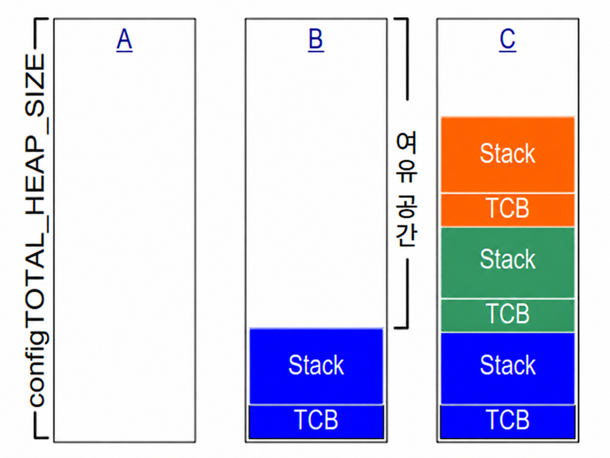
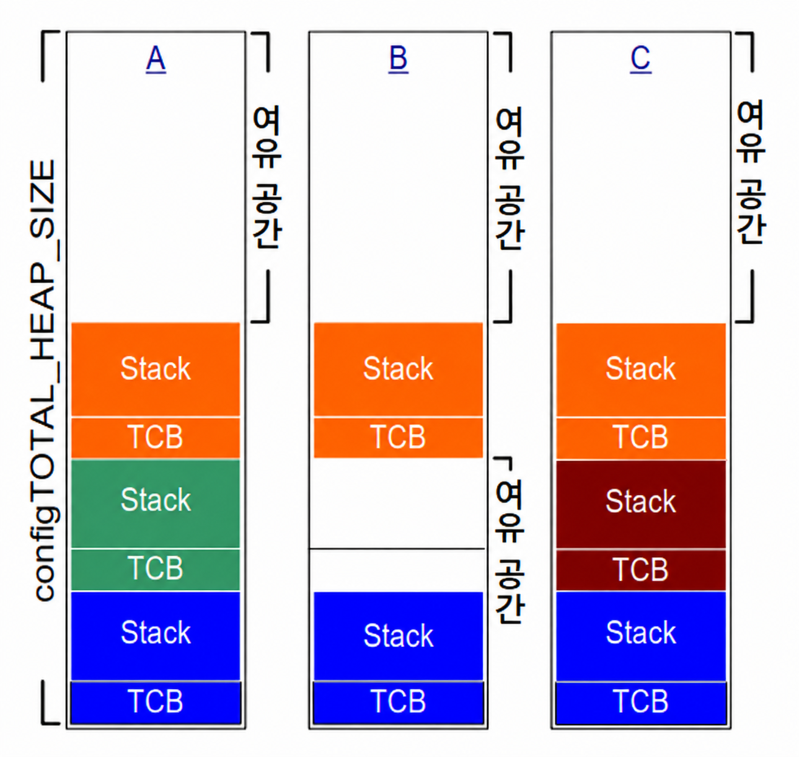
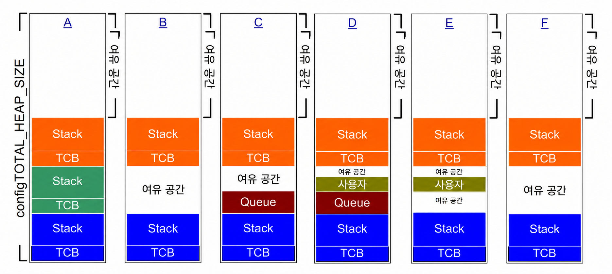
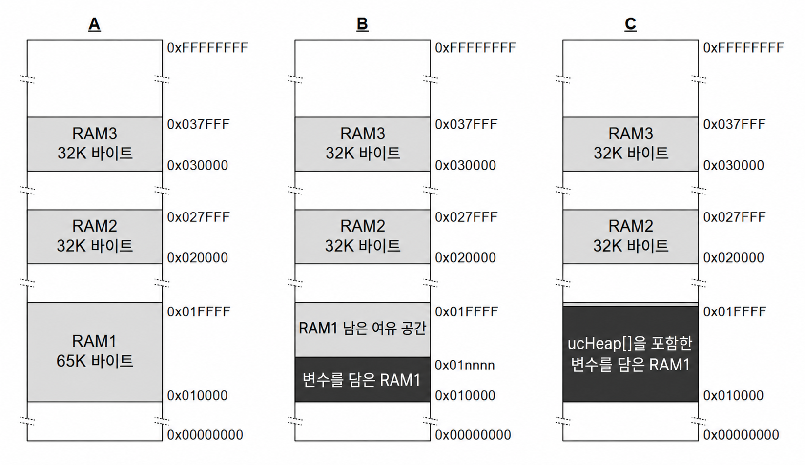

<a id="3-heap-memory-management"></a>
# 3 힙 메모리 관리 (Heap Memory Management)

<a id="31-introduction"></a>
## 3.1 개요 (Introduction)

<a id="311-prerequisites"></a>
### 3.1.1 선수 지식 (Prerequisites)

FreeRTOS를 사용하기 위해서는 능숙한 C 프로그래밍 능력이 필수적이다. 따라서 이 장에서는 독자가 다음과 같은 개념에 이미 익숙하다고 가정한다.

- C 프로젝트를 빌드할 때 거치는 컴파일 및 링킹 단계
- stack(스택)과 heap(힙)의 개념
- 표준 C 라이브러리의 `malloc()` 및 `free()` 함수

<a id="312-scope"></a>
### 3.1.2 다루는 범위 (Scope)

이 장에서는 다음 내용을 다룬다.

- FreeRTOS가 RAM을 할당하는 시점
- FreeRTOS와 함께 제공되는 5가지 예제 메모리 할당 체계
- 어떤 메모리 할당 체계를 선택해야 하는지에 대한 기준

<a id="313-switching-between-static-and-dynamic-memory-allocation"></a>
### 3.1.3 정적 및 동적 메모리 할당 간의 전환 (Switching Between Static and Dynamic Memory Allocation)

다음 장들에서는 task(태스크), queue(큐), semaphore(세마포어), event group(이벤트 그룹)과 같은 커널 객체들을 소개한다. 이러한 객체들을 유지하는 데 필요한 RAM은 컴파일 시점에 정적(statically)으로 할당하거나 런타임에 동적(dynamically)으로 할당할 수 있다. 동적 할당을 사용하면 설계 및 계획에 드는 노력을 줄이고 API를 단순화하며 RAM 사용량을 최소화할 수 있다. 반면 정적 할당은 결정론적(deterministic)이며 메모리 할당 실패를 처리할 필요가 없고, heap 단편화(heap fragmentation, heap에 총 여유 메모리는 충분하지만 하나의 연속된 가용 블록으로 존재하지 않는 현상)의 위험을 원천적으로 제거한다.

정적으로 할당된 메모리를 사용하여 커널 객체를 생성하는 FreeRTOS API 함수들은 `FreeRTOSConfig.h`에서 `configSUPPORT_STATIC_ALLOCATION`이 1로 설정되어 있을 때만 사용할 수 있다. 동적으로 할당된 메모리를 사용하여 커널 객체를 생성하는 FreeRTOS API 함수들은 `FreeRTOSConfig.h`에서 `configSUPPORT_DYNAMIC_ALLOCATION`이 1로 설정되어 있거나 아예 정의되지 않았을 때만 사용할 수 있다. 두 상수를 동시에 모두 1로 설정하는 것도 유효하다.

`configSUPPORT_STATIC_ALLOCATION`에 관한 더 자세한 정보는 3.4절 '정적 메모리 할당 활용'에서 다룬다.

<a id="314-using-dynamic-memory-allocation"></a>
### 3.1.4 동적 메모리 할당의 활용 (Using Dynamic Memory Allocation)

동적 메모리 할당은 C 프로그래밍의 일반적인 개념이며, FreeRTOS나 멀티태스킹에만 국한된 개념이 아니다. 이 개념이 FreeRTOS와 밀접한 이유는 커널 객체를 생성할 때 동적으로 할당된 메모리를 선택적으로 사용할 수 있기 때문이다. 이때 표준 범용 C 라이브러리의 `malloc()`과 `free()` 함수는 다음과 같은 하나 이상의 이유로 적합하지 않을 수 있다.

- 소형 임베디드 시스템에서는 항상 제공되는 것이 아니다.
- 구현 코드의 크기가 상대적으로 커서 귀중한 코드 공간을 많이 차지할 수 있다.
- 스레드 안전(thread-safe)을 보장하는 경우가 드물다.
- 결정론적이지 않다. 즉, 함수를 실행하는 데 걸리는 시간이 호출할 때마다 다를 수 있다.
- 단편화(fragmentation) 문제를 겪을 수 있다.
- 링커 구성을 복잡하게 만들 수 있다.
- heap 영역이 다른 변수들이 사용하는 메모리 영역을 침범하도록 방치될 경우 디버깅하기 매우 어려운 오류의 원인이 될 수 있다.

<a id="315-options-for-dynamic-memory-allocation"></a>
### 3.1.5 동적 메모리 할당 옵션 (Options for Dynamic Memory Allocation)

초기 버전의 FreeRTOS는 메모리 풀(memory pool) 할당 체계를 사용했다. 이 방식은 컴파일 시점에 서로 다른 크기의 메모리 블록 풀을 미리 할당해 둔 다음 메모리 할당 함수가 이를 반환하는 방식이었다. 블록 할당은 실시간 시스템에서 흔히 쓰이지만, 아주 작은 소형 임베디드 시스템에서는 비효율적인 RAM 사용으로 인해 수많은 지원 요청이 발생하여 결국 FreeRTOS에서 제거되었다.

현재 FreeRTOS는 메모리 할당을 핵심 코드베이스의 일부가 아니라 포터블 계층(portable layer)의 일부로 취급한다. 임베디드 시스템마다 요구되는 동적 메모리 할당 특성과 타이밍 요구조건이 제각각이므로, 단 하나의 동적 메모리 할당 알고리즘으로는 전체 애플리케이션 중 일부에만 적합할 수밖에 없기 때문이다. 또한 핵심 코드베이스에서 동적 메모리 할당을 분리함으로써, 애플리케이션 작성자가 필요에 따라 고유한 맞춤 구현을 직접 제공할 수도 있다.

FreeRTOS는 RAM이 필요할 때 `malloc()` 대신 `pvPortMalloc()`을 호출한다. 마찬가지로 이전에 할당된 RAM을 해제할 때는 `free()` 대신 `vPortFree()`를 호출한다. `pvPortMalloc()`은 표준 C 라이브러리의 `malloc()` 함수와 동일한 함수 원형을 가지며, `vPortFree()`는 표준 C 라이브러리의 `free()` 함수와 동일한 함수 원형을 갖는다.

`pvPortMalloc()`과 `vPortFree()`는 공개(public) 함수이므로 애플리케이션 코드에서도 직접 호출할 수 있다.

FreeRTOS에는 `pvPortMalloc()`과 `vPortFree()`의 5가지 예제 구현이 함께 제공되며, 모두 이 장에서 상세히 설명한다. FreeRTOS 애플리케이션은 이 예제 구현 중 하나를 선택해 사용하거나 독자적인 구현을 제공할 수 있다.

이 5가지 예제는 각각 `heap_1.c`, `heap_2.c`, `heap_3.c`, `heap_4.c`, `heap_5.c` 소스 파일에 정의되어 있으며, 모두 `FreeRTOS/Source/portable/MemMang` 디렉터리에 위치한다.

<a id="32-example-memory-allocation-schemes"></a>
## 3.2 예제 메모리 할당 체계 (Example Memory Allocation Schemes)

<a id="321-heap_1"></a>
### 3.2.1 Heap_1 (Heap_1)

작고 전용화된 임베디드 시스템에서는 FreeRTOS scheduler(스케줄러)를 시작하기 전에만 task 및 기타 커널 객체를 생성하는 경우가 흔하다. 이러한 시스템에서는 애플리케이션이 실시간 기능을 본격적으로 수행하기 전에만 커널에 의해 메모리가 (동적으로) 할당되며, 한번 할당된 메모리는 애플리케이션의 수명이 다할 때까지 유지된다. 즉, 선택된 할당 체계가 결정론이나 단편화와 같은 복잡한 메모리 할당 문제를 고려할 필요가 없으며, 대신 코드 크기와 단순성 같은 특성을 우선시할 수 있다.

`heap_1.c`는 매우 기본적인 버전의 `pvPortMalloc()`을 구현하며, `vPortFree()`는 전혀 구현하지 않는다. task나 기타 커널 객체를 한 번 생성한 후 절대 삭제하지 않는 애플리케이션이라면 heap_1을 사용할 수 있다. 동적 메모리 할당의 사용을 금지하는 일부 상용 중요 시스템 및 안전 필수(safety-critical) 시스템에서도 heap_1은 활용될 수 있다. 안전 필수 시스템에서 동적 메모리 할당을 금지하는 주된 이유는 비결정론, 메모리 단편화, 할당 실패에 수반되는 불확실성 때문이다. heap_1은 언제나 결정론적이며 메모리를 단편화하지 않는다.

heap_1의 `pvPortMalloc()` 구현은 호출될 때마다 FreeRTOS heap이라 불리는 단순한 `uint8_t` 배열을 더 작은 블록으로 단순히 분할해 나간다. `FreeRTOSConfig.h`의 `configTOTAL_HEAP_SIZE` 상수가 이 배열의 크기(바이트 단위)를 결정한다. heap을 정적으로 할당된 배열로 구현하기 때문에 heap이 FreeRTOS 데이터의 일부가 되어 FreeRTOS가 RAM을 많이 소비하는 것처럼 보일 수 있다.

동적으로 할당되는 task 하나당 `pvPortMalloc()`이 두 번 호출된다. 첫 번째 호출은 Task Control Block(TCB)을 할당하고, 두 번째 호출은 task의 stack을 할당한다. 그림 3.1은 task가 생성됨에 따라 heap_1이 단순 배열을 어떻게 분할해 나가는지 보여준다.

그림 3.1을 참고하면 다음과 같다.

- **A**는 아무런 task도 생성하기 전의 배열 상태를 나타내며, 전체 배열이 비어 있다.
- **B**는 하나의 task를 생성한 후의 배열 상태를 나타낸다.
- **C**는 세 개의 task를 생성한 후의 배열 상태를 나타낸다.

> [옮긴이 주] `xTaskCreate()`는 [4.4절](ch04.md#44-task-creation)에서 설명한다. 원문은 이를 3.4절이라고 가리키므로 실제 위치에 맞춰 연결했다. [원문 대조 사항 N12](SOURCE_NOTES.md#n12).

<a name="fig3.1" title="Figure 3.1 RAM being allocated from the heap_1 array each time a task is created"></a>

* * *


***그림 3.1 (Figure 3.1)*** *task가 생성될 때마다 heap_1 배열에서 RAM이 할당되는 과정*

* * *

<a id="322-heap_2"></a>
### 3.2.2 Heap_2 (Heap_2)

heap_2는 더 향상된 기능을 갖춘 heap_4로 대체되었다. heap_2는 하위 호환성을 위해 FreeRTOS 배포판에 유지되고 있을 뿐이며, 새로운 설계에는 권장하지 않는다.

`heap_2.c` 역시 `configTOTAL_HEAP_SIZE` 상수로 크기가 지정된 배열을 분할하는 방식으로 동작한다. 메모리 할당에는 최적 적합(best-fit) 알고리즘을 사용하며, heap_1과 달리 `vPortFree()`를 구현한다. 마찬가지로 heap을 정적 배열로 선언하므로 heap 영역이 FreeRTOS 데이터로 잡혀 FreeRTOS의 RAM 소비량이 많아 보일 수 있다.

최적 적합(best-fit) 알고리즘은 요청된 바이트 수와 크기가 가장 근접한 여유 메모리 블록을 `pvPortMalloc()`이 사용하도록 보장한다. 예를 들어 다음과 같은 시나리오를 살펴본다.

- heap에 각각 5바이트, 25바이트, 100바이트 크기의 여유 메모리 블록 3개가 있다.
- `pvPortMalloc()`이 20바이트의 RAM을 요청한다.

요청된 바이트 수가 들어갈 수 있는 가장 작은 여유 RAM 블록은 25바이트 블록이므로, `pvPortMalloc()`은 25바이트 블록을 20바이트 블록 하나와 5바이트 블록 하나로 분할한 뒤 20바이트 블록에 대한 포인터를 반환한다[^2]. 새로 분할된 5바이트 블록은 이후의 `pvPortMalloc()` 호출에서 사용할 수 있도록 남아 있게 된다.

[^2]: 이는 이해를 돕기 위한 단순화된 설명이다. 실제로는 heap_2가 heap 영역 내부의 블록 크기 정보를 함께 저장하므로, 분할된 두 블록의 합은 실제 25보다 작다.

heap_4와 달리 heap_2는 인접한 여유 블록들을 하나의 더 큰 블록으로 병합(coalesce)하지 않으므로, heap_4에 비해 단편화에 취약하다. 그러나 할당된 후 해제되는 블록들의 크기가 항상 동일하다면 단편화는 문제가 되지 않는다.

<a name="fig3.2" title="Figure 3.2 RAM being allocated and freed from the heap_2 array as tasks are created and deleted"></a>

* * *


***그림 3.2 (Figure 3.2)*** *task가 생성 및 삭제됨에 따라 heap_2 배열에서 RAM이 할당되고 해제되는 과정*

* * *

그림 3.2는 task가 생성되고, 삭제되고, 다시 생성될 때 최적 적합 알고리즘이 어떻게 동작하는지 보여준다. 그림 3.2를 참고하면 다음과 같다.

- **A**는 3개의 task를 할당한 후의 배열을 나타낸다. 배열 상단에 커다란 여유 블록 하나가 남아 있다.
- **B**는 그중 하나의 task를 삭제한 후의 배열을 나타낸다. 배열 상단의 큰 여유 블록은 그대로 유지된다. 삭제된 task의 TCB와 stack이 차지하고 있던 자리에는 이제 두 개의 작은 여유 블록이 생긴다.
- **C**는 또 다른 task를 새로 생성한 후의 상황을 나타낸다. task를 생성하면 `xTaskCreate()` API 함수 내부에서 `pvPortMalloc()`이 두 번 호출되어 하나는 새 TCB를 할당하고 다른 하나는 task stack을 할당한다.
  모든 TCB는 크기가 동일하므로, 최적 적합 알고리즘은 삭제된 이전 task의 TCB를 담고 있던 RAM 블록을 재사용하여 새로 생성된 task의 TCB를 할당한다.
  만약 새로 생성된 task에 할당되는 stack 크기가 이전에 삭제된 task의 stack 크기와 동일하다면, 최적 적합 알고리즘은 삭제된 이전 task의 stack 블록을 재사용하여 새 task의 stack을 할당한다.
  배열 상단에 있던 더 큰 미할당 블록은 전혀 건드리지 않고 그대로 유지된다.

heap_2는 결정론적이지는 않지만 대부분의 표준 라이브러리 `malloc()` 및 `free()` 구현보다는 훨씬 빠르다.

<a id="323-heap_3"></a>
### 3.2.3 Heap_3 (Heap_3)

`heap_3.c`는 표준 라이브러리의 `malloc()`과 `free()` 함수를 그대로 사용하므로 링커 설정에 따라 heap 크기가 결정되며, `configTOTAL_HEAP_SIZE` 상수는 사용되지 않는다.

heap_3은 `malloc()`과 `free()`가 실행되는 동안 FreeRTOS scheduler를 일시 중지(suspend)함으로써 이 함수들을 스레드 안전(thread-safe)하게 만든다. 8장 '자원 관리'에서 스레드 안전성과 scheduler 일시 중지에 대해 다룬다.

<a id="324-heap_4"></a>
### 3.2.4 Heap_4 (Heap_4)

heap_1, heap_2와 마찬가지로 heap_4도 하나의 배열을 더 작은 블록들로 분할하는 방식으로 동작한다. 이전과 동일하게 이 배열은 정적으로 할당되고 `configTOTAL_HEAP_SIZE`에 의해 크기가 결정되므로, heap이 FreeRTOS 데이터의 일부가 되어 FreeRTOS가 많은 RAM을 사용하는 것처럼 보인다.

heap_4는 메모리를 할당할 때 최초 적합(first-fit) 알고리즘을 사용한다. heap_2와 달리 heap_4는 인접한 여유 메모리 블록들을 하나의 더 큰 블록으로 병합(coalesce)하므로 메모리 단편화 위험을 최소화한다.

최초 적합(first-fit) 알고리즘은 요청된 바이트 수를 담기에 충분한 크기를 가진 여유 메모리 블록 중 '가장 먼저 발견되는 블록'을 `pvPortMalloc()`이 사용하도록 한다. 예를 들어 다음과 같은 시나리오를 살펴본다.

- heap에 배열에 나타나는 순서대로 각각 5바이트, 200바이트, 100바이트 크기의 여유 메모리 블록 3개가 있다.
- `pvPortMalloc()`이 20바이트의 RAM을 요청한다.

요청된 바이트 수가 들어갈 수 있는 첫 번째 여유 RAM 블록은 200바이트 블록이다. 따라서 `pvPortMalloc()`은 200바이트 블록을 20바이트 블록 하나와 180바이트 블록 하나로 분할한 뒤[^3] 20바이트 블록에 대한 포인터를 반환한다. 새로 생긴 180바이트 블록은 이후의 `pvPortMalloc()` 호출에서 계속 사용할 수 있다.

[^3]: 이는 이해를 돕기 위한 단순화된 설명이다. 실제로는 heap_4가 heap 영역 내부의 블록 크기 정보를 함께 저장하므로 분할된 두 블록의 합은 200바이트보다 작다.

heap_4는 인접한 여유 블록들을 하나의 커다란 블록으로 병합하여 단편화 위험을 최소화하므로, 서로 다른 크기의 RAM 블록을 반복적으로 할당하고 해제하는 애플리케이션에 매우 적합하다.

<a name="fig3.3" title="Figure 3.3 RAM being allocated and freed from the heap_4 array"></a>

* * *


***그림 3.3 (Figure 3.3)*** *heap_4 배열에서 RAM이 할당되고 해제되는 과정*

* * *

그림 3.3은 메모리 병합 기능을 갖춘 heap_4의 최초 적합 알고리즘 동작 방식을 보여준다. 그림 3.3을 참고하면 다음과 같다.

- **A**는 3개의 task를 생성한 후의 배열을 나타낸다. 배열 상단에 커다란 여유 블록 하나가 남아 있다.
- **B**는 그중 한 task를 삭제한 후의 배열을 나타낸다. 배열 상단의 큰 여유 블록은 그대로 유지된다. 삭제된 task의 TCB와 stack이 있던 자리에 또 다른 여유 블록이 생긴다. heap_2 예제와 달리, heap_4는 삭제된 task의 TCB와 stack을 담고 있던 두 메모리 블록을 병합하여 하나의 더 큰 단일 여유 블록으로 합친다.
- **C**는 FreeRTOS queue를 생성한 후의 상황을 나타낸다. queue를 동적으로 할당하는 `xQueueCreate()` API 함수는 이 책의 5.3절에서 다룬다. `xQueueCreate()`는 `pvPortMalloc()`을 호출하여 queue가 사용할 RAM을 할당한다. heap_4는 최초 적합 알고리즘을 사용하므로, `pvPortMalloc()`은 queue를 담기에 충분한 첫 번째 여유 RAM 블록(그림 3.3에서는 task 삭제로 해제된 블록)에서 RAM을 할당한다. queue가 이 여유 블록의 모든 공간을 다 쓰지는 않으므로 블록은 둘로 분할되며, 남은 미사용 부분은 향후 `pvPortMalloc()` 호출에서 사용할 수 있도록 남겨진다.
- **D**는 FreeRTOS API 함수를 통한 간접 호출이 아니라, 애플리케이션 코드에서 직접 `pvPortMalloc()`을 호출한 후의 상황을 나타낸다. 사용자가 할당한 블록은 첫 번째 여유 블록(queue에 할당된 메모리와 그 뒤를 잇는 TCB에 할당된 메모리 사이의 블록)에 들어갈 만큼 충분히 작았다.
  task 삭제로 해제되었던 메모리는 이제 세 개의 개별 블록으로 나뉜다. 첫 번째 블록은 queue를 담고 있고, 두 번째 블록은 사용자가 할당한 메모리를 담고 있으며, 세 번째 블록은 여유 공간으로 남는다.
- **E**는 queue를 삭제한 후의 상황을 나타낸다. queue가 삭제되면 해당 queue에 할당되었던 메모리가 자동으로 해제된다. 이제 사용자가 할당한 블록의 양쪽에 각각 여유 메모리가 존재하게 된다.
- **F**는 사용자가 할당했던 메모리를 해제한 후의 상황을 나타낸다. 사용자가 할당했던 블록이 사용하던 메모리가 양쪽의 여유 메모리와 병합되어 하나의 더 큰 단일 여유 블록을 형성한다.

heap_4는 결정론적이지는 않지만 대부분의 표준 라이브러리 `malloc()` 및 `free()` 구현보다는 훨씬 빠르다.

<a id="325-heap_5"></a>
### 3.2.5 Heap_5 (Heap_5)

heap_5는 heap_4와 동일한 할당 알고리즘을 사용한다. 단 하나의 배열에서만 메모리를 할당할 수 있는 heap_4와 달리, heap_5는 서로 분리된 여러 메모리 공간의 메모리를 결합하여 하나의 단일 heap으로 구성할 수 있다. heap_5는 FreeRTOS가 실행되는 시스템에서 제공하는 RAM이 시스템 메모리 맵 상에서 단일한 연속 블록으로 나타나지 않을 때 유용하다.

<a id="326-initialising-heap_5-the-vportdefineheapregions-api-function"></a>
### 3.2.6 heap_5 초기화: vPortDefineHeapRegions() API 함수 (Initialising heap_5: The vPortDefineHeapRegions() API Function)

`vPortDefineHeapRegions()`는 heap_5가 관리할 heap을 구성하는 각각의 분리된 메모리 영역의 시작 주소와 크기를 지정하여 heap_5를 초기화한다. heap_5는 명시적인 초기화가 필요한 유일한 제공 heap 할당 체계이며, `vPortDefineHeapRegions()`가 호출되기 전에는 사용할 수 없다. 즉, `vPortDefineHeapRegions()`를 호출하기 전에는 task, queue, semaphore와 같은 커널 객체를 동적으로 생성할 수 없다.

<a name="list3.1" title="Listing 3.1 The vPortDefineHeapRegions() API function prototype"></a>

```c
void vPortDefineHeapRegions( const HeapRegion_t * const pxHeapRegions );
```
***코드 3.1 (Listing 3.1)*** *vPortDefineHeapRegions() API 함수 원형*

`vPortDefineHeapRegions()`는 유일한 매개변수로 `HeapRegion_t` 구조체 배열을 받는다. 각 구조체는 heap의 일부가 될 메모리 블록의 시작 주소와 크기를 정의하며, 전체 구조체 배열이 heap 공간 전체를 정의한다.

<a name="list3.2" title="Listing 3.2 The HeapRegion_t structure"></a>

```c
typedef struct HeapRegion
{
    /* The start address of a block of memory that will be part of the heap.*/
    uint8_t *pucStartAddress;

    /* The size of the block of memory in bytes. */
    size_t xSizeInBytes;

} HeapRegion_t;
```
***코드 3.2 (Listing 3.2)*** *HeapRegion_t 구조체*

**매개변수:**

- `pxHeapRegions`

  `HeapRegion_t` 구조체 배열의 시작을 가리키는 포인터다. 각 구조체는 heap의 일부가 될 메모리 블록의 시작 주소와 크기를 정의한다.

  배열 내의 `HeapRegion_t` 구조체들은 반드시 시작 주소 오름차순으로 정렬되어 있어야 한다. 즉, 가장 낮은 시작 주소를 가진 메모리 영역을 기술하는 `HeapRegion_t` 구조체가 배열의 첫 번째 항목이어야 하며, 가장 높은 시작 주소를 가진 메모리 영역을 기술하는 구조체가 배열의 마지막 항목이어야 한다.

  배열의 끝은 `pucStartAddress` 멤버가 `NULL`로 설정된 `HeapRegion_t` 구조체로 표시한다.

예를 들어, RAM1, RAM2, RAM3이라는 3개의 분리된 RAM 블록을 포함하는 그림 3.4 **A**의 가상 메모리 맵을 살펴보자. 실행 가능한 코드는 읽기 전용 메모리(ROM/Flash)에 배치되며 여기서는 표시되지 않았다고 가정한다.

<a name="fig3.4" title="Figure 3.4 Memory Map"></a>

* * *


***그림 3.4 (Figure 3.4)*** *메모리 맵*

* * *

코드 3.3은 세 RAM 블록 전체를 함께 기술하는 `HeapRegion_t` 구조체 배열을 보여준다.

<a name="list3.3" title="Listing 3.3 An array of HeapRegion_t structures that together describe the 3 regions of RAM in their entirety"></a>

```c
/* Define the start address and size of the three RAM regions. */
#define RAM1_START_ADDRESS ( ( uint8_t * ) 0x00010000 )
#define RAM1_SIZE ( 64 * 1024 )

#define RAM2_START_ADDRESS ( ( uint8_t * ) 0x00020000 )
#define RAM2_SIZE ( 32 * 1024 )

#define RAM3_START_ADDRESS ( ( uint8_t * ) 0x00030000 )
#define RAM3_SIZE ( 32 * 1024 )

/* Create an array of HeapRegion_t definitions, with an index for each
   of the three RAM regions, and terminate the array with a HeapRegion_t
   structure containing a NULL address. The HeapRegion_t structures must
   appear in start address order, with the structure that contains the
   lowest start address appearing first. */
const HeapRegion_t xHeapRegions[] =
{
    { RAM1_START_ADDRESS, RAM1_SIZE },
    { RAM2_START_ADDRESS, RAM2_SIZE },
    { RAM3_START_ADDRESS, RAM3_SIZE },
    { NULL,               0         } /* Marks the end of the array. */
};

int main( void )
{
    /* Initialize heap_5. */
    vPortDefineHeapRegions( xHeapRegions );

    /* Add application code here. */
}
```
***코드 3.3 (Listing 3.3)*** *3개의 RAM 영역 전체를 기술하는 HeapRegion_t 구조체 배열*

코드 3.3이 RAM 영역을 올바르게 기술하고 있기는 하지만, 모든 RAM을 heap에 할당하여 다른 변수들이 사용할 여유 RAM을 전혀 남기지 않으므로 실제로 사용할 수 있는 예제는 아니다.

빌드 과정의 링킹 단계에서는 각 변수에 RAM 주소를 할당한다. 링커가 사용할 수 있는 RAM은 통상 링커 스크립트와 같은 링커 구성 파일에 정의된다. 그림 3.4 **B**에서는 링커 스크립트에 RAM1에 대한 정보는 포함되어 있지만 RAM2나 RAM3에 대한 정보는 포함되어 있지 않다고 가정한다. 그 결과 링커는 RAM1에 변수들을 배치하며, 0x0001nnnn 주소 이상의 RAM1 영역만 heap_5에서 사용할 수 있게 남겨둔다. 0x0001nnnn의 실제 값은 애플리케이션에 포함된 모든 변수의 총 크기에 따라 달라진다. 링커는 RAM2와 RAM3은 전혀 사용하지 않은 채로 남겨두므로, RAM2 전체와 RAM3 전체를 heap_5에서 온전히 사용할 수 있다.

코드 3.3에 나온 코드를 그대로 사용하면 주소 0x0001nnnn 이하에서 heap_5에 할당된 RAM이 변수들을 저장하는 데 쓰이는 RAM과 겹치게(overlap) 된다. `xHeapRegions[]` 배열 내 첫 번째 `HeapRegion_t` 구조체의 시작 주소를 0x00010000 대신 0x0001nnnn으로 설정하면 heap이 링커가 사용하는 RAM과 겹치지 않게 할 수 있다. 그러나 이 방식은 다음과 같은 이유로 권장되지 않는다.

- 시작 주소를 정확히 알아내기 어려울 수 있다.
- 향후 빌드 시 링커가 사용하는 RAM의 크기가 변경될 수 있으며, 그에 따라 `HeapRegion_t` 구조체에 사용된 시작 주소를 매번 업데이트해야 한다.
- 링커가 사용하는 RAM과 heap_5가 사용하는 RAM이 겹치더라도 빌드 도구가 이를 감지하지 못하므로 애플리케이션 작성자에게 경고를 보낼 수 없다.

코드 3.4는 훨씬 더 편리하고 유지보수하기 쉬운 방법을 보여준다. 이 코드는 `ucHeap`이라는 배열을 선언한다. `ucHeap`은 일반 변수이므로 링커에 의해 RAM1에 할당되는 데이터의 일부가 된다. `xHeapRegions` 배열의 첫 번째 `HeapRegion_t` 구조체는 `ucHeap`의 시작 주소와 크기를 기술하므로, `ucHeap`이 heap_5가 관리하는 메모리의 일부가 된다. 그림 3.4 **C**에 나타난 바와 같이, `ucHeap`의 크기는 링커가 사용하는 RAM이 RAM1 전체를 다 쓸 때까지 늘릴 수 있다.

<a name="list3.4" title="Listing 3.4 An array of HeapRegion_t structures that describe all of RAM2, all of RAM3, but only part of RAM1"></a>

```c
/* Define the start address and size of the two RAM regions not used by
   the linker. */
#define RAM2_START_ADDRESS ( ( uint8_t * ) 0x00020000 )
#define RAM2_SIZE ( 32 * 1024 )

#define RAM3_START_ADDRESS ( ( uint8_t * ) 0x00030000 )
#define RAM3_SIZE ( 32 * 1024 )

/* Declare an array that will be part of the heap used by heap_5. The
   array will be placed in RAM1 by the linker. */
#define RAM1_HEAP_SIZE ( 30 * 1024 )
static uint8_t ucHeap[ RAM1_HEAP_SIZE ];

/* Create an array of HeapRegion_t definitions. Whereas in Listing 3.3 the
   first entry described all of RAM1, so heap_5 will have used all of
   RAM1, this time the first entry only describes the ucHeap array, so
   heap_5 will only use the part of RAM1 that contains the ucHeap array.
   The HeapRegion_t structures must still appear in start address order,
   with the structure that contains the lowest start address appearing first. */

const HeapRegion_t xHeapRegions[] =
{
    { ucHeap,             RAM1_HEAP_SIZE },
    { RAM2_START_ADDRESS, RAM2_SIZE },
    { RAM3_START_ADDRESS, RAM3_SIZE },
    { NULL,               0 }           /* Marks the end of the array. */
};
```
***코드 3.4 (Listing 3.4)*** *RAM2 전체, RAM3 전체, 그리고 RAM1의 일부만을 기술하는 HeapRegion_t 구조체 배열*

코드 3.4에서 보여준 기법의 장점은 다음과 같다.

- 하드코딩된 시작 주소를 사용할 필요가 없다.
- `HeapRegion_t` 구조체에 사용되는 주소가 링커에 의해 자동으로 설정되므로, 향후 빌드 시 링커가 사용하는 RAM 크기가 변경되더라도 항상 올바른 주소가 유지된다.
- heap_5에 할당된 RAM이 링커에 의해 RAM1에 배치된 데이터와 겹치는 일이 원천적으로 불가능하다.
- `ucHeap`이 너무 크면 애플리케이션의 링크 작업이 실패하므로 문제를 즉시 인지할 수 있다.

<a id="33-heap-related-utility-functions-and-macros"></a>
## 3.3 힙 관련 유틸리티 함수 및 매크로 (Heap Related Utility Functions and Macros)

<a id="331-defining-the-heap-start-address"></a>
### 3.3.1 힙 시작 주소 정의 (Defining the Heap Start Address)

heap_1, heap_2, heap_4는 `configTOTAL_HEAP_SIZE`에 의해 크기가 결정되는 정적 배열에서 메모리를 할당한다. 이 절에서는 이러한 할당 체계들을 통칭하여 heap_n이라고 부른다.

때로는 heap을 특정한 메모리 주소에 배치해야 할 때가 있다. 예를 들어 동적으로 생성된 task에 할당되는 stack은 heap에서 가져오므로, 느린 외부 메모리 대신 빠른 내부 메모리에 heap을 배치해야 할 수 있다. (task stack을 고속 메모리에 할당하는 또 다른 방법은 아래의 'task stack을 고속 메모리에 배치하기' 소절을 참조한다.) `configAPPLICATION_ALLOCATED_HEAP` 컴파일 타임 구성 상수를 사용하면, `heap_n.c` 소스 파일 내부에 선언되어 있을 배열 대신 애플리케이션에서 직접 배열을 선언할 수 있다. 애플리케이션 코드에서 배열을 선언하면 애플리케이션 작성자가 시작 주소를 직접 지정할 수 있게 된다.

`FreeRTOSConfig.h`에서 `configAPPLICATION_ALLOCATED_HEAP`이 1로 설정되어 있다면, FreeRTOS를 사용하는 애플리케이션은 `configTOTAL_HEAP_SIZE` 상수로 크기가 지정된 `ucHeap`이라는 `uint8_t` 배열을 반드시 직접 선언해야 한다.

변수를 특정 메모리 주소에 배치하기 위해 요구되는 문법은 사용하는 컴파일러에 따라 다르므로 해당 컴파일러 문서를 참조해야 한다. 다음은 두 컴파일러의 예시다.

- 코드 3.5는 GCC 컴파일러를 사용하여 배열을 선언하고 `.my_heap`이라는 메모리 섹션에 배치하는 문법을 보여준다.
- 코드 3.6은 IAR 컴파일러를 사용하여 배열을 선언하고 절대 메모리 주소 `0x20000000`에 배치하는 문법을 보여준다.

<a name="list3.5" title="Listing 3.5 Using GCC syntax to declare the array that will be used by heap_4, and place the array in a memory section named .my_heap"></a>

```c
uint8_t ucHeap[ configTOTAL_HEAP_SIZE ] __attribute__ ( ( section( ".my_heap" ) ) );
```
***코드 3.5 (Listing 3.5)*** *GCC 문법을 사용하여 heap_4가 사용할 배열을 선언하고 .my_heap 섹션에 배치하는 예*

<a name="list3.6" title="Listing 3.6 Using IAR syntax to declare the array that will be used by heap_4, and place the array at the absolute address 0x20000000"></a>

```c
uint8_t ucHeap[ configTOTAL_HEAP_SIZE ] @ 0x20000000;
```
***코드 3.6 (Listing 3.6)*** *IAR 문법을 사용하여 heap_4가 사용할 배열을 선언하고 절대 주소 0x20000000에 배치하는 예*

<a id="332-the-xportgetfreeheapsize-api-function"></a>
### 3.3.2 xPortGetFreeHeapSize() API 함수 (The xPortGetFreeHeapSize() API Function)

`xPortGetFreeHeapSize()` API 함수는 함수가 호출된 시점에 heap에 남아 있는 여유 바이트 수를 반환한다. 이 함수는 heap 단편화에 대한 정보는 제공하지 않는다.

`xPortGetFreeHeapSize()`는 heap_3에는 구현되어 있지 않다.

<a name="list3.7" title="Listing 3.7 The xPortGetFreeHeapSize() API function prototype"></a>

```c
size_t xPortGetFreeHeapSize( void );
```
***코드 3.7 (Listing 3.7)*** *xPortGetFreeHeapSize() API 함수 원형*

**반환값:**

- `xPortGetFreeHeapSize()`는 호출 시점에 heap에 미할당 상태로 남아 있는 총 바이트 수를 반환한다.

<a id="333-the-xportgetminimumeverfreeheapsize-api-function"></a>
### 3.3.3 xPortGetMinimumEverFreeHeapSize() API 함수 (The xPortGetMinimumEverFreeHeapSize() API Function)

`xPortGetMinimumEverFreeHeapSize()` API 함수는 FreeRTOS 애플리케이션이 실행을 시작한 이래 heap에 존재했던 최소 미할당 바이트 수를 반환한다.

`xPortGetMinimumEverFreeHeapSize()`가 반환하는 값은 애플리케이션이 heap 공간 고갈에 얼마나 가까이 도달했었는지를 나타낸다. 예를 들어 `xPortGetMinimumEverFreeHeapSize()`가 200을 반환했다면, 애플리케이션 실행 중 어느 한 시점에 heap 공간이 고갈되기까지 불과 200바이트밖에 남지 않았던 순간이 있었음을 의미한다.

`xPortGetMinimumEverFreeHeapSize()`는 heap 크기를 최적화하는 데도 활용할 수 있다. 예를 들어 가장 많은 heap 메모리를 소비하는 것으로 알려진 코드를 실행한 후 `xPortGetMinimumEverFreeHeapSize()`를 호출했을 때 2000이 반환된다면, `configTOTAL_HEAP_SIZE`를 최대 2000바이트까지 줄일 수 있다.

`xPortGetMinimumEverFreeHeapSize()`는 heap_4와 heap_5에만 구현되어 있다.

<a name="list3.8" title="Listing 3.8 The xPortGetMinimumEverFreeHeapSize() API function prototype"></a>

```c
size_t xPortGetMinimumEverFreeHeapSize( void );
```
***코드 3.8 (Listing 3.8)*** *xPortGetMinimumEverFreeHeapSize() API 함수 원형*

**반환값:**

- `xPortGetMinimumEverFreeHeapSize()`는 FreeRTOS 애플리케이션이 실행을 시작한 이후 heap에 존재했던 가장 적었던 미할당 바이트 수를 반환한다.

<a id="334-the-vportgetheapstats-api-function"></a>
### 3.3.4 vPortGetHeapStats() API 함수 (The vPortGetHeapStats() API Function)

heap_4와 heap_5는 `vPortGetHeapStats()`를 구현한다. 이 함수는 유일한 매개변수로 참조 전달(pass by reference)된 `HeapStats_t` 구조체의 내용을 채운다.

코드 3.9는 `vPortGetHeapStats()` 함수의 원형을 보여준다. 코드 3.10은 `HeapStats_t` 구조체의 멤버들을 보여준다.

<a name="list3.9" title="Listing 3.9 The vPortGetHeapStatus() API function prototype"></a>

```c
void vPortGetHeapStats( HeapStats_t *xHeapStats );
```
***코드 3.9 (Listing 3.9)*** *vPortGetHeapStats() API 함수 원형*

<a name="list3.10" title="Listing 3.10 The HeapStatus_t() structure"></a>

```c
/* Prototype of the vPortGetHeapStats() function. */
void vPortGetHeapStats( HeapStats_t *xHeapStats );

/* Definition of the HeapStats_t structure. All sizes specified in bytes. */
typedef struct xHeapStats
{
    /* The total heap size currently available - this is the sum of all the
       free blocks, not the largest available block. */
    size_t xAvailableHeapSpaceInBytes;

    /* The size of the largest free block within the heap at the time
       vPortGetHeapStats() is called. */
    size_t xSizeOfLargestFreeBlockInBytes;

    /* The size of the smallest free block within the heap at the time
       vPortGetHeapStats() is called. */
    size_t xSizeOfSmallestFreeBlockInBytes;

    /* The number of free memory blocks within the heap at the time
       vPortGetHeapStats() is called. */
    size_t xNumberOfFreeBlocks;

    /* The minimum amount of total free memory (sum of all free blocks)
       there has been in the heap since the system booted. */
    size_t xMinimumEverFreeBytesRemaining;

    /* The number of calls to pvPortMalloc() that have returned a valid
       memory block. */
    size_t xNumberOfSuccessfulAllocations;

    /* The number of calls to vPortFree() that has successfully freed a
       block of memory. */
    size_t xNumberOfSuccessfulFrees;
} HeapStats_t;
```
***코드 3.10 (Listing 3.10)*** *HeapStats_t 구조체*

<a id="335-collecting-per-task-heap-usage-statistics"></a>
### 3.3.5 태스크별 힙 사용량 통계 수집 (Collecting Per-task Heap Usage Statistics)

> [옮긴이 주] 원문 캡션의 API·자료형 오기를 이 절의 실제 코드에 맞춰 `vPortGetHeapStats()`와 `HeapStats_t`로 표기했다. [원문 대조 사항 N01](SOURCE_NOTES.md#n01).

애플리케이션 작성자는 다음 추적 매크로(trace macro)들을 사용하여 task별 heap 사용량 통계를 수집할 수 있다.

- `traceMALLOC`
- `traceFREE`

코드 3.11은 task별 heap 사용량 통계를 수집하기 위해 이 추적 매크로들을 구현한 한 예시를 보여준다.

<a name="list3.11" title="Listing 3.11 Collecting Per-task Heap Usage Statistics"></a>

```c
#define mainNUM_ALLOCATION_ENTRIES          512
#define mainNUM_PER_TASK_ALLOCATION_ENTRIES 32

/*-----------------------------------------------------------*/

/*
 * +-----------------+--------------+----------------+-------------------+
 * | Allocating Task | Entry in use | Allocated Size | Allocated Pointer |
 * +-----------------+--------------+----------------+-------------------+
 * |                 |              |                |                   |
 * +-----------------+--------------+----------------+-------------------+
 * |                 |              |                |                   |
 * +-----------------+--------------+----------------+-------------------+
 */
typedef struct AllocationEntry
{
    BaseType_t xInUse;
    TaskHandle_t xAllocatingTaskHandle;
    size_t uxAllocatedSize;
    void * pvAllocatedPointer;
} AllocationEntry_t;

AllocationEntry_t xAllocationEntries[ mainNUM_ALLOCATION_ENTRIES ];

/*
 * +------+-----------------------+----------------------+
 * | Task | Memory Currently Held | Max Memory Ever Held |
 * +------+-----------------------+----------------------+
 * |      |                       |                      |
 * +------+-----------------------+----------------------+
 * |      |                       |                      |
 * +------+-----------------------+----------------------+
 */
typedef struct PerTaskAllocationEntry
{
    TaskHandle_t xTask;
    size_t uxMemoryCurrentlyHeld;
    size_t uxMaxMemoryEverHeld;
} PerTaskAllocationEntry_t;

PerTaskAllocationEntry_t xPerTaskAllocationEntries[ mainNUM_PER_TASK_ALLOCATION_ENTRIES ];

/*-----------------------------------------------------------*/

void TracepvPortMalloc( size_t uxAllocatedSize, void * pv )
{
    size_t i;
    TaskHandle_t xAllocatingTaskHandle;
    AllocationEntry_t * pxAllocationEntry = NULL;
    PerTaskAllocationEntry_t * pxPerTaskAllocationEntry = NULL;

    if( xTaskGetSchedulerState() != taskSCHEDULER_NOT_STARTED )
    {
        xAllocatingTaskHandle = xTaskGetCurrentTaskHandle();

        for( i = 0; i < mainNUM_ALLOCATION_ENTRIES; i++ )
        {
            if( xAllocationEntries[ i ].xInUse == pdFALSE )
            {
                pxAllocationEntry = &( xAllocationEntries[ i ] );
                break;
            }
        }

        /* Do we already have an entry in the per task table? */
        for( i = 0; i < mainNUM_PER_TASK_ALLOCATION_ENTRIES; i++ )
        {
            if( xPerTaskAllocationEntries[ i ].xTask == xAllocatingTaskHandle )
            {
                pxPerTaskAllocationEntry = &( xPerTaskAllocationEntries[ i ] );
                break;
            }
        }

        /* We do not have an entry in the per task table. Find an empty slot. */
        if( pxPerTaskAllocationEntry == NULL )
        {
            for( i = 0; i < mainNUM_PER_TASK_ALLOCATION_ENTRIES; i++ )
            {
                if( xPerTaskAllocationEntries[ i ].xTask == NULL )
                {
                    pxPerTaskAllocationEntry = &( xPerTaskAllocationEntries[ i ] );
                    break;
                }
            }
        }

        /* Ensure that we have space in both the tables. */
        configASSERT( pxAllocationEntry != NULL );
        configASSERT( pxPerTaskAllocationEntry != NULL );

        pxAllocationEntry->xAllocatingTaskHandle = xAllocatingTaskHandle;
        pxAllocationEntry->xInUse = pdTRUE;
        pxAllocationEntry->uxAllocatedSize = uxAllocatedSize;
        pxAllocationEntry->pvAllocatedPointer = pv;

        pxPerTaskAllocationEntry->xTask = xAllocatingTaskHandle;
        pxPerTaskAllocationEntry->uxMemoryCurrentlyHeld += uxAllocatedSize;
        if( pxPerTaskAllocationEntry->uxMaxMemoryEverHeld < pxPerTaskAllocationEntry->uxMemoryCurrentlyHeld )
        {
            pxPerTaskAllocationEntry->uxMaxMemoryEverHeld = pxPerTaskAllocationEntry->uxMemoryCurrentlyHeld;
        }
    }
}
/*-----------------------------------------------------------*/

void TracevPortFree( void * pv )
{
    size_t i;
    AllocationEntry_t * pxAllocationEntry = NULL;
    PerTaskAllocationEntry_t * pxPerTaskAllocationEntry = NULL;

    for( i = 0; i < mainNUM_ALLOCATION_ENTRIES; i++ )
    {
        if( ( xAllocationEntries[ i ].xInUse == pdTRUE ) &&
            ( xAllocationEntries[ i ].pvAllocatedPointer == pv ) )
        {
            pxAllocationEntry = &( xAllocationEntries [ i ] );
            break;
        }
    }

    /* Attempt to free a block that was never allocated. */
    configASSERT( pxAllocationEntry != NULL );

    for( i = 0; i < mainNUM_PER_TASK_ALLOCATION_ENTRIES; i++ )
    {
        if( xPerTaskAllocationEntries[ i ].xTask == pxAllocationEntry->xAllocatingTaskHandle )
        {
            pxPerTaskAllocationEntry = &( xPerTaskAllocationEntries[ i ] );
            break;
        }
    }

    /* An entry must exist in the per task table. */
    configASSERT( pxPerTaskAllocationEntry != NULL );

    pxPerTaskAllocationEntry->uxMemoryCurrentlyHeld -= pxAllocationEntry->uxAllocatedSize;

    pxAllocationEntry->xInUse = pdFALSE;
    pxAllocationEntry->xAllocatingTaskHandle = NULL;
    pxAllocationEntry->uxAllocatedSize = 0;
    pxAllocationEntry->pvAllocatedPointer = NULL;
}
/*-----------------------------------------------------------*/

/* The following goes in FreeRTOSConfig.h: */
extern void TracepvPortMalloc( size_t uxAllocatedSize, void * pv );
extern void TracevPortFree( void * pv );

#define traceMALLOC( pvReturn, xAllocatedBlockSize ) \
TracepvPortMalloc( xAllocatedBlockSize, pvReturn )

#define traceFREE( pv, xAllocatedBlockSize ) \
TracevPortFree( pv )
```
***코드 3.11 (Listing 3.11)*** *task별 heap 사용량 통계 수집*

<a id="336-malloc-failed-hook-functions"></a>
### 3.3.6 Malloc 실패 Hook 함수 (Malloc Failed Hook Functions)

표준 라이브러리의 `malloc()` 함수와 마찬가지로, `pvPortMalloc()`은 요청된 양의 RAM을 할당할 수 없을 때 NULL을 반환한다. malloc 실패 hook(또는 callback)은 `pvPortMalloc()`이 NULL을 반환했을 때 호출되는 애플리케이션 제공 함수다. 이 callback이 호출되도록 하려면 `FreeRTOSConfig.h`에서 `configUSE_MALLOC_FAILED_HOOK`을 1로 설정해야 한다. 만약 커널 객체를 생성하기 위해 동적 메모리 할당을 사용하는 FreeRTOS API 함수 내부에서 malloc 실패 hook이 호출되면 해당 객체는 생성되지 않는다.

`FreeRTOSConfig.h`에서 `configUSE_MALLOC_FAILED_HOOK`이 1로 설정된 경우, 애플리케이션은 코드 3.12에 표시된 이름과 원형을 가진 malloc 실패 hook 함수를 반드시 제공해야 한다. 애플리케이션은 자신의 요구에 맞게 이 함수를 구현할 수 있다. 제공된 FreeRTOS 데모 애플리케이션 중 대다수는 할당 실패를 치명적인 오류로 취급하지만, 할당 실패로부터 안정적으로 복구(graceful recovery)해야 하는 실제 양산 시스템에서는 이러한 방식이 최선의 관행(best practice)은 아니다.

<a name="list3.12" title="Listing 3.12 The malloc failed hook function name and prototype"></a>

```c
void vApplicationMallocFailedHook( void );
```
***코드 3.12 (Listing 3.12)*** *malloc 실패 hook 함수 이름과 원형*

<a id="337-placing-task-stacks-in-fast-memory"></a>
### 3.3.7 태스크 스택을 고속 메모리에 배치하기 (Placing Task Stacks in Fast Memory)

stack은 읽기와 쓰기가 매우 빈번하게 발생하므로 고속 메모리에 배치해야 하지만, heap 전체를 고속 메모리에 배치하고 싶지는 않을 수 있다. FreeRTOS는 `pvPortMallocStack()`과 `vPortFreeStack()` 매크로를 사용하여 FreeRTOS API 코드 내부에서 할당되는 stack이 자체 메모리 할당자를 선택적으로 사용할 수 있도록 지원한다. 만약 stack이 `pvPortMalloc()`이 관리하는 일반 heap에서 할당되기를 원한다면 `pvPortMallocStack()`과 `vPortFreeStack()`을 정의하지 않은 채로 두면 된다. 정의되지 않은 경우 기본적으로 각각 `pvPortMalloc()`과 `vPortFree()`를 호출하도록 설정된다. 그렇지 않고 독자적인 고속 할당자를 사용하고자 한다면 코드 3.13과 같이 애플리케이션이 제공하는 함수를 호출하도록 매크로를 정의한다.

<a name="list3.13" title="Listing 3.13 Mapping the pvPortMallocStack() and vPortFreeStack() macros to an application defined memory allocator"></a>

```c
/* Functions provided by the application writer than allocate and free
   memory from a fast area of RAM. */

void *pvMallocFastMemory( size_t xWantedSize );

void vPortFreeFastMemory( void *pvBlockToFree );

/* Add the following to FreeRTOSConfig.h to map the pvPortMallocStack()
   and vPortFreeStack() macros to the functions that use fast memory. */

#define pvPortMallocStack( x ) pvMallocFastMemory( x )

#define vPortFreeStack( x ) vPortFreeFastMemory( x )
```
***코드 3.13 (Listing 3.13)*** *pvPortMallocStack() 및 vPortFreeStack() 매크로를 애플리케이션 정의 메모리 할당자에 매핑하기*

<a id="34-using-static-memory-allocation"></a>
## 3.4 정적 메모리 할당 활용 (Using Static Memory Allocation)

3.1.4절에서는 동적 메모리 할당에 수반되는 몇 가지 단점들을 나열했다. 이러한 문제점들을 방지하기 위해 정적 메모리 할당을 사용하면 개발자가 애플리케이션에 필요한 모든 메모리 블록을 명시적으로 직접 생성할 수 있다. 이는 다음과 같은 장점을 갖는다.

- 필요한 모든 메모리가 컴파일 시점에 미리 확정된다.
- 모든 메모리 동작이 결정론적이다.

이러한 장점 외에도 여러 이점이 있지만, 몇 가지 복잡한 점도 수반된다. 가장 큰 난점은 일부 커널 메모리를 관리하기 위해 몇 가지 사용자 정의 함수를 추가해야 한다는 점이며, 두 번째 난점은 모든 정적 메모리가 적절한 스코프(scope) 내에 선언되도록 보장해야 한다는 점이다.

<a id="341-enabling-static-memory-allocation"></a>
### 3.4.1 정적 메모리 할당 활성화 (Enabling Static Memory Allocation)

정적 메모리 할당은 `FreeRTOSConfig.h`에서 `configSUPPORT_STATIC_ALLOCATION`을 1로 설정하여 활성화한다. 이 구성이 활성화되면 커널은 커널 함수들의 모든 `static` 버전을 활성화한다. 해당 함수들은 다음과 같다.

- `xTaskCreateStatic`
- `xEventGroupCreateStatic`
- `xEventGroupGetStaticBuffer`
- `xQueueGenericCreateStatic`
- `xQueueGenericGetStaticBuffers`
- `xQueueCreateMutexStatic`
  - *`configUSE_MUTEXES`가 1인 경우*
- `xQueueCreateCountingSemaphoreStatic`
  - *`configUSE_COUNTING_SEMAPHORES`가 1인 경우*
- `xStreamBufferGenericCreateStatic`
- `xStreamBufferGetStaticBuffers`
- `xTimerCreateStatic`
  - *`configUSE_TIMERS`가 1인 경우*
- `xTimerGetStaticBuffer`
  - *`configUSE_TIMERS`가 1인 경우*

이 함수들은 이 책의 해당 장에서 자세히 설명한다.

<a id="342-static-internal-kernel-memory"></a>
### 3.4.2 정적 내부 커널 메모리 (Static Internal Kernel Memory)

정적 메모리 할당자가 활성화되면, idle task(유휴 task) 및 (활성화된 경우) timer task는 사용자 함수가 제공하는 정적 메모리를 사용하게 된다. 이러한 사용자 함수는 다음과 같다.

- `vApplicationGetTimerTaskMemory`
  - *`configUSE_TIMERS`가 1인 경우*
- `vApplicationGetIdleTaskMemory`

<a id="3421-vapplicationgettimertaskmemory"></a>
#### 3.4.2.1 vApplicationGetTimerTaskMemory (vApplicationGetTimerTaskMemory)

`configSUPPORT_STATIC_ALLOCATION`과 `configUSE_TIMERS`가 둘 다 활성화되어 있으면, 커널은 `vApplicationGetTimerTaskMemory()`를 호출하여 애플리케이션이 timer task의 TCB와 timer task의 stack을 위한 메모리 버퍼를 생성하여 반환할 수 있도록 한다. 이 함수는 또한 timer task stack의 크기도 반환한다. timer task 메모리 함수의 권장 구현 예시가 코드 3.14에 나와 있다.

<a name="list3.14" title="Listing 3.14 Typical implementation of vApplicationGetTimerTaskMemory"></a>

```c
void vApplicationGetTimerTaskMemory( StaticTask_t **ppxTimerTaskTCBBuffer,
                                     StackType_t **ppxTimerTaskStackBuffer,
                                     uint32_t *pulTimerTaskStackSize )
{
  /* If the buffers to be provided to the Timer task are declared inside this
  function then they must be declared static - otherwise they will be allocated on
  the stack and hence would not exists after this function exits. */
  static StaticTask_t xTimerTaskTCB;
  static StackType_t uxTimerTaskStack[ configMINIMAL_STACK_SIZE ];

  /* Pass out a pointer to the StaticTask_t structure in which the Timer task's
  state will be stored. */
  *ppxTimerTaskTCBBuffer = &xTimerTaskTCB;

  /* Pass out the array that will be used as the Timer task's stack. */
  *ppxTimerTaskStackBuffer = uxTimerTaskStack;

  /* Pass out the stack size of the array pointed to by *ppxTimerTaskStackBuffer.
  Note the stack size is a count of StackType_t */
  *pulTimerTaskStackSize = sizeof(uxTimerTaskStack) / sizeof(*uxTimerTaskStack);
}
```
***코드 3.14 (Listing 3.14)*** *vApplicationGetTimerTaskMemory의 전형적인 구현*

대칭형 다중 처리(SMP)를 포함한 모든 시스템에서 timer task는 시스템 전체에 오직 하나만 존재하므로, `vApplicationGetTimerTaskMemory()` 함수 내에 정적 버퍼를 선언하고 해당 버퍼 포인터들을 커널에 반환하는 것이 timer task 메모리 문제에 대한 유효한 해결책이다.

> [옮긴이 주] 원문의 `vApplicationGetTimeTaskMemory()`는 이 절의 코드에 따라 `vApplicationGetTimerTaskMemory()`로 표기했다. [원문 대조 사항 N02](SOURCE_NOTES.md#n02).

<a id="3422-vapplicationgetidletaskmemory"></a>
#### 3.4.2.2 vApplicationGetIdleTaskMemory (vApplicationGetIdleTaskMemory)

idle task는 특정 코어에 스케줄링된 작업이 모두 소진되었을 때 실행된다. idle task는 몇 가지 관리 작업을 수행하며, 활성화된 경우 사용자의 `vTaskIdleHook()`을 호출할 수도 있다. 대칭형 다중 처리(SMP) 시스템에서는 나머지 각 코어마다 관리 작업을 수행하지 않는 비-관리형(non-housekeeping) idle task들도 존재하지만, 이들은 내부적으로 `configMINIMAL_STACK_SIZE` 바이트 크기로 정적 할당된다.

> [옮긴이 주] 이 문단의 “바이트”는 원문 표현을 유지했다. 같은 장의 stack 배열 선언과 단위가 일치하는지 확인이 필요한 원문 항목이다. 실제 메모리 크기를 계산할 때는 사용 중인 커널과 port의 stack 단위를 확인한다. [원문 대조 사항 N03](SOURCE_NOTES.md#n03).

`vApplicationGetIdleTaskMemory` 함수는 애플리케이션이 '메인' idle task에 필요한 버퍼들을 생성할 수 있도록 호출된다. 코드 3.15는 정적 지역 변수를 사용하여 필요한 버퍼들을 생성하는 `vApplicationGetIdleTaskMemory()` 함수의 전형적인 구현을 보여준다.

> [옮긴이 주] 원문의 `vApplicationIdleTaskMemory()`는 코드 3.15에 따라 `vApplicationGetIdleTaskMemory()`로 표기했다. [원문 대조 사항 N02](SOURCE_NOTES.md#n02).

<a name="list3.15" title="Listing 3.15 Typical implementation of vApplicationGetIdleTaskMemory"></a>

```c
void vApplicationGetIdleTaskMemory( StaticTask_t **ppxIdleTaskTCBBuffer,
                                    StackType_t **ppxIdleTaskStackBuffer,
                                    uint32_t *pulIdleTaskStackSize )
{
  static StaticTask_t xIdleTaskTCB;
  static StackType_t uxIdleTaskStack[ configMINIMAL_STACK_SIZE ];

  *ppxIdleTaskTCBBuffer = &xIdleTaskTCB;
  *ppxIdleTaskStackBuffer = uxIdleTaskStack;
  *pulIdleTaskStackSize = configMINIMAL_STACK_SIZE;
}
```
***코드 3.15 (Listing 3.15)*** *vApplicationGetIdleTaskMemory의 전형적인 구현*