<a id="4-task-management"></a>
# 4 태스크 관리 (Task Management)

<a id="41-introduction"></a>
## 4.1 개요 (Introduction)

<a id="411-scope"></a>
### 4.1.1 다루는 범위 (Scope)

이 장에서는 다음 내용을 다룬다.

- FreeRTOS가 애플리케이션 내의 각 task(태스크)에 처리 시간을 할당하는 방식
- 특정 시점에 FreeRTOS가 실행할 task를 선택하는 기준
- 각 task의 상대적 우선순위(priority)가 시스템 동작에 미치는 영향
- task가 가질 수 있는 여러 가지 상태(state)

아울러 다음 실무 내용도 함께 설명한다.

- task 함수를 구현하는 방법
- task의 인스턴스를 하나 이상 생성하는 방법
- task 매개변수(`pvParameters`)를 활용하는 방법
- 이미 생성된 task의 우선순위를 변경하는 방법
- task를 삭제(delete)하는 방법
- task를 사용하여 주기적인 처리를 구현하는 방법 (software timer(소프트웨어 타이머)를 활용하여 동일한 처리를 구현하는 방법은 후반부 장에서 다룸)
- idle task(유휴 task)가 실행되는 시점과 활용 방법

이 장에서 소개하는 개념들은 FreeRTOS의 활용 원리와 FreeRTOS 애플리케이션의 동작 방식을 이해하는 데 가장 핵심적인 기초가 된다. 따라서 이 책에서 가장 상세하게 다루는 장이다.

<a id="42-task-functions"></a>
## 4.2 task 함수 (Task Functions)

task는 표준 C 함수 형태로 구현된다. task 함수는 코드 4.1에 나와 있는 함수 원형을 반드시 만족해야 하며, `void *` 매개변수 하나를 받고 `void`를 반환해야 한다.

<a name="list4.1" title="Listing 4.1 The task function prototype"></a>

```c
void vATaskFunction( void * pvParameters );
```
***코드 4.1*** *task 함수 원형*

각 task는 그 자체로 하나의 작은 독립 프로그램이다. 고유한 진입점(entry point)을 가지며, 통상 무한 루프 내에서 영구히 실행되고 함수 바깥으로 빠져나가지(exit) 않는다. 코드 4.2는 전형적인 task 함수의 구조를 보여준다.

FreeRTOS task는 어떠한 경우에도 자신을 구현하는 함수로부터 `return`하여 빠져나가서는 안 된다. `return` 문을 포함해서는 안 되며, 함수 본문의 끝을 지나쳐 실행이 종료되도록 방치해서도 안 된다. 만약 해당 task가 더 이상 필요하지 않다면, 코드 4.2에 나와 있는 것처럼 명시적으로 삭제(`vTaskDelete()`)해야 한다.

단 하나의 task 함수 정의를 재사용하여 여러 개의 task 인스턴스를 생성할 수 있다. 이때 생성된 각 task는 완전히 분리된 별개의 실행 인스턴스가 된다. 각 인스턴스는 자신만의 독립된 stack(스택)을 가지므로, task 함수 내에 선언된 자동(stack) 변수들의 사본도 인스턴스마다 각각 독립적으로 소유하게 된다.

<a name="list4.2" title="Listing 4.2 The structure of a typical task function"></a>

```c
void vATaskFunction( void * pvParameters )
{
    /*
     * Stack-allocated variables can be declared normally when inside a function.
     * Each instance of a task created using this example function will have its
     * own separate instance of lStackVariable allocated on the task's stack.
     */
    long lStackVariable = 0;

    /*
     * In contrast to stack allocated variables, variables declared with the `static`
     * keyword are allocated to a specific location in memory by the linker.
     * This means that all tasks calling vATaskFunction will share the same
     * instance of lStaticVariable.
     */
    static long lStaticVariable = 0;

    for( ;; )
    {
        /* The code to implement the task functionality will go here. */
    }

    /*
     * If the task implementation ever exits the above loop, then the task
     * must be deleted before reaching the end of its implementing function.
     * When NULL is passed as a parameter to the vTaskDelete() API function,
     * this indicates that the task to be deleted is the calling (this) task.
     */
    vTaskDelete( NULL );
}
```
***코드 4.2*** *전형적인 task 함수의 구조*

<a id="43-top-level-task-states"></a>
## 4.3 최상위 task 상태 (Top Level Task States)

애플리케이션은 수많은 task로 구성될 수 있다. 애플리케이션을 구동하는 프로세서가 단일 코어라면 특정 시점에는 오직 하나의 task만 실행될 수 있다. 이는 곧 임의의 task가 **Running 상태(실행 중)**와 **Not Running 상태(실행 중이 아님)**라는 두 가지 기본 상태 중 하나로만 존재할 수 있음을 의미한다. 우선은 이 단순화된 모델부터 살펴본다. Not Running 상태의 여러 세부 하위 상태(sub-states)는 이 장의 후반부에서 설명한다.

프로세서가 특정 task의 코드를 실제로 실행하고 있을 때 해당 task는 *Running 상태*에 있다. task가 *Not Running 상태*에 있을 때는 실행이 일시 정지된 상태이며, 다음번에 scheduler(스케줄러)가 해당 task를 다시 Running 상태로 전환하기로 결정했을 때 실행을 온전히 재개할 수 있도록 task의 문맥(context)이 안전하게 저장되어 있다. task가 실행을 재개할 때는 Running 상태를 벗어나기 직전에 막 실행하려 했던 바로 그 명령어부터 다시 실행을 시작한다.

<a name="fig4.1" title="Figure 4.1 Top level task states and transitions"></a>

***
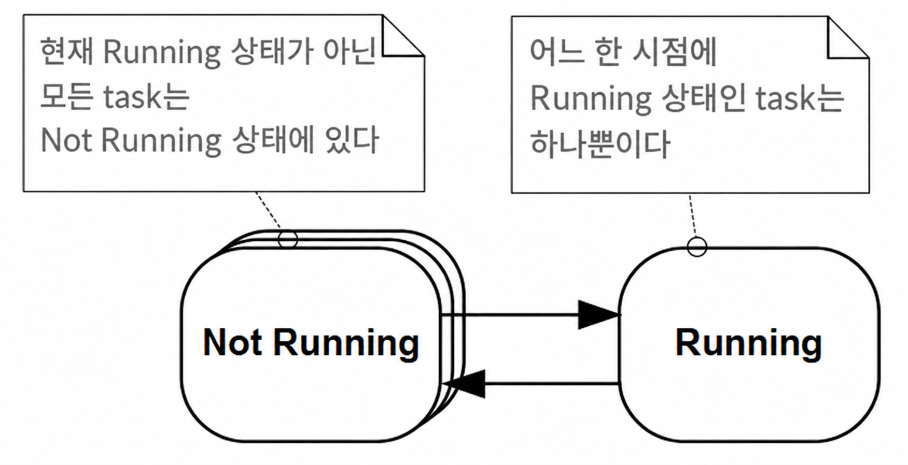

***그림 4.1*** *최상위 task 상태와 전이*

***

task가 Not Running 상태에서 Running 상태로 전환되는 것을 "스위치 인(switched in)" 또는 "스왑 인(swapped in)"되었다고 표현한다. 반대로 Running 상태에서 Not Running 상태로 전환되는 것을 "스위치 아웃(switched out)" 또는 "스왑 아웃(swapped out)"되었다고 표현한다. FreeRTOS scheduler는 task를 Running 상태로 들여보내거나 내보낼 수 있는 유일한 주체다.

<a id="44-task-creation"></a>
## 4.4 task 생성 (Task Creation)

task를 생성하는 데는 다음 6가지 API 함수를 사용할 수 있다.

- `xTaskCreate()`
- `xTaskCreateStatic()`
- `xTaskCreateRestricted()`
- `xTaskCreateRestrictedStatic()`
- `xTaskCreateAffinitySet()`
- `xTaskCreateStaticAffinitySet()`

각 task는 두 개의 RAM 블록을 필요로 한다. 하나는 Task Control Block(TCB)을 보관하는 블록이고, 다른 하나는 해당 task의 stack을 저장하는 블록이다. 함수 이름에 "Static"이 포함된 FreeRTOS API 함수들은 함수의 매개변수로 전달받은 사전 할당된 RAM 블록을 사용한다. 반대로 이름에 "Static"이 없는 API 함수들은 시스템 heap(힙)으로부터 런타임에 필요한 RAM을 동적으로 할당한다.

일부 FreeRTOS 포트는 "제한(restricted)" 모드 또는 "비특권(unprivileged)" 모드로 실행되는 task를 지원한다. 함수 이름에 "Restricted"가 포함된 FreeRTOS API 함수들은 시스템 메모리에 대한 접근 권한이 제한된 task를 생성한다. 이름에 "Restricted"가 없는 API 함수들은 전체 시스템 메모리 맵에 자유롭게 접근할 수 있는 "특권(privileged) 모드" task를 생성한다.

대칭형 다중 처리(SMP)를 지원하는 FreeRTOS 포트에서는 동일한 CPU의 여러 코어에서 서로 다른 task를 동시에 실행할 수 있다. 이러한 포트에서는 함수 이름에 "Affinity"가 포함된 함수를 사용하여 특정 task가 어느 코어에서 실행될지를 직접 지정할 수 있다.

FreeRTOS의 task 생성 API 함수들은 꽤 다양한 옵션을 제공한다. 이 책의 대다수 예제에서는 이 중 가장 단순하고 널리 쓰이는 `xTaskCreate()`를 사용한다.

<a id="441-the-xtaskcreate-api-function"></a>
### 4.4.1 xTaskCreate() API 함수 (The xTaskCreate() API Function)

코드 4.3은 `xTaskCreate()` API 함수의 원형을 보여준다. `xTaskCreateStatic()`은 task의 데이터 구조체와 stack을 보관하기 위해 미리 할당된 메모리를 가리키는 두 개의 매개변수를 추가로 갖는다. 사용되는 데이터 타입과 명명 규칙은 [2.5절 데이터 타입과 코딩 스타일 가이드](ch02.md#25-data-types-and-coding-style-guide)에 설명되어 있다.

<a name="list4.3" title="Listing 4.3 The xTaskCreate() API function prototype"></a>

```c
BaseType_t xTaskCreate( TaskFunction_t pvTaskCode,
                        const char * const pcName,
                        configSTACK_DEPTH_TYPE usStackDepth,
                        void * pvParameters,
                        UBaseType_t uxPriority,
                        TaskHandle_t * pxCreatedTask );
```
***코드 4.3*** *xTaskCreate() API 함수 원형*

**xTaskCreate() 매개변수 및 반환값:**

- `pvTaskCode`

  task는 종료되지 않는 C 함수이며, 통상 무한 루프로 구현된다. `pvTaskCode` 매개변수는 해당 task를 구현하는 함수에 대한 포인터다(실질적으로 함수의 이름).

- `pcName`

  task를 식별하기 위한 서술적 이름이다. FreeRTOS 내부에서는 이 이름을 어떠한 제어 목적으로도 사용하지 않으며, 순수하게 디버깅 보조 용도로만 포함된다. 핸들 값보다 사람이 읽을 수 있는 이름으로 task를 식별하는 편이 훨씬 직관적이기 때문이다.

  애플리케이션 정의 상수인 `configMAX_TASK_NAME_LEN`은 NULL 종료 문자를 포함하여 task 이름의 최대 길이를 정의한다. 이보다 긴 문자열을 전달하면 문자열이 잘려 저장된다.

- `usStackDepth`

  task가 사용할 stack의 크기를 지정한다. 동적으로 할당되는 메모리 대신 미리 할당된 메모리를 사용하려면 `xTaskCreate()` 대신 `xTaskCreateStatic()`을 사용한다.

  이 값은 바이트 수가 아니라 stack이 담을 수 있는 **워드(word) 수**를 나타낸다는 점에 각별히 유의해야 한다. 예를 들어 stack 너비가 32비트(4바이트)이고 `usStackDepth`가 128이라면, `xTaskCreate()`는 512바이트(128 * 4바이트)의 stack 공간을 할당한다.

  `configSTACK_DEPTH_TYPE`은 애플리케이션 작성자가 stack 크기를 보관하는 데 사용할 데이터 타입을 지정할 수 있게 해주는 매크로다. 정의되지 않은 경우 기본값은 `uint16_t`다. stack 깊이에 stack 너비를 곱한 값이 65,535(16비트 최대값)보다 크다면 `FreeRTOSConfig.h`에서 `configSTACK_DEPTH_TYPE`을 `unsigned long`이나 `size_t`로 정의해야 한다.

  최적의 stack 크기를 선택하는 실무적 방법은 [13.3절 stack overflow](ch13.md#133-stack-overflow)에서 설명한다.

- `pvParameters`

  task를 구현하는 함수는 단 하나의 `void *` 매개변수를 받는다. `pvParameters`는 해당 매개변수를 통해 task 함수로 전달될 값이다.

- `uxPriority`

  task의 우선순위를 정의한다. 0이 가장 낮은 우선순위이며, `(configMAX_PRIORITIES – 1)`이 가장 높은 우선순위다. 사용자 정의 상수인 `configMAX_PRIORITIES`에 대해서는 [4.5절](#45-task-priorities)에서 설명한다.

  만약 `(configMAX_PRIORITIES – 1)`보다 큰 `uxPriority` 값을 지정하면 자동으로 `(configMAX_PRIORITIES – 1)` 값으로 제한된다.

- `pxCreatedTask`

  생성된 task의 핸들을 저장할 위치를 가리키는 포인터다. 이 핸들은 이후 API 호출에서 task의 우선순위를 변경하거나 task를 삭제하는 등의 작업에 사용될 수 있다.

  `pxCreatedTask`는 선택적(optional) 매개변수이며, task 핸들이 필요하지 않은 경우 `NULL`로 설정할 수 있다.

- 반환값

  두 가지 가능한 반환값이 있다.

  - `pdPASS`: task가 성공적으로 생성되었음을 나타낸다.
  - `pdFAIL`: task를 생성하기에 충분한 heap 메모리가 부족함을 나타낸다. heap 메모리 관리에 대한 자세한 내용은 [3장](ch03.md#3-heap-memory-management)을 참조한다.

<a name="example4.1" title="Example 4.1 Creating tasks"></a>
---
***예제 4.1*** *task 생성*

---

다음 예제는 두 개의 단순한 task를 생성한 후 생성된 task들을 시작하는 데 필요한 단계를 보여준다. 이 task들은 단순한 빈 루프(null loop)를 사용하여 주기적인 지연을 생성하고 문자열을 주기적으로 출력한다. 두 task는 동일한 우선순위로 생성되며 출력하는 문자열만 다를 뿐 완전히 동일하다. 구현 코드는 각각 코드 4.4와 코드 4.5를 참조한다. task 내부에서 `printf()`를 사용할 때의 주의사항은 8장에서 다룬다.

<a name="list4.4" title="Listing 4.4 Implementation of the first task used in Example 4.1"></a>

```c
void vTask1( void * pvParameters )
{
    /* ulCount is declared volatile to ensure it is not optimized out. */
    volatile unsigned long ulCount;

    for( ;; )
    {
        /* Print out the name of the current task task. */
        vPrintLine( "Task 1 is running" );

        /* Delay for a period. */
        for( ulCount = 0; ulCount < mainDELAY_LOOP_COUNT; ulCount++ )
        {
            /*
             * This loop is just a very crude delay implementation. There is
             * nothing to do in here. Later examples will replace this crude
             * loop with a proper delay/sleep function.
             */
        }
    }
}
```
***코드 4.4*** *예제 4.1에서 사용된 첫 번째 task의 구현*

<a name="list4.5" title="Listing 4.5 Implementation of the second task used in Example 4.1"></a>

```c
void vTask2( void * pvParameters )
{
    /* ulCount is declared volatile to ensure it is not optimized out. */
    volatile unsigned long ulCount;

    /* As per most tasks, this task is implemented in an infinite loop. */
    for( ;; )
    {
        /* Print out the name of this task. */
        vPrintLine( "Task 2 is running" );

        /* Delay for a period. */
        for( ulCount = 0; ulCount < mainDELAY_LOOP_COUNT; ulCount++ )
        {
            /*
             * This loop is just a very crude delay implementation. There is
             * nothing to do in here. Later examples will replace this crude
             * loop with a proper delay/sleep function.
             */
        }
    }
}
```
***코드 4.5*** *예제 4.1에서 사용된 두 번째 task의 구현*

`main()` 함수는 scheduler를 시작하기 전에 task들을 생성한다. 구현 코드는 코드 4.6을 참조한다.

<a name="list4.6" title="Listing 4.6 Starting the Example 4.1 tasks"></a>

```c
int main( void )
{
    /*
     * Variables declared here may no longer exist after starting the FreeRTOS
     * scheduler. Do not attempt to access variables declared on the stack used
     * by main() from tasks.
     */

    /*
     * Create one of the two tasks. Note that a real application should check
     * the return value of the xTaskCreate() call to ensure the task was
     * created successfully.
     */
    xTaskCreate( vTask1,  /* Pointer to the function that implements the task.*/
                 "Task 1",/* Text name for the task. */
                 1000,    /* Stack depth in words. */
                 NULL,    /* This example does not use the task parameter. */
                 1,       /* This task will run at priority 1. */
                 NULL );  /* This example does not use the task handle. */

    /* Create the other task in exactly the same way and at the same priority.*/
    xTaskCreate( vTask2, "Task 2", 1000, NULL, 1, NULL );

    /* Start the scheduler so the tasks start executing. */
    vTaskStartScheduler();

    /*
     * If all is well main() will not reach here because the scheduler will now
     * be running the created tasks. If main() does reach here then there was
     * not enough heap memory to create either the idle or timer tasks
     * (described later in this book). Chapter 3 provides more information on
     * heap memory management.
     */
    for( ;; );
}
```
***코드 4.6*** *예제 4.1의 task 실행 시작*

이 예제를 실행하면 그림 4.2와 같은 출력이 생성된다.

<a name="fig4.2" title="Figure 4.2 The output produced when executing Example 4.1"></a>

***

```console
C:\Temp>rtosdemo
Task 1 is running
Task 2 is running
Task 1 is running
Task 2 is running
Task 1 is running
Task 2 is running
Task 1 is running
Task 2 is running
Task 1 is running
Task 2 is running
Task 1 is running
Task 2 is running
Task 1 is running
Task 2 is running
```
***그림 4.2*** *예제 4.1 실행 시 생성되는 출력[^4]*

***

[^4]: 이 스크린샷은 다음 task가 실행되기 전에 각 task가 정확히 한 번씩 메시지를 출력하는 모습을 보여준다. 이는 FreeRTOS Windows 시뮬레이터를 사용했기 때문에 나타나는 인위적인 결과다. Windows 시뮬레이터는 엄밀한 실시간 환경이 아니다. 또한 Windows 콘솔에 출력하는 작업은 상대적으로 오랜 시간이 걸리며 일련의 Windows 시스템 호출을 수반한다. 빠르고 비차단형(non-blocking)인 출력 함수를 갖춘 실제 임베디드 타깃 하드웨어에서 동일한 코드를 실행하면, 다른 task로 스위치 아웃되기 전에 각 task가 문자열을 여러 번 연속해서 출력할 수도 있다.

그림 4.2에서는 두 task가 동시에 실행되는 것처럼 보인다. 그러나 두 task는 동일한 단일 프로세서 코어에서 실행되므로 물리적으로 동시에 실행될 수는 없다. 실제로는 두 task가 매우 빠른 속도로 Running 상태에 진입했다가 빠져나오는 과정을 반복하고 있는 것이다. 두 task는 동일한 우선순위로 실행되므로 동일한 프로세서 코어의 시간을 나누어 쓴다. 그림 4.3은 실제 실행 패턴을 보여준다.

그림 4.3 하단의 화살표는 시간 t1 이후로 시간이 흘러가는 과정을 나타낸다. 색상 선은 각 시점에 어느 task가 실행 중인지를 나타낸다(예: 시간 t1과 t2 사이에는 Task 1이 실행 중이다).

특정 시점에 Running 상태로 존재할 수 있는 task는 오직 하나뿐이다. 따라서 한 task가 Running 상태로 진입(스위치 인)하면 다른 task는 Not Running 상태로 진입(스위치 아웃)한다.

<a name="fig4.3" title="Figure 4.3 The actual execution pattern of the two Example 4.1 tasks"></a>

***
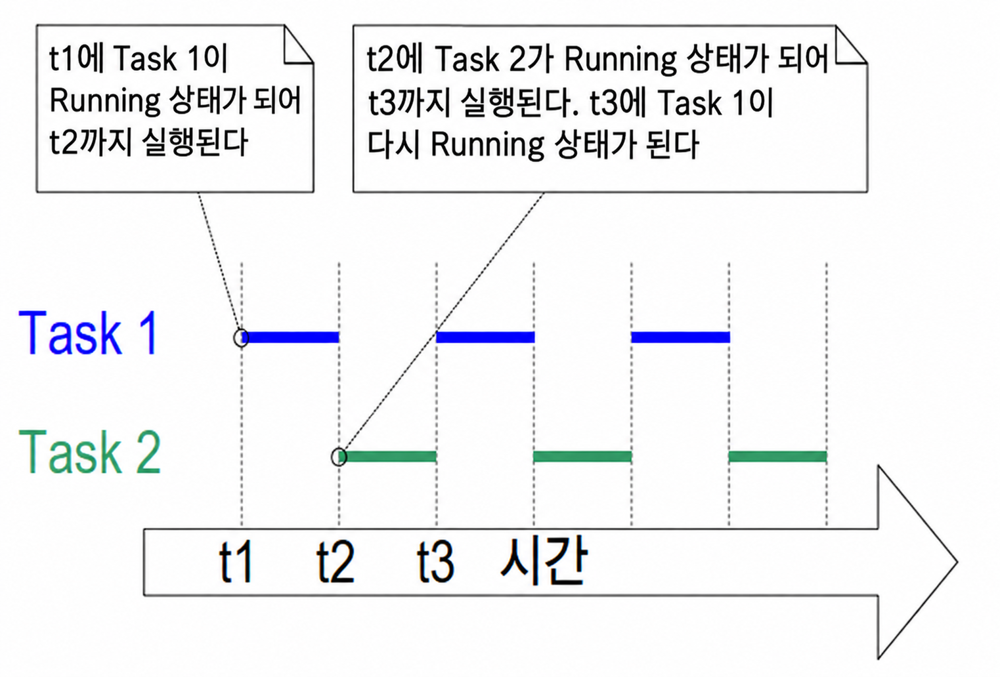

***그림 4.3*** *예제 4.1의 두 task가 보이는 실제 실행 패턴*

***

예제 4.1에서는 scheduler를 시작하기 전에 `main()` 함수 내부에서 두 task를 모두 생성했다. 하지만 특정 task 내부에서 또 다른 task를 생성하는 것도 가능하다. 예를 들어 코드 4.7에 나와 있는 것처럼 Task 1 내부에서 Task 2를 생성할 수도 있다.

<a name="list4.7" title="Listing 4.7 Creating a task from within another task after the scheduler has started"></a>

```c
void vTask1( void * pvParameters )
{
    const char *pcTaskName = "Task 1 is running\r\n";
    volatile unsigned long ul; /* volatile to ensure ul is not optimized away. */

    /*
     * If this task code is executing then the scheduler must already have
     * been started. Create the other task before entering the infinite loop.
     */
    xTaskCreate( vTask2, "Task 2", 1000, NULL, 1, NULL );

    for( ;; )
    {
        /* Print out the name of this task. */
        vPrintLine( pcTaskName );

        /* Delay for a period. */
        for( ul = 0; ul < mainDELAY_LOOP_COUNT; ul++ )
        {
            /*
             * This loop is just a very crude delay implementation. There is
             * nothing to do in here. Later examples will replace this crude
             * loop with a proper delay/sleep function.
             */
        }
    }
}
```
***코드 4.7*** *scheduler가 시작된 후 다른 task 내부에서 task 생성하기*

<a name="example4.2" title="Example 4.2 Using the task parameter"></a>
---
***예제 4.2*** *task 매개변수의 활용*

---

예제 4.1에서 생성한 두 task는 거의 동일하며, 유일한 차이점은 출력하는 문자열뿐이다. 단일 task 구현의 두 인스턴스를 생성하고 task 매개변수를 사용하여 각 인스턴스에 서로 다른 문자열을 전달하면 코드 중복을 제거할 수 있다.

예제 4.2는 예제 4.1의 두 task 함수를 코드 4.8에 표시된 `vTaskFunction()`이라는 단일 task 함수로 대체한다. task가 출력할 문자열을 얻기 위해 task 매개변수를 `char *`로 캐스팅하는 방식에 주목하기 바란다.

<a name="list4.8" title="Listing 4.8 The single task function used to create two tasks in Example 4.2"></a>

```c
void vTaskFunction( void * pvParameters )
{

    char *pcTaskName;
    volatile unsigned long ul; /* volatile to ensure ul is not optimized away. */

    /*
     * The string to print out is passed in via the parameter. Cast this to a
     * character pointer.
     */
    pcTaskName = ( char * ) pvParameters;

    /* As per most tasks, this task is implemented in an infinite loop. */
    for( ;; )
    {
        /* Print out the name of this task. */
        vPrintLine( pcTaskName );

        /* Delay for a period. */
        for( ul = 0; ul < mainDELAY_LOOP_COUNT; ul++ )
        {
            /*
             * This loop is just a very crude delay implementation. There is
             * nothing to do in here. Later exercises will replace this crude
             * loop with a proper delay/sleep function.
             */
        }
    }
}
```
***코드 4.8*** *예제 4.2에서 두 task를 생성하는 데 사용된 단일 task 함수*

코드 4.9는 `vTaskFunction()`으로 구현된 task의 인스턴스 두 개를 생성하며, task 매개변수를 사용하여 각 인스턴스에 서로 다른 문자열을 전달한다. 두 task는 FreeRTOS scheduler의 제어 하에 각자의 독립된 stack을 소유하고 `pcTaskName`과 `ul` 변수의 독립된 복사본을 유지하면서 독립적으로 실행된다.

<a name="list4.9" title="Listing 4.9 The main() function for Example 2"></a>

```c
/*
 * Define the strings that will be passed in as the task parameters. These are
 * defined const and not on the stack used by main() to ensure they remain
 * valid when the tasks are executing.
 */
static const char * pcTextForTask1 = "Task 1 is running";
static const char * pcTextForTask2 = "Task 2 is running";

int main( void )
{
    /*
     * Variables declared here may no longer exist after starting the FreeRTOS
     * scheduler. Do not attempt to access variables declared on the stack used
     * by main() from tasks.
     */

    /* Create one of the two tasks. */
    xTaskCreate( vTaskFunction,             /* Pointer to the function that
                                               implements the task. */
                 "Task 1",                  /* Text name for the task. This is to
                                               facilitate debugging only. */
                 1000,                      /* Stack depth - small microcontrollers
                                               will use much less stack than this.*/
                 ( void * ) pcTextForTask1, /* Pass the text to be printed into
                                               the task using the task parameter. */
                 1,                         /* This task will run at priority 1. */
                 NULL );                    /* The task handle is not used in
                                               this example. */

    /*
     * Create the other task in exactly the same way. Note this time that
     * multiple tasks are being created from the SAME task implementation
     * (vTaskFunction). Only the value passed in the parameter is different.
     * Two instances of the same task definition are being created.
     */
    xTaskCreate( vTaskFunction,
                 "Task 2",
                 1000,
                 ( void * ) pcTextForTask2,
                 1,
                 NULL );

    /* Start the scheduler so the tasks start executing. */
    vTaskStartScheduler();

    /*
     * If all is well main() will not reach here because the scheduler will
     * now be running the created tasks. If main() does reach here then there
     * was not enough heap memory to create either the idle or timer tasks
     * (described later in this book). Chapter 3 provides more information on
     * heap memory management.
     */
    for( ;; )
    {
    }
}
```
***코드 4.9*** *예제 4.2의 main() 함수*

예제 4.2의 실행 결과는 그림 4.2에 표시된 예제 4.1의 출력 결과와 완전히 동일하다.

> [옮긴이 주] 원문 캡션의 “Example 2”는 문맥에 따라 “예제 4.2”로 표기했다. [원문 대조 사항 N04](SOURCE_NOTES.md#n04).

<a id="45-task-priorities"></a>
## 4.5 task 우선순위 (Task Priorities)

FreeRTOS scheduler는 실행 가능한 task 중 가장 높은 우선순위를 가진 task가 항상 Running 상태로 진입하도록 보장한다. 동일한 우선순위를 가진 task들은 차례대로 교대하며 Running 상태로 전환되고 빠져나온다.

task 생성 API 함수의 `uxPriority` 매개변수는 해당 task의 초기 우선순위를 지정한다. task 생성 후에는 `vTaskPrioritySet()` API 함수를 사용하여 우선순위를 동적으로 변경할 수 있다.

애플리케이션 정의 컴파일 타임 상수인 `configMAX_PRIORITIES`는 사용 가능한 최대 우선순위 개수를 설정한다. 낮은 숫자 값은 낮은 우선순위를 의미하며, 우선순위 0이 가능한 가장 낮은 우선순위다. 따라서 유효한 우선순위 범위는 0부터 `(configMAX_PRIORITIES – 1)`까지다. 동일한 우선순위를 여러 task가 공유할 수 있으며 개수 제한은 없다.

FreeRTOS scheduler는 Running 상태 task를 선택하는 알고리즘에 대해 두 가지 구현 방식을 제공하며, `configMAX_PRIORITIES`의 최대 허용값은 사용되는 구현 방식에 따라 달라진다.

<a id="451-generic-scheduler"></a>
### 4.5.1 범용 스케줄러 (Generic Scheduler)

범용 scheduler는 순수 C로 작성되었으며 모든 FreeRTOS 아키텍처 포트에서 사용할 수 있다. `configMAX_PRIORITIES` 값에 상한 제한을 두지 않는다. 일반적으로 우선순위 개수가 많아질수록 더 많은 RAM이 소비되고 최악 조건 실행 시간(worst-case execution time)이 길어지므로, `configMAX_PRIORITIES` 값을 실무적으로 필요한 최소한으로 유지하는 것이 바람직하다.

<a id="452-architecture-optimized-scheduler"></a>
### 4.5.2 아키텍처 최적화 스케줄러 (Architecture-Optimized Scheduler)

아키텍처 최적화 구현은 특정 프로세서 아키텍처 전용 어셈블리 코드로 작성되었으며, 범용 C 구현보다 성능이 뛰어나고 모든 `configMAX_PRIORITIES` 값에 대해 최악 조건 실행 시간이 항상 일정하다.

아키텍처 최적화 구현은 32비트 아키텍처에서 최대 32개, 64비트 아키텍처에서 최대 64개의 `configMAX_PRIORITIES` 상한을 갖는다. 범용 방식과 마찬가지로 값이 클수록 RAM 소비가 늘어나므로 실질적으로 필요한 최소값을 유지하는 것이 좋다.

`FreeRTOSConfig.h`에서 `configUSE_PORT_OPTIMISED_TASK_SELECTION`을 1로 설정하면 아키텍처 최적화 구현이 사용되고, 0으로 설정하면 범용 구현이 사용된다. 모든 FreeRTOS 포트가 아키텍처 최적화 구현을 지원하는 것은 아니다. 지원하는 포트에서는 정의되지 않은 경우 기본값이 1이며, 지원하지 않는 포트에서는 기본값이 0이다.

> [옮긴이 주] 원문의 설정 이름은 동봉 커널의 실제 매크로 이름에 맞춰 `configUSE_PORT_OPTIMISED_TASK_SELECTION`으로 표기했다. [원문 대조 사항 N11](SOURCE_NOTES.md#n11).

<a id="46-time-measurement-and-the-tick-interrupt"></a>
## 4.6 시간 측정과 tick 인터럽트 (Time Measurement and the Tick Interrupt)

[4.12절 스케줄링 알고리즘](#412-scheduling-algorithms)에서는 '시분할(time slicing)'이라는 선택적 기능을 설명한다. 앞서 제시된 예제들에서도 시분할이 사용되었으며, 출력 결과에서 관찰된 동작이 바로 시분할의 결과다. 예제에서는 두 task가 동일한 우선순위로 생성되었고 두 task 모두 항상 실행 가능한 상태였다. 따라서 각 task는 하나의 '타임 슬라이스(time slice)' 동안 실행되어 타임 슬라이스 시작 시점에 Running 상태로 진입하고 끝 시점에 Running 상태에서 벗어났다. 그림 4.3에서 t1과 t2 사이의 시간이 정확히 하나의 타임 슬라이스에 해당한다.

scheduler는 각 타임 슬라이스의 끝에서 실행되어 다음에 실행할 task를 선택한다[^5]. 이를 위해 'tick(틱) 인터럽트(tick interrupt(tick 인터럽트))'라는 주기적 인터럽트가 사용된다. `configTICK_RATE_HZ` 컴파일 타임 구성 상수는 tick 인터럽트의 주파수를 설정하며, 따라서 각 타임 슬라이스의 길이도 결정한다. 예를 들어 `configTICK_RATE_HZ`를 100(Hz)으로 설정하면 각 타임 슬라이스는 10밀리초 동안 지속된다. 두 tick 인터럽트 사이의 시간을 'tick period(tick 주기)'라고 부르므로, 1 타임 슬라이스는 곧 1 tick period와 같다.

[^5]: scheduler가 실행할 새 task를 선택하는 지점이 오직 타임 슬라이스의 끝뿐만이 아니라는 점을 이해하는 것이 중요하다. 이 책 전반에서 보여주듯이, scheduler는 현재 실행 중인 task가 Blocked 상태로 진입한 직후나, 인터럽트로 인해 더 높은 우선순위의 task가 Ready 상태로 이동한 직후에도 즉시 새 task를 선택하여 실행한다.

그림 4.4는 그림 4.3을 확장하여 scheduler의 실행 시점도 함께 보여준다. 그림 4.4에서 맨 위 선은 scheduler가 실행되는 시점을 나타내며, 얇은 화살표는 task에서 tick 인터럽트로, 그리고 다시 tick 인터럽트에서 다른 task로 이어지는 실행 순서를 나타낸다.

`configTICK_RATE_HZ`의 최적값은 애플리케이션에 따라 다르지만 보통 100이 전형적인 값이다.

<a name="fig4.4" title="Figure 4.4 The execution sequence expanded to show the tick interrupt executing"></a>

***
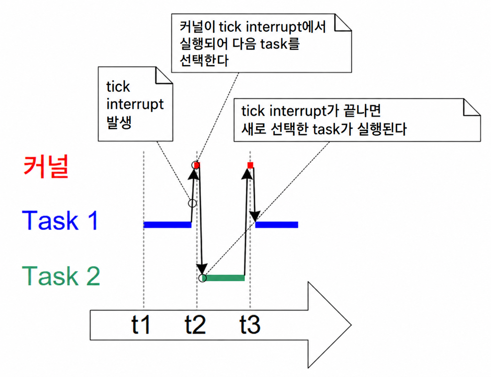

***그림 4.4*** *tick 인터럽트 실행 과정을 보여주도록 확장된 실행 순서*

***

FreeRTOS API 호출 시 시간은 tick period의 배수로 지정하며, 이를 흔히 단순히 'tick'이라고 부른다. `pdMS_TO_TICKS()` 매크로는 밀리초(ms) 단위로 지정된 시간을 tick 단위 시간으로 변환한다. 사용 가능한 시간 해상도는 정의된 tick 주파수에 따라 달라지며, tick 주파수가 1kHz를 초과하는 경우(`configTICK_RATE_HZ`가 1000보다 큰 경우)에는 `pdMS_TO_TICKS()`를 사용할 수 없다. 코드 4.10은 `pdMS_TO_TICKS()`를 사용하여 200밀리초로 지정된 시간을 이에 상응하는 tick 수로 변환하는 방법을 보여준다.

<a name="list4.10" title="Listing 4.10 Using the pdMS_TO_TICKS() macro to convert 200 milliseconds..."></a>

```c
/*
 * pdMS_TO_TICKS() takes a time in milliseconds as its only parameter,
 * and evaluates to the equivalent time in tick periods. This example shows
 * xTimeInTicks being set to the number of tick periods that are equivalent
 * to 200 milliseconds.
 */
TickType_t xTimeInTicks = pdMS_TO_TICKS( 200 );
```
***코드 4.10*** *pdMS_TO_TICKS() 매크로를 사용하여 200밀리초를 tick 기간에 상응하는 시간으로 변환하기*

시간을 tick으로 직접 지정하지 않고 `pdMS_TO_TICKS()`를 사용하여 밀리초 단위로 지정하면, 향후 tick 주파수가 변경되더라도 애플리케이션 내부에서 지정한 실제 시간 간격이 변경되지 않도록 보장할 수 있다.

'tick count(누적 tick 값)'는 tick count가 오버플로되지 않았다고 가정할 때 scheduler가 시작된 이래 발생한 tick 인터럽트의 총 횟수다. FreeRTOS가 시간 일관성을 내부적으로 관리하므로 사용자 애플리케이션은 지연 시간을 지정할 때 오버플로를 별도로 고려할 필요가 없다.

[4.12절 스케줄링 알고리즘](#412-scheduling-algorithms)에서는 scheduler가 실행할 새 task를 선택하는 시점과 tick 인터럽트가 실행되는 시점에 영향을 미치는 구성 상수들을 자세히 설명한다.

<a name="example4.3" title="Example 4.3 Experimenting with priorities"></a>
---
***예제 4.3*** *우선순위 실험*

---

scheduler는 항상 실행 가능한 task 중 가장 높은 우선순위의 task를 선택하여 Running 상태로 전환한다. 지금까지의 예제에서는 동일한 우선순위로 두 task를 생성했기 때문에 두 task가 차례대로 Running 상태에 진입하고 빠져나왔다. 이 예제에서는 task들이 서로 다른 우선순위를 가질 때 어떤 일이 발생하는지 살펴본다. 코드 4.11은 첫 번째 task는 우선순위 1로, 두 번째 task는 우선순위 2로 생성하는 코드를 보여준다. 두 task를 구현하는 단일 함수 자체는 변경되지 않았으며, 여전히 빈 루프를 사용하여 지연을 생성하고 주기적으로 문자열을 출력한다.

<a name="list4.11" title="Listing 4.11. Creating two tasks at different priorities"></a>

```c
/*
 * Define the strings that will be passed in as the task parameters.
 * These are defined const and not on the stack to ensure they remain valid
 * when the tasks are executing.
 */
static const char * pcTextForTask1 = "Task 1 is running";
static const char * pcTextForTask2 = "Task 2 is running";

int main( void )
{
    /* Create the first task with a priority of 1. */
    xTaskCreate( vTaskFunction,             /* Task Function    */
                 "Task 1",                  /* Task Name        */
                 1000,                      /* Task Stack Depth */
                 ( void * ) pcTextForTask1, /* Task Parameter   */
                 1,                         /* Task Priority    */
                 NULL );

    /* Create the second task at a higher priority of 2. */
    xTaskCreate( vTaskFunction,             /* Task Function    */
                 "Task 2",                  /* Task Name        */
                 1000,                      /* Task Stack Depth */
                 ( void * ) pcTextForTask2, /* Task Parameter   */
                 2,                         /* Task Priority    */
                 NULL );

    /* Start the scheduler so the tasks start executing. */
    vTaskStartScheduler();

    /* Will not reach here. */
    return 0;
}
```
***코드 4.11*** *서로 다른 우선순위로 두 task 생성하기*

그림 4.5는 예제 4.3에 의해 생성된 출력을 보여준다.

scheduler는 항상 실행 가능한 가장 높은 우선순위의 task를 선택한다. Task 2는 Task 1보다 높은 우선순위를 가지며 항상 실행 가능하므로, scheduler는 언제나 Task 2를 선택하고 Task 1은 전혀 실행되지 못한다. 이 상황에서 Task 1은 Task 2에 의해 처리 시간을 박탈당하는 기아 상태(starved)에 놓였다고 표현한다. Task 1은 Running 상태에 단 한 번도 진입하지 못하므로 자신의 문자열을 출력할 수 없다.

<a name="fig4.5" title="Figure 4.5 Running both tasks at different priorities"></a>

***
```console
C:\Temp>rtosdemo
Task 2 is running
Task 2 is running
Task 2 is running
Task 2 is running
Task 2 is running
Task 2 is running
Task 2 is running
Task 2 is running
Task 2 is running
Task 2 is running
Task 2 is running
Task 2 is running
Task 2 is running
Task 2 is running
Task 2 is running
```
***그림 4.5*** *서로 다른 우선순위로 두 task를 실행한 결과*

***

Task 2는 무언가를 기다릴 필요가 전혀 없이 빈 루프를 돌거나 터미널에 출력하는 작업만 계속 반복하므로 항상 실행 가능한 상태를 유지한다.

<a name="fig4.6" title="Figure 4.6 The execution pattern when one task has a higher priority than the..."></a>

***
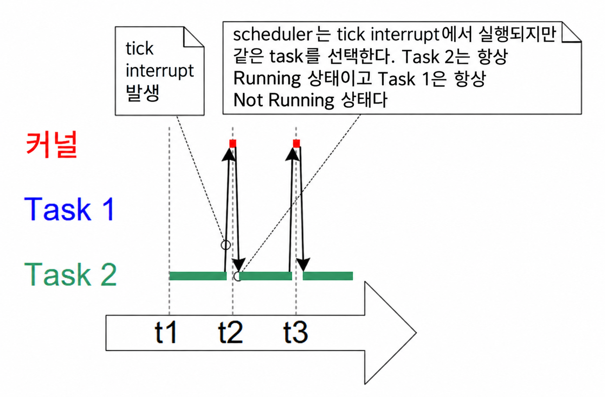

***그림 4.6*** *예제 4.3에서 한 task가 다른 task보다 높은 우선순위를 가질 때의 실행 패턴*

***

<a id="47-expanding-the-not-running-state"></a>
## 4.7 Not Running 상태의 세분화 (Expanding the *Not Running* State)

지금까지 생성한 task들은 항상 수행할 작업이 있었고 무언가를 대기할 필요가 없었기 때문에, 언제든지 Running 상태로 진입할 수 있었다. 이러한 '연속 처리(continuous processing)' task들은 가장 낮은 우선순위(0)로만 생성할 수 있다는 한계가 있다. 만약 다른 우선순위로 실행된다면 더 낮은 우선순위를 가진 모든 task가 전혀 실행되지 못하도록 가로막기 때문이다.

이러한 task들을 실용적으로 만들기 위해서는 이벤트 기반(event-driven)으로 다시 작성해야 한다. 이벤트 기반 task는 이벤트가 자신을 깨운 후에만 수행할 작업(처리)이 생기며, 그전까지는 Running 상태로 진입할 수 없다. scheduler는 항상 실행 가능한 가장 높은 우선순위의 task를 선택한다. 높은 우선순위의 task가 이벤트를 기다리느라 선택될 수 없는 경우, scheduler는 그 대신 실행 가능한 더 낮은 우선순위의 task를 선택하여 실행한다. 따라서 이벤트 기반 구조로 task를 작성하면, 가장 높은 우선순위의 task가 하위 우선순위 task들의 처리 시간을 완전히 고갈시키지 않으면서도 서로 다른 우선순위를 가진 task들을 공존시킬 수 있다.

<a id="471-the-blocked-state"></a>
### 4.7.1 Blocked 상태 (The *Blocked* State)

이벤트를 기다리는 task를 **Blocked 상태(대기 상태)**에 있다고 하며, 이는 Not Running 상태의 하위 상태다.

task는 두 가지 서로 다른 유형의 이벤트를 기다리기 위해 Blocked 상태로 진입할 수 있다.

1. **시간 관련(temporal) 이벤트**: 지연 시간이 만료되거나 절대적인 특정 시각에 도달했을 때 발생한다. 예를 들어 task는 10밀리초가 경과하기를 기다리기 위해 Blocked 상태로 진입할 수 있다.
2. **동기화(synchronization) 이벤트**: 다른 task나 인터럽트로부터 비롯되는 이벤트다. 예를 들어 task는 queue(큐)에 데이터가 도착하기를 기다리기 위해 Blocked 상태로 진입할 수 있다. 동기화 이벤트는 광범위한 이벤트 유형을 포괄한다.

FreeRTOS의 queue, binary semaphore(이진 세마포어), counting semaphore(계수 세마포어), mutex(뮤텍스), recursive mutex(재귀 뮤텍스), event group(이벤트 그룹), stream buffer, message buffer, 그리고 task notification(태스크 알림)은 모두 동기화 이벤트를 생성할 수 있다. 이 기능들의 대부분은 후반부 장들에서 다룬다.

task는 타임아웃(대기 제한 시간)을 지정하여 동기화 이벤트를 대기할 수도 있으며, 이를 통해 두 가지 유형의 이벤트를 동시에 대기할 수 있다. 예를 들어 task가 queue에 데이터가 도착하기를 최대 10밀리초 동안 대기하도록 지정할 수 있다. 10밀리초 이내에 데이터가 도착하거나, 데이터가 도착하지 않은 채 10밀리초가 경과하면 task는 Blocked 상태에서 벗어난다.

<a id="472-the-suspended-state"></a>
### 4.7.2 Suspended 상태 (The *Suspended* State)

**Suspended 상태(일시 중지 상태)** 역시 Not Running의 하위 상태다. Suspended 상태에 있는 task는 scheduler의 스케줄링 대상에서 완전히 제외된다. Suspended 상태로 진입하는 유일한 방법은 `vTaskSuspend()` API 함수를 호출하는 것이며, 벗어나는 유일한 방법은 `vTaskResume()` 또는 `xTaskResumeFromISR()` API 함수를 호출하는 것이다. 대부분의 애플리케이션에서는 Suspended 상태를 사용하지 않는다.

<a id="473-the-ready-state"></a>
### 4.7.3 Ready 상태 (The Ready State)

Not Running 상태에 있으면서 Blocked 상태나 Suspended 상태가 아닌 task를 **Ready 상태(실행 가능 상태)**에 있다고 한다. 이들은 즉시 실행할 수 있는 준비가 되어 있지만, 현재 프로세서에서 실제로 실행되고 있는(Running 상태인) 것은 아니다.

<a id="474-completing-the-state-transition-diagram"></a>
### 4.7.4 상태 전이 다이어그램의 완성 (Completing the State Transition Diagram)

그림 4.7은 단순화되었던 상태 다이어그램을 확장하여 이 절에서 설명한 Not Running의 모든 하위 상태를 포함한 전체 상태 머신을 보여준다. 지금까지의 예제에서 생성된 task들은 Blocked 상태나 Suspended 상태를 사용하지 않았으며, 그림 4.7의 굵은 선으로 표시된 것처럼 오직 Ready 상태와 Running 상태 사이만을 오갔다.

<a name="fig4.7" title="Figure 4.7 Full task state machine"></a>

***
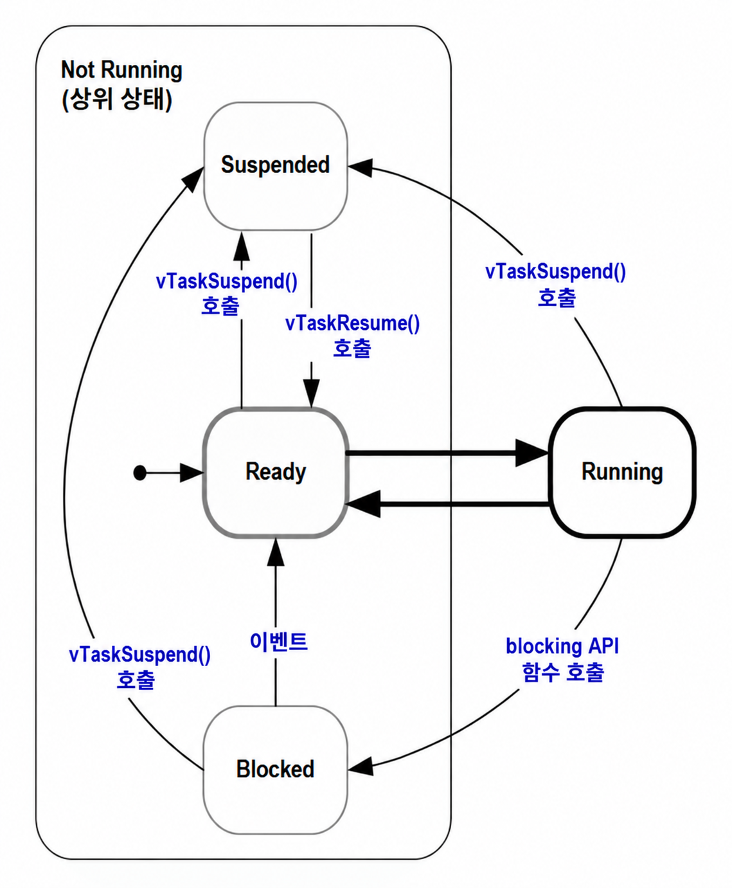

***그림 4.7*** *전체 task 상태 머신*

***

<a name="example4.4" title="Example 4.4 Using the Blocked state to create a delay"></a>
---
***예제 4.4*** *Blocked 상태를 사용한 지연 생성*

---

지금까지의 예제에서 생성된 모든 task는 '주기적(periodic)'이었다. 즉, 일정 시간 동안 지연한 후 문자열을 출력하고, 다시 지연하는 동작을 반복했다. 지금까지는 빈 루프를 사용하여 지연을 매우 조잡하게 생성했으며, task가 루프 카운터를 증가시키며 고정된 값에 도달할 때까지 폴링했다. 예제 4.3은 이 방식의 치명적인 단점을 명확히 보여주었다. 더 높은 우선순위의 task가 빈 루프를 실행하는 동안 내내 Running 상태를 유지하면서, 더 낮은 우선순위의 task에게 돌아갈 처리 시간을 완전히 고갈시켜 버렸기 때문이다.

어떠한 형태이든 폴링 방식에는 여러 단점이 따르며, 그중 가장 큰 문제는 비효율성이다. 폴링을 수행하는 동안 task는 실질적으로 할 일이 아무것도 없으면서도 프로세서 시간을 최대한 소비하여 CPU 사이클을 낭비한다. 예제 4.4는 폴링 빈 루프를 `vTaskDelay()` API 함수 호출로 대체하여 이 문제를 바로잡는다. 함수 원형은 코드 4.12에 나와 있으며, 새로운 task 정의는 코드 4.13에 나와 있다. `vTaskDelay()` API 함수는 `FreeRTOSConfig.h`에서 `INCLUDE_vTaskDelay`가 1로 설정되어 있을 때만 사용할 수 있다.

`vTaskDelay()`는 호출한 task를 고정된 수의 tick 인터럽트 동안 Blocked 상태로 전환시킨다. task는 Blocked 상태에 있는 동안 프로세서 시간을 전혀 소비하지 않으므로, 실제로 수행할 작업이 있을 때만 프로세서 시간을 사용하게 된다.

<a name="list4.12" title="Listing 4.12 The vTaskDelay() API function prototype"></a>

```c
void vTaskDelay( TickType_t xTicksToDelay );
```
***코드 4.12*** *vTaskDelay() API 함수 원형*

**vTaskDelay 매개변수:**

- `xTicksToDelay`

  호출한 task가 다시 Ready 상태로 전환되기 전까지 Blocked 상태에 머무를 tick 인터럽트의 횟수다.

  예를 들어 tick count가 10,000일 때 task가 `vTaskDelay( 100 )`을 호출하면, task는 즉시 Blocked 상태로 진입하여 tick count가 10,100에 도달할 때까지 Blocked 상태를 유지한다.

  `pdMS_TO_TICKS()` 매크로를 사용하여 밀리초 단위 시간을 tick 단위 시간으로 변환할 수 있다. 예를 들어 `vTaskDelay( pdMS_TO_TICKS( 100 ) )`을 호출하면 호출한 task는 100밀리초 동안 Blocked 상태를 유지한다.

<a name="list4.13" title="Listing 4.13 The source code for the example task after replacing the null loop delay with a call..."></a>

```c
void vTaskFunction( void * pvParameters )
{
    char * pcTaskName;
    const TickType_t xDelay250ms = pdMS_TO_TICKS( 250 );

    /*
     * The string to print out is passed in via the parameter. Cast this to a
     * character pointer.
     */
    pcTaskName = ( char * ) pvParameters;

    /* As per most tasks, this task is implemented in an infinite loop. */
    for( ;; )
    {
        /* Print out the name of this task. */
        vPrintLine( pcTaskName );

        /*
         * Delay for a period. This time a call to vTaskDelay() is used which
         * places the task into the Blocked state until the delay period has
         * expired. The parameter takes a time specified in 'ticks', and the
         * pdMS_TO_TICKS() macro is used (where the xDelay250ms constant is
         * declared) to convert 250 milliseconds into an equivalent time in
         * ticks.
         */
        vTaskDelay( xDelay250ms );
    }
}
```
***코드 4.13*** *빈 루프 지연을 vTaskDelay() 호출로 대체한 예제 task 소스 코드*

두 task가 여전히 서로 다른 우선순위로 생성되었음에도 불구하고 이제는 두 task가 모두 정상적으로 실행된다. 그림 4.8에 표시된 예제 4.4의 출력 결과가 이러한 기대 동작을 확인해 준다.

<a name="fig4.8" title="Figure 4.8 The output produced when Example 4.4 is executed"></a>

***

```console
C:\Temp>rtosdemo
Task 2 is running
Task 1 is running
Task 2 is running
Task 1 is running
Task 2 is running
Task 1 is running
Task 2 is running
Task 1 is running
Task 2 is running
Task 1 is running
Task 2 is running
Task 1 is running
Task 2 is running
Task 1 is running
Task 2 is running
Task 1 is running
```
***그림 4.8*** *예제 4.4 실행 시 생성되는 출력*

***

그림 4.9의 실행 순서는 서로 다른 우선순위로 생성되었음에도 불구하고 두 task가 모두 실행될 수 있는 이유를 설명한다. 설명의 단순화를 위해 scheduler 자체의 실행은 생략되었다.

idle task는 scheduler가 시작될 때 자동으로 생성되어, 항상 실행 가능한 task가 최소 하나(Ready 상태인 task가 최소 하나) 존재하도록 보장한다. idle task에 대한 자세한 내용은 [4.8절 Idle Task와 Idle Task Hook](#48-the-idle-task-and-the-idle-task-hook)에서 다룬다.

<a name="fig4.9" title="Figure 4.9 The execution sequence when the tasks use vTaskDelay() in place of the null loop"></a>

***
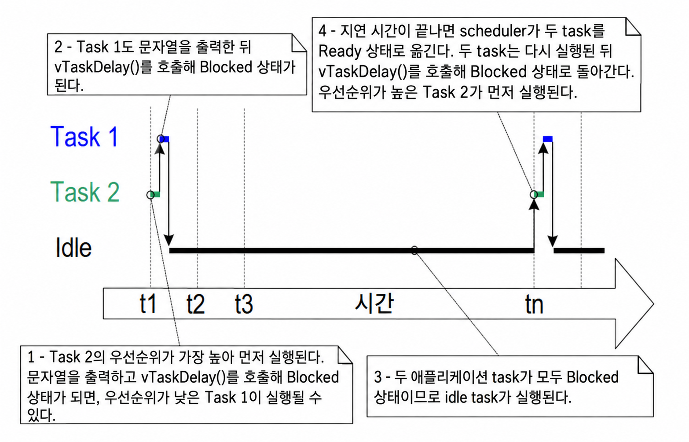

***그림 4.9*** *task들이 빈 루프 대신 vTaskDelay()를 사용할 때의 실행 순서*

***

두 task의 구현 방식만 바뀌었을 뿐 기능 자체는 바뀌지 않았다. 그림 4.9와 그림 4.4를 비교해보면 동일한 기능이 훨씬 더 효율적인 방식으로 달성되고 있음을 명확히 확인할 수 있다.

그림 4.4는 task들이 지연을 생성하기 위해 빈 루프를 사용하여 항상 실행 가능한 상태였을 때의 실행 패턴을 보여준다. 그 결과 두 task는 둘이 합쳐 사용 가능한 프로세서 시간의 100%를 전부 소진했다. 반면 그림 4.9는 task들이 지연 시간 전체 동안 Blocked 상태로 진입했을 때의 실행 패턴을 보여준다. task들은 실제로 수행해야 할 작업(이 경우 단순 메시지 출력)이 있을 때만 프로세서 시간을 사용하므로, 사용 가능한 처리 시간 중 극히 일부분만 소비한다.

그림 4.9의 시나리오에서 각 task는 Blocked 상태에서 벗어날 때마다 tick period의 일부분 동안만 실행된 후 다시 Blocked 상태로 들어간다. 대부분의 시간에는 실행 가능한 애플리케이션 task(Ready 상태인 애플리케이션 task)가 없으므로 Running 상태로 선택될 수 있는 애플리케이션 task도 없다. 이러한 유휴 시간 동안 idle task가 실행된다. idle task에 할당되는 처리 시간의 양은 시스템의 여유 처리 용량을 나타내는 척도가 된다. RTOS를 사용하면 애플리케이션을 완전한 이벤트 기반으로 동작하게 함으로써 시스템의 여유 처리 용량을 크게 늘릴 수 있다.

그림 4.10의 굵은 선은 예제 4.4의 task들이 수행한 전이를 보여주며, 각 task가 이제 Ready 상태로 돌아오기 전에 Blocked 상태를 거쳐 전환됨을 나타낸다.

<a name="fig4.10" title="Figure 4.10 Bold lines indicate the state transitions performed by the tasks..."></a>

***
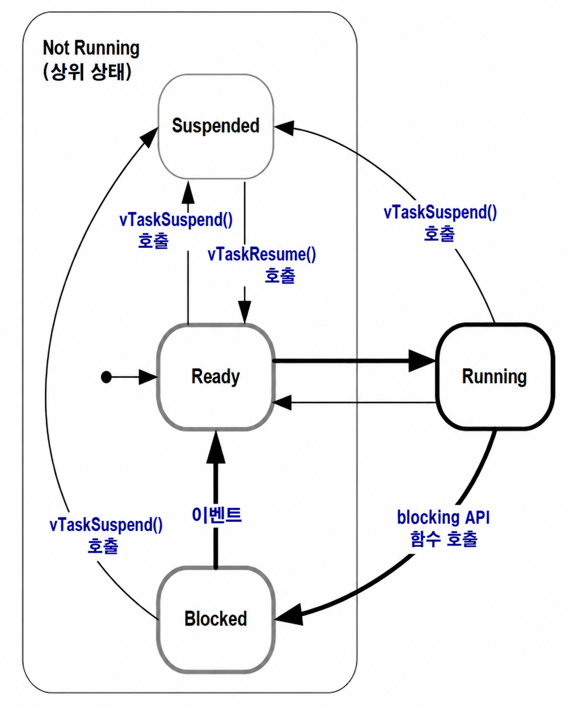

***그림 4.10*** *예제 4.4의 task들이 수행하는 상태 전이를 나타내는 굵은 선*

***

<a id="475-the-vtaskdelayuntil-api-function"></a>
### 4.7.5 vTaskDelayUntil() API 함수 (The vTaskDelayUntil() API Function)

`vTaskDelayUntil()`은 `vTaskDelay()`와 유사하다. 방금 살펴본 바와 같이, `vTaskDelay()`의 매개변수는 task가 `vTaskDelay()`를 호출한 시점부터 해당 task가 다시 Blocked 상태에서 벗어날 때까지 경과해야 하는 tick 인터럽트의 횟수를 지정한다. task가 Blocked 상태에 머무는 시간의 길이는 `vTaskDelay()` 매개변수에 의해 지정되지만, task가 Blocked 상태를 떠나는 시점은 `vTaskDelay()`가 **호출된 시점에 대한 상대적인 시간**이다.

반면 `vTaskDelayUntil()`의 매개변수는 호출한 task가 Blocked 상태에서 Ready 상태로 이동해야 하는 **정확한 절대 tick count 값**을 지정한다. `vTaskDelayUntil()`은 고정된 실행 주기(고정된 주파수로 task가 주기적으로 실행되어야 하는 경우)가 요구될 때 사용하는 API 함수다. task가 대기에서 깨어나는 시점이 함수가 호출된 시점에 대한 상대적 시간이 아니라 절대적인 기준 시각이기 때문이다.

<a name="list4.14" title="Listing 4.14 vTaskDelayUntil() API function prototype"></a>

```c
void vTaskDelayUntil( TickType_t * pxPreviousWakeTime,
                      TickType_t xTimeIncrement );
```
***코드 4.14*** *vTaskDelayUntil() API 함수 원형*

**vTaskDelayUntil() 매개변수:**

- `pxPreviousWakeTime`

  이 매개변수는 `vTaskDelayUntil()`이 고정된 주파수로 주기적으로 실행되는 task를 구현하는 데 사용된다는 가정 하에 명명되었다. 이 경우 `pxPreviousWakeTime`은 해당 task가 마지막으로 Blocked 상태를 벗어난(깨어난) 시각을 보관한다. 이 시각은 task가 다음에 Blocked 상태를 벗어나야 하는 시각을 계산하기 위한 기준점으로 사용된다.

  `pxPreviousWakeTime`이 가리키는 변수는 `vTaskDelayUntil()` 함수 내부에서 자동으로 업데이트된다. 애플리케이션 코드에서 이를 임의로 수정해서는 안 되지만, 처음 사용하기 전에 반드시 현재 tick count 값으로 초기화되어야 한다. 코드 4.15는 이 변수를 초기화하는 방법을 보여준다.

- `xTimeIncrement`

  이 매개변수 역시 `vTaskDelayUntil()`이 `xTimeIncrement` 값으로 설정된 고정 주파수로 주기적으로 실행되는 task를 구현하는 데 쓰인다는 전제 하에 명명되었다.

  `xTimeIncrement`는 tick 단위로 지정된다. `pdMS_TO_TICKS()` 매크로를 사용하여 밀리초 단위 시간을 tick 단위 시간으로 변환할 수 있다.

<a name="example4.5" title="Example 4.5 Converting the example tasks to use vTaskDelayUntil()"></a>
---
***예제 4.5*** *예제 task를 vTaskDelayUntil()을 사용하도록 변환*

---

예제 4.4에서 생성된 두 task는 주기적 task이지만, `vTaskDelay()`를 사용하면 task가 Blocked 상태를 떠나는 시점이 `vTaskDelay()`를 호출한 시점에 상대적이므로 task가 실행되는 주파수가 완전히 고정된다고 보장할 수 없다. `vTaskDelay()` 대신 `vTaskDelayUntil()`을 사용하도록 task를 변환하면 이 잠재적 문제를 해결할 수 있다.

<a name="list4.15" title="Listing 4.15 The implementation of the example task using vTaskDelayUntil()"></a>

```c
void vTaskFunction( void * pvParameters )
{
    char * pcTaskName;
    TickType_t xLastWakeTime;

    /*
     * The string to print out is passed in via the parameter. Cast this to a
     * character pointer.
     */
    pcTaskName = ( char * ) pvParameters;

    /*
     * The xLastWakeTime variable needs to be initialized with the current tick
     * count. Note that this is the only time the variable is written to
     * explicitly. After this xLastWakeTime is automatically updated within
     * vTaskDelayUntil().
     */
    xLastWakeTime = xTaskGetTickCount();

    /* As per most tasks, this task is implemented in an infinite loop. */
    for( ;; )
    {
        /* Print out the name of this task. */
        vPrintLine( pcTaskName );

        /*
         * This task should execute every 250 milliseconds exactly. As per
         * the vTaskDelay() function, time is measured in ticks, and the
         * pdMS_TO_TICKS() macro is used to convert milliseconds into ticks.
         * xLastWakeTime is automatically updated within vTaskDelayUntil(), so
         * is not explicitly updated by the task.
         */
        vTaskDelayUntil( &xLastWakeTime, pdMS_TO_TICKS( 250 ) );
    }
}
```
***코드 4.15*** *vTaskDelayUntil()을 사용한 예제 task 구현*

예제 4.5에 의해 생성되는 출력 결과는 그림 4.8에 표시된 예제 4.4의 출력과 완전히 동일하다.

<a name="example4.6" title="Example 4.6 Combining blocking and non-blocking tasks"></a>
---
***예제 4.6*** *Blocking task와 Non-blocking task의 조합*

---

이전 예제들에서는 폴링 task와 블로킹 task의 동작을 각각 독립적으로 살펴보았다. 이번 예제는 지금까지 설명한 시스템 기대 동작을 재확인하고 두 방식이 결합될 때의 실행 순서를 다음과 같이 시연한다.

1. 우선순위 1로 두 개의 task를 생성한다. 이 task들은 쉬지 않고 지속적으로 문자열을 출력하는 일만 수행한다.
   이 task들은 Blocked 상태를 유발할 수 있는 API 함수를 전혀 호출하지 않으므로, 항상 Ready 상태이거나 Running 상태다. 이러한 특성을 가진 task들을 '연속 처리(continuous processing)' task라고 부른다. 코드 4.16은 연속 처리 task의 소스 코드를 보여준다.

2. 그 다음 우선순위 2로 세 번째 task를 생성한다. 이는 앞서 생성한 두 task보다 높은 우선순위다. 세 번째 task 역시 문자열을 출력하지만, 이번에는 주기적으로 출력하므로 출력 반복 사이에 `vTaskDelayUntil()` API 함수를 호출하여 자신을 Blocked 상태로 전환한다.

코드 4.17은 이 주기적 task의 소스 코드를 보여준다.

<a name="list4.16" title="Listing 4.16 The continuous processing task used in Example 4.6"></a>

```c
void vContinuousProcessingTask( void * pvParameters )
{
    char * pcTaskName;

    /*
     * The string to print out is passed in via the parameter. Cast this to a
     * character pointer.
     */
    pcTaskName = ( char * ) pvParameters;

    /* As per most tasks, this task is implemented in an infinite loop. */
    for( ;; )
    {
        /*
         * Print out the name of this task. This task just does this repeatedly
         * without ever blocking or delaying.
         */
        vPrintLine( pcTaskName );
    }
}
```
***코드 4.16*** *예제 4.6에서 사용된 연속 처리 task*

<a name="list4.17" title="Listing 4.17 The periodic task used in Example 4.6"></a>

```c
void vPeriodicTask( void * pvParameters )
{
    TickType_t xLastWakeTime;

    const TickType_t xDelay3ms = pdMS_TO_TICKS( 3 );

    /*
     * The xLastWakeTime variable needs to be initialized with the current tick
     * count. Note that this is the only time the variable is explicitly
     * written to. After this xLastWakeTime is managed automatically by the
     * vTaskDelayUntil() API function.
     */
    xLastWakeTime = xTaskGetTickCount();

    /* As per most tasks, this task is implemented in an infinite loop. */
    for( ;; )
    {
        /* Print out the name of this task. */
        vPrintLine( "Periodic task is running" );

        /*
         * The task should execute every 3 milliseconds exactly – see the
         * declaration of xDelay3ms in this function.
         */
        vTaskDelayUntil( &xLastWakeTime, xDelay3ms );
    }
}
```
***코드 4.17*** *예제 4.6에서 사용된 주기적 task*

그림 4.11은 예제 4.6을 실행했을 때 생성되는 출력을 보여주며, 관찰된 동작에 대한 상세한 설명은 그림 4.12의 실행 순서 다이어그램을 통해 확인할 수 있다.

<a name="fig4.11" title="Figure 4.11 The output produced when Example 4.6 is executed"></a>

***

```console
Continuous task 2 running
Continuous task 2 running
Periodic task is running
Continuous task 1 running
Continuous task 1 running
Continuous task 1 running
Continuous task 1 running
Continuous task 1 running
Continuous task 2 running
Continuous task 2 running
Continuous task 2 running
Continuous task 2 running
Continuous task 2 running
Continuous task 1 running
Continuous task 1 running
Continuous task 1 running
Continuous task 1 running
Continuous task 1 running
Continuous task 1 running
Continuous task 1 running
Continuous task 1 running
Continuous task 1 running
Periodic task is running
Continuous task 2 running
Continuous task 2 running
```
***그림 4.11*** *예제 4.6 실행 시 생성되는 출력*

***

<a name="fig4.12" title="Figure 4.12 The execution pattern of Example 4.6"></a>

***
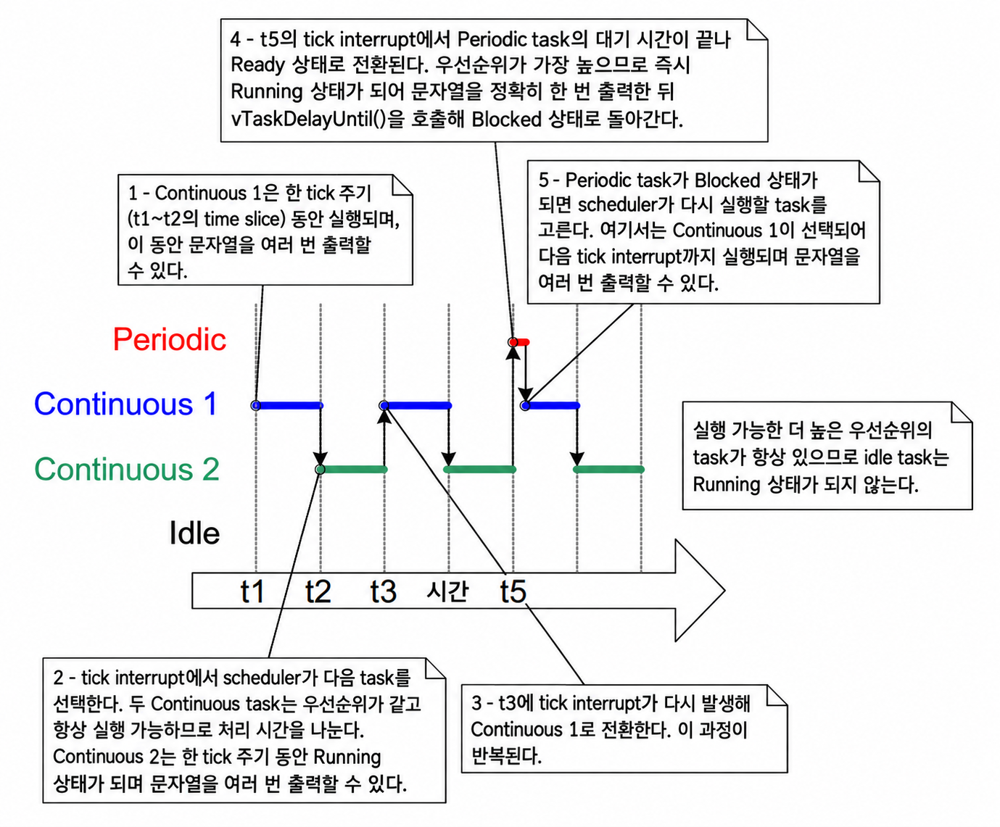

***그림 4.12*** *예제 4.6의 실행 패턴*

***

<a id="48-the-idle-task-and-the-idle-task-hook"></a>
## 4.8 Idle Task와 Idle Task Hook (The Idle Task and the Idle Task Hook)

예제 4.4에서 생성된 task들은 대부분의 시간을 Blocked 상태에서 보낸다. 이 상태에 있는 동안에는 실행될 수 없으므로 scheduler에 의해 선택될 수 없다.

시스템에는 언제나 Running 상태로 진입할 수 있는 task가 최소 하나는 반드시 존재해야 한다[^6]. 이를 보장하기 위해 `vTaskStartScheduler()`가 호출될 때 scheduler는 자동으로 idle task(유휴 task)를 생성한다. idle task는 루프 내에서 대기하는 것 외에는 거의 아무 일도 하지 않으므로, 첫 예제들의 task들과 마찬가지로 항상 실행 가능한 상태를 유지한다.

[^6]: 이는 FreeRTOS의 특수한 저전력 기능을 사용할 때도 마찬가지다. 저전력 기능을 사용할 경우 애플리케이션이 생성한 task 중 실행 가능한 task가 아무것도 없을 때 FreeRTOS가 구동되는 마이크로컨트롤러가 저전력 모드로 전환된다.

idle task는 가능한 가장 낮은 우선순위(우선순위 0)를 갖는다. 이는 더 높은 우선순위의 애플리케이션 task가 Running 상태로 진입하는 것을 절대 방해하지 않도록 하기 위함이다. 그러나 애플리케이션 설계자가 원한다면 idle task 우선순위를 공유하는 task를 생성하는 것도 얼마든지 가능하다. `FreeRTOSConfig.h`의 `configIDLE_SHOULD_YIELD` 컴파일 타임 상수를 사용하면, 동일하게 우선순위 0을 갖는 애플리케이션 task들에게 더 생산적으로 할당될 수 있는 처리 시간을 idle task가 불필요하게 소비하는 것을 방지할 수 있다. 4.12절 스케줄링 알고리즘에서 `configIDLE_SHOULD_YIELD`를 자세히 다룬다.

가장 낮은 우선순위로 실행되므로 idle task는 더 높은 우선순위의 task가 Ready 상태로 진입하는 즉시 Running 상태에서 벗어난다. 이는 그림 4.9의 시간 **tn**에서 확인할 수 있다. Task 2가 Blocked 상태를 벗어나는 바로 그 순간, Task 2가 실행될 수 있도록 idle task가 즉시 스왑 아웃된다. 이때 Task 2가 idle task를 **선점(preempt)**했다고 말한다. 선점은 자동으로 발생하며 선점당하는 task는 이를 알지 못한다.

> *참고: task가 자신을 삭제하기 위해 `vTaskDelete()` API 함수를 사용하는 경우, idle task가 처리 시간에서 완전히 배제(starved)되지 않도록 하는 것이 필수적이다. 스스로를 삭제한 task들이 사용하던 커널 자원을 정리(clean-up)하는 책임을 바로 idle task가 담당하기 때문이다.*

<a id="481-idle-task-hook-functions"></a>
### 4.8.1 Idle Task Hook 함수 (Idle Task Hook Functions)

idle hook(또는 idle callback) 함수를 사용하면 idle task 내부에 애플리케이션 고유의 기능을 직접 추가할 수 있다. idle hook 함수는 idle task 루프의 반복마다 idle task에 의해 자동으로 한 번씩 호출되는 함수다.

idle task hook의 일반적인 용도는 다음과 같다.

- 전용 애플리케이션 task를 생성하는 RAM 오버헤드 없이 낮은 우선순위의 백그라운드 작업이나 연속 처리 기능을 수행할 때
- 여유 처리 용량을 측정할 때 (idle task는 더 높은 우선순위의 모든 애플리케이션 task가 할 일이 없을 때만 실행되므로, idle task에 할당된 처리 시간의 양을 측정하면 시스템의 여유 처리 시간을 명확히 파악할 수 있음)
- 애플리케이션 처리가 필요 없을 때마다 프로세서를 저전력 모드로 전환하여 손쉽고 자동화된 방식으로 전력을 절감할 때 (단, 절감할 수 있는 전력 폭은 tickless 유휴 모드보다는 작음)

<a id="482-limitations-on-the-implementation-of-idle-task-hook-functions"></a>
### 4.8.2 Idle Task Hook 함수 구현 시의 제약 사항 (Limitations on the Implementation of Idle Task Hook Functions)

idle task hook 함수는 반드시 다음 규칙을 엄격히 준수해야 한다.

- idle task hook 함수는 절대 스스로 Blocked 상태나 Suspended 상태로 진입하려 시도해서는 안 된다.
  *참고: 어떤 방식으로든 idle task를 차단(block)하면 Running 상태로 진입할 수 있는 task가 시스템에 아무것도 남지 않는 비정상적인 상황이 발생할 수 있다.*

- 애플리케이션 task가 자신을 삭제하기 위해 `vTaskDelete()` API 함수를 사용하는 경우, idle task hook은 항상 합리적인 시간 내에 호출자에게 제어권을 반환(`return`)해야 한다. idle task가 스스로 삭제된 task에게 할당되었던 커널 자원을 정리해야 하기 때문이다. 만약 idle task가 Idle hook 함수 내에 영구히 머무르게 되면 이러한 자원 정리가 정상적으로 수행될 수 없다.

idle task hook 함수는 코드 4.18에 표시된 이름과 함수 원형을 반드시 가져야 한다.

<a name="list4.18" title="Listing 4.18 The idle task hook function name and prototype"></a>

```c
void vApplicationIdleHook( void );
```
***코드 4.18*** *idle task hook 함수의 이름과 함수 원형*

<a name="example4.7" title="Example 4.7 Defining an idle task hook function"></a>
---
***예제 4.7*** *idle task hook 함수 정의*

---

예제 4.4에서 블로킹 `vTaskDelay()` API를 사용함으로써 많은 양의 유휴 시간(idle time), 즉 두 애플리케이션 task가 모두 Blocked 상태에 머무르는 동안 idle task가 실행되는 시간이 생겨났다. 예제 4.7은 코드 4.19에 나와 있는 Idle hook 함수를 추가하여 이 유휴 시간을 활용한다.

<a name="list4.19" title="Listing 4.19 A very simple Idle hook function"></a>

```c
/* Declare a variable that will be incremented by the hook function.  */
volatile unsigned long ulIdleCycleCount = 0UL;

/*
 * Idle hook functions MUST be called vApplicationIdleHook(), take no
 * parameters, and return void.
 */
void vApplicationIdleHook( void )
{
    /* This hook function does nothing but increment a counter. */
    ulIdleCycleCount++;
}
```
***코드 4.19*** *매우 단순한 Idle hook 함수*

idle hook 함수가 호출되도록 하려면 `FreeRTOSConfig.h`에서 `configUSE_IDLE_HOOK`을 1로 설정해야 한다.

생성된 task들을 구현하는 함수는 코드 4.20에 나타난 바와 같이 `ulIdleCycleCount` 값을 함께 출력하도록 약간 수정된다.

<a name="list4.20" title="Listing 4.20 The source code for the example task now prints out the ulIdleCycleCount value"></a>

```c
void vTaskFunction( void * pvParameters )
{
    char * pcTaskName;
    const TickType_t xDelay250ms = pdMS_TO_TICKS( 250 );

    /*
     * The string to print out is passed in via the parameter. Cast this to
     * a character pointer.
     */
    pcTaskName = ( char * ) pvParameters;

    /* As per most tasks, this task is implemented in an infinite loop. */
    for( ;; )
    {
        /*
         * Print out the name of this task AND the number of times
         * ulIdleCycleCount has been incremented.
         */
        vPrintLineAndNumber( pcTaskName, ulIdleCycleCount );

        /* Delay for a period of 250 milliseconds. */
        vTaskDelay( xDelay250ms );
    }
}
```
***코드 4.20*** *ulIdleCycleCount 값을 출력하도록 수정한 예제 task 소스 코드*

그림 4.13은 예제 4.7에 의해 생성된 출력을 보여준다. 애플리케이션 task들이 한 번씩 실행되는 사이사이에 idle task hook 함수가 대략 4백만 번 정도 실행됨을 확인할 수 있다(반복 횟수는 하드웨어 속도에 따라 달라짐).

<a name="fig4.13" title="Figure 4.13 The output produced when Example 4.7 is executed"></a>

***

```console
C:\Temp>rtosdemo
Task 2 is running
ulIdleCycleCount = 0
Task 1 is running
ulIdleCycleCount = 0
Task 2 is running
ulIdleCycleCount = 3869504
Task 1 is running
ulIdleCycleCount = 3869504
Task 2 is running
ulIdleCycleCount = 8564623
Task 1 is running
ulIdleCycleCount = 8564623
Task 2 is running
ulIdleCycleCount = 13181489
Task 1 is running
ulIdleCycleCount = 13181489
Task 2 is running
ulIdleCycleCount = 17838406
Task 1 is running
ulIdleCycleCount = 17838406
Task 2 is running
```
***그림 4.13*** *예제 4.7 실행 시 생성되는 출력*

***

<a id="49-changing-the-priority-of-a-task"></a>
## 4.9 task 우선순위 변경 (Changing the Priority of a Task)

<a id="491-the-vtaskpriorityset-api-function"></a>
### 4.9.1 vTaskPrioritySet() API 함수 (The vTaskPrioritySet() API Function)

`vTaskPrioritySet()` API 함수는 scheduler가 시작된 후 특정 task의 우선순위를 동적으로 변경한다. 이 함수는 `FreeRTOSConfig.h`에서 `INCLUDE_vTaskPrioritySet`이 1로 설정되어 있을 때만 사용할 수 있다.

<a name="list4.21" title="Listing 4.21 The vTaskPrioritySet() API function prototype"></a>

```c
void vTaskPrioritySet( TaskHandle_t xTask,
                       UBaseType_t uxNewPriority );
```
***코드 4.21*** *vTaskPrioritySet() API 함수 원형*

**vTaskPrioritySet() 매개변수:**

- `xTask`

  우선순위를 수정할 대상 task의 핸들이다. task 핸들을 얻는 방법에 대해서는 `xTaskCreate()`의 `pxCreatedTask` 매개변수 또는 `xTaskCreateStatic()`의 반환값을 참조한다.

  task는 유효한 핸들 대신 `NULL`을 전달하여 자신의 우선순위를 직접 변경할 수 있다.

- `uxNewPriority`

  대상 task에 새로 지정할 우선순위다. 이 값은 `FreeRTOSConfig.h`에 설정된 최대 사용 가능 우선순위인 `(configMAX_PRIORITIES – 1)` 값으로 자동 제한된다.

<a id="492-the-uxtaskpriorityget-api-function"></a>
### 4.9.2 uxTaskPriorityGet() API 함수 (The uxTaskPriorityGet() API Function)

`uxTaskPriorityGet()` API 함수는 특정 task의 현재 우선순위를 조회하여 반환한다. 이 함수는 `FreeRTOSConfig.h`에서 `INCLUDE_uxTaskPriorityGet`이 1로 설정되어 있을 때만 사용할 수 있다.

<a name="list4.22" title="Listing 4.22 The uxTaskPriorityGet() API function prototype"></a>

```c
UBaseType_t uxTaskPriorityGet( TaskHandle_t xTask );
```
***코드 4.22*** *uxTaskPriorityGet() API 함수 원형*

**uxTaskPriorityGet() 매개변수 및 반환값:**

- `xTask`

  우선순위를 조회할 대상 task의 핸들이다. task 핸들을 얻는 방법은 `xTaskCreate()`의 `pxCreatedTask` 매개변수 또는 `xTaskCreateStatic()`의 반환값을 참조한다.

  task는 유효한 핸들 대신 `NULL`을 전달하여 자신의 현재 우선순위를 직접 조회할 수 있다.

- 반환값

  조회 대상 task에 현재 할당되어 있는 우선순위 값이다.

<a name="example4.8" title="Example 4.8 Changing task priorities"></a>
---
***예제 4.8*** *task 우선순위 변경*

---

scheduler는 항상 실행 가능한 가장 높은 우선순위의 Ready 상태 task를 선택하여 Running 상태로 전환한다. 예제 4.8은 `vTaskPrioritySet()` API 함수를 사용하여 두 task의 상대적인 우선순위를 번갈아 가며 변경하는 방식을 시연한다.

예제 4.8에서는 서로 다른 두 가지 우선순위로 두 개의 task를 생성한다. 두 task 모두 Blocked 상태를 유발할 수 있는 API를 전혀 호출하지 않으므로, 항상 Ready 상태이거나 Running 상태다. 따라서 상대적으로 우선순위가 더 높은 task가 항상 scheduler에 의해 선택되어 Running 상태가 된다.

예제 4.8의 구체적인 동작 흐름은 다음과 같다.

1. Task 1(코드 4.23)이 더 높은 우선순위로 생성되므로 가장 먼저 실행된다. Task 1은 두 개의 문자열을 출력한 다음, Task 2(코드 4.24)의 우선순위를 자신의 우선순위보다 높게 올린다.
2. Task 2는 상대적으로 더 높은 우선순위를 갖게 되는 즉시 실행을 시작한다(Running 상태로 진입). 특정 시점에 오직 하나의 task만 Running 상태가 될 수 있으므로, Task 2가 Running 상태가 되면 Task 1은 Ready 상태가 된다.
3. Task 2는 메시지를 출력한 후 자신의 우선순위를 다시 Task 1보다 낮은 값으로 내린다.
4. Task 2가 우선순위를 낮추면 다시 Task 1이 가장 높은 우선순위 task가 되므로, Task 1이 다시 Running 상태로 진입하고 Task 2는 다시 Ready 상태로 밀려난다.

<a name="list4.23" title="Listing 4.23 The implementation of Task 1 in Example 4.8"></a>

```c
void vTask1( void * pvParameters )
{
    UBaseType_t uxPriority;

    /*
     * This task will always run before Task 2 as it is created with the higher
     * priority. Neither Task 1 nor Task 2 ever block so both will always be in
     * either the Running or the Ready state.
     */

    /*
     * Query the priority at which this task is running - passing in NULL means
     * "return the calling task's priority".
     */
    uxPriority = uxTaskPriorityGet( NULL );

    for( ;; )
    {
        /* Print out the name of this task. */
        vPrintLine( "Task 1 is running" );

        /*
         * Setting the Task 2 priority above the Task 1 priority will cause
         * Task 2 to immediately start running (as then Task 2 will have the
         * higher priority of the two created tasks). Note the use of the
         * handle to task 2 (xTask2Handle) in the call to vTaskPrioritySet().
         * Listing 4.25 shows how the handle was obtained.
         */
        vPrintLine( "About to raise the Task 2 priority" );
        vTaskPrioritySet( xTask2Handle, ( uxPriority + 1 ) );

        /*
         * Task 1 will only run when it has a priority higher than Task 2.
         * Therefore, for this task to reach this point, Task 2 must already
         * have executed and set its priority back down to below the priority
         * of this task.
         */
    }
}
```
***코드 4.23*** *예제 4.8의 Task 1 구현*

<a name="list4.24" title="Listing 4.24 The implementation of Task 2 in Example 4.8"></a>

```c
void vTask2( void * pvParameters )
{
    UBaseType_t uxPriority;

    /*
     * Task 1 will always run before this task as Task 1 is created with the
     * higher priority. Neither Task 1 nor Task 2 ever block so will always be
     * in either the Running or the Ready state.
     *
     * Query the priority at which this task is running - passing in NULL means
     * "return the calling task's priority".
     */
    uxPriority = uxTaskPriorityGet( NULL );

    for( ;; )
    {
        /*
         * For this task to reach this point Task 1 must have already run and
         * set the priority of this task higher than its own.
         */

         /* Print out the name of this task. */
        vPrintLine( "Task 2 is running" );

        /*
         * Set the priority of this task back down to its original value.
         * Passing in NULL as the task handle means "change the priority of the
         * calling task". Setting the priority below that of Task 1 will cause
         * Task 1 to immediately start running again – preempting this task.
         */
        vPrintLine( "About to lower the Task 2 priority" );
        vTaskPrioritySet( NULL, ( uxPriority - 2 ) );
    }
}
```
***코드 4.24*** *예제 4.8의 Task 2 구현*

각 task는 유효한 핸들 대신 `NULL`을 전달하여 자신의 우선순위를 조회하고 설정할 수 있다. task 핸들은 Task 1이 Task 2의 우선순위를 변경하는 경우처럼 자기 자신이 아닌 다른 task를 참조하고자 할 때만 필요하다. 이를 가능하게 하기 위해 코드 4.25에 강조된 바와 같이 Task 2가 생성될 때 Task 2의 핸들을 받아 저장해 둔다.

<a name="list4.25" title="Listing 4.25 The implementation of main() for Example 4.8"></a>

```c
/* Declare a variable that is used to hold the handle of Task 2. */
TaskHandle_t xTask2Handle = NULL;

int main( void )
{
    /*
     * Create the first task at priority 2. The task parameter is not used
     * and set to NULL. The task handle is also not used so is also set to
     * NULL.
     */
    xTaskCreate( vTask1, "Task 1", 1000, NULL, 2, NULL );
    /* The task is created at priority 2 ______^. */

    /*
     * Create the second task at priority 1 - which is lower than the priority
     * given to Task 1. Again the task parameter is not used so is set to NULL-
     * BUT this time the task handle is required so the address of xTask2Handle
     * is passed in the last parameter.
     */
    xTaskCreate( vTask2, "Task 2", 1000, NULL, 1, &xTask2Handle );
    /* The task handle is the last parameter _____^^^^^^^^^^^^^ */

    /* Start the scheduler so the tasks start executing. */
    vTaskStartScheduler();

    /*
     * If all is well main() will not reach here because the scheduler will
     * now be running the created tasks. If main() does reach here then there
     * was not enough heap memory to create either the idle or timer tasks
     * (described later in this book). Chapter 3 provides more information on
     * heap memory management.
     */
    for( ;; )
    {
    }
}
```
***코드 4.25*** *예제 4.8의 main() 함수 구현*

그림 4.14는 예제 4.8의 task들이 실행되는 순서를 보여주며, 그에 따른 출력 결과는 그림 4.15에 나와 있다.

<a name="fig4.14" title="Figure 4.14 The sequence of task execution when running Example 4.8"></a>

***
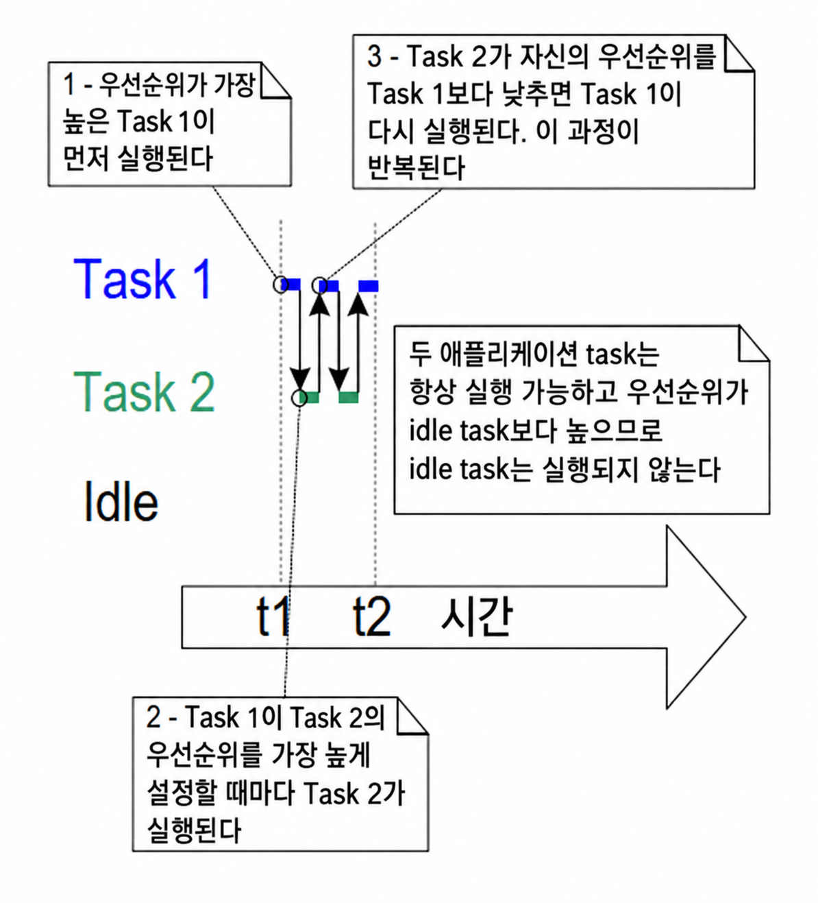

***그림 4.14*** *예제 4.8 실행 시의 task 실행 순서*

***

<a name="fig4.15" title="Figure 4.15 The output produced when Example 4.8 is executed"></a>

***

```console
Task1 is running
About to raise the Task2 priority
Task2 is running
About to lower the Task2 priority
Task1 is running
About to raise the Task2 priority
Task2 is running
About to lower the Task2 priority
Task1 is running
About to raise the Task2 priority
Task2 is running
About to lower the Task2 priority
Task1 is running
```
***그림 4.15*** *예제 4.8 실행 시 생성되는 출력*

***

<a id="410-deleting-a-task"></a>
## 4.10 task 삭제 (Deleting a Task)

<a id="4101-the-vtaskdelete-api-function"></a>
### 4.10.1 vTaskDelete() API 함수 (The vTaskDelete() API Function)

`vTaskDelete()` API 함수는 task를 삭제한다. 이 함수는 `FreeRTOSConfig.h`에서 `INCLUDE_vTaskDelete`가 1로 설정되어 있을 때만 사용할 수 있다.

런타임에 task를 지속적으로 생성하고 삭제하는 것은 좋은 설계 관행이 아니다. 이러한 함수가 필요하다고 느껴진다면 task를 재사용하는 등의 다른 설계 옵션을 먼저 고려하는 것이 바람직하다.

삭제된 task는 더 이상 존재하지 않으며 다시는 Running 상태로 진입할 수 없다.

동적 메모리 할당으로 생성된 task가 나중에 스스로를 삭제하는 경우, 삭제된 task의 데이터 구조체와 stack 등 커널이 할당했던 메모리를 해제하는 작업은 **idle task가 전담**한다. 따라서 이 경우 애플리케이션이 idle task의 실행 시간을 완전히 고갈시키지 않도록 주의해야 한다.

> *참고: task가 삭제될 때 자동으로 해제되는 것은 커널 자체가 해당 task에 할당했던 메모리뿐이다. task 구현 코드 내부에서 동적으로 할당한 메모리나 기타 시스템 자원은 더 이상 필요하지 않을 때 애플리케이션 코드가 직접 명시적으로 해제해야 한다.*

<a name="list4.26" title="Listing 4.26 The vTaskDelete() API function prototype"></a>

```c
void vTaskDelete( TaskHandle_t xTaskToDelete );
```
***코드 4.26*** *vTaskDelete() API 함수 원형*

**vTaskDelete() 매개변수:**

- `xTaskToDelete`

  삭제할 대상 task의 핸들이다. task 핸들을 얻는 방법은 `xTaskCreate()`의 `pxCreatedTask` 매개변수 또는 `xTaskCreateStatic()`의 반환값을 참조한다.

  task는 유효한 핸들 대신 `NULL`을 전달하여 자기 자신을 직접 삭제할 수 있다.

<a name="example4.9" title="Example 4.9 Deleting tasks"></a>
---
***예제 4.9*** *task 삭제*

---

이 예제는 다음과 같이 동작하는 매우 단순한 예제다.

1. Task 1이 `main()`에 의해 우선순위 1로 생성된다. Task 1이 실행되면 우선순위 2로 Task 2를 생성한다. 이제 Task 2가 가장 높은 우선순위 task가 되므로 즉시 실행을 시작한다. 코드 4.27은 `main()`의 소스 코드를, 코드 4.28은 Task 1의 소스 코드를 보여준다.
2. Task 2는 실행 후 자기 자신을 삭제하는 일만 수행한다. `NULL`을 전달하여 삭제할 수도 있지만, 시연 목적으로 자신의 task 핸들을 사용한다. 코드 4.29는 Task 2의 소스 코드를 보여준다.
3. Task 2가 삭제되면 다시 Task 1이 가장 높은 우선순위 task가 되므로 계속 실행을 이어가며, 이 시점에 `vTaskDelay()`를 호출하여 잠시 동안 Blocked 상태가 된다.
4. Task 1이 Blocked 상태에 있는 동안 idle task가 실행되며, 방금 삭제된 Task 2에 할당되었던 메모리를 해제한다.
5. 지연 시간이 끝나 Task 1이 Blocked 상태를 벗어나면 다시 가장 높은 우선순위의 Ready 상태 task가 되어 idle task를 선점한다. Running 상태로 진입한 Task 1은 다시 Task 2를 생성하며, 이 과정이 반복된다.

<a name="list4.27" title="Listing 4.27 The implementation of main() for Example 4.9"></a>

```c
int main( void )
{
    /* Create the first task at priority 1. */
    xTaskCreate( vTask1, "Task 1", 1000, NULL, 1, NULL );

    /* Start the scheduler so the task starts executing. */
    vTaskStartScheduler();

    /* main() should never reach here as the scheduler has been started. */
    for( ;; )
    {
    }
}
```
***코드 4.27*** *예제 4.9의 main() 함수 구현*

<a name="list4.28" title="Listing 4.28 The implementation of Task 1 for Example 4.9"></a>

```c
TaskHandle_t xTask2Handle = NULL;

void vTask1( void * pvParameters )
{
    const TickType_t xDelay100ms = pdMS_TO_TICKS( 100UL );

    for( ;; )
    {
        /* Print out the name of this task. */
        vPrintLine( "Task 1 is running" );

        /*
         * Create task 2 at a higher priority.
         * Pass the address of xTask2Handle as the pxCreatedTask parameter so
         * that xTaskCreate write the resulting task handle to that variable.
         */
        xTaskCreate( vTask2, "Task 2", 1000, NULL, 2, &xTask2Handle );

        /*
         * Task 2 has/had the higher priority. For Task 1 to reach here, Task 2
         * must have already executed and deleted itself.
         */
        vTaskDelay( xDelay100ms );
    }
}
```
***코드 4.28*** *예제 4.9의 Task 1 구현*

<a name="list4.29" title="Listing 4.29 The implementation of Task 2 for Example 4.9"></a>

```c
void vTask2( void * pvParameters )
{
    /*
     * Task 2 immediately deletes itself upon starting.
     * To do this it could call vTaskDelete() using NULL as the parameter.
     * For demonstration purposes, it instead calls vTaskDelete() with its own
     * task handle.
     */
    vPrintLine( "Task 2 is running and about to delete itself" );
    vTaskDelete( xTask2Handle );
}
```
***코드 4.29*** *예제 4.9의 Task 2 구현*

그림 4.16은 예제 4.9를 실행했을 때 생성되는 콘솔 출력을 보여주며, 그림 4.17은 실행 순서를 보여준다.

<a name="fig4.16" title="Figure 4.16 The output produced when Example 4.9 is executed"></a>

***

```console
C:\Temp>rtosdemo
Task1 is running
Task2 is running and about to delete itself
Task1 is running
Task2 is running and about to delete itself
Task1 is running
Task2 is running and about to delete itself
Task1 is running
Task2 is running and about to delete itself
Task1 is running
Task2 is running and about to delete itself
Task1 is running
Task2 is running and about to delete itself
Task1 is running
Task2 is running and about to delete itself
Task1 is running
Task2 is running and about to delete itself
```
***그림 4.16*** *예제 4.9 실행 시 생성되는 출력*

***

<a name="fig4.17" title="Figure 4.17 The execution sequence for Example 4.9"></a>

***
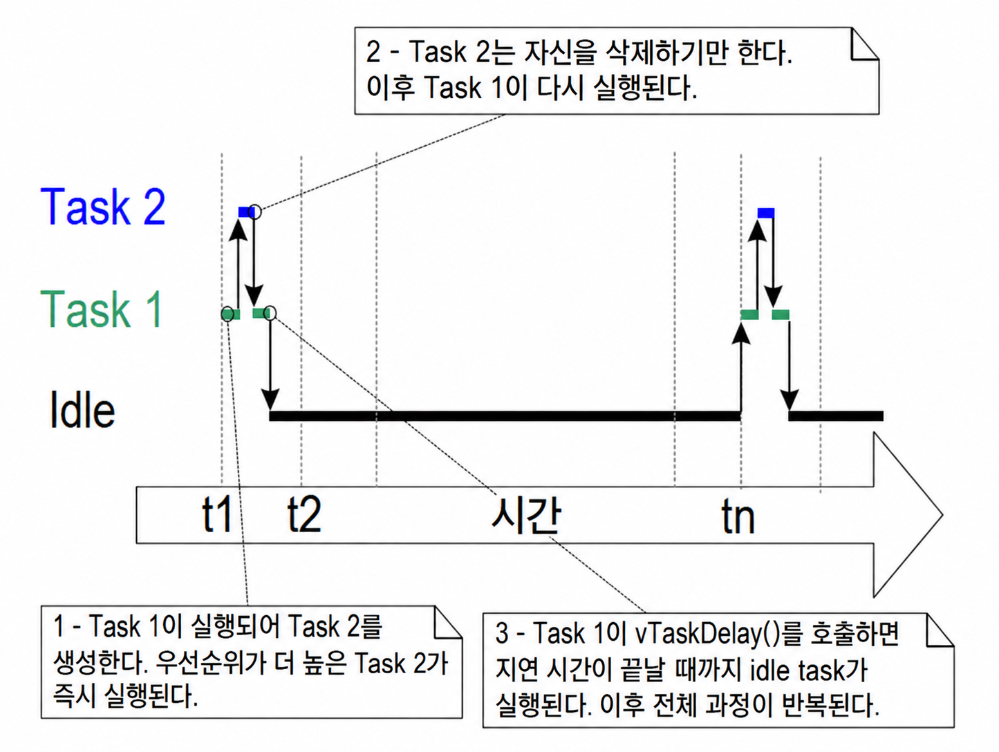

***그림 4.17*** *예제 4.9의 실행 순서*

***

<a id="411-thread-local-storage-and-reentrancy"></a>
## 4.11 스레드 로컬 스토리지와 재진입성 (Thread Local Storage and Reentrancy)

스레드 로컬 스토리지(Thread Local Storage, TLS)는 개발자가 각 task의 Task Control Block(TCB) 내부에 임의의 전용 데이터를 저장할 수 있게 해주는 기능이다. 이 기능은 비재진입(non-reentrant) 함수들이 일반적으로 전역 변수에 저장하는 데이터를 task별로 독립 보관하는 데 가장 흔히 쓰인다.

재진입 가능한(reentrant) 함수란 여러 스레드에서 동시에 실행되어도 어떠한 부작용(side effect)도 일으키지 않는 함수를 말한다. TLS가 없는 멀티스레드 환경에서 비재진입 함수를 사용할 때는 critical section(임계 구역) 내부에서 함수의 반환값 외의 경로로 전달되는 결과를 확인하는 등 각별한 주의를 기울여야 한다. 그러나 critical section을 과도하게 사용하면 RTOS 성능이 저하되므로, critical section 대신 스레드 로컬 스토리지를 사용하는 방식이 선호된다.

TLS의 가장 대표적인 사용 사례는 C 표준 라이브러리와 POSIX 시스템의 ISO C 표준에서 사용되는 ```errno``` 전역 변수다. ```errno```는 `strtof`나 `strtol` 같은 일반 표준 라이브러리 함수에서 확장된 결과나 오류 코드를 제공하는 데 사용된다.

<a id="4111-c-runtime-thread-local-storage-implementations"></a>
### 4.11.1 C 런타임 스레드 로컬 스토리지 구현체 (C Runtime Thread Local Storage Implementations)

대다수 임베디드 libc 구현체는 비재진입 함수가 멀티스레드 환경에서 올바르게 동작할 수 있도록 보장하는 재진입 API를 제공한다. FreeRTOS는 널리 사용되는 두 오픈소스 라이브러리인 [newlib](https://sourceware.org/newlib/)와 [picolibc](https://github.com/picolibc/picolibc)의 재진입 API를 기본 지원한다. 프로젝트의 `FreeRTOSConfig.h` 파일에 다음 매크로를 정의하여 이러한 C 런타임 TLS 구현을 활성화할 수 있다.

- [newlib](https://sourceware.org/newlib/)의 경우: ```configUSE_NEWLIB_REENTRANT```
- [picolibc](https://github.com/picolibc/picolibc)의 경우: ```configUSE_PICOLIBC_TLS```

<a id="4112-custom-c-runtime-thread-local-storage"></a>
### 4.11.2 맞춤형 C 런타임 스레드 로컬 스토리지 (Custom C Runtime Thread Local Storage)

애플리케이션 개발자는 `FreeRTOSConfig.h` 파일에 다음 매크로들을 정의하여 독자적인 C 런타임 TLS를 구현할 수도 있다.

- ```configUSE_C_RUNTIME_TLS_SUPPORT```를 1로 정의하여 C 런타임 TLS 지원을 활성화한다.
- ```configTLS_BLOCK_TYPE```을 C 런타임 TLS 데이터를 저장하는 데 사용할 C 데이터 타입으로 정의한다.
- ```configINIT_TLS_BLOCK```을 C 런타임 TLS 블록을 초기화할 때 실행할 C 코드로 정의한다.
- ```configSET_TLS_BLOCK```을 새 task로 전환(스위치 인)할 때 실행할 C 코드로 정의한다.
- ```configDEINIT_TLS_BLOCK```을 C 런타임 TLS 블록을 해제할 때 실행할 C 코드로 정의한다.

<a id="4113-application-thread-local-storage"></a>
### 4.11.3 애플리케이션 스레드 로컬 스토리지 (Application Thread Local Storage)

C 런타임 TLS 외에도 애플리케이션 개발자는 task control block에 애플리케이션 고유의 포인터 세트를 포함하도록 정의할 수 있다. 이 기능은 `FreeRTOSConfig.h`에서 ```configNUM_THREAD_LOCAL_STORAGE_POINTERS```를 0이 아닌 숫자로 설정하여 활성화한다. 코드 4.30에 정의된 ```vTaskSetThreadLocalStoragePointer```와 ```pvTaskGetThreadLocalStoragePointer``` 함수를 사용하여 런타임에 각 TLS 포인터 값을 설정하고 조회할 수 있다.

<a name="list4.30" title="Listing 4.30 Function prototypes of the Thread Local Storage Pointer API functions"></a>

```c
void * pvTaskGetThreadLocalStoragePointer( TaskHandle_t xTaskToQuery,
                                           BaseType_t xIndex )

void vTaskSetThreadLocalStoragePointer( TaskHandle_t xTaskToSet,
                                        BaseType_t xIndex,
                                        void * pvValue );
```
***코드 4.30*** *Thread Local Storage Pointer API 함수의 원형*

<a id="412-scheduling-algorithms"></a>
## 4.12 스케줄링 알고리즘 (Scheduling Algorithms)

<a id="4121-a-recap-of-task-states-and-events"></a>
### 4.12.1 task 상태 및 이벤트 요약 (A Recap of Task States and Events)

실제로 실행되고 있는(프로세서 처리 시간을 사용하고 있는) task는 **Running 상태**에 있다. 단일 코어 프로세서에서는 특정 시점에 오직 하나의 task만 Running 상태가 될 수 있다. 비대칭형 다중 처리(AMP) 환경에서 둘 이상의 코어에서 각각 FreeRTOS를 독립 실행하거나, 대칭형 다중 처리(SMP) 환경에서 FreeRTOS가 여러 코어에 걸쳐 task들을 스케줄링하도록 할 수도 있지만 여기서는 다루지 않는다.

실제로 실행 중이지는 않지만 Blocked 상태나 Suspended 상태가 아닌 task들은 **Ready 상태**에 있다. Ready 상태에 있는 task들은 scheduler에 의해 선택되어 Running 상태로 진입할 수 있는 후보들이다. scheduler는 항상 Ready 상태에 있는 가장 높은 우선순위의 task를 선택하여 Running 상태로 전환한다.

task는 이벤트를 기다리기 위해 **Blocked 상태**에서 대기할 수 있으며, 해당 이벤트가 발생하면 자동으로 **Ready 상태**로 복귀한다. 시간 관련 이벤트는 특정 시점(예: 지연 시간 만료)에 발생하며 주기적 동작이나 타임아웃 처리를 구현하는 데 주로 쓰인다. 동기화 이벤트는 task나 인터럽트 서비스 루틴이 task notification, queue, event group, message buffer, stream buffer, 또는 semaphore(세마포어)를 사용하여 정보를 전송할 때 발생하며, 주변 장치에 데이터가 도착하는 것과 같은 비동기 활동을 알리는 데 주로 쓰인다.

<a id="4122-selecting-the-scheduling-algorithm"></a>
### 4.12.2 스케줄링 알고리즘의 선택 (Selecting the Scheduling Algorithm)

스케줄링 알고리즘은 어느 Ready 상태 task를 Running 상태로 전환할지 결정하는 소프트웨어 루틴이다.

지금까지의 모든 예제는 동일한 스케줄링 알고리즘을 사용했지만, `FreeRTOSConfig.h`에 정의된 `configUSE_PREEMPTION`과 `configUSE_TIME_SLICING` 구성 상수를 사용하여 알고리즘을 변경할 수 있다.

세 번째 구성 상수인 `configUSE_TICKLESS_IDLE` 역시 스케줄링 알고리즘에 영향을 미친다. 이 상수를 사용하면 긴 시간 동안 tick 인터럽트가 완전히 꺼질 수 있기 때문이다. `configUSE_TICKLESS_IDLE`은 전력 소비를 극도로 최소화해야 하는 애플리케이션을 위해 제공되는 고급 옵션이다. 이 절의 설명은 이 상수가 기본값인 0으로 설정되어 있다고 가정한다.

모든 단일 코어 구성에서 FreeRTOS scheduler는 동일한 우선순위를 공유하는 task들을 차례대로 교대하며 선택한다. 이처럼 '차례대로 번갈아 실행하는' 정책을 흔히 **라운드 로빈 스케줄링(Round Robin Scheduling)**이라고 부른다. 라운드 로빈 스케줄링 알고리즘은 동일한 우선순위의 task들에게 시간이 정확히 균등하게 분배된다고 보장하지는 않으며, 단지 동일 우선순위의 Ready 상태 task들이 번갈아 가며 Running 상태로 진입함을 보장할 뿐이다.

<a name="tbl5" title="Table 5 The FreeRTOSConfig.h settings to configure the kernel scheduling algorithms"></a>

***
| 스케줄링 알고리즘 | 우선순위 기반(Prioritized) | `configUSE_PREEMPTION` | `configUSE_TIME_SLICING` |
| :--- | :--- | :--- | :--- |
| 시분할 선점형 스케줄링 (Preemptive With Time Slicing) | 예 (Yes) | 1 | 1 |
| 시분할 없는 선점형 스케줄링 (Preemptive Without Time Slicing) | 예 (Yes) | 1 | 0 |
| 협력형 스케줄링 (Co-Operative) | 아니오 (No) | 0 | 무관 (Any) |

***표 5*** *커널 스케줄링 알고리즘을 구성하는 FreeRTOSConfig.h 설정*

* * *

<a id="4123-prioritized-preemptive-scheduling-with-time-slicing"></a>
### 4.12.3 시분할 선점형 스케줄링 (Prioritized Preemptive Scheduling with Time Slicing)

표 5에 나와 있는 구성은 FreeRTOS scheduler를 **시분할 고정 우선순위 선점형 스케줄링(Fixed Priority Preemptive Scheduling with Time Slicing)** 방식으로 동작하도록 설정한다. 이는 소형 RTOS 애플리케이션에서 가장 보편적으로 사용되는 알고리즘이며, 이 책의 지금까지의 모든 예제에서 사용된 알고리즘이다. 명칭에 사용된 용어의 의미는 다음과 같다.

- **고정 우선순위 (Fixed Priority)**:
  scheduler가 스케줄링 대상 task에 할당된 우선순위를 임의로 변경하지 않는 알고리즘을 의미한다. 단, task 스스로가 자신의 우선순위나 다른 task의 우선순위를 변경하는 것까지 막지는 않는다.

- **선점형 (Preemptive)**:
  Running 상태 task보다 높은 우선순위를 가진 task가 Ready 상태로 진입하면, 즉시 현재 실행 중인 task를 '선점(preempt)'하는 알고리즘이다. 선점당한다는 것은 실행 중이던 task가 명시적으로 CPU를 양보(`yield`)하거나 대기(`block`)하지 않았음에도 불구하고, 다른 더 높은 우선순위 task가 실행될 수 있도록 비자발적으로 Running 상태에서 Ready 상태로 전환됨을 의미한다. 선점은 RTOS tick 인터럽트 시점뿐 아니라 어느 순간에나 발생할 수 있다.

- **시분할 (Time Slicing)**:
  동일한 우선순위를 가진 task들이 명시적으로 실행권을 양보하거나 Blocked 상태로 들어가지 않더라도, 이들 사이에 처리 시간을 분할하여 공유하도록 하는 방식이다. 시분할 알고리즘을 사용하는 scheduler는 각 타임 슬라이스의 끝에서 Running 상태 task와 동일한 우선순위를 가진 다른 Ready 상태 task가 존재할 경우, 새 task를 선택하여 Running 상태로 전환한다. 1 타임 슬라이스는 두 RTOS tick 인터럽트 사이의 시간과 같다.

그림 4.18과 그림 4.19는 시분할 고정 우선순위 선점형 스케줄링 알고리즘이 적용될 때 task들이 어떻게 스케줄링되는지 보여준다. 그림 4.18은 애플리케이션의 모든 task가 서로 다른 고유한 우선순위를 가질 때 task들이 선택되는 순서를 보여주며, 그림 4.19는 두 task가 동일한 우선순위를 공유할 때의 순서를 보여준다.

<a name="fig4.18" title="Figure 4.18 Execution pattern highlighting task prioritization and preemption..."></a>

***
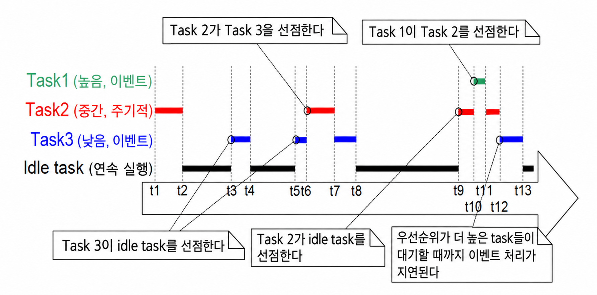

***그림 4.18*** *각 task가 고유한 우선순위를 가질 때 task 우선순위와 선점이 작동하는 실행 패턴*

***

그림 4.18을 참고하면 다음과 같다.

- **Idle Task**: 가장 낮은 우선순위로 실행되므로, t3, t5, t9 시점처럼 더 높은 우선순위의 task가 Ready 상태로 진입할 때마다 선점당한다.
- **Task 3**: 상대적으로 낮지만 Idle보다는 높은 우선순위로 실행되는 이벤트 기반 task다. 대부분의 시간을 관심 있는 이벤트를 기다리며 Blocked 상태에서 보내고, 이벤트가 발생할 때마다 Blocked 상태에서 Ready 상태로 전환된다.
  이벤트는 t3과 t5 시점, 그리고 t9와 t12 사이의 어느 시점에 발생한다. t3과 t5에 발생한 이벤트는 즉시 처리되는데, 이 시점에 Task 3이 실행 가능한 가장 높은 우선순위 task이기 때문이다. 반면 t9와 t12 사이에서 발생한 이벤트는 t12가 되어서야 비로소 처리된다. 그때까지 더 높은 우선순위의 Task 1과 Task 2가 계속 실행되고 있었기 때문이다. t12 시점에 Task 1과 Task 2가 모두 Blocked 상태로 들어가면서 비로소 Task 3이 가장 높은 우선순위의 Ready 상태 task가 된다.
- **Task 2**: Task 3보다는 높고 Task 1보다는 낮은 우선순위로 실행되는 주기적 task다. Task 2는 주기 간격에 따라 t1, t6, t9 시점에 실행되기를 원한다.
  t6 시점에 Task 3이 Running 상태에 있었지만, Task 2의 상대적 우선순위가 더 높으므로 Task 3을 선점하고 즉시 실행을 시작한다. Task 2는 처리를 완료하고 t7 시점에 다시 Blocked 상태로 진입하며, 이때 Task 3이 다시 Running 상태로 복귀하여 남은 처리를 마친다. Task 3 자체는 t8 시점에 Blocked 상태가 된다.
- **Task 1**: 가장 높은 우선순위로 실행되는 이벤트 기반 task다. 시스템 내의 그 어떤 task라도 선점할 수 있다. 다이어그램에 표시된 유일한 Task 1 이벤트는 t10 시점에 발생하며, 이때 Task 1이 Task 2를 선점한다. Task 2는 Task 1이 처리를 마치고 t11 시점에 다시 Blocked 상태로 들어간 후에야 비로소 남은 처리를 완료할 수 있다.

<a name="fig4.19" title="Figure 4.19 Execution pattern highlighting task prioritization and time slicing..."></a>

***
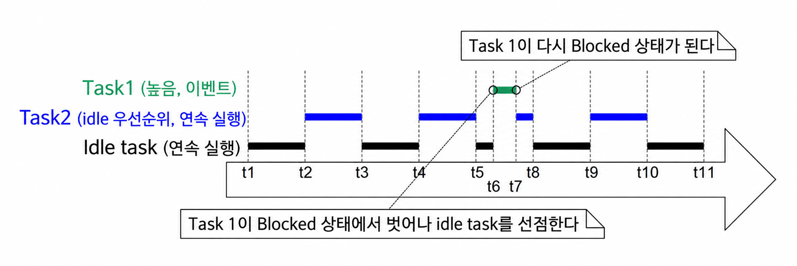

***그림 4.19*** *두 task가 동일한 우선순위를 공유할 때 task 우선순위와 시분할이 작동하는 실행 패턴*

***

그림 4.19를 참고하면 다음과 같다.

- **Idle Task 및 Task 2**: 둘 다 연속 처리 task이며 둘 다 가능한 가장 낮은 우선순위인 우선순위 0을 갖는다. scheduler는 실행 가능한 더 높은 우선순위 task가 없을 때만 우선순위 0의 task들에게 처리 시간을 할당하며, 시분할을 통해 이 시간을 분할 공유한다. 새로운 타임 슬라이스는 매 tick 인터럽트마다 시작되며, 그림 4.19에서는 t1, t2, t3, t4, t5, t8, t9, t10, t11 시점이 이에 해당한다.
  idle task와 Task 2는 차례대로 번갈아 Running 상태로 진입하며, t5와 t8 사이처럼 한 타임 슬라이스의 일부분씩을 두 task가 나누어 실행할 수도 있다.
- **Task 1**: Idle 우선순위보다 높은 우선순위를 갖는다. 관심 있는 이벤트를 기다리며 대부분의 시간을 Blocked 상태에서 보내는 이벤트 기반 task다.
  관심 이벤트는 t6 시점에 발생한다. t6 시점에 Task 1은 실행 가능한 가장 높은 우선순위 task가 되므로, 타임 슬라이스 도중에 idle task를 즉시 선점한다. 이벤트 처리는 t7 시점에 완료되며, 이때 Task 1은 다시 Blocked 상태로 진입한다.

그림 4.19는 idle task가 애플리케이션 작성자가 생성한 task와 처리 시간을 나누어 쓰는 모습을 보여준다. 만약 애플리케이션 작성자가 만든 우선순위 0의 task들은 수행할 작업이 많은 반면 idle task는 할 일이 없다면, idle task에 이처럼 많은 처리 시간을 할당하는 것은 비효율적일 수 있다. `FreeRTOSConfig.h`의 `configIDLE_SHOULD_YIELD` 상수를 사용하면 idle task의 스케줄링 방식을 변경할 수 있다.

- `configIDLE_SHOULD_YIELD`가 0으로 설정되면, 더 높은 우선순위 task에 의해 선점당하지 않는 한 idle task는 자신의 타임 슬라이스 전체 동안 Running 상태를 유지한다.
- `configIDLE_SHOULD_YIELD`가 1로 설정되면, Ready 상태에 있는 다른 우선순위 0 task가 존재할 경우 idle task는 루프의 각 반복마다 스스로 실행권을 양보(`yield`)하여 남은 타임 슬라이스를 다른 task에게 넘겨준다.

그림 4.19의 실행 패턴은 `configIDLE_SHOULD_YIELD`가 0으로 설정되었을 때 관찰되는 모습이다. 반면 그림 4.20은 동일한 시나리오에서 `configIDLE_SHOULD_YIELD`를 1로 설정했을 때 관찰되는 실행 패턴을 보여준다.

<a name="fig4.20" title="Figure 4.20 The execution pattern for the same scenario as shown in Figure 4.19..."></a>

***
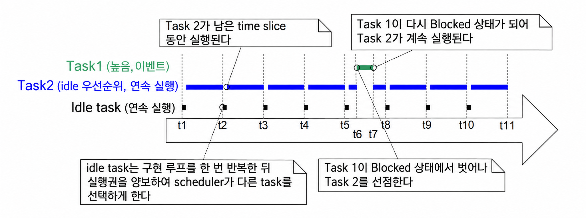

***그림 4.20*** *그림 4.19와 동일한 시나리오에서 configIDLE_SHOULD_YIELD를 1로 설정했을 때의 실행 패턴*

***

그림 4.20은 `configIDLE_SHOULD_YIELD`가 1로 설정되었을 때, idle task 다음으로 Running 상태에 진입하도록 선택된 task가 온전한 타임 슬라이스 전체를 실행하는 것이 아니라, idle task가 양보하고 남긴 잔여 타임 슬라이스 동안만 실행된다는 점도 보여준다.

<a id="4124-prioritized-preemptive-scheduling-without-time-slicing"></a>
### 4.12.4 시분할 없는 선점형 스케줄링 (Prioritized Preemptive Scheduling without Time Slicing)

시분할 없는 우선순위 기반 선점형 스케줄링은 앞 절에서 설명한 task 선택 및 선점 알고리즘을 그대로 유지하지만, 동일한 우선순위를 가진 task들 사이에서 시분할을 사용하여 처리 시간을 나누지 않는다.

표 5는 FreeRTOS scheduler가 시분할 없는 선점형 스케줄링을 사용하도록 구성하는 `FreeRTOSConfig.h` 설정을 보여준다.

그림 4.19에서 살펴보았듯이, 시분할을 사용하는 환경에서 실행 가능한 최상위 우선순위에 둘 이상의 Ready 상태 task가 존재하면 scheduler는 매 RTOS tick 인터럽트마다 새 task를 선택하여 Running 상태로 전환한다. 반면 시분할을 사용하지 않는 경우 scheduler는 오직 다음 두 상황에서만 새 task를 Running 상태로 전환한다.

- 더 높은 우선순위의 task가 Ready 상태로 진입했을 때
- Running 상태에 있던 task가 Blocked 상태 또는 Suspended 상태로 진입했을 때

시분할을 사용하지 않으면 시분할을 사용할 때보다 task 문맥 전환(context switch) 횟수가 줄어든다. 따라서 시분할을 끄면 scheduler의 처리 오버헤드를 줄일 수 있다. 그러나 시분할을 끄면 그림 4.21에서 보여주는 바와 같이 동일한 우선순위를 가진 task들이 현저하게 불균등한 처리 시간을 배분받는 결과가 초래될 수 있다. 이러한 이유로 시분할 없이 scheduler를 구동하는 것은 숙련된 사용자만이 사용해야 하는 고급 기법으로 간주된다.

<a name="fig4.21" title="Figure 4.21 Execution pattern that demonstrates how tasks of equal priority can..."></a>

***
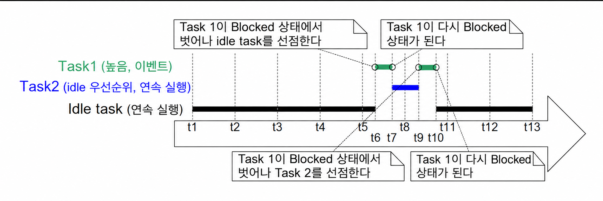

***그림 4.21*** *시분할을 사용하지 않을 때 동일 우선순위 task들이 극심하게 불균등한 처리 시간을 배분받는 모습을 보여주는 실행 패턴*

***

`configIDLE_SHOULD_YIELD`가 0으로 설정되어 있다고 가정하는 그림 4.21을 참고하면 다음과 같다.

- **Tick 인터럽트**: t1, t2, t3, t4, t5, t8, t11, t12, t13 시점에 발생한다.
- **Task 1**: 대부분의 시간을 관심 이벤트를 기다리며 Blocked 상태에서 보내는 높은 우선순위 이벤트 기반 task다. 이벤트가 발생할 때마다 Blocked 상태에서 Ready 상태로 전환되며, 최상위 우선순위이므로 곧바로 Running 상태로 진입한다. t6과 t7 사이, 그리고 t9와 t10 사이에서 이벤트를 처리한다.
- **Idle Task 및 Task 2**: 둘 다 연속 처리 task이며 둘 다 우선순위 0(idle 우선순위)을 갖는다. 연속 처리 task는 Blocked 상태로 들어가지 않는다.
  시분할이 사용되지 않으므로, Running 상태에 진입한 idle 우선순위 task는 더 높은 우선순위의 Task 1에 의해 선점당하기 전까지 계속 Running 상태를 유지한다.
  그림 4.21에서 idle task는 t1 시점에 실행을 시작하여 Task 1에 의해 선점되는 t6 시점까지 Running 상태를 유지하며, 이는 4번의 완전한 tick period보다 긴 시간이다.
  Task 2는 Task 1이 다시 Blocked 상태로 들어가 이벤트를 대기하는 t7 시점에 실행을 시작한다. Task 2는 t9 시점에 다시 Task 1에 의해 선점당할 때까지 Running 상태를 유지하지만, 이 시간은 1 tick period에도 미치지 못한다.
  t10 시점에 idle task가 다시 Running 상태로 복귀하는데, idle task는 이미 Task 2보다 4배 이상 많은 처리 시간을 소비했음에도 불구하고 다시 선택된 것이다.

<a id="4125-cooperative-scheduling"></a>
### 4.12.5 협력형 스케줄링 (Cooperative Scheduling)

이 책은 선점형 스케줄링을 주로 다루지만, FreeRTOS는 협력형(cooperative) 스케줄링도 지원한다. 표 5는 FreeRTOS scheduler를 협력형 스케줄링으로 설정하는 `FreeRTOSConfig.h` 구성을 보여준다.

협력형 scheduler를 사용하는 경우(그리고 애플리케이션 정의 인터럽트 서비스 루틴이 명시적으로 문맥 전환을 요청하지 않는다고 가정할 때), 문맥 전환은 Running 상태 task가 Blocked 상태로 진입하거나, Running 상태 task가 `taskYIELD()`를 명시적으로 호출하여 자발적으로 재스케줄링을 요청할 때만 발생한다. task가 결코 강제로 선점당하지 않으므로 시분할은 사용할 수 없다.

그림 4.22는 협력형 scheduler의 동작 방식을 보여준다. 그림 4.22의 수평 점선은 task가 Ready 상태에 머물러 있는 구간을 나타낸다.

<a name="fig4.22" title="Figure 4.22 Execution pattern demonstrating the behavior of the cooperative scheduler"></a>

***
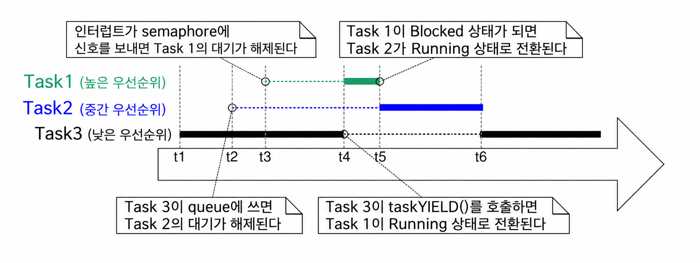

***그림 4.22*** *협력형 scheduler의 동작 방식을 보여주는 실행 패턴*

***

그림 4.22를 참고하면 다음과 같다.

- **Task 1**: 가장 높은 우선순위를 갖는다. 처음에는 semaphore(세마포어)를 기다리며 Blocked 상태에서 시작한다.
  t3 시점에 인터럽트가 발생하여 semaphore를 반환(`give`)하고, 이로 인해 Task 1이 Blocked 상태를 벗어나 Ready 상태로 진입한다(인터럽트에서의 semaphore 처리는 6장에서 다룸).
  t3 시점에 Task 1은 가장 높은 우선순위의 Ready 상태 task가 되며, 만약 선점형 scheduler를 사용했다면 Task 1이 즉시 Running 상태가 되었을 것이다. 그러나 협력형 scheduler를 사용하고 있으므로, Task 1은 Running 상태 task가 `taskYIELD()`를 호출하는 t4 시점까지 계속 Ready 상태에서 대기한다.
- **Task 2**: Task 1과 Task 3 사이의 우선순위를 갖는다. 처음에는 t2 시점에 Task 3이 자신에게 보낼 메시지를 기다리며 Blocked 상태에서 시작한다.
  t2 시점에 Task 2는 가장 높은 우선순위의 Ready 상태 task가 되며, 선점형 scheduler였다면 즉시 Running 상태가 되었을 것이다. 그러나 협력형 환경이므로 Running 상태 task가 Blocked 상태로 들어가거나 `taskYIELD()`를 호출할 때까지 Ready 상태로 남아 있는다.
  Running 상태 task가 t4 시점에 `taskYIELD()`를 호출하지만, 그 시점에는 Task 1이 더 높은 우선순위의 Ready 상태 task이므로 Task 2는 실행되지 못하고, Task 1이 처리를 마치고 t5 시점에 다시 Blocked 상태로 들어간 후에야 비로소 Running 상태가 된다.
  t6 시점에 Task 2는 다음 메시지를 기다리기 위해 다시 Blocked 상태로 진입하며, 이 시점에 다시 Task 3이 가장 높은 우선순위 Ready 상태 task가 된다.

멀티태스킹 애플리케이션에서 개발자는 둘 이상의 task가 동일한 자원에 동시에 접근하지 않도록 주의해야 한다. 동시 접근은 공유 자원의 데이터를 손상시킬 수 있기 때문이다. 예를 들어 공유 자원이 UART(직렬 포트)인 시나리오를 생각해보자. 두 task가 UART에 문자열을 출력하는데, Task 1은 "abcdefghijklmnop"를 출력하고 Task 2는 "123456789"를 출력한다.

1. Task 1이 Running 상태에서 문자열을 쓰기 시작하여 UART에 "abcdefg"를 썼지만, 나머지 문자를 마저 쓰기 전에 Running 상태를 벗어난다.
2. Task 2가 Running 상태로 진입하여 UART에 "123456789"를 전부 쓴 뒤 Running 상태를 벗어난다.
3. Task 1이 다시 Running 상태로 진입하여 문자열의 남은 문자들을 UART에 쓴다.

이 경우 UART에 실제로 출력되는 결과는 "abcdefg123456789hijklmnop"가 된다. Task 1이 쓰려던 문자열이 의도한 대로 끊김 없이 출력되지 못하고 중간에 Task 2의 문자열이 끼어들어 데이터가 오염된 것이다.

협력형 scheduler를 사용하면 선점형 scheduler를 사용할 때보다 동시 접근으로 인한 문제를 방지하기가 훨씬 쉬워진다[^7].

[^7]: task 간에 자원을 안전하게 공유하는 방법은 이 책의 후반부에서 자세히 설명한다. queue나 semaphore처럼 FreeRTOS 자체가 제공하는 커널 자원들은 본래부터 task 간에 항상 안전하게 공유될 수 있도록 설계되어 있다.

- 선점형 scheduler를 사용할 때는 다른 task와 공유하고 있는 자원이 불완전한 상태(inconsistent state)에 놓여 있는 도중에도 Running 상태 task가 언제든지 불시에 선점당할 수 있다. 방금 살펴본 UART 예제처럼 자원을 불완전한 상태로 남겨둔 채 선점당하면 데이터 오염이 발생한다.
- 협력형 scheduler를 사용할 때는 개발자가 다른 task로 전환되는 시점을 온전히 통제할 수 있다. 따라서 자원이 불완전한 상태에 있는 동안에는 다른 task로 전환되지 않도록 확실하게 보장할 수 있다.
- 위의 UART 예제라면 Task 1이 자신의 전체 문자열을 UART에 완전히 다 쓸 때까지 Running 상태를 벗어나지 않도록 보장할 수 있으며, 이를 통해 다른 task의 간섭으로 문자열이 손상될 가능성을 원천 차단할 수 있다.

그러나 그림 4.22에서 확인했듯이 협력형 scheduler를 사용하면 선점형 scheduler를 사용할 때보다 시스템의 실시간 반응성(responsiveness)이 떨어질 수밖에 없다.

- 선점형 scheduler를 사용할 때는 특정 task가 가장 높은 우선순위의 Ready 상태 task가 되는 즉시 scheduler가 해당 task를 실행하기 시작한다. 정해진 시간 내에 높은 우선순위 이벤트에 반드시 반응해야 하는 실시간 시스템에서는 이러한 즉각적인 선점 반응성이 필수적이다.
- 반면 협력형 scheduler를 사용할 때는 어떤 task가 가장 높은 우선순위의 Ready 상태 task가 되더라도, 현재 Running 상태인 task가 스스로 Blocked 상태로 들어가거나 `taskYIELD()`를 호출하기 전까지는 해당 고우선순위 task로의 전환이 지연된다.
