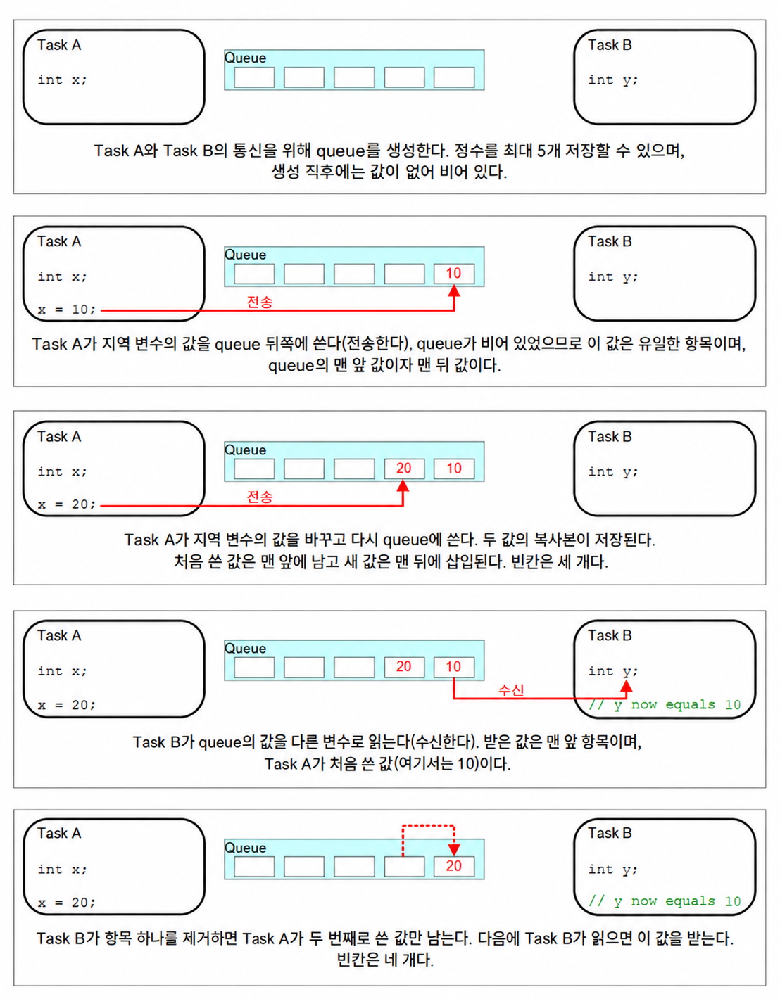
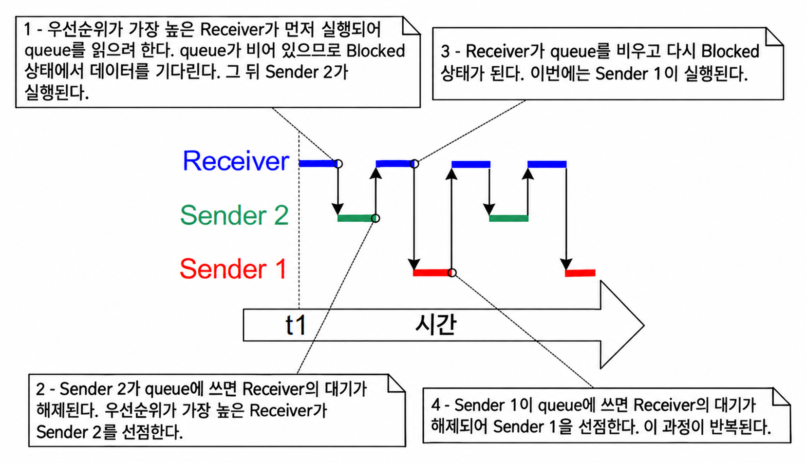
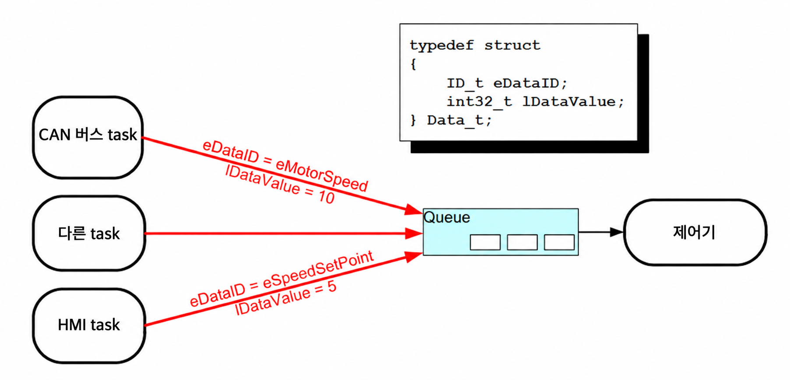
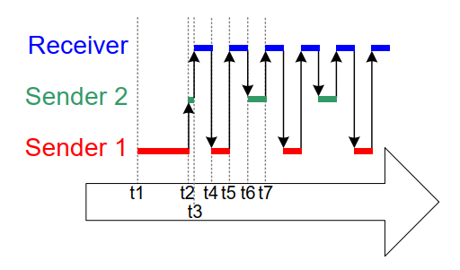

<a id="5-queue-management"></a>
# 5 큐 관리 (Queue Management)

<a id="51-introduction"></a>
## 5.1 소개 (Introduction)

'큐(Queue)'는 태스크 간(task-to-task), 태스크와 인터럽트 간(task-to-interrupt), 인터럽트와 태스크 간(interrupt-to-task) 통신 메커니즘을 제공한다.


<a id="511-scope"></a>
### 5.1.1 범위 (Scope)

이 장에서는 다음 내용을 다룬다:

- 큐를 생성하는 방법.
- 큐가 포함된 데이터를 관리하는 방법.
- 큐에 데이터를 보내는 방법.
- 큐에서 데이터를 수신하는 방법.
- 큐에서 블록(Block)된다는 것의 의미.
- 여러 큐에 대해 블록하는 방법.
- 큐의 데이터를 덮어쓰는(overwrite) 방법.
- 큐를 초기화(clear)하는 방법.
- 큐에 쓰고 읽을 때 태스크 우선순위가 미치는 영향.

이 장에서는 태스크 간 통신만을 다룬다. 7장에서는 태스크와 인터럽트 간, 그리고 인터럽트와 태스크 간 통신을 다룬다.


<a id="52-characteristics-of-a-queue"></a>
## 5.2 큐의 특성 (Characteristics of a Queue)

<a id="521-data-storage"></a>
### 5.2.1 데이터 저장 (Data Storage)

큐는 유한한 개수의 고정 크기 데이터 항목을 보유할 수 있다[^8]. 큐가 보유할 수 있는 최대 항목 수를 '길이(length)'라고 부른다. 큐의 길이와 각 데이터 항목의 크기는 모두 큐가 생성될 때 설정된다.

[^8]: TBD 장에서 설명하는 FreeRTOS 메시지 버퍼(message buffer)는 가변 길이 메시지를 보유할 수 있는 큐에 대한 더 가벼운 대안을 제공한다.

큐는 일반적으로 데이터가 큐의 끝(tail)에 쓰여지고 큐의 앞(head)에서 제거되는 FIFO(First In First Out) 버퍼로 사용된다. 그림 5.1은 FIFO로 사용되는 큐에 데이터를 쓰고 읽는 과정을 보여준다. 또한 큐의 맨 앞에 쓰는 것도 가능하며, 이미 큐 맨 앞에 있는 데이터를 덮어쓰는 것도 가능하다.

<a name="fig5.1" title="Figure 5.1 An example sequence of writes to, and reads from a queue"></a>

* * *
   
***그림 5.1*** *큐에 대한 쓰기 및 읽기 예제 시퀀스 (An example sequence of writes to, and reads from a queue)*
* * *

큐의 동작을 구현할 수 있는 두 가지 방식이 있다:

1. 복사에 의한 큐잉 (Queue by copy)

    복사에 의한 큐잉은 큐로 전송된 데이터를 바이트 단위로 큐 내부에 그대로 복사하는 것을 의미한다.

1. 참조에 의한 큐잉 (Queue by reference)

    참조에 의한 큐잉은 큐가 전송된 데이터 자체가 아니라 데이터에 대한 포인터만 보유하는 것을 의미한다.

FreeRTOS는 복사에 의한 큐잉 방식을 사용한다. 이 방식이 참조에 의한 큐잉보다 더 강력하고 사용하기 간단하기 때문이다:

- 복사에 의한 큐잉을 사용한다고 해서 큐를 참조에 의한 큐잉으로 사용하는 것이 불가능하지 않다. 예를 들어, 큐에 넣을 데이터의 크기가 너무 커서 데이터를 큐로 복사하는 것이 비실용적인 경우, 데이터에 대한 포인터를 대신 큐로 복사하면 된다.

- 스택 변수를 선언한 함수가 종료된 후 해당 변수가 더 이상 존재하지 않게 되더라도, 스택 변수를 큐로 직접 보낼 수 있다.

- 데이터를 보관하기 위한 버퍼를 먼저 할당하고(그 후 데이터를 할당된 버퍼로 복사한 뒤 해당 버퍼에 대한 참조를 큐에 넣는 방식 없이) 데이터를 큐로 바로 보낼 수 있다.

- 송신 태스크는 큐로 전송된 변수나 버퍼를 즉시 재사용할 수 있다.

- 송신 태스크와 수신 태스크가 완전히 분리(de-coupled)된다. 애플리케이션 설계자는 어떤 태스크가 데이터를 '소유'하는지, 또는 어떤 태스크가 데이터 해제를 책임져야 하는지 신경 쓸 필요가 없다.

- RTOS가 데이터를 저장하는 데 사용되는 메모리 할당을 전적으로 책임진다.

- 메모리 보호 시스템에서는 RAM에 대한 접근을 제한하므로, 이 경우 송신 태스크와 수신 태스크가 모두 참조된 데이터에 접근할 수 있어야만 참조에 의한 큐잉이 가능하다. 반면 복사에 의한 큐잉은 데이터가 메모리 보호 경계를 넘나들 수 있도록 한다.


<a id="522-access-by-multiple-tasks"></a>
### 5.2.2 다중 태스크의 접근 (Access by Multiple Tasks)

큐는 그 자체로 독립된 객체이며, 큐의 존재를 알고 있는 모든 태스크나 ISR(인터럽트 서비스 루틴)에 의해 접근될 수 있다. 몇 개든 원하는 만큼의 태스크가 동일한 큐에 쓸 수 있으며, 몇 개든 원하는 만큼의 태스크가 동일한 큐에서 읽을 수 있다. 실제로는 하나의 큐에 여러 개의 쓰기 태스크(writer)가 존재하는 경우가 매우 흔하지만, 여러 개의 읽기 태스크(reader)가 존재하는 경우는 훨씬 드물다.


<a id="523-blocking-on-queue-reads"></a>
### 5.2.3 큐 읽기 시 블록 (Blocking on Queue Reads)

태스크가 큐에서 읽기를 시도할 때, 선택적으로 '블록(block)' 시간을 지정할 수 있다. 이는 큐가 이미 비어 있는 경우, 큐에서 데이터를 사용할 수 있게 될 때까지 태스크가 Blocked 상태(대기)로 유지되는 시간이다. 큐에서 데이터를 사용할 수 있기를 기다리며 Blocked 상태에 있는 태스크는 다른 태스크나 인터럽트가 큐에 데이터를 넣으면 자동으로 Ready 상태(실행 가능)로 이동한다. 또한 지정된 블록 시간이 만료될 때까지 데이터를 사용할 수 없게 되면, 태스크는 Blocked 상태에서 Ready 상태로 자동으로 이동한다.

큐에는 여러 개의 읽기 태스크가 존재할 수 있으므로, 단일 큐에서 데이터를 기다리며 둘 이상의 태스크가 블록될 수 있다. 이러한 경우, 데이터를 사용할 수 있게 되면 오직 하나의 태스크만 블록 해제된다. 블록 해제되는 태스크는 데이터를 기다리던 태스크 중 항상 가장 높은 우선순위를 가진 태스크이다. 만약 둘 이상의 블록된 태스크가 동일한 우선순위를 가진다면, 가장 오래 기다린 태스크가 블록 해제된다.


<a id="524-blocking-on-queue-writes"></a>
### 5.2.4 큐 쓰기 시 블록 (Blocking on Queue Writes)

큐에서 읽을 때와 마찬가지로, 태스크는 큐에 쓸 때도 선택적으로 블록 시간을 지정할 수 있다. 이 경우 블록 시간은 큐가 이미 가득 찬 경우, 큐에 공간이 생길 때까지 태스크가 Blocked 상태로 유지되는 최대 시간이다.

큐에는 여러 개의 쓰기 태스크가 존재할 수 있으므로, 가득 찬 큐에서 전송 작업을 완료하기 위해 둘 이상의 태스크가 블록될 수 있다. 이러한 경우, 큐에 공간이 생기면 오직 하나의 태스크만 블록 해제된다. 블록 해제되는 태스크는 공간을 기다리던 태스크 중 항상 가장 높은 우선순위를 가진 태스크이다. 둘 이상의 블록된 태스크가 동일한 우선순위를 가진다면, 가장 오래 기다린 태스크가 블록 해제된다.


<a id="525-blocking-on-multiple-queues"></a>
### 5.2.5 다중 큐에 대한 블록 (Blocking on Multiple Queues)

큐들을 세트(set)로 그룹화하여, 세트에 포함된 큐 중 어느 하나에라도 데이터가 들어올 때까지 태스크가 Blocked 상태로 대기하도록 만들 수 있다. 5.6절 "다중 큐로부터 수신"에서 큐 세트(Queue Set)를 설명한다.


<a id="526-creating-queues-statically-allocated-and-dynamically-allocated-queues"></a>
### 5.2.6 큐 생성: 정적 할당 큐와 동적 할당 큐 (Creating Queues: Statically Allocated and Dynamically Allocated Queues)

큐는 `QueueHandle_t` 타입의 변수인 핸들(handle)로 참조된다. 큐를 사용하기 전에 반드시 명시적으로 생성해야 한다.

두 개의 API 함수가 큐를 생성한다: `xQueueCreate()`, `xQueueCreateStatic()`.

각 큐는 두 개의 RAM 블록을 필요로 한다. 첫 번째는 큐의 데이터 구조를 보관하기 위한 것이고, 두 번째는 큐에 들어가는 데이터를 보관하기 위한 것이다. `xQueueCreate()`는 필요한 RAM을 힙에서 (동적으로) 할당한다. `xQueueCreateStatic()`은 함수의 매개변수로 전달된 사전 할당된 RAM을 사용한다.


<a id="53-using-a-queue"></a>
## 5.3 큐 사용하기 (Using a Queue)

<a id="531-the-xqueuecreate-api-function"></a>
### 5.3.1 xQueueCreate() API 함수 (The xQueueCreate() API Function)

Listing 5.1은 `xQueueCreate()` 함수 프로토타입을 보여준다. `xQueueCreateStatic()`은 각각 큐의 데이터 구조와 데이터 저장 영역을 보관하도록 사전 할당된 메모리를 가리키는 두 개의 추가 매개변수를 갖는다.

<a name="list5.1" title="Listing 5.1 The xQueueCreate() API function prototype"></a>

```c
QueueHandle_t xQueueCreate( UBaseType_t uxQueueLength, UBaseType_t uxItemSize );
```
***Listing 5.1*** *The xQueueCreate() API function prototype*


**xQueueCreate() 매개변수 및 반환값:**

- `uxQueueLength`

  생성되는 큐가 한 번에 보유할 수 있는 최대 항목 수.

- `uxItemSize`

  큐에 저장될 수 있는 각 데이터 항목의 바이트 단위 크기.

- 반환값

  NULL이 반환되면 FreeRTOS가 큐 데이터 구조 및 저장 영역을 할당하기에 사용 가능한 힙 메모리가 부족하여 큐를 생성할 수 없음을 의미한다. 2장에서 FreeRTOS 힙에 대한 자세한 정보를 제공한다.

  NULL이 아닌 값이 반환되면 큐가 성공적으로 생성되었음을 의미하며, 반환된 값은 생성된 큐에 대한 핸들이다.

`xQueueReset()`은 이전에 생성된 큐를 원래의 비어 있는 상태로 복원하는 API 함수이다.


<a id="532-the-xqueuesendtoback-and-xqueuesendtofront-api-functions"></a>
### 5.3.2 xQueueSendToBack() 및 xQueueSendToFront() API 함수 (The xQueueSendToBack() and xQueueSendToFront() API Functions)

예상할 수 있듯이, `xQueueSendToBack()`은 큐의 뒤쪽(tail)으로 데이터를 보내고, `xQueueSendToFront()`는 큐의 앞쪽(head)으로 데이터를 보낸다.

`xQueueSend()`는 `xQueueSendToBack()`과 동등하며 완전히 동일하다.

> *참고: 인터럽트 서비스 루틴 내에서 `xQueueSendToFront()`나 `xQueueSendToBack()`을 절대로 호출해서는 안 된다. 그 대신 인터럽트 안전 버전인 `xQueueSendToFrontFromISR()` 및 `xQueueSendToBackFromISR()`을 사용해야 한다. 이에 대해서는 7장에서 설명한다.*

<a name="list5.2" title="Listing 5.2 The xQueueSendToFront() API function prototype"></a>


```c
BaseType_t xQueueSendToFront( QueueHandle_t xQueue,
                              const void * pvItemToQueue,
                              TickType_t xTicksToWait );
```
***Listing 5.2*** *The xQueueSendToFront() API function prototype*


<a name="list5.3" title="Listing 5.3 The xQueueSendToBack() API function prototype"></a>


```c
BaseType_t xQueueSendToBack( QueueHandle_t xQueue,
                             const void * pvItemToQueue,
                             TickType_t xTicksToWait );
```
***Listing 5.3*** *The xQueueSendToBack() API function prototype*


**xQueueSendToFront() 및 xQueueSendToBack() 함수 매개변수와 반환값**

- `xQueue`

  데이터가 전송되는(쓰여지는) 큐의 핸들. 이 큐 핸들은 큐를 생성하는 데 사용된 `xQueueCreate()` 또는 `xQueueCreateStatic()` 호출에서 반환된 값이다.

- `pvItemToQueue`

  큐로 복사될 데이터에 대한 포인터.

  큐가 보유할 수 있는 각 항목의 크기는 큐가 생성될 때 설정되므로, `pvItemToQueue`로부터 큐 저장 영역으로 그만큼의 바이트가 복사된다.

- `xTicksToWait`

  큐가 이미 가득 찬 경우, 큐에 공간이 생길 때까지 태스크가 Blocked 상태로 머물러야 하는 최대 시간.

  `xTicksToWait`가 0이고 큐가 이미 가득 차 있으면 `xQueueSendToFront()`와 `xQueueSendToBack()` 모두 즉시 반환된다.

  블록 시간은 틱 주기로 지정되므로, 이것이 나타내는 절대 시간은 틱 주파수에 따라 달라진다. 매크로 `pdMS_TO_TICKS()`를 사용하여 밀리초 단위로 지정된 시간을 틱 단위 시간으로 변환할 수 있다.

  FreeRTOSConfig.h에서 `INCLUDE_vTaskSuspend`가 1로 설정되어 있는 경우, `xTicksToWait`를 `portMAX_DELAY`로 설정하면 태스크가 (시간 초과 없이) 무기한 대기하게 된다.

- 반환값

  두 가지 가능한 반환값이 있다:

  - `pdPASS`

    데이터가 큐로 성공적으로 전송되었을 때 `pdPASS`가 반환된다.

    블록 시간이 지정된 경우(`xTicksToWait`가 0이 아님), 함수가 반환되기 전에 큐에 공간이 생기기를 기다리기 위해 호출 태스크가 Blocked 상태로 전환되었을 수 있으나, 블록 시간이 만료되기 전에 데이터가 큐에 성공적으로 기록된 것이다.

  - `errQUEUE_FULL` (`pdFAIL`과 동일한 값)

    큐가 이미 가득 차서 데이터를 큐에 쓸 수 없는 경우 `errQUEUE_FULL`이 반환된다.

    블록 시간이 지정된 경우(`xTicksToWait`가 0이 아님), 다른 태스크나 인터럽트가 큐에 공간을 만들어 주기를 기다리기 위해 호출 태스크가 Blocked 상태로 전환되었으나, 그 일이 일어나기 전에 지정된 블록 시간이 만료된 것이다.


<a id="533-the-xqueuereceive-api-function"></a>
### 5.3.3 xQueueReceive() API 함수 (The xQueueReceive() API Function)

`xQueueReceive()`는 큐에서 항목을 수신(읽기)한다. 수신된 항목은 큐에서 제거된다.

> *참고: 인터럽트 서비스 루틴 내에서 `xQueueReceive()`를 절대로 호출해서는 안 된다. 인터럽트 안전한 `xQueueReceiveFromISR()` API 함수는 7장에서 설명한다.*

<a name="list5.4" title="Listing 5.4 The xQueueReceive() API function prototype"></a>

```c
BaseType_t xQueueReceive( QueueHandle_t xQueue,
                          void * const pvBuffer,
                          TickType_t xTicksToWait );
```
***Listing 5.4*** *The xQueueReceive() API function prototype*


**xQueueReceive() 함수 매개변수 및 반환값**

- `xQueue`

  데이터를 수신(읽기)할 큐의 핸들. 이 큐 핸들은 큐를 생성하는 데 사용된 `xQueueCreate()` 또는 `xQueueCreateStatic()` 호출에서 반환된 값이다.

- `pvBuffer`

  수신된 데이터가 복사될 메모리에 대한 포인터.

  큐가 보유하는 각 데이터 항목의 크기는 큐가 생성될 때 설정된다. `pvBuffer`가 가리키는 메모리는 최소한 그 크기만큼의 바이트를 수용할 수 있을 만큼 커야 한다.

- `xTicksToWait`

  큐가 이미 비어 있는 경우, 큐에서 데이터를 사용할 수 있게 될 때까지 태스크가 Blocked 상태로 머물러야 하는 최대 시간.

  `xTicksToWait`가 0이면, 큐가 이미 비어 있는 경우 `xQueueReceive()`는 즉시 반환된다.

  블록 시간은 틱 주기로 지정되므로, 이것이 나타내는 절대 시간은 틱 주파수에 따라 달라진다. 매크로 `pdMS_TO_TICKS()`를 사용하여 밀리초 단위로 지정된 시간을 틱 단위 시간으로 변환할 수 있다.

  FreeRTOSConfig.h에서 `INCLUDE_vTaskSuspend`가 1로 설정되어 있는 경우, `xTicksToWait`를 `portMAX_DELAY`로 설정하면 태스크가 (시간 초과 없이) 무기한 대기하게 된다.

- 반환값

  두 가지 가능한 반환값이 있다:

  - `pdPASS`

    큐에서 데이터를 성공적으로 읽었을 때 `pdPASS`가 반환된다.

    블록 시간이 지정된 경우(`xTicksToWait`가 0이 아님), 호출 태스크가 큐에서 데이터를 사용할 수 있게 되기를 기다리기 위해 Blocked 상태로 전환되었을 수 있으나, 블록 시간이 만료되기 전에 큐에서 데이터를 성공적으로 읽은 것이다.

  - `errQUEUE_EMPTY` (`pdFAIL`과 동일한 값)

    큐가 이미 비어 있어서 큐에서 데이터를 읽을 수 없는 경우 `errQUEUE_EMPTY`가 반환된다.

    블록 시간이 지정된 경우(`xTicksToWait`가 0이 아님), 다른 태스크나 인터럽트가 큐로 데이터를 보내주기를 기다리기 위해 호출 태스크가 Blocked 상태로 전환되었으나, 그 일이 일어나기 전에 블록 시간이 만료된 것이다.


<a id="534-the-uxqueuemessageswaiting-api-function"></a>
### 5.3.4 uxQueueMessagesWaiting() API 함수 (The uxQueueMessagesWaiting() API Function)

`uxQueueMessagesWaiting()`은 현재 큐에 있는 항목의 개수를 조회한다.

> *참고: 인터럽트 서비스 루틴 내에서 `uxQueueMessagesWaiting()`을 절대로 호출해서는 안 된다. 그 대신 인터럽트 안전한 `uxQueueMessagesWaitingFromISR()`을 사용해야 한다.*

<a name="list5.5" title="Listing 5.5 The uxQueueMessagesWaiting() API function prototype"></a>

```c
UBaseType_t uxQueueMessagesWaiting( QueueHandle_t xQueue );
```
***Listing 5.5*** *The uxQueueMessagesWaiting() API function prototype*


**uxQueueMessagesWaiting() 함수 매개변수 및 반환값**

- `xQueue`

  조회 대상 큐의 핸들. 이 큐 핸들은 큐를 생성하는 데 사용된 `xQueueCreate()` 또는 `xQueueCreateStatic()` 호출에서 반환된 값이다.

- 반환값

  조회 중인 큐에 현재 저장되어 있는 항목의 개수. 0이 반환되면 큐가 비어 있음을 의미한다.


<a name="example5.1" title="Example 5.1 Blocking when receiving from a queue"></a>
---
***예제 5.1*** *큐에서 수신할 때의 블록 (Blocking when receiving from a queue)*

---

이 예제는 큐를 생성하고, 여러 태스크에서 큐로 데이터를 전송하며, 큐에서 데이터를 수신하는 과정을 보여준다. 큐는 `int32_t` 타입의 데이터 항목을 보유하도록 생성된다. 큐로 데이터를 보내는 태스크들은 블록 시간을 지정하지 않는 반면, 큐에서 수신하는 태스크는 블록 시간을 지정한다.

큐로 데이터를 보내는 태스크들은 큐에서 수신하는 태스크보다 낮은 우선순위를 갖는다. 즉, 큐에 데이터가 전송되는 즉시 수신 태스크가 블록 해제되어 (우선순위가 더 높으므로) 송신 태스크를 선점(pre-empt)하고 데이터를 제거하여 큐를 다시 비워두기 때문에, 큐는 한 번에 둘 이상의 항목을 절대로 포함하지 않아야 한다.

이 예제는 Listing 5.6에 표시된 태스크의 인스턴스를 두 개 생성한다. 하나는 큐에 지속적으로 값 100을 쓰고, 다른 하나는 동일한 큐에 지속적으로 값 200을 쓴다. 태스크 매개변수는 이러한 값을 각 태스크 인스턴스로 전달하는 데 사용된다.

<a name="list5.6" title="Listing 5.6 Implementation of the sending task used in Example 5.1"></a>

```c
static void vSenderTask( void *pvParameters )
{

    int32_t lValueToSend;

    BaseType_t xStatus;

    /* Two instances of this task are created so the value that is sent to
       the queue is passed in via the task parameter - this way each instance 
       can use a different value. The queue was created to hold values of type 
       int32_t, so cast the parameter to the required type. */
    lValueToSend = ( int32_t ) pvParameters;

    /* As per most tasks, this task is implemented within an infinite loop. */
    for( ;; )
    {

        /* Send the value to the queue.

           The first parameter is the queue to which data is being sent. The
           queue was created before the scheduler was started, so before this 
           task started to execute.

           The second parameter is the address of the data to be sent, in this 
           case the address of lValueToSend.

           The third parameter is the Block time – the time the task should be 
           kept in the Blocked state to wait for space to become available on 
           the queue should the queue already be full. In this case a block 
           time is not specified because the queue should never contain more 
           than one item, and therefore never be full. */
        xStatus = xQueueSendToBack( xQueue, &lValueToSend, 0 );

        if( xStatus != pdPASS )
        {
            /* The send operation could not complete because the queue was full-
               this must be an error as the queue should never contain more than
               one item! */
            vPrintString( "Could not send to the queue.
" );
        }
    }
}
```
***Listing 5.6*** *Implementation of the sending task used in Example 5.1*


Listing 5.7은 큐에서 데이터를 수신하는 태스크의 구현을 보여준다. 수신 태스크는 100밀리초의 블록 시간을 지정한 후, 데이터를 사용할 수 있게 될 때까지 대기하기 위해 Blocked 상태로 진입한다. 큐에서 데이터를 사용할 수 있게 되거나, 데이터 없이 100밀리초가 경과하면 Blocked 상태를 벗어난다. 이 예제에서는 두 태스크가 지속적으로 큐에 쓰기를 수행하므로 100밀리초 타임아웃은 절대 만료되지 않는다.

<a name="list5.7" title="Listing 5.7  Implementation of the receiver task for Example 5.1"></a>

```c
static void vReceiverTask( void *pvParameters )
{
    /* Declare the variable that will hold the values received from the
       queue. */
    int32_t lReceivedValue;
    BaseType_t xStatus;
    const TickType_t xTicksToWait = pdMS_TO_TICKS( 100 );

    /* This task is also defined within an infinite loop. */
    for( ;; )
    {
        /* This call should always find the queue empty because this task will
           immediately remove any data that is written to the queue. */
        if( uxQueueMessagesWaiting( xQueue ) != 0 )
        {
            vPrintString( "Queue should have been empty!
" );
        }

        /* Receive data from the queue.

           The first parameter is the queue from which data is to be received.
           The queue is created before the scheduler is started, and therefore
           before this task runs for the first time.

           The second parameter is the buffer into which the received data will
           be placed. In this case the buffer is simply the address of a 
           variable that has the required size to hold the received data.

           The last parameter is the block time – the maximum amount of time 
           that the task will remain in the Blocked state to wait for data to 
           be available should the queue already be empty. */
        xStatus = xQueueReceive( xQueue, &lReceivedValue, xTicksToWait );

        if( xStatus == pdPASS )
        {
            /* Data was successfully received from the queue, print out the
               received value. */
            vPrintStringAndNumber( "Received = ", lReceivedValue );
        }
        else
        {
            /* Data was not received from the queue even after waiting for 
               100ms. This must be an error as the sending tasks are free 
               running and will be continuously writing to the queue. */
            vPrintString( "Could not receive from the queue.
" );
        }
    }
}
```
***Listing 5.7***  *Implementation of the receiver task for Example 5.1*


Listing 5.8은 `main()` 함수의 정의를 담고 있다. 이는 스케줄러를 시작하기 전에 단순히 큐와 세 태스크를 생성한다. 큐는 상대적인 태스크 우선순위로 인해 한 번에 둘 이상의 항목을 보유하지 않음에도 불구하고 최대 5개의 `int32_t` 값을 보유하도록 생성된다.

<a name="list5.8" title="Listing 5.8 The implementation of main() in Example 5.1"></a>

```c
/* Declare a variable of type QueueHandle_t. This is used to store the
   handle to the queue that is accessed by all three tasks. */
QueueHandle_t xQueue;

int main( void )
{
    /* The queue is created to hold a maximum of 5 values, each of which is
       large enough to hold a variable of type int32_t. */
    xQueue = xQueueCreate( 5, sizeof( int32_t ) );

    if( xQueue != NULL )
    {
        /* Create two instances of the task that will send to the queue. The
           task parameter is used to pass the value that the task will write 
           to the queue, so one task will continuously write 100 to the queue 
           while the other task will continuously write 200 to the queue. Both
           tasks are created at priority 1. */
        xTaskCreate( vSenderTask, "Sender1", 1000, ( void * ) 100, 1, NULL );
        xTaskCreate( vSenderTask, "Sender2", 1000, ( void * ) 200, 1, NULL );

        /* Create the task that will read from the queue. The task is created
           with priority 2, so above the priority of the sender tasks. */
        xTaskCreate( vReceiverTask, "Receiver", 1000, NULL, 2, NULL );

        /* Start the scheduler so the created tasks start executing. */
        vTaskStartScheduler();
    }
    else
    {
        /* The queue could not be created. */
    }

    /* If all is well then main() will never reach here as the scheduler will
       now be running the tasks. If main() does reach here then it is likely
       that there was insufficient FreeRTOS heap memory available for the idle 
       task to be created. Chapter 3 provides more information on heap memory 
       management. */
    for( ;; );
}
```
***Listing 5.8*** *The implementation of main() in Example 5.1*

그림 5.2는 예제 5.1에 의해 생성된 출력을 보여준다.

<a name="fig5.2" title="Figure 5.2 The output produced when Example 5.1 is executed"></a>

* * *
   
***그림 5.2*** *예제 5.1 실행 시 생성되는 출력 (The output produced when Example 5.1 is executed)*
* * *


그림 5.3은 실행 시퀀스를 보여준다.

<a name="fig5.3" title="Figure 5.3 The sequence of execution produced by Example 5.1"></a>

* * *
   
***그림 5.3*** *예제 5.1에서 생성되는 실행 시퀀스 (The sequence of execution produced by Example 5.1)*
* * *


<a id="54-receiving-data-from-multiple-sources"></a>
## 5.4 여러 소스로부터 데이터 수신 (Receiving Data From Multiple Sources)

FreeRTOS 설계에서 태스크가 둘 이상의 소스로부터 데이터를 수신하는 것은 일반적이다. 수신 태스크는 데이터로 무엇을 해야 할지 결정하기 위해 데이터가 어디서 왔는지 알아야 한다. 이를 달성하기 위한 쉬운 디자인 패턴은 그림 5.4에 나와 있는 것처럼 데이터 값과 데이터 소스를 모두 포함하는 구조체를 단일 큐를 통해 전송하는 것이다.

<a name="fig5.4" title="Figure 5.4 An example scenario where structures are sent on a queue"></a>

* * *
   
***그림 5.4*** *큐를 통해 구조체를 전송하는 예제 시나리오 (An example scenario where structures are sent on a queue)*
* * *

그림 5.4를 참조하면 다음과 같다:

- 생성된 큐는 `Data_t` 타입의 구조체를 보유한다. 이 구조체를 통해 데이터 값과 데이터의 의미를 나타내는 열거형 타입을 하나의 메시지로 큐에 전송할 수 있다.

- 중앙 제어기(Controller) 태스크는 주요 시스템 기능을 수행한다. 이는 큐를 통해 전달된 시스템 상태의 변화와 입력에 반응해야 한다.

- CAN 버스 태스크는 CAN 버스 인터페이싱 기능을 캡슐화하는 데 사용된다. CAN 버스 태스크는 메시지를 수신하고 디코딩하면 이미 디코딩된 메시지를 `Data_t` 구조체에 담아 제어기 태스크로 보낸다. 전달된 구조체의 `eDataID` 멤버는 제어기 태스크에 해당 데이터가 무엇인지를 알려준다. 여기에 표시된 경우 모터 속도 값이다. 전달된 구조체의 `lDataValue` 멤버는 제어기 태스크에 실제 모터 속도 값을 알려준다.

- HMI(Human Machine Interface) 태스크는 모든 HMI 기능을 캡슐화하는 데 사용된다. 기계 운전자는 여러 가지 방식으로 명령을 입력하고 값을 조회할 수 있으며, 이는 HMI 태스크 내에서 감지되고 해석되어야 한다. 새로운 명령이 입력되면 HMI 태스크는 명령을 `Data_t` 구조체에 담아 제어기 태스크로 보낸다. 전달된 구조체의 `eDataID` 멤버는 제어기 태스크에 해당 데이터가 무엇인지를 알려준다. 여기에 표시된 경우 새로운 설정값(set point)이다. 전달된 구조체의 `lDataValue` 멤버는 제어기 태스크에 실제 설정값을 알려준다.

(RB-TBD) 장에서는 제어기 태스크가 구조체를 큐에 넣은 태스크에 직접 응답할 수 있도록 이 디자인 패턴을 확장하는 방법을 보여준다.


<a name="example5.2" title="Example 5.2 Blocking when sending to a queue, and sending structures on a queue"></a>
---
***예제 5.2*** *큐에 보낼 때의 블록 및 큐를 통한 구조체 전송 (Blocking when sending to a queue, and sending structures on a queue)*

---

예제 5.2는 예제 5.1과 유사하지만 태스크 우선순위가 뒤바뀌어 수신 태스크가 송신 태스크보다 낮은 우선순위를 갖는다. 또한 생성된 큐는 정수가 아닌 구조체를 보관한다.

Listing 5.9는 예제 5.2에서 사용되는 구조체의 정의를 보여준다.

<a name="list5.9" title="Listing 5.9 The definition of the structure that is to be passed on a queue, plus the declaration of two variables for use by the example"></a>

```c
/* Define an enumerated type used to identify the source of the data. */
typedef enum
{
    eSender1,
    eSender2
} DataSource_t;

/* Define the structure type that will be passed on the queue. */
typedef struct
{
    uint8_t ucValue;
    DataSource_t eDataSource;
} Data_t;

/* Declare two variables of type Data_t that will be passed on the queue. */
static const Data_t xStructsToSend[ 2 ] =
{
    { 100, eSender1 }, /* Used by Sender1. */
    { 200, eSender2 }  /* Used by Sender2. */
};
```
***Listing 5.9*** *The definition of the structure that is to be passed on a queue, plus the declaration of two variables for use by the example*

예제 5.1에서는 수신 태스크가 가장 높은 우선순위를 가지므로 큐에 둘 이상의 항목이 들어 있지 않다. 이는 데이터가 큐에 배치되는 즉시 수신 태스크가 송신 태스크를 선점하기 때문에 발생한다. 예제 5.2에서는 송신 태스크가 더 높은 우선순위를 가지므로 큐가 일반적으로 가득 차 있게 된다. 수신 태스크가 큐에서 항목을 제거하는 즉시 송신 태스크 중 하나에 의해 선점되고, 그 송신 태스크가 즉시 큐를 다시 채우기 때문이다. 그런 다음 송신 태스크는 큐에 다시 공간이 생기기를 기다리기 위해 Blocked 상태로 다시 진입한다.

Listing 5.10은 송신 태스크의 구현을 보여준다. 송신 태스크는 100밀리초의 블록 시간을 지정하므로 큐가 가득 찰 때마다 공간이 생기기를 기다리기 위해 Blocked 상태로 진입한다. 큐에 공간이 생기거나 공간 없이 100밀리초가 경과하면 Blocked 상태를 벗어난다. 이 예제에서는 수신 태스크가 지속적으로 큐의 공간을 만들어 주므로 100밀리초 타임아웃은 절대 만료되지 않는다.

<a name="list5.10" title="Listing 5.10 The implementation of the sending task for Example 5.2"></a>

```c
static void vSenderTask( void *pvParameters )
{
    BaseType_t xStatus;
    const TickType_t xTicksToWait = pdMS_TO_TICKS( 100 );

    /* As per most tasks, this task is implemented within an infinite loop. */
    for( ;; )
    {
        /* Send to the queue.

           The second parameter is the address of the structure being sent. The
           address is passed in as the task parameter so pvParameters is used
           directly.

           The third parameter is the Block time - the time the task should be 
           kept in the Blocked state to wait for space to become available on 
           the queue if the queue is already full. A block time is specified 
           because the sending tasks have a higher priority than the receiving 
           task so the queue is expected to become full. The receiving task 
           will remove items from the queue when both sending tasks are in the 
           Blocked state. */
        xStatus = xQueueSendToBack( xQueue, pvParameters, xTicksToWait );

        if( xStatus != pdPASS )
        {
            /* The send operation could not complete, even after waiting for 
               100ms. This must be an error as the receiving task should make 
               space in the queue as soon as both sending tasks are in the 
               Blocked state. */
            vPrintString( "Could not send to the queue.
" );
        }
    }
}
```
***Listing 5.10*** *The implementation of the sending task for Example 5.2*


수신 태스크는 가장 낮은 우선순위를 가지므로 두 송신 태스크가 모두 Blocked 상태에 있을 때만 실행된다. 송신 태스크는 큐가 가득 찼을 때만 Blocked 상태로 진입하므로, 수신 태스크는 큐가 이미 가득 찬 상태에서만 실행된다. 따라서 블록 시간을 지정하지 않더라도 항상 데이터를 수신할 수 있을 것으로 기대한다.

Listing 5.11은 수신 태스크의 구현을 보여준다.

<a name="list5.11" title="Listing 5.11 The definition of the receiving task for Example 5.2"></a>

```c
static void vReceiverTask( void *pvParameters )
{
    /* Declare the structure that will hold the values received from the
       queue. */
    Data_t xReceivedStructure;
    BaseType_t xStatus;

    /* This task is also defined within an infinite loop. */
    for( ;; )
    {
        /* Because it has the lowest priority this task will only run when the
           sending tasks are in the Blocked state. The sending tasks will only
           enter the Blocked state when the queue is full so this task always 
           expects the number of items in the queue to be equal to the queue 
           length, which is 3 in this case. */
        if( uxQueueMessagesWaiting( xQueue ) != 3 )
        {
            vPrintString( "Queue should have been full!
" );
        }

        /* Receive from the queue.

           The second parameter is the buffer into which the received data will
           be placed. In this case the buffer is simply the address of a 
           variable that has the required size to hold the received structure.

           The last parameter is the block time - the maximum amount of time 
           that the task will remain in the Blocked state to wait for data to 
           be available if the queue is already empty. In this case a block 
           time is not necessary because this task will only run when the 
           queue is full. */
        xStatus = xQueueReceive( xQueue, &xReceivedStructure, 0 );

        if( xStatus == pdPASS )
        {
            /* Data was successfully received from the queue, print out the
               received value and the source of the value. */
            if( xReceivedStructure.eDataSource == eSender1 )
            {
                vPrintStringAndNumber( "From Sender 1 = ", 
                                       xReceivedStructure.ucValue );
            }
            else
            {
                vPrintStringAndNumber( "From Sender 2 = ", 
                                       xReceivedStructure.ucValue );
            }
        }
        else
        {
            /* Nothing was received from the queue. This must be an error as 
               this task should only run when the queue is full. */
            vPrintString( "Could not receive from the queue.
" );
        }
    }
}
```
***Listing 5.11*** *The definition of the receiving task for Example 5.2*

`main()`은 이전 예제에서 약간만 변경된다. 큐는 세 개의 `Data_t` 구조체를 보관하도록 생성되며, 송신 태스크와 수신 태스크의 우선순위가 뒤바뀐다. Listing 5.12는 `main()`의 구현을 보여준다.

<a name="list5.12" title="Listing 5.12 The implementation of main() for Example 5.2"></a>

```c
int main( void )
{
    /* The queue is created to hold a maximum of 3 structures of type Data_t. */
    xQueue = xQueueCreate( 3, sizeof( Data_t ) );

    if( xQueue != NULL )
    {
        /* Create two instances of the task that will write to the queue. The
           parameter is used to pass the structure that the task will write to
           the queue, so one task will continuously send xStructsToSend[ 0 ]
           to the queue while the other task will continuously send 
           xStructsToSend[ 1 ]. Both tasks are created at priority 2, which is
           above the priority of the receiver. */
        xTaskCreate( vSenderTask, "Sender1", 1000, &( xStructsToSend[ 0 ] ),
                     2, NULL );
        xTaskCreate( vSenderTask, "Sender2", 1000, &( xStructsToSend[ 1 ] ),
                     2, NULL );

        /* Create the task that will read from the queue. The task is created
           with priority 1, so below the priority of the sender tasks. */
        xTaskCreate( vReceiverTask, "Receiver", 1000, NULL, 1, NULL );

        /* Start the scheduler so the created tasks start executing. */
        vTaskStartScheduler();
    }
    else
    {
        /* The queue could not be created. */
    }

    /* If all is well then main() will never reach here as the scheduler will
       now be running the tasks. If main() does reach here then it is likely
       that there was insufficient heap memory available for the idle task to 
       be created. Chapter 3 provides more information on heap memory 
       management. */
    for( ;; );
}
```
***Listing 5.12*** *The implementation of main() for Example 5.2*

그림 5.5는 예제 5.2에 의해 생성된 출력을 보여준다.

<a name="fig5.5" title="Figure 5.5 The output produced by Example 5.2"></a>

* * *
   
***그림 5.5*** *예제 5.2에 의해 생성된 출력 (The output produced by Example 5.2)*
* * *

그림 5.6은 송신 태스크의 우선순위가 수신 태스크의 우선순위보다 높을 때 발생하는 실행 시퀀스를 보여준다. 아래에 그림 5.6에 대한 추가 설명과 처음 네 개의 메시지가 동일한 태스크에서 비롯되는 이유에 대한 설명이 제시되어 있다.

<a name="fig5.6" title="Figure 5.6 The sequence of execution produced by Example 5.2"></a>

* * *
   
***그림 5.6*** *예제 5.2에서 생성되는 실행 시퀀스 (The sequence of execution produced by Example 5.2)*
* * *

**그림 5.6 설명 (Key to Figure 5.6)**

- t1

  Task Sender 1이 실행되어 큐에 3개의 데이터 항목을 전송한다.

- t2

  큐가 가득 차서 Sender 1은 다음 전송이 완료되기를 기다리기 위해 Blocked 상태로 진입한다. 이제 Task Sender 2가 실행 가능한 가장 높은 우선순위 태스크가 되므로 Running 상태(실행 중)로 진입한다.

- t3

  Task Sender 2는 큐가 이미 가득 차 있음을 발견하고 첫 번째 전송이 완료되기를 기다리기 위해 Blocked 상태로 진입한다. 이제 Task Receiver가 실행 가능한 가장 높은 우선순위 태스크가 되므로 Running 상태로 진입한다.

- t4

  수신 태스크의 우선순위보다 높은 우선순위를 가진 두 태스크가 큐에 공간이 생기기를 기다리고 있으므로, task Receiver는 큐에서 하나의 항목을 제거하자마자 선점된다. Task Sender 1과 Sender 2는 동일한 우선순위를 가지므로, 스케줄러는 가장 오래 대기한 태스크를 Running 상태로 진입할 태스크로 선택한다—이 경우 Task Sender 1이다.

- t5

  Task Sender 1이 큐에 또 다른 데이터 항목을 보낸다. 큐에는 하나의 공간만 있었으므로, Task Sender 1은 다음 전송이 완료되기를 기다리기 위해 Blocked 상태로 진입한다. Task Receiver가 다시 실행 가능한 가장 높은 우선순위 태스크가 되므로 Running 상태로 진입한다.

  Task Sender 1은 이제 큐에 4개의 항목을 전송했으며, Task Sender 2는 여전히 큐에 첫 번째 항목을 보내기 위해 대기하고 있다.

- t6

  수신 태스크의 우선순위보다 높은 우선순위를 가진 두 태스크가 큐에 공간이 생기기를 기다리고 있으므로, task Receiver는 큐에서 하나의 항목을 제거하자마자 선점된다. 이번에는 Sender 2가 Sender 1보다 오래 기다렸으므로 Sender 2가 Running 상태로 진입한다.

- t7

  Task Sender 2가 큐에 데이터 항목을 보낸다. 큐에는 하나의 공간만 있었으므로 Sender 2는 다음 전송이 완료되기를 기다리기 위해 Blocked 상태로 진입한다. Task Sender 1과 Sender 2가 모두 큐에 공간이 생기기를 기다리고 있으므로, task Receiver가 Running 상태로 진입할 수 있는 유일한 태스크가 된다.


<a id="55-working-with-large-or-variable-sized-data"></a>
## 5.5 크기가 크거나 가변적인 데이터 다루기 (Working with Large or Variable Sized Data)

<a id="551-queuing-pointers"></a>
### 5.5.1 포인터 큐잉 (Queuing Pointers)

큐에 저장되는 데이터의 크기가 큰 경우, 데이터를 바이트 단위로 큐에 복사하고 꺼내는 것보다 데이터에 대한 포인터를 전송하기 위해 큐를 사용하는 것이 바람직하다. 포인터를 전송하는 것은 처리 시간과 큐를 생성하는 데 필요한 RAM 크기 면에서 모두 더 효율적이다. 그러나 포인터를 큐에 넣을 때는 다음 사항을 보장하기 위해 극도의 주의를 기울여야 한다:

- 가리키는 대상 RAM의 소유자가 명확히 정의되어야 한다.

  포인터를 통해 태스크 간에 메모리를 공유할 때, 두 태스크가 메모리 내용을 동시에 수정하거나 메모리 내용이 유효하지 않거나 일관되지 않게 만들 수 있는 다른 조치를 취하지 않도록 보장하는 것이 필수적이다. 이상적으로는 포인터가 큐로 전송되기 전에는 송신 태스크만 메모리에 접근할 수 있어야 하고, 큐에서 포인터를 수신한 후에는 수신 태스크만 메모리에 접근할 수 있어야 한다.

- 가리키는 대상 RAM이 유효한 상태로 유지되어야 한다.

  가리키는 대상 메모리가 동적으로 할당되었거나 사전 할당된 버퍼 풀에서 얻은 것이라면, 정확히 하나의 태스크가 메모리 해제를 담당해야 한다. 메모리가 해제된 후에는 어떤 태스크도 해당 메모리에 접근을 시도해서는 안 된다.

  태스크 스택에 할당된 데이터에 접근하기 위해 포인터를 사용해서는 절대로 안 된다. 스택 프레임이 변경된 후에는 데이터가 더 이상 유효하지 않기 때문이다.

예를 들어 Listing 5.13, 5.14, 5.15는 한 태스크에서 다른 태스크로 버퍼에 대한 포인터를 보내기 위해 큐를 사용하는 방법을 보여준다:

- Listing 5.13은 최대 5개의 포인터를 보유할 수 있는 큐를 생성한다.

- Listing 5.14는 버퍼를 할당하고, 버퍼에 문자열을 쓴 다음, 큐로 버퍼에 대한 포인터를 전송한다.

- Listing 5.15는 큐에서 버퍼에 대한 포인터를 수신한 다음 버퍼에 포함된 문자열을 출력한다.

<a name="list5.13" title="Listing 5.13 Creating a queue that holds pointers"></a>

```c
/* Declare a variable of type QueueHandle_t to hold the handle of the
   queue being created. */
QueueHandle_t xPointerQueue;

/* Create a queue that can hold a maximum of 5 pointers, in this case
   character pointers. */
xPointerQueue = xQueueCreate( 5, sizeof( char * ) );
```
***Listing 5.13*** *Creating a queue that holds pointers*

<a name="list5.14" title="Listing 5.14 Using a queue to send a pointer to a buffer"></a>

```c
/* A task that obtains a buffer, writes a string to the buffer, then
   sends the address of the buffer to the queue created in Listing 5.13. */
void vStringSendingTask( void *pvParameters )
{
    char *pcStringToSend;
    const size_t xMaxStringLength = 50;
    BaseType_t xStringNumber = 0;

    for( ;; )
    {
        /* Obtain a buffer that is at least xMaxStringLength characters big.
           The implementation of prvGetBuffer() is not shown – it might obtain
           the buffer from a pool of pre-allocated buffers, or just allocate 
           the buffer dynamically. */
        pcStringToSend = ( char * ) prvGetBuffer( xMaxStringLength );

        /* Write a string into the buffer. */
        snprintf( pcStringToSend, xMaxStringLength, "String number %d
",
                  xStringNumber );

        /* Increment the counter so the string is different on each iteration
           of this task. */
        xStringNumber++;

        /* Send the address of the buffer to the queue that was created in
           Listing 5.13. The address of the buffer is stored in the 
           pcStringToSend variable.*/
        xQueueSend( xPointerQueue,   /* The handle of the queue. */
                    &pcStringToSend, /* The address of the pointer that points
                                        to the buffer. */
                    portMAX_DELAY );
    }
}
```
***Listing 5.14*** *Using a queue to send a pointer to a buffer*

<a name="list5.15" title="Listing 5.15 Using a queue to receive a pointer to a buffer"></a>

```c
/* A task that receives the address of a buffer from the queue created
   in Listing 5.13, and written to in Listing 5.14. The buffer contains a
   string, which is printed out. */

void vStringReceivingTask( void *pvParameters )
{
    char *pcReceivedString;

    for( ;; )
    {
        /* Receive the address of a buffer. */
        xQueueReceive( xPointerQueue,     /* The handle of the queue. */
                       &pcReceivedString, /* Store the buffer's address in 
                                              pcReceivedString. */
                       portMAX_DELAY );

        /* The buffer holds a string, print it out. */
        vPrintString( pcReceivedString );

        /* The buffer is not required any more - release it so it can be freed,
           or re-used. */
        prvReleaseBuffer( pcReceivedString );
    }
}
```
***Listing 5.15*** *Using a queue to receive a pointer to a buffer*


<a id="552-using-a-queue-to-send-different-types-and-lengths-of-data9"></a>
### 5.5.2 서로 다른 유형과 길이의 데이터를 전송하기 위한 큐 사용[^9] (Using a Queue to Send Different Types and Lengths of Data[^9])

[^9]: FreeRTOS 메시지 버퍼는 가변 길이 데이터를 보유하는 큐에 대한 더 가벼운 대안이다.

이 책의 이전 절들에서는 구조체를 큐로 보내는 것과 포인터를 큐로 보내는 두 가지 강력한 디자인 패턴을 시연했다. 이러한 기법들을 결합하면 태스크가 모든 데이터 소스로부터 모든 데이터 타입을 수신하기 위해 단일 큐를 사용할 수 있게 된다. FreeRTOS+TCP TCP/IP 스택의 구현은 이것이 어떻게 달성되는지에 대한 실용적인 예를 제공한다.

자체 태스크에서 실행되는 TCP/IP 스택은 다양한 소스의 이벤트를 처리해야 한다. 서로 다른 이벤트 유형은 서로 다른 유형과 길이의 데이터와 연관된다. `IPStackEvent_t` 구조체는 TCP/IP 태스크 외부에서 발생하는 모든 이벤트를 기술하며, 큐를 통해 TCP/IP 태스크로 전송된다. Listing 5.16은 `IPStackEvent_t` 구조체를 보여준다. `IPStackEvent_t` 구조체의 `pvData` 멤버는 값을 직접 보관하거나 버퍼를 가리키는 데 사용할 수 있는 포인터이다.

<a name="list5.16" title="Listing 5.16 The structure used to send events to the TCP/IP stack task in FreeRTOS+TCP"></a>

```c
/* A subset of the enumerated types used in the TCP/IP stack to
   identify events. */
typedef enum
{
    eNetworkDownEvent = 0, /* The network interface has been lost, or needs
                              (re)connecting. */
    eNetworkRxEvent,       /* A packet has been received from the network. */
    eTCPAcceptEvent,       /* FreeRTOS_accept() called to accept or wait for a
                              new client. */

/* Other event types appear here but are not shown in this listing. */

} eIPEvent_t;

/* The structure that describes events, and is sent on a queue to the
   TCP/IP task. */
typedef struct IP_TASK_COMMANDS
{
    /* An enumerated type that identifies the event. See the eIPEvent_t
       definition above. */
    eIPEvent_t eEventType;

    /* A generic pointer that can hold a value, or point to a buffer. */
    void *pvData;

} IPStackEvent_t;
```
***Listing 5.16*** *The structure used to send events to the TCP/IP stack task in FreeRTOS+TCP*

예제 TCP/IP 이벤트 및 관련 데이터에는 다음이 포함된다:

- `eNetworkRxEvent`: 네트워크로부터 데이터 패킷이 수신되었다.

  네트워크 인터페이스는 `IPStackEvent_t` 타입의 구조체를 사용하여 데이터 수신 이벤트를 TCP/IP 태스크로 보낸다. 구조체의 `eEventType` 멤버는 `eNetworkRxEvent`로 설정되고, 구조체의 `pvData` 멤버는 수신된 데이터가 포함된 버퍼를 가리키는 데 사용된다. Listing 5.17은 의사 코드 예제를 보여준다.

  <a name="list5.17" title="Listing 5.17 Pseudo code showing how an IPStackEvent_t structure is used to send data received from the network to the TCP/IP task"></a>

  ```c
  void vSendRxDataToTheTCPTask( NetworkBufferDescriptor_t *pxRxedData )
  {
      IPStackEvent_t xEventStruct;
  
      /* Complete the IPStackEvent_t structure. The received data is stored in
         pxRxedData. */
      xEventStruct.eEventType = eNetworkRxEvent;
      xEventStruct.pvData = ( void * ) pxRxedData;
  
      /* Send the IPStackEvent_t structure to the TCP/IP task. */
      xSendEventStructToIPTask( &xEventStruct );
  }
  ```
  ***Listing 5.17*** *Pseudo code showing how an IPStackEvent_t structure is used to send data received from the network to the TCP/IP task*

- `eTCPAcceptEvent`: 소켓이 클라이언트의 연결을 수락하거나 대기해야 한다.

  `FreeRTOS_accept()`를 호출한 태스크는 `IPStackEvent_t` 타입의 구조체를 사용하여 accept 이벤트를 TCP/IP 태스크로 보낸다. 구조체의 `eEventType` 멤버는 `eTCPAcceptEvent`로 설정되고, 구조체의 `pvData` 멤버는 연결을 수락하는 소켓의 핸들로 설정된다. Listing 5.18은 의사 코드 예제를 보여준다.

  <a name="list5.18" title="Listing 5.18 Pseudo code showing how an IPStackEvent_t structure is used to send the handle of a socket that is accepting a connection to the TCP/IP task"></a>

  ```c
  void vSendAcceptRequestToTheTCPTask( Socket_t xSocket )
  {
      IPStackEvent_t xEventStruct;

      /* Complete the IPStackEvent_t structure. */
      xEventStruct.eEventType = eTCPAcceptEvent;
      xEventStruct.pvData = ( void * ) xSocket;

      /* Send the IPStackEvent_t structure to the TCP/IP task. */
      xSendEventStructToIPTask( &xEventStruct );
  }
  ```
  ***Listing 5.18*** *Pseudo code showing how an IPStackEvent_t structure is used to send the handle of a socket that is accepting a connection to the TCP/IP task*
  
- `eNetworkDownEvent`: 네트워크 연결 또는 재연결이 필요하다.

  네트워크 인터페이스는 `IPStackEvent_t` 타입의 구조체를 사용하여 네트워크 다운 이벤트를 TCP/IP 태스크로 보낸다. 구조체의 `eEventType` 멤버는 `eNetworkDownEvent`로 설정된다. 네트워크 다운 이벤트는 어떤 데이터와도 연관되지 않으므로 구조체의 `pvData` 멤버는 사용되지 않는다. Listing 5.19는 의사 코드 예제를 보여준다.

  <a name="list5.19" title="Listing 5.19 Pseudo code showing how an IPStackEvent_t structure is used to send a network down event to the TCP/IP task"></a>

  ```c
  void vSendNetworkDownEventToTheTCPTask( Socket_t xSocket )
  {
      IPStackEvent_t xEventStruct;

      /* Complete the IPStackEvent_t structure. */
      xEventStruct.eEventType = eNetworkDownEvent;

      xEventStruct.pvData = NULL; /* Not used, but set to NULL for
                                     completeness. */

      /* Send the IPStackEvent_t structure to the TCP/IP task. */
      xSendEventStructToIPTask( &xEventStruct );
  }
  ```
  ***Listing 5.19*** *Pseudo code showing how an IPStackEvent_t structure is used to send a network down event to the TCP/IP task*
  
  Listing 5.20은 TCP/IP 태스크 내에서 이러한 이벤트를 수신하고 처리하는 코드를 보여준다. 큐에서 수신된 `IPStackEvent_t` 구조체의 `eEventType` 멤버가 `pvData` 멤버를 어떻게 해석할지 결정하는 데 사용되는 것을 볼 수 있다.

  <a name="list5.20" title="Listing 5.20 Pseudo code showing how an IPStackEvent_t structure is received and processed"></a>

  ```c
  IPStackEvent_t xReceivedEvent;

  /* Block on the network event queue until either an event is received, or 
     xNextIPSleep ticks pass without an event being received. eEventType is 
     set to eNoEvent in case the call to xQueueReceive() returns because it 
     timed out, rather than because an event was received. */
  xReceivedEvent.eEventType = eNoEvent;
  xQueueReceive( xNetworkEventQueue, &xReceivedEvent, xNextIPSleep );

  /* Which event was received, if any? */
  switch( xReceivedEvent.eEventType )
  {
      case eNetworkDownEvent :
           /* Attempt to (re)establish a connection. This event is not 
              associated with any data. */
           prvProcessNetworkDownEvent();
           break;

      case eNetworkRxEvent:
           /* The network interface has received a new packet. A pointer to the
              received data is stored in the pvData member of the received 
              IPStackEvent_t structure. Process the received data. */
           prvHandleEthernetPacket( ( NetworkBufferDescriptor_t * )
                                    ( xReceivedEvent.pvData ) );
           break;

      case eTCPAcceptEvent:
           /* The FreeRTOS_accept() API function was called. The handle of the
              socket that is accepting a connection is stored in the pvData 
              member of the received IPStackEvent_t structure. */
           xSocket = ( FreeRTOS_Socket_t * ) ( xReceivedEvent.pvData );
           xTCPCheckNewClient( xSocket );
           break;

      /* Other event types are processed in the same way, but are not shown
         here. */

  }
  ```
  ***Listing 5.20*** *Pseudo code showing how an IPStackEvent_t structure is received and processed*  


<a id="56-receiving-from-multiple-queues"></a>
## 5.6 다중 큐로부터 수신 (Receiving From Multiple Queues)

<a id="561-queue-sets"></a>
### 5.6.1 큐 세트 (Queue Sets)

애플리케이션 설계 시 단일 태스크가 다양한 크기의 데이터, 서로 다른 의미를 가진 데이터, 다양한 소스로부터 오는 데이터를 수신해야 하는 경우가 자주 있다. 이전 절에서는 구조체를 수신하는 단일 큐를 사용하여 깔끔하고 효율적인 방식으로 이를 수행하는 방법을 보여주었다. 그러나 때로는 애플리케이션 설계자가 설계 선택을 제한하는 제약 조건 하에서 작업하여 일부 데이터 소스에 대해 별도의 큐를 사용해야 할 수도 있다. 예를 들어, 설계에 통합되는 서드파티 코드가 전용 큐의 존재를 전제할 수 있다. 이러한 경우 '큐 세트(queue set)'를 사용할 수 있다.

큐 세트를 사용하면 태스크가 어떤 큐에 데이터가 포함되어 있는지 확인하기 위해 각 큐를 차례로 폴링(polling)하지 않고도 둘 이상의 큐로부터 데이터를 수신할 수 있다.

다중 소스로부터 데이터를 수신하기 위해 큐 세트를 사용하는 설계는 구조체를 수신하는 단일 큐를 사용하여 동일한 기능을 달성하는 설계보다 덜 깔끔하고 덜 효율적이다. 이러한 이유로, 설계 제약 조건으로 인해 그 사용이 반드시 필요한 경우에만 큐 세트를 사용할 것을 권장한다.

다음 절들에서는 다음을 수행하여 큐 세트를 사용하는 방법을 설명한다:

- 큐 세트 생성.

- 세트에 큐 추가.

  세마포어(Semaphore)도 큐 세트에 추가할 수 있다. 세마포어는 이 책의 뒷부분에서 설명한다.

- 세트 내의 어떤 큐에 데이터가 포함되어 있는지 확인하기 위해 큐 세트에서 읽기.

  세트의 구성원인 큐가 데이터를 수신하면, 수신한 큐의 핸들이 큐 세트로 전송되며, 태스크가 큐 세트에서 읽는 함수를 호출할 때 반환된다. 따라서 큐 세트에서 큐 핸들이 반환되면 해당 핸들이 참조하는 큐에 데이터가 포함되어 있는 것이 확실하므로 태스크는 해당 큐에서 직접 데이터를 읽을 수 있다.

  > *참고: 큐가 큐 세트의 구성원인 경우, 큐 세트로부터 해당 큐의 핸들을 수신할 때마다 큐에서 읽어야 하며, 큐 세트로부터 핸들을 수신하기 전에는 큐에서 읽어서는 안 된다.*

큐 세트 기능은 FreeRTOSConfig.h에서 `configUSE_QUEUE_SETS` 컴파일 타임 구성 상수를 1로 설정하여 활성화한다.


<a id="562-the-xqueuecreateset-api-function"></a>
### 5.6.2 xQueueCreateSet() API 함수 (The xQueueCreateSet() API Function)

큐 세트는 사용하기 전에 명시적으로 생성해야 한다. 작성 시점에는 `xQueueCreateSetStatic()`의 구현이 없다. 그러나 큐 세트 자체도 큐이므로, 특별히 구성된 `xQueueCreateStatic()` 호출을 사용하여 사전 할당된 메모리로 세트를 생성하는 것은 가능하다.

큐 세트는 `QueueSetHandle_t` 타입의 변수인 핸들로 참조된다. `xQueueCreateSet()` API 함수는 큐 세트를 생성하고 생성된 큐 세트를 참조하는 `QueueSetHandle_t`를 반환한다.

<a name="list5.21" title="Listing 5.21 The xQueueCreateSet() API function prototype"></a>

```c
QueueSetHandle_t xQueueCreateSet( const UBaseType_t uxEventQueueLength);
```
***Listing 5.21*** *The xQueueCreateSet() API function prototype*


**xQueueCreateSet() 매개변수 및 반환값**

- `uxEventQueueLength`

  큐 세트의 구성원인 큐가 데이터를 수신하면 수신한 큐의 핸들이 큐 세트로 전송된다. `uxEventQueueLength`는 생성되는 큐 세트가 한 번에 보유할 수 있는 큐 핸들의 최대 개수를 정의한다.

  큐 핸들은 세트 내의 큐가 데이터를 수신할 때만 큐 세트로 전송된다. 큐가 가득 차면 데이터를 수신할 수 없으므로, 세트 내의 모든 큐가 가득 차면 큐 세트로 큐 핸들이 전송될 수 없다. 따라서 큐 세트가 한 번에 보유해야 하는 최대 항목 수는 세트 내 모든 큐의 길이의 합이다.

  예를 들어 세트에 세 개의 비어 있는 큐가 있고 각 큐의 길이가 5라면, 세트 내의 모든 큐가 가득 차기 전에 큐 세트는 총 15개의 항목(3개 큐 곱하기 각 5개 항목)을 수신할 수 있다. 이 예에서 큐 세트가 전송된 모든 항목을 수신할 수 있음을 보장하려면 `uxEventQueueLength`를 15로 설정해야 한다.

  세마포어도 큐 세트에 추가할 수 있다. 세마포어는 이 책의 뒷부분에서 다룬다. 필요한 `uxEventQueueLength`를 계산할 때 바이너리 세마포어의 길이는 1이고, 뮤텍스의 길이는 1이며, 카운팅 세마포어의 길이는 세마포어의 최대 카운트 값으로 주어진다.

  또 다른 예로, 큐 세트에 길이가 3인 큐와 바이너리 세마포어(길이가 1)가 포함될 경우, `uxEventQueueLength`는 4(3 더하기 1)로 설정해야 한다.

- 반환값

  NULL이 반환되면 FreeRTOS가 큐 세트 데이터 구조 및 저장 영역을 할당하기에 사용 가능한 힙 메모리가 부족하여 큐 세트를 생성할 수 없음을 의미한다. 3장에서 FreeRTOS 힙에 대한 자세한 정보를 제공한다.

  NULL이 아닌 값이 반환되면 큐 세트가 성공적으로 생성되었음을 의미하며 반환된 값은 생성된 큐 세트에 대한 핸들이다.


<a id="563-the-xqueueaddtoset-api-function"></a>
### 5.6.3 xQueueAddToSet() API 함수 (The xQueueAddToSet() API Function)

`xQueueAddToSet()`은 큐나 세마포어를 큐 세트에 추가한다. 세마포어는 이 책의 뒷부분에서 설명한다.

<a name="list5.22" title="Listing 5.22 The xQueueAddToSet() API function prototype"></a>

```c
BaseType_t xQueueAddToSet( QueueSetMemberHandle_t xQueueOrSemaphore,
                           QueueSetHandle_t xQueueSet );
```
***Listing 5.22*** *The xQueueAddToSet() API function prototype*

**xQueueAddToSet() 매개변수 및 반환값**

- `xQueueOrSemaphore`

  큐 세트에 추가되는 큐 또는 세마포어의 핸들.

  큐 핸들과 세마포어 핸들은 모두 `QueueSetMemberHandle_t` 타입으로 캐스팅될 수 있다.

- `xQueueSet`

  큐 또는 세마포어가 추가되는 대상 큐 세트의 핸들.

- 반환값

  두 가지 가능한 반환값이 있다:

  1. `pdPASS`

     이는 큐 또는 세마포어가 큐 세트에 성공적으로 추가되었음을 나타낸다.

  1. `pdFAIL`

     이는 큐 또는 세마포어를 큐 세트에 추가할 수 없음을 나타낸다.

  큐와 바이너리 세마포어는 비어 있을 때만 세트에 추가할 수 있다. 카운팅 세마포어는 카운트가 0일 때만 세트에 추가할 수 있다. 큐와 세마포어는 한 번에 하나의 세트의 구성원만 될 수 있다.


<a id="564-the-xqueueselectfromset-api-function"></a>
### 5.6.4 xQueueSelectFromSet() API 함수 (The xQueueSelectFromSet() API Function)

`xQueueSelectFromSet()`은 큐 세트에서 큐 핸들을 읽는다.

세트의 구성원인 큐나 세마포어가 데이터를 수신하면, 수신한 큐 또는 세마포어의 핸들이 큐 세트로 전송되고, 태스크가 `xQueueSelectFromSet()`을 호출할 때 반환된다. `xQueueSelectFromSet()` 호출에서 핸들이 반환되면 해당 핸들이 참조하는 큐 또는 세마포어에 데이터가 포함되어 있는 것이 확실하므로, 호출 태스크는 해당 큐나 세마포어에서 직접 읽어야 한다.

> *참고: 먼저 `xQueueSelectFromSet()` 호출에서 큐 또는 세마포어의 핸들이 반환되지 않은 한 세트의 구성원인 큐나 세마포어에서 데이터를 읽지 마라. `xQueueSelectFromSet()` 호출에서 큐 핸들이나 세마포어 핸들이 반환될 때마다 큐나 세마포어에서 오직 하나의 항목만 읽어야 한다.*

<a name="list5.23" title="Listing 5.23 The xQueueSelectFromSet() API function prototype"></a>

```c
QueueSetMemberHandle_t xQueueSelectFromSet( QueueSetHandle_t xQueueSet,
                                            const TickType_t xTicksToWait );
```
***Listing 5.23*** *The xQueueSelectFromSet() API function prototype*

**xQueueSelectFromSet() 매개변수 및 반환값**

- `xQueueSet`

  큐 핸들이나 세마포어 핸들을 수신(읽기)할 큐 세트의 핸들. 이 큐 세트 핸들은 큐 세트를 생성하는 데 사용된 `xQueueCreateSet()` 호출에서 반환된 값이다.

- `xTicksToWait`

  세트 내의 모든 큐와 세마포어가 비어 있는 경우, 큐 세트로부터 큐 또는 세마포어 핸들을 수신하기 위해 호출 태스크가 Blocked 상태로 대기해야 하는 최대 시간.

  `xTicksToWait`가 0이면 세트 내의 모든 큐와 세마포어가 비어 있을 때 `xQueueSelectFromSet()`이 즉시 반환된다.

  블록 시간은 틱 주기로 지정되므로 절대 시간은 틱 주파수에 따라 달라진다. 매크로 `pdMS_TO_TICKS()`를 사용하여 밀리초 단위로 지정된 시간을 틱 단위 시간으로 변환할 수 있다.

  FreeRTOSConfig.h에서 `INCLUDE_vTaskSuspend`가 1로 설정되어 있는 경우 `xTicksToWait`를 `portMAX_DELAY`로 설정하면 태스크가 (시간 초과 없이) 무기한 대기하게 된다.

- 반환값

  NULL이 아닌 반환값은 데이터가 포함된 것으로 확인된 큐 또는 세마포어의 핸들이다. 블록 시간이 지정된 경우(`xTicksToWait`가 0이 아님), 호출 태스크가 세트 내의 큐나 세마포어에서 데이터를 사용할 수 있게 되기를 기다리기 위해 Blocked 상태로 전환되었을 수 있으나, 블록 시간이 만료되기 전에 큐 세트에서 핸들을 성공적으로 읽은 것이다. 핸들은 `QueueSetMemberHandle_t` 타입으로 반환되며, 이는 `QueueHandle_t` 타입 또는 `SemaphoreHandle_t` 타입으로 캐스팅될 수 있다.

  반환값이 NULL이면 큐 세트에서 핸들을 읽을 수 없음을 의미한다. 블록 시간이 지정된 경우(`xTicksToWait`가 0이 아님), 호출 태스크가 다른 태스크나 인터럽트가 세트 내의 큐나 세마포어로 데이터를 전송하기를 기다리기 위해 Blocked 상태로 전환되었으나, 그 일이 일어나기 전에 블록 시간이 만료된 것이다.


<a name="example5.3" title="Example 5.3 Using a Queue Set"></a>
---
***예제 5.3*** *큐 세트 사용 (Using a Queue Set)*

---

이 예제는 두 개의 송신 태스크와 하나의 수신 태스크를 생성한다. 송신 태스크들은 각 태스크마다 하나씩 할당된 두 개의 별도 큐를 통해 수신 태스크로 데이터를 보낸다. 두 큐는 하나의 큐 세트에 추가되고, 수신 태스크는 두 큐 중 어느 큐에 데이터가 포함되어 있는지 확인하기 위해 큐 세트에서 읽는다.

태스크, 큐, 큐 세트는 모두 `main()`에서 생성된다—그 구현은 Listing 5.24를 참조하라.

<a name="list5.24" title="Listing 5.24  Implementation of main() for Example 5.3"></a>

```c
/* Declare two variables of type QueueHandle_t. Both queues are added
   to the same queue set. */
static QueueHandle_t xQueue1 = NULL, xQueue2 = NULL;

/* Declare a variable of type QueueSetHandle_t. This is the queue set
   to which the two queues are added. */
static QueueSetHandle_t xQueueSet = NULL;

int main( void )
{
    /* Create the two queues, both of which send character pointers. The 
       priority of the receiving task is above the priority of the sending 
       tasks, so the queues will never have more than one item in them at 
       any one time*/
    xQueue1 = xQueueCreate( 1, sizeof( char * ) );
    xQueue2 = xQueueCreate( 1, sizeof( char * ) );

    /* Create the queue set. Two queues will be added to the set, each of
       which can contain 1 item, so the maximum number of queue handles the 
       queue set will ever have to hold at one time is 2 (2 queues multiplied 
       by 1 item per queue). */
    xQueueSet = xQueueCreateSet( 1 * 2 );

    /* Add the two queues to the set. */
    xQueueAddToSet( xQueue1, xQueueSet );
    xQueueAddToSet( xQueue2, xQueueSet );

    /* Create the tasks that send to the queues. */
    xTaskCreate( vSenderTask1, "Sender1", 1000, NULL, 1, NULL );
    xTaskCreate( vSenderTask2, "Sender2", 1000, NULL, 1, NULL );

    /* Create the task that reads from the queue set to determine which of
       the two queues contain data. */
    xTaskCreate( vReceiverTask, "Receiver", 1000, NULL, 2, NULL );

    /* Start the scheduler so the created tasks start executing. */
    vTaskStartScheduler();

    /* As normal, vTaskStartScheduler() should not return, so the following
       lines will never execute. */
    for( ;; );
    return 0;
}
```
***Listing 5.24*** *Implementation of main() for Example 5.3*

첫 번째 송신 태스크는 100밀리초마다 `xQueue1`을 사용하여 수신 태스크로 문자 포인터를 전송한다. 두 번째 송신 태스크는 200밀리초마다 `xQueue2`를 사용하여 수신 태스크로 문자 포인터를 전송한다. 문자 포인터는 송신 태스크를 식별하는 문자열을 가리킨다. Listing 5.25는 두 태스크의 구현을 보여준다.

<a name="list5.25" title="Listing 5.25 The sending tasks used in Example 5.3"></a>

```c
void vSenderTask1( void *pvParameters )
{
    const TickType_t xBlockTime = pdMS_TO_TICKS( 100 );
    const char * const pcMessage = "Message from vSenderTask1
";

    /* As per most tasks, this task is implemented within an infinite loop. */

    for( ;; )
    {

        /* Block for 100ms. */
        vTaskDelay( xBlockTime );

        /* Send this task's string to xQueue1. It is not necessary to use a
           block time, even though the queue can only hold one item. This is 
           because the priority of the task that reads from the queue is 
           higher than the priority of this task; as soon as this task writes 
           to the queue it will be pre-empted by the task that reads from the 
           queue, so the queue will already be empty again by the time the 
           call to xQueueSend() returns. The block time is set to 0. */
        xQueueSend( xQueue1, &pcMessage, 0 );
    }
}

/*-----------------------------------------------------------*/

void vSenderTask2( void *pvParameters )
{
    const TickType_t xBlockTime = pdMS_TO_TICKS( 200 );
    const char * const pcMessage = "Message from vSenderTask2
";

    /* As per most tasks, this task is implemented within an infinite loop. */
    for( ;; )
    {
        /* Block for 200ms. */
        vTaskDelay( xBlockTime );

        /* Send this task's string to xQueue2. It is not necessary to use a
           block time, even though the queue can only hold one item. This is 
           because the priority of the task that reads from the queue is 
           higher than the priority of this task; as soon as this task writes 
           to the queue it will be pre-empted by the task that reads from the 
           queue, so the queue will already be empty again by the time the 
           call to xQueueSend() returns. The block time is set to 0. */
        xQueueSend( xQueue2, &pcMessage, 0 );
    }
}
```
***Listing 5.25*** *The sending tasks used in Example 5.3*

송신 태스크가 쓰는 큐들은 동일한 큐 세트의 구성원이다. 태스크가 큐 중 하나로 보낼 때마다 해당 큐의 핸들이 큐 세트로 전송된다. 수신 태스크는 큐 세트로부터 큐 핸들을 읽기 위해 `xQueueSelectFromSet()`을 호출한다. 수신 태스크는 세트로부터 큐 핸들을 수신한 후, 수신된 핸들이 참조하는 큐에 데이터가 포함되어 있음을 알게 되므로 큐에서 직접 데이터를 읽는다. 큐에서 읽은 데이터는 문자열에 대한 포인터이며, 수신 태스크는 이를 출력한다.

`xQueueSelectFromSet()` 호출이 타임아웃되면 NULL을 반환한다. 예제 5.3에서는 무기한 블록 시간으로 `xQueueSelectFromSet()`을 호출하므로 결코 타임아웃되지 않으며 유효한 큐 핸들만 반환할 수 있다. 따라서 수신 태스크는 반환된 값을 사용하기 전에 `xQueueSelectFromSet()`이 NULL을 반환했는지 확인할 필요가 없다.

`xQueueSelectFromSet()`은 핸들이 참조하는 큐에 데이터가 포함되어 있는 경우에만 큐 핸들을 반환하므로, 큐에서 읽을 때 블록 시간을 사용할 필요가 없다.

Listing 5.26은 수신 태스크의 구현을 보여준다.

<a name="list5.26" title="Listing 5.26 The receive task used in Example 5.3"></a>

```c
void vReceiverTask( void *pvParameters )
{
    QueueHandle_t xQueueThatContainsData;
    char *pcReceivedString;

    /* As per most tasks, this task is implemented within an infinite loop. */
    for( ;; )
    {
        /* Block on the queue set to wait for one of the queues in the set to
           contain data. Cast the QueueSetMemberHandle_t value returned from
           xQueueSelectFromSet() to a QueueHandle_t, as it is known all the 
           members of the set are queues (the queue set does not contain any 
           semaphores). */
        xQueueThatContainsData = ( QueueHandle_t ) xQueueSelectFromSet(
                                                     xQueueSet, portMAX_DELAY );

        /* An indefinite block time was used when reading from the queue set,
           so xQueueSelectFromSet() will not have returned unless one of the 
           queues in the set contained data, and xQueueThatContainsData cannot
           be NULL. Read from the queue. It is not necessary to specify a 
           block time because it is known the queue contains data. The block 
           time is set to 0. */
        xQueueReceive( xQueueThatContainsData, &pcReceivedString, 0 );

        /* Print the string received from the queue. */
        vPrintString( pcReceivedString );
    }
}
```
***Listing 5.26*** *The receive task used in Example 5.3*

그림 5.7은 예제 5.3에 의해 생성된 출력을 보여준다. 수신 태스크가 두 송신 태스크 모두로부터 문자열을 수신하는 것을 볼 수 있다. `vSenderTask1()`에서 사용하는 블록 시간은 `vSenderTask2()`에서 사용하는 블록 시간의 절반이므로, `vSenderTask1()`이 보낸 문자열이 `vSenderTask2()`가 보낸 문자열보다 두 배 자주 출력된다.

<a name="fig5.7" title="Figure 5.7 The output produced when Example 5.3 is executed"></a>

* * *
   
***그림 5.7*** *예제 5.3 실행 시 생성되는 출력 (The output produced when Example 5.3 is executed)*
* * *


<a id="565-more-realistic-queue-set-use-cases"></a>
### 5.6.5 보다 실무적인 큐 세트 활용 사례 (More Realistic Queue Set Use Cases)

예제 5.3은 매우 단순화된 사례를 시연했다. 큐 세트에는 오직 큐만 포함되었고, 포함된 두 개의 큐는 모두 문자 포인터를 보내는 데 사용되었다. 실제 애플리케이션에서 큐 세트에는 큐와 세마포어가 모두 포함될 수 있으며, 큐들이 모두 동일한 데이터 타입을 보유하지 않을 수도 있다. 이러한 경우 반환된 값을 사용하기 전에 `xQueueSelectFromSet()`에서 반환된 값을 테스트해야 한다. Listing 5.27은 세트가 다음 구성원을 가질 때 `xQueueSelectFromSet()`에서 반환된 값을 사용하는 방법을 보여준다:

- 바이너리 세마포어.
- 문자 포인터를 읽는 큐.
- `uint32_t` 값을 읽는 큐.

Listing 5.27은 큐와 세마포어가 이미 생성되어 큐 세트에 추가되었다고 가정한다.

<a name="list5.27" title="Listing 5.27 Using a queue set that contains queues and semaphores"></a>

```c
/* The handle of the queue from which character pointers are received. */
QueueHandle_t xCharPointerQueue;

/* The handle of the queue from which uint32_t values are received. */
QueueHandle_t xUint32tQueue;

/* The handle of the binary semaphore. */
SemaphoreHandle_t xBinarySemaphore;

/* The queue set to which the two queues and the binary semaphore belong. */
QueueSetHandle_t xQueueSet;

void vAMoreRealisticReceiverTask( void *pvParameters )
{
    QueueSetMemberHandle_t xHandle;
    char *pcReceivedString;
    uint32_t ulRecievedValue;
    const TickType_t xDelay100ms = pdMS_TO_TICKS( 100 );

    for( ;; )
    {
        /* Block on the queue set for a maximum of 100ms to wait for one of the
           members of the set to contain data. */
        xHandle = xQueueSelectFromSet( xQueueSet, xDelay100ms );

        /* Test the value returned from xQueueSelectFromSet(). If the returned
           value is NULL then the call to xQueueSelectFromSet() timed out. If 
           the returned value is not NULL then the returned value will be the 
           handle of one of the set's members. The QueueSetMemberHandle_t 
           value can be cast to either a QueueHandle_t or a SemaphoreHandle_t.
           Whether an explicit cast is required depends on the compiler. */

        if( xHandle == NULL )
        {
            /* The call to xQueueSelectFromSet() timed out. */
        }
        else if( xHandle == ( QueueSetMemberHandle_t ) xCharPointerQueue )
        {
            /* The call to xQueueSelectFromSet() returned the handle of the 
               queue that receives character pointers. Read from the queue. 
               The queue is known to contain data, so a block time of 0 is 
               used. */
            xQueueReceive( xCharPointerQueue, &pcReceivedString, 0 );

            /* The received character pointer can be processed here... */
        }
        else if( xHandle == ( QueueSetMemberHandle_t ) xUint32tQueue )
        {
            /* The call to xQueueSelectFromSet() returned the handle of the 
               queue that receives uint32_t types. Read from the queue. The 
               queue is known to contain data, so a block time of 0 is used. */
            xQueueReceive(xUint32tQueue, &ulRecievedValue, 0 );

            /* The received value can be processed here... */
        }
        else if( xHandle == ( QueueSetMemberHandle_t ) xBinarySemaphore )
        {
            /* The call to xQueueSelectFromSet() returned the handle of the 
               binary semaphore. Take the semaphore now. The semaphore is 
               known to be available so a block time of 0 is used. */
            xSemaphoreTake( xBinarySemaphore, 0 );

            /* Whatever processing is necessary when the semaphore is taken 
               can be performed here... */
        }
    }
}
```
***Listing 5.27*** *Using a queue set that contains queues and semaphores*


<a id="57-using-a-queue-to-create-a-mailbox"></a>
## 5.7 큐를 이용한 메일박스 생성 (Using a Queue to Create a Mailbox)

임베디드 커뮤니티 내에서 용어에 대한 합의는 없으며, 서로 다른 RTOS에서 '메일박스(mailbox)'는 서로 다른 의미를 가질 수 있다. 이 책에서 메일박스라는 용어는 길이가 1인 큐를 지칭하는 데 사용된다. 큐가 메일박스로 설명될 수 있는 이유는 큐와 기능적인 차이가 있어서가 아니라 애플리케이션에서 사용되는 방식 때문이다:

- 큐는 한 태스크에서 다른 태스크로, 또는 인터럽트 서비스 루틴에서 태스크로 데이터를 보내는 데 사용된다. 송신자는 큐에 항목을 넣고, 수신자는 큐에서 항목을 제거한다. 데이터는 송신자로부터 수신자로 큐를 통과하여 지나간다.

- 메일박스는 모든 태스크나 모든 인터럽트 서비스 루틴에서 읽을 수 있는 데이터를 보유하는 데 사용된다. 데이터는 메일박스를 통과하여 지나가지 않고 덮어써질 때까지 메일박스에 그대로 남아 있다. 송신자는 메일박스의 값을 덮어쓴다. 수신자는 메일박스에서 값을 읽지만 메일박스에서 값을 제거하지 않는다.

이 장에서는 큐를 메일박스로 사용할 수 있도록 지원하는 두 가지 큐 API 함수를 설명한다.

Listing 5.28은 메일박스로 사용하기 위해 큐를 생성하는 방법을 보여준다.

<a name="list5.28" title="Listing 5.28 A queue being created for use as a mailbox"></a>

```c
/* A mailbox can hold a fixed size data item. The size of the data item is set
   when the mailbox (queue) is created. In this example the mailbox is created 
   to hold an Example_t structure. Example_t includes a time stamp to allow the
   data held in the mailbox to note the time at which the mailbox was last 
   updated. The time stamp used in this example is for demonstration purposes 
   only - a mailbox can hold any data the application writer wants, and the 
   data does not need to include a time stamp. */
typedef struct xExampleStructure
{
    TickType_t xTimeStamp;
    uint32_t ulValue;
} Example_t;

/* A mailbox is a queue, so its handle is stored in a variable of type
   QueueHandle_t. */
QueueHandle_t xMailbox;

void vAFunction( void )
{
    /* Create the queue that is going to be used as a mailbox. The queue has 
       a length of 1 to allow it to be used with the xQueueOverwrite() API 
       function, which is described below. */
    xMailbox = xQueueCreate( 1, sizeof( Example_t ) );
}
```
***Listing 5.28*** *A queue being created for use as a mailbox*


<a id="571-the-xqueueoverwrite-api-function"></a>
### 5.7.1 xQueueOverwrite() API 함수 (The xQueueOverwrite() API Function)

`xQueueSendToBack()` API 함수와 마찬가지로 `xQueueOverwrite()` API 함수는 큐로 데이터를 보낸다. `xQueueSendToBack()`과 달리, 큐가 이미 가득 찬 경우 `xQueueOverwrite()`는 이미 큐에 있는 데이터를 덮어쓴다.

`xQueueOverwrite()`는 반드시 길이가 1인 큐에만 사용해야 한다. 덮어쓰기 모드는 항상 큐의 맨 앞(front)에 쓰고 큐의 앞 포인터를 업데이트하지만, 대기 중인 메시지 수(messages waiting)는 업데이트하지 않는다. `configASSERT`가 정의되어 있는 경우 큐의 길이가 1을 초과하면 어설션(assert)이 발생한다.

> *참고: 인터럽트 서비스 루틴 내에서 `xQueueOverwrite()`를 절대로 호출해서는 안 된다. 그 대신 인터럽트 안전 버전인 `xQueueOverwriteFromISR()`을 사용해야 한다.*

<a name="list5.29" title="Listing 5.29 The xQueueOverwrite() API function prototype"></a>

```c
BaseType_t xQueueOverwrite( QueueHandle_t xQueue, const void * pvItemToQueue );
```
***Listing 5.29*** *The xQueueOverwrite() API function prototype*

**xQueueOverwrite() 매개변수 및 반환값**

- `xQueue`

  데이터가 전송되는(쓰여지는) 큐의 핸들. 큐 핸들은 큐를 생성하는 데 사용된 `xQueueCreate()` 또는 `xQueueCreateStatic()` 호출에서 반환된 값이다.

- `pvItemToQueue`

  큐로 복사될 데이터에 대한 포인터.

  큐가 보유할 수 있는 각 항목의 크기는 큐가 생성될 때 설정되므로, `pvItemToQueue`로부터 큐 저장 영역으로 그만큼의 바이트가 복사된다.

- 반환값

  `xQueueOverwrite()`는 큐가 가득 찬 경우에도 큐에 쓰기를 수행하므로, `pdPASS`가 유일한 가능한 반환값이다.

Listing 5.30은 Listing 5.28에서 생성된 메일박스(큐)에 쓰기 위해 `xQueueOverwrite()`가 어떻게 사용되는지 보여준다.

<a name="list5.30" title="Listing 5.30 Using the xQueueOverwrite() API function"></a>

```c
void vUpdateMailbox( uint32_t ulNewValue )
{
    /* Example_t was defined in Listing 5.28. */
    Example_t xData;

    /* Write the new data into the Example_t structure.*/
    xData.ulValue = ulNewValue;

    /* Use the RTOS tick count as the time stamp stored in the Example_t
       structure. */
    xData.xTimeStamp = xTaskGetTickCount();

    /* Send the structure to the mailbox - overwriting any data that is 
       already in the mailbox. */
    xQueueOverwrite( xMailbox, &xData );
}
```
***Listing 5.30*** *Using the xQueueOverwrite() API function*


<a id="572-the-xqueuepeek-api-function"></a>
### 5.7.2 xQueuePeek() API 함수 (The xQueuePeek() API Function)

`xQueuePeek()`는 큐에서 항목을 제거하지 *않고* 큐에서 항목을 수신(읽기)한다. `xQueuePeek()`는 큐에 저장된 데이터나 데이터가 큐에 저장된 순서를 수정하지 않고 큐의 맨 앞(head)에서 데이터를 수신한다.

> *참고: 인터럽트 서비스 루틴 내에서 `xQueuePeek()`를 절대로 호출해서는 안 된다. 그 대신 인터럽트 안전 버전인 `xQueuePeekFromISR()`을 사용해야 한다.*

*`xQueuePeek()`는 `xQueueReceive()`와 동일한 함수 매개변수와 반환값을 갖는다.*

<a name="list5.31" title="Listing 5.31 The xQueuePeek() API function prototype"></a>

```c
BaseType_t xQueuePeek( QueueHandle_t xQueue,
                       void * const pvBuffer,
                       TickType_t xTicksToWait );
```
***Listing 5.31*** *The xQueuePeek() API function prototype*


Listing 5.32는 Listing 5.30에서 메일박스(큐)에 게시된 항목을 수신하기 위해 `xQueuePeek()`가 사용되는 모습을 보여준다.

<a name="list5.32" title="Listing 5.32 Using the xQueuePeek() API function"></a>

```c
BaseType_t vReadMailbox( Example_t *pxData )
{
    TickType_t xPreviousTimeStamp;
    BaseType_t xDataUpdated;

    /* This function updates an Example_t structure with the latest value
       received from the mailbox. Record the time stamp already contained in 
       *pxData before it gets overwritten by the new data. */
    xPreviousTimeStamp = pxData->xTimeStamp;

    /* Update the Example_t structure pointed to by pxData with the data
       contained in the mailbox. If xQueueReceive() was used here then the 
       mailbox would be left empty, and the data could not then be read by 
       any other tasks. Using xQueuePeek() instead of xQueueReceive() ensures 
       the data remains in the mailbox.

       A block time is specified, so the calling task will be placed in the
       Blocked state to wait for the mailbox to contain data should the mailbox
       be empty. An infinite block time is used, so it is not necessary to 
       check the value returned from xQueuePeek(), as xQueuePeek() will only 
       return when data is available. */
    xQueuePeek( xMailbox, pxData, portMAX_DELAY );

    /* Return pdTRUE if the value read from the mailbox has been updated since
       this function was last called. Otherwise return pdFALSE. */
    if( pxData->xTimeStamp > xPreviousTimeStamp )
    {
        xDataUpdated = pdTRUE;
    }
    else
    {
        xDataUpdated = pdFALSE;
    }

    return xDataUpdated;
}
```
***Listing 5.32*** *Using the xQueuePeek() API function*
