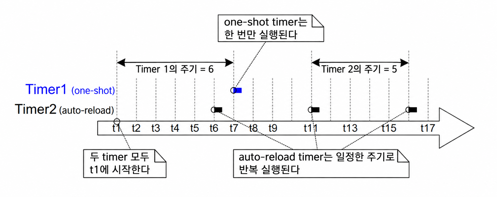
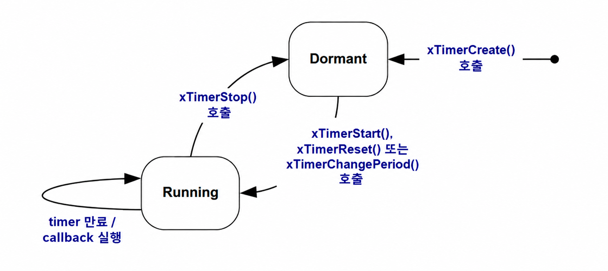
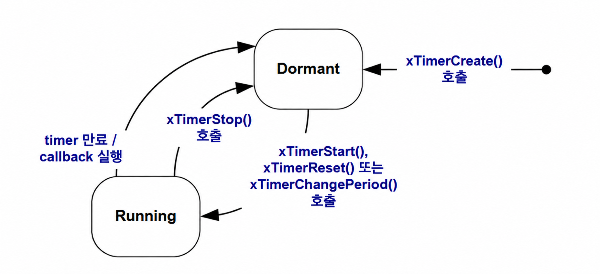
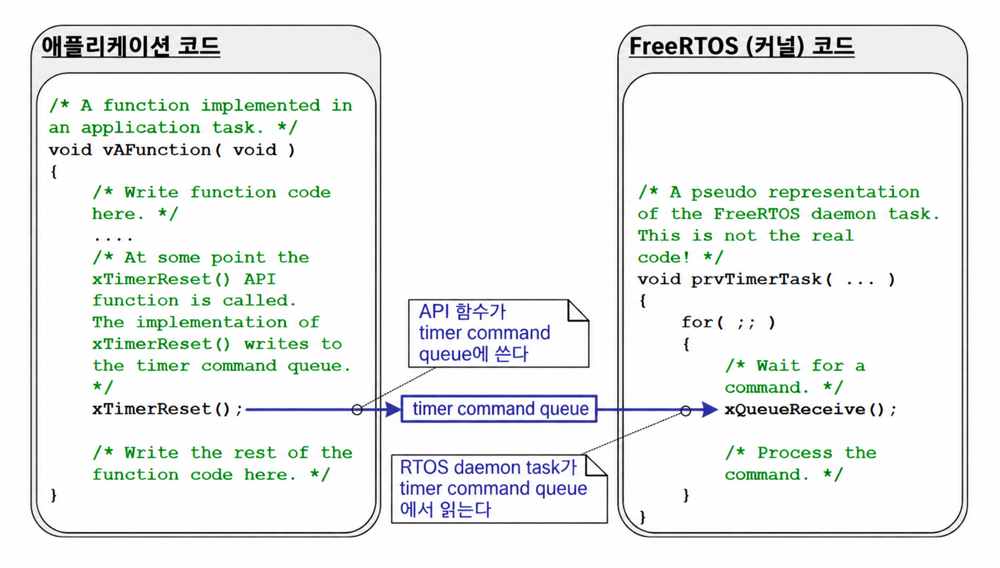
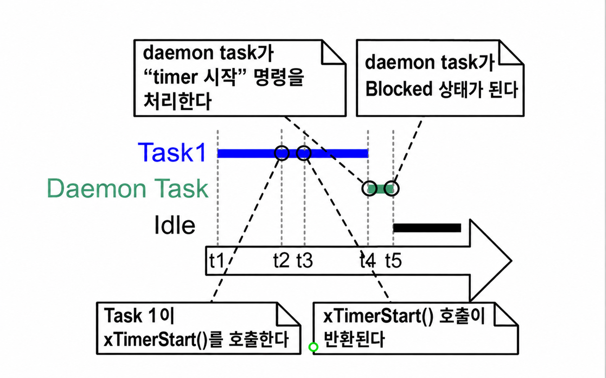
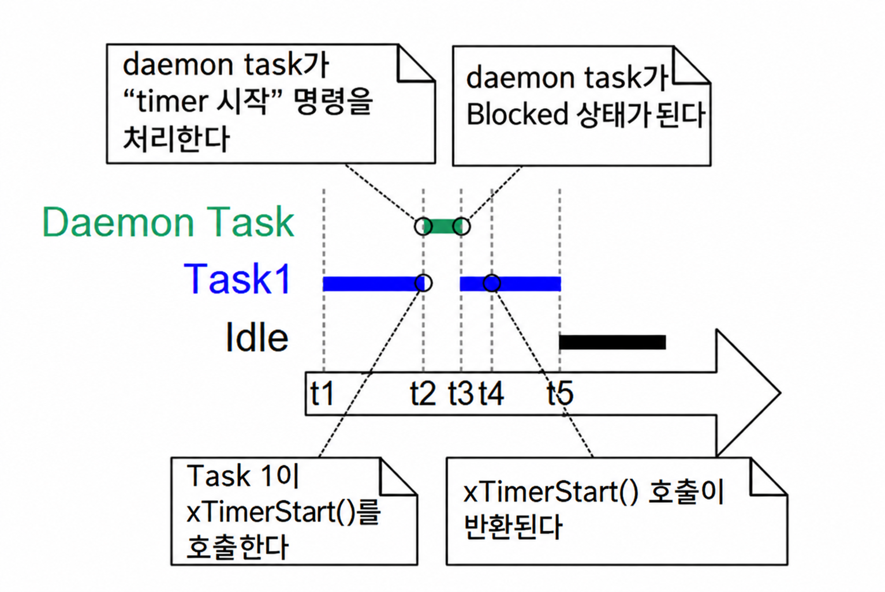
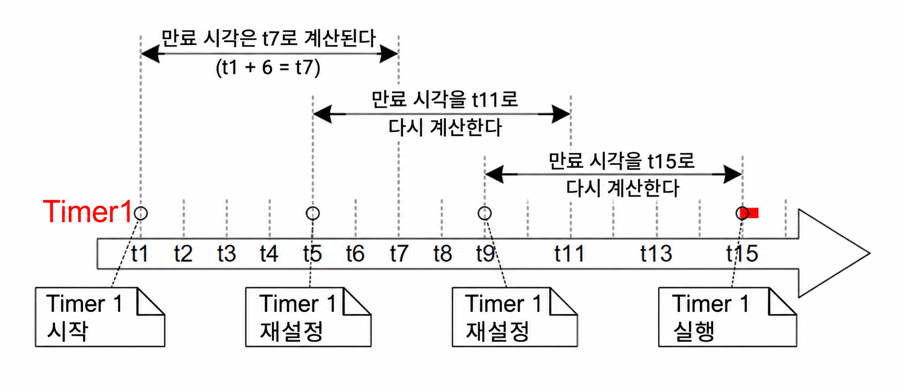

<a id="6-software-timer-management"></a>
# 6 소프트웨어 타이머 관리 (Software Timer Management)

<a id="61-chapter-introduction-and-scope"></a>
## 6.1 장 소개 및 범위 (Chapter Introduction and Scope)

소프트웨어 타이머는 미래의 설정된 시간에 또는 고정된 주기로 주기적으로 함수의 실행을 스케줄링하는 데 사용된다. 소프트웨어 타이머에 의해 실행되는 함수를 소프트웨어 타이머의 콜백 함수(callback function)라고 한다.

소프트웨어 타이머는 FreeRTOS 커널에 의해 구현되며 커널의 제어를 받는다. 하드웨어 지원을 필요로 하지 않으며 하드웨어 타이머나 하드웨어 카운터와는 무관하다.

최대 효율성을 보장하기 위해 혁신적인 설계를 사용하는 FreeRTOS 철학에 따라, 소프트웨어 타이머 콜백 함수가 실제로 실행 중이지 않은 한 소프트웨어 타이머는 어떠한 처리 시간도 소비하지 않는다는 점에 유의해야 한다.

소프트웨어 타이머 기능은 선택 사항이다. 소프트웨어 타이머 기능을 포함하려면 다음 절차를 따른다:

1. FreeRTOS 소스 파일 `FreeRTOS/Source/timers.c`를 프로젝트의 일부로 빌드한다.

2. 애플리케이션의 `FreeRTOSConfig.h` 헤더 파일에 아래에 자세히 설명된 상수를 정의한다:

- `configUSE_TIMERS`

  `FreeRTOSConfig.h`에서 `configUSE_TIMERS`를 1로 설정한다.

- `configTIMER_TASK_PRIORITY`

  타이머 서비스 태스크의 우선순위를 0에서 (`configMAX_PRIORITIES` - 1) 사이로 설정한다.

- `configTIMER_QUEUE_LENGTH`

  타이머 명령 큐가 한 번에 보유할 수 있는 미처리 명령의 최대 개수를 설정한다.

- `configTIMER_TASK_STACK_DEPTH`

  타이머 서비스 태스크에 할당되는 스택 크기(바이트가 아닌 워드 단위)를 설정한다.


<a id="611-scope"></a>
### 6.1.1 범위 (Scope)

이 장에서는 다음 내용을 다룬다:

- 태스크의 특성과 비교한 소프트웨어 타이머의 특성.
- RTOS 데몬(daemon) 태스크.
- 타이머 명령 큐.
- 원샷(one-shot) 소프트웨어 타이머와 주기적(periodic) 소프트웨어 타이머의 차이점.
- 소프트웨어 타이머를 생성, 시작, 리셋하고 주기를 변경하는 방법.


<a id="62-software-timer-callback-functions"></a>
## 6.2 소프트웨어 타이머 콜백 함수 (Software Timer Callback Functions)

소프트웨어 타이머 콜백 함수는 C 함수로 구현된다. 이들에 대해 특별한 유일한 점은 프로토타입이며, 반드시 void를 반환하고 소프트웨어 타이머에 대한 핸들을 유일한 매개변수로 받아야 한다. 콜백 함수 프로토타입은 Listing 6.1에 나와 있다.

<a name="list6.1" title="Listing 6.1 The software timer callback function prototype"></a>

```c
void ATimerCallback( TimerHandle_t xTimer );
```
***Listing 6.1*** *The software timer callback function prototype*

소프트웨어 타이머 콜백 함수는 시작부터 끝까지 실행되고 정상적인 방식으로 종료된다. 콜백 함수는 짧게 유지되어야 하며, 절대로 Blocked 상태(대기)로 진입해서는 안 된다.

> *참고: 앞으로 보게 되겠지만 소프트웨어 타이머 콜백 함수는 FreeRTOS 스케줄러가 시작될 때 자동으로 생성되는 태스크의 컨텍스트에서 실행된다. 따라서 소프트웨어 타이머 콜백 함수는 호출 태스크를 Blocked 상태로 진입하게 만드는 FreeRTOS API 함수를 절대로 호출해서는 안 된다. `xQueueReceive()`와 같은 함수를 호출하는 것은 괜찮지만, 함수의 `xTicksToWait` 매개변수(블록 시간을 지정함)가 0으로 설정된 경우에만 허용된다. `vTaskDelay()`와 같은 함수를 호출하는 것은 허용되지 않는데, `vTaskDelay()`를 호출하면 항상 호출 태스크가 Blocked 상태로 전환되기 때문이다.*


<a id="63-attributes-and-states-of-a-software-timer"></a>
## 6.3 소프트웨어 타이머의 속성과 상태 (Attributes and States of a Software Timer)

<a id="631-period-of-a-software-timer"></a>
### 6.3.1 소프트웨어 타이머의 주기 (Period of a Software Timer)

소프트웨어 타이머의 '주기(period)'는 소프트웨어 타이머가 시작된 시점과 소프트웨어 타이머의 콜백 함수가 실행되는 시점 사이의 시간이다.


<a id="632-one-shot-and-auto-reload-timers"></a>
### 6.3.2 원샷 타이머와 자동 재로드 타이머 (One-shot and Auto-reload Timers)

소프트웨어 타이머에는 두 가지 유형이 있다:

1. 원샷 타이머 (One-shot timers)

   시작되면 원샷 타이머는 콜백 함수를 단 한 번만 실행한다. 원샷 타이머는 수동으로 다시 시작할 수 있지만 스스로 다시 시작되지는 않는다.

1. 자동 재로드 타이머 (Auto-reload timers)

   시작되면 자동 재로드 타이머는 만료될 때마다 스스로 다시 시작되어 콜백 함수가 주기적으로 실행되도록 한다.

그림 6.1은 원샷 타이머와 자동 재로드 타이머 간의 동작 차이를 보여준다. 수직 점선은 틱 인터럽트가 발생하는 시점을 나타낸다.

<a name="fig6.1" title="Figure 6.1 The difference in behavior between one-shot and auto-reload software timers"></a>

* * *

***그림 6.1*** *원샷 및 자동 재로드 소프트웨어 타이머 간의 동작 차이 (The difference in behavior between one-shot and auto-reload software timers)*
* * *

그림 6.1을 참조하면 다음과 같다:

- Timer 1

  Timer 1은 주기가 6틱인 원샷 타이머이다. 시간 t1에 시작되므로 콜백 함수는 6틱 후인 시간 t7에 실행된다. Timer 1은 원샷 타이머이므로 콜백 함수가 다시 실행되지 않는다.

- Timer 2

  Timer 2는 주기가 5틱인 자동 재로드 타이머이다. 시간 t1에 시작되므로 콜백 함수는 시간 t1 이후 매 5틱마다 실행된다. 그림 6.1에서는 시간 t6, t11, t16에 해당한다.


<a id="633-software-timer-states"></a>
### 6.3.3 소프트웨어 타이머 상태 (Software Timer States)

소프트웨어 타이머는 다음 두 가지 상태 중 하나에 있을 수 있다:

- 휴면 상태 (Dormant)

  Dormant 상태의 소프트웨어 타이머는 존재하며 핸들로 참조할 수 있지만 실행 중이 아니므로 콜백 함수가 실행되지 않는다.

- 실행 상태 (Running)

  Running 상태의 소프트웨어 타이머는 타이머가 Running 상태로 진입한 후 또는 마지막으로 리셋된 후 주기에 해당하는 시간이 경과하면 콜백 함수를 실행한다.

그림 6.2와 그림 6.3은 각각 자동 재로드 타이머와 원샷 타이머에 대해 Dormant 상태와 Running 상태 간의 가능한 전이를 보여준다. 두 다이어그램 간의 주요 차이점은 타이머 만료 후 진입하는 상태이다. 자동 재로드 타이머는 콜백 함수를 실행한 후 Running 상태로 다시 진입하지만, 원샷 타이머는 콜백 함수를 실행한 후 Dormant 상태로 진입한다.

<a name="fig6.2" title="Figure 6.2 Auto-reload software timer states and transitions"></a>
<a name="fig6.3" title="Figure 6.3 One-shot software timer states and transitions"></a>

* * *

***그림 6.2*** *자동 재로드 소프트웨어 타이머 상태 및 전이 (Auto-reload software timer states and transitions)*


***그림 6.3*** *원샷 소프트웨어 타이머 상태 및 전이 (One-shot software timer states and transitions)*
* * *

`xTimerDelete()` API 함수는 타이머를 삭제한다. 타이머는 언제든지 삭제할 수 있다. 함수 프로토타입은 Listing 6.2에 나와 있다.

<a name="list6.2" title="Listing 6.2 The xTimerDelete() API function prototype"></a>

```c
BaseType_t xTimerDelete( TimerHandle_t xTimer, TickType_t xTicksToWait );
```
***Listing 6.2*** *The xTimerDelete() API function prototype*

**xTimerDelete() 매개변수 및 반환값**

- `xTimer`

  삭제할 타이머의 핸들.

- `xTicksToWait`

  `xTimerDelete()`가 호출되었을 때 타이머 명령 큐가 이미 가득 찬 경우, 삭제 명령이 타이머 명령 큐로 성공적으로 전송될 때까지 호출 태스크가 Blocked 상태로 유지되어야 하는 시간(틱 단위)을 지정한다. 스케줄러가 시작되기 전에 `xTimerDelete()`가 호출되면 `xTicksToWait`는 무시된다.

- 반환값

  두 가지 가능한 반환값이 있다:

  - `pdPASS`

    명령이 타이머 명령 큐로 성공적으로 전송된 경우 `pdPASS`가 반환된다.

  - `pdFAIL`

    `xBlockTime` 틱이 경과한 후에도 삭제 명령을 타이머 명령 큐로 보낼 수 없는 경우 `pdFAIL`이 반환된다.


<a id="64-the-context-of-a-software-timer"></a>
## 6.4 소프트웨어 타이머의 컨텍스트 (The Context of a Software Timer)

<a id="641-the-rtos-daemon-timer-service-task"></a>
### 6.4.1 RTOS 데몬(타이머 서비스) 태스크 (The RTOS Daemon (Timer Service) Task)

모든 소프트웨어 타이머 콜백 함수는 동일한 RTOS 데몬(또는 '타이머 서비스') 태스크의 컨텍스트에서 실행된다[^10].

[^10]: 이 태스크는 원래 소프트웨어 타이머 콜백 함수를 실행하는 데에만 사용되었기 때문에 '타이머 서비스 태스크'라고 불렸다. 현재는 동일한 태스크가 다른 목적으로도 사용되므로 'RTOS 데몬 태스크'라는 보다 일반적인 이름으로 불린다.

데몬 태스크는 스케줄러가 시작될 때 자동으로 생성되는 표준 FreeRTOS 태스크이다. 그 우선순위와 스택 크기는 각각 `configTIMER_TASK_PRIORITY`와 `configTIMER_TASK_STACK_DEPTH` 컴파일 타임 구성 상수에 의해 설정된다. 두 상수 모두 `FreeRTOSConfig.h` 내에 정의된다.

소프트웨어 타이머 콜백 함수는 호출 태스크를 Blocked 상태로 진입하게 만드는 FreeRTOS API 함수를 절대로 호출해서는 안 되는데, 그렇게 하면 데몬 태스크가 Blocked 상태로 진입하게 되기 때문이다.


<a id="642-the-timer-command-queue"></a>
### 6.4.2 타이머 명령 큐 (The Timer Command Queue)

소프트웨어 타이머 API 함수는 호출 태스크로부터 데몬 태스크로 '타이머 명령 큐(timer command queue)'라는 큐를 통해 명령을 보낸다. 이것이 그림 6.4에 나와 있다. 명령의 예로는 '타이머 시작', '타이머 중지', '타이머 리셋' 등이 있다.

타이머 명령 큐는 스케줄러가 시작될 때 자동으로 생성되는 표준 FreeRTOS 큐이다. 타이머 명령 큐의 길이는 `FreeRTOSConfig.h`의 `configTIMER_QUEUE_LENGTH` 컴파일 타임 구성 상수에 의해 설정된다.

<a name="fig6.4" title="Figure 6.4 The timer command queue being used by a software timer API function to communicate with the RTOS daemon task"></a>

* * *

***그림 6.4*** *RTOS 데몬 태스크와 통신하기 위해 소프트웨어 타이머 API 함수에 의해 사용되는 타이머 명령 큐 (The timer command queue being used by a software timer API function to communicate with the RTOS daemon task)*
* * *


<a id="643-daemon-task-scheduling"></a>
### 6.4.3 데몬 태스크 스케줄링 (Daemon Task Scheduling)

데몬 태스크는 다른 FreeRTOS 태스크와 마찬가지로 스케줄링된다. 실행 가능한 가장 높은 우선순위 태스크일 때만 명령을 처리하거나 타이머 콜백 함수를 실행한다. 그림 6.5와 그림 6.6은 `configTIMER_TASK_PRIORITY` 설정이 실행 패턴에 미치는 영향을 보여준다.

그림 6.5는 데몬 태스크의 우선순위가 `xTimerStart()` API 함수를 호출하는 태스크의 우선순위보다 낮을 때의 실행 패턴을 보여준다.

<a name="fig6.5" title="Figure 6.5 The execution pattern when the priority of a task calling xTimerStart() is above the priority of the daemon task"></a>

* * *

***그림 6.5*** *xTimerStart()를 호출하는 태스크의 우선순위가 데몬 태스크의 우선순위보다 높을 때의 실행 패턴 (The execution pattern when the priority of a task calling xTimerStart() is above the priority of the daemon task)*
* * *

Task 1의 우선순위가 데몬 태스크의 우선순위보다 높고, 데몬 태스크의 우선순위가 Idle 태스크의 우선순위보다 높은 그림 6.5를 참조하면 다음과 같다:

1. 시간 t1에서

   Task 1은 Running 상태(실행 중)이고 데몬 태스크는 Blocked 상태(대기)이다.

   데몬 태스크는 타이머 명령 큐로 명령이 전송되면(이 경우 명령을 처리함) Blocked 상태를 벗어나거나, 소프트웨어 타이머가 만료되면(이 경우 소프트웨어 타이머의 콜백 함수를 실행함) Blocked 상태를 벗어난다.

1. 시간 t2에서

   Task 1이 `xTimerStart()`를 호출한다.

   `xTimerStart()`는 타이머 명령 큐로 명령을 전송하여 데몬 태스크가 Blocked 상태를 벗어나도록 만든다. Task 1의 우선순위가 데몬 태스크의 우선순위보다 높으므로 데몬 태스크는 Task 1을 선점하지 않는다.

   Task 1은 여전히 Running 상태이고, 데몬 태스크는 Blocked 상태를 벗어나 Ready 상태(실행 가능)로 진입했다.

1. 시간 t3에서

   Task 1이 `xTimerStart()` API 함수 실행을 완료한다. Task 1은 Running 상태를 벗어나지 않고 함수의 시작부터 끝까지 `xTimerStart()`를 실행했다.

1. 시간 t4에서

   Task 1이 Blocked 상태로 진입하게 만드는 API 함수를 호출한다. 데몬 태스크가 이제 Ready 상태에서 가장 높은 우선순위 태스크가 되므로 스케줄러는 데몬 태스크를 Running 상태로 진입할 태스크로 선택한다. 그런 다음 데몬 태스크는 Task 1에 의해 타이머 명령 큐로 전송된 명령을 처리하기 시작한다.

   > *참고: 시작되는 소프트웨어 타이머가 만료될 시간은 '타이머 시작' 명령이 타이머 명령 큐로 전송된 시점부터 계산된다—데몬 태스크가 타이머 명령 큐로부터 '타이머 시작' 명령을 수신한 시점부터 계산되는 것이 아니다.*

1. 시간 t5에서

   데몬 태스크가 Task 1에 의해 전송된 명령 처리를 완료하고 타이머 명령 큐로부터 더 많은 데이터를 수신하려고 시도한다. 타이머 명령 큐가 비어 있으므로 데몬 태스크는 다시 Blocked 상태로 진입한다. 데몬 태스크는 타이머 명령 큐로 명령이 전송되거나 소프트웨어 타이머가 만료되면 다시 Blocked 상태를 벗어난다.

   Idle 태스크가 이제 Ready 상태에서 가장 높은 우선순위 태스크이므로 스케줄러는 Idle 태스크를 Running 상태로 진입할 태스크로 선택한다.

그림 6.6은 그림 6.5와 유사한 시나리오를 보여주지만, 이번에는 데몬 태스크의 우선순위가 `xTimerStart()`를 호출하는 태스크의 우선순위보다 높다.

<a name="fig6.6" title="Figure 6.6 The execution pattern when the priority of a task calling xTimerStart() is below the priority of the daemon task"></a>

* * *

***그림 6.6*** *xTimerStart()를 호출하는 태스크의 우선순위가 데몬 태스크의 우선순위보다 낮을 때의 실행 패턴 (The execution pattern when the priority of a task calling xTimerStart() is below the priority of the daemon task)*
* * *

데몬 태스크의 우선순위가 Task 1의 우선순위보다 높고, Task 1의 우선순위가 Idle 태스크의 우선순위보다 높은 그림 6.6을 참조하면 다음과 같다:

1. 시간 t1에서

   이전과 마찬가지로 Task 1은 Running 상태이고 데몬 태스크는 Blocked 상태이다.

1. 시간 t2에서

   Task 1이 `xTimerStart()`를 호출한다.

   `xTimerStart()`는 타이머 명령 큐로 명령을 전송하여 데몬 태스크가 Blocked 상태를 벗어나도록 만든다. 데몬 태스크의 우선순위가 Task 1의 우선순위보다 높으므로 스케줄러는 데몬 태스크를 Running 상태로 진입할 태스크로 선택한다.

   Task 1은 `xTimerStart()` 함수 실행을 완료하기 전에 데몬 태스크에 의해 선점되었으며 현재 Ready 상태에 있다.

   데몬 태스크는 Task 1에 의해 타이머 명령 큐로 전송된 명령을 처리하기 시작한다.

1. 시간 t3에서

   데몬 태스크가 Task 1에 의해 전송된 명령 처리를 완료하고 타이머 명령 큐로부터 더 많은 데이터를 수신하려고 시도한다. 타이머 명령 큐가 비어 있으므로 데몬 태스크는 다시 Blocked 상태로 진입한다.

   Task 1이 이제 Ready 상태에서 가장 높은 우선순위 태스크이므로 스케줄러는 Task 1을 Running 상태로 진입할 태스크로 선택한다.

1. 시간 t4에서

   Task 1은 `xTimerStart()` 함수 실행을 완료하기 전에 데몬 태스크에 의해 선점되었으므로 Running 상태로 다시 진입한 후에만 `xTimerStart()`를 종료(반환)한다.

1. 시간 t5에서

   Task 1이 Blocked 상태로 진입하게 만드는 API 함수를 호출한다. Idle 태스크가 이제 Ready 상태에서 가장 높은 우선순위 태스크이므로 스케줄러는 Idle 태스크를 Running 상태로 진입할 태스크로 선택한다.

그림 6.5에 표시된 시나리오에서는 Task 1이 타이머 명령 큐로 명령을 전송한 시점과 데몬 태스크가 명령을 수신하고 처리한 시점 사이에 시간이 경과했다. 그림 6.6에 표시된 시나리오에서는 Task 1이 명령을 보낸 함수로부터 반환되기 전에 데몬 태스크가 Task 1에 의해 전송된 명령을 이미 수신하고 처리했다.

타이머 명령 큐로 전송되는 명령에는 타임스탬프가 포함된다. 타임스탬프는 애플리케이션 태스크에 의해 명령이 전송된 시점과 데몬 태스크에 의해 동일한 명령이 처리된 시점 사이에 경과하는 시간을 보정하는 데 사용된다. 예를 들어 주기가 10틱인 타이머를 시작하기 위해 '타이머 시작' 명령이 전송된 경우, 타임스탬프는 시작되는 타이머가 데몬 태스크에 의해 명령이 처리된 시점으로부터 10틱 뒤가 아니라 명령이 전송된 시점으로부터 10틱 뒤에 만료되도록 보장하는 데 사용된다.


<a id="65-creating-and-starting-a-software-timer"></a>
## 6.5 소프트웨어 타이머 생성 및 시작 (Creating and Starting a Software Timer)

<a id="651-the-xtimercreate-api-function"></a>
### 6.5.1 xTimerCreate() API 함수 (The xTimerCreate() API Function)

FreeRTOS에는 컴파일 타임에 타이머를 생성하는 데 필요한 메모리를 정적으로 할당하는 `xTimerCreateStatic()` 함수도 포함되어 있다. 소프트웨어 타이머는 사용하기 전에 반드시 명시적으로 생성해야 한다.

소프트웨어 타이머는 `TimerHandle_t` 타입의 변수로 참조된다. `xTimerCreate()`는 소프트웨어 타이머를 생성하는 데 사용되며 생성된 소프트웨어 타이머를 참조하는 `TimerHandle_t`를 반환한다. 소프트웨어 타이머는 Dormant(휴면) 상태로 생성된다.

소프트웨어 타이머는 스케줄러가 실행되기 전에 생성할 수도 있고, 스케줄러가 시작된 후 태스크 내에서 생성할 수도 있다.

[2.5절: 데이터 타입 및 코딩 스타일 가이드](ch02.md#25-data-types-and-coding-style-guide)에서 사용된 데이터 타입과 명명 규칙을 설명한다.

<a name="list6.3" title="Listing 6.3 The xTimerCreate() API function prototype"></a>

```c
TimerHandle_t xTimerCreate( const char * const pcTimerName,
                            const TickType_t xTimerPeriodInTicks,
                            const BaseType_t xAutoReload,
                            void * const pvTimerID,
                            TimerCallbackFunction_t pxCallbackFunction );
```
***Listing 6.3*** *The xTimerCreate() API function prototype*

**xTimerCreate() 매개변수 및 반환값**

- `pcTimerName`

  타이머의 설명용 이름. 이는 FreeRTOS에서 어떤 방식으로도 사용되지 않는다. 순수하게 디버깅 보조 도구로 포함된 것이다. 사람이 읽을 수 있는 이름으로 타이머를 식별하는 것이 핸들로 식별하려고 시도하는 것보다 훨씬 간단하다.

- `xTimerPeriodInTicks`

  틱 단위로 지정된 타이머 주기. `pdMS_TO_TICKS()` 매크로를 사용하여 밀리초 단위로 지정된 시간을 틱 단위 시간으로 변환할 수 있다. 0이 될 수 없다.

- `xAutoReload`

  자동 재로드 타이머를 생성하려면 `xAutoReload`를 `pdTRUE`로 설정한다. 원샷 타이머를 생성하려면 `xAutoReload`를 `pdFALSE`로 설정한다.

- `pvTimerID`

  각 소프트웨어 타이머에는 ID 값이 있다. 이 ID는 void 포인터이며 애플리케이션 작성자가 어떤 목적으로든 사용할 수 있다. 이 ID는 둘 이상의 소프트웨어 타이머에서 동일한 콜백 함수를 사용할 때 특히 유용한데, 타이머별 전용 저장 공간을 제공하는 데 사용할 수 있기 때문이다. 타이머 ID의 사용법은 이 장의 예제에서 시연된다.

  `pvTimerID`는 생성되는 태스크(타이머)의 ID 초기값을 설정한다.

- `pxCallbackFunction`

  소프트웨어 타이머 콜백 함수는 단순히 Listing 6.1에 표시된 프로토타입을 따르는 C 함수이다. `pxCallbackFunction` 매개변수는 생성되는 소프트웨어 타이머의 콜백 함수로 사용할 함수에 대한 포인터(실제로는 함수 이름)이다.

- 반환값

  NULL이 반환되면 FreeRTOS가 필요한 데이터 구조를 할당하기에 사용 가능한 힙 메모리가 부족하여 소프트웨어 타이머를 생성할 수 없음을 의미한다.

  NULL이 아닌 값이 반환되면 소프트웨어 타이머가 성공적으로 생성되었음을 나타낸다. 반환된 값은 생성된 타이머의 핸들이다.

  3장에서 힙 메모리 관리에 대한 자세한 정보를 제공한다.


<a id="652-the-xtimerstart-api-function"></a>
### 6.5.2 xTimerStart() API 함수 (The xTimerStart() API Function)

`xTimerStart()`는 Dormant 상태에 있는 소프트웨어 타이머를 시작하거나, Running 상태에 있는 소프트웨어 타이머를 리셋(재시작)하는 데 사용된다. `xTimerStop()`은 Running 상태에 있는 소프트웨어 타이머를 중지하는 데 사용된다. 소프트웨어 타이머를 중지하는 것은 타이머를 Dormant 상태로 전이시키는 것과 같다.

`xTimerStart()`는 스케줄러가 시작되기 전에 호출될 수 있지만, 그렇게 할 경우 소프트웨어 타이머는 스케줄러가 시작되는 시점까지 실제로 시작되지 않는다.

> *참고: 인터럽트 서비스 루틴 내에서 `xTimerStart()`를 절대로 호출해서는 안 된다. 그 대신 인터럽트 안전 버전인 `xTimerStartFromISR()`을 사용해야 한다.*

<a name="list6.4" title="Listing 6.4 The xTimerStart() API function prototype"></a>

```c
BaseType_t xTimerStart( TimerHandle_t xTimer, TickType_t xTicksToWait );
```
***Listing 6.4*** *The xTimerStart() API function prototype*

**xTimerStart() 매개변수 및 반환값**

- `xTimer`

  시작되거나 리셋되는 소프트웨어 타이머의 핸들. 이 핸들은 소프트웨어 타이머를 생성하는 데 사용된 `xTimerCreate()` 호출에서 반환된 값이다.

- `xTicksToWait`

  `xTimerStart()`는 타이머 명령 큐를 사용하여 데몬 태스크로 '타이머 시작' 명령을 보낸다. `xTicksToWait`는 큐가 이미 가득 찬 경우 타이머 명령 큐에 공간이 생길 때까지 호출 태스크가 Blocked 상태로 머물러야 하는 최대 시간을 지정한다.

  `xTicksToWait`가 0이고 타이머 명령 큐가 이미 가득 찬 경우 `xTimerStart()`는 즉시 반환된다.

  블록 시간은 틱 주기로 지정되므로 절대 시간은 틱 주파수에 따라 달라진다. 매크로 `pdMS_TO_TICKS()`를 사용하여 밀리초 단위로 지정된 시간을 틱 단위 시간으로 변환할 수 있다.

  `FreeRTOSConfig.h`에서 `INCLUDE_vTaskSuspend`가 1로 설정되어 있는 경우, `xTicksToWait`를 `portMAX_DELAY`로 설정하면 호출 태스크가 타이머 명령 큐에 공간이 생길 때까지 (타임아웃 없이) 무기한 Blocked 상태로 유지된다.

  스케줄러가 시작되기 전에 `xTimerStart()`가 호출되면 `xTicksToWait` 값은 무시되며 `xTimerStart()`는 `xTicksToWait`가 0으로 설정된 것처럼 동작한다.

- 반환값

  두 가지 가능한 반환값이 있다:

  - `pdPASS`

    '타이머 시작' 명령이 타이머 명령 큐로 성공적으로 전송된 경우에만 `pdPASS`가 반환된다.

    데몬 태스크의 우선순위가 `xTimerStart()`를 호출한 태스크의 우선순위보다 높은 경우, 스케줄러는 `xTimerStart()`가 반환되기 전에 시작 명령이 처리되도록 보장한다. 타이머 명령 큐에 데이터가 들어오는 즉시 데몬 태스크가 `xTimerStart()`를 호출한 태스크를 선점하기 때문이다.

    블록 시간이 지정된 경우(`xTicksToWait`가 0이 아님), 함수가 반환되기 전에 호출 태스크가 타이머 명령 큐에 공간이 생기기를 기다리기 위해 Blocked 상태로 전환되었을 수 있으나, 블록 시간이 만료되기 전에 타이머 명령 큐에 데이터가 성공적으로 기록된 것이다.

  - `pdFAIL`

    큐가 이미 가득 차서 '타이머 시작' 명령을 타이머 명령 큐에 쓸 수 없는 경우 `pdFAIL`이 반환된다.

    블록 시간이 지정된 경우(`xTicksToWait`가 0이 아님), 호출 태스크가 데몬 태스크가 타이머 명령 큐에 공간을 만들어 주기를 기다리기 위해 Blocked 상태로 전환되었으나, 그 일이 발생하기 전에 지정된 블록 시간이 만료된 것이다.


<a name="example6.1" title="Example 6.1 Creating one-shot and auto-reload timers"></a>
---
***예제 6.1*** *원샷 및 자동 재로드 타이머 생성 (Creating one-shot and auto-reload timers)*

---

이 예제는 Listing 6.5에 표시된 것처럼 원샷 타이머와 자동 재로드 타이머를 생성하고 시작한다.

<a name="list6.5" title="Listing 6.5 Creating and starting the timers used in Example 6.1"></a>

```c
/* The periods assigned to the one-shot and auto-reload timers are 3.333
   second and half a second respectively. */
#define mainONE_SHOT_TIMER_PERIOD pdMS_TO_TICKS( 3333 )
#define mainAUTO_RELOAD_TIMER_PERIOD pdMS_TO_TICKS( 500 )

int main( void )
{
    TimerHandle_t xAutoReloadTimer, xOneShotTimer;
    BaseType_t xTimer1Started, xTimer2Started;

    /* Create the one shot timer, storing the handle to the created timer in
       xOneShotTimer. */
    xOneShotTimer = xTimerCreate(
        /* Text name for the software timer - not used by FreeRTOS. */
                                  "OneShot",
        /* The software timer's period in ticks. */
                                   mainONE_SHOT_TIMER_PERIOD,
        /* Setting uxAutoRealod to pdFALSE creates a one-shot software timer. */
                                   pdFALSE,
        /* This example does not use the timer id. */
                                   0,
        /* Callback function to be used by the software timer being created. */
                                   prvOneShotTimerCallback );

    /* Create the auto-reload timer, storing the handle to the created timer
       in xAutoReloadTimer. */
    xAutoReloadTimer = xTimerCreate(
        /* Text name for the software timer - not used by FreeRTOS. */
                                     "AutoReload",
        /* The software timer's period in ticks. */
                                     mainAUTO_RELOAD_TIMER_PERIOD,
        /* Setting uxAutoRealod to pdTRUE creates an auto-reload timer. */
                                     pdTRUE,
        /* This example does not use the timer id. */
                                     0,
        /* Callback function to be used by the software timer being created. */
                                     prvAutoReloadTimerCallback );

    /* Check the software timers were created. */
    if( ( xOneShotTimer != NULL ) && ( xAutoReloadTimer != NULL ) )
    {
        /* Start the software timers, using a block time of 0 (no block time).
            The scheduler has not been started yet so any block time specified
            here would be ignored anyway. */
        xTimer1Started = xTimerStart( xOneShotTimer, 0 );
        xTimer2Started = xTimerStart( xAutoReloadTimer, 0 );

        /* The implementation of xTimerStart() uses the timer command queue,
           and xTimerStart() will fail if the timer command queue gets full.
           The timer service task does not get created until the scheduler is
           started, so all commands sent to the command queue will stay in the
           queue until after the scheduler has been started. Check both calls
           to xTimerStart() passed. */
        if( ( xTimer1Started == pdPASS ) && ( xTimer2Started == pdPASS ) )
        {
            /* Start the scheduler. */
            vTaskStartScheduler();
        }
    }

    /* As always, this line should not be reached. */
    for( ;; );
}
```
***Listing 6.5*** *Creating and starting the timers used in Example 6.1*

타이머의 콜백 함수는 호출될 때마다 단순히 메시지를 출력한다. 원샷 타이머 콜백 함수의 구현은 Listing 6.6에 나와 있다. 자동 재로드 타이머 콜백 함수의 구현은 Listing 6.7에 나와 있다.

<a name="list6.6" title="Listing 6.6 The callback function used by the one-shot timer in Example 6.1"></a>

```c
static void prvOneShotTimerCallback( TimerHandle_t xTimer )
{
    TickType_t xTimeNow;

    /* Obtain the current tick count. */
    xTimeNow = xTaskGetTickCount();

    /* Output a string to show the time at which the callback was executed. */
    vPrintStringAndNumber( "One-shot timer callback executing", xTimeNow );

    /* File scope variable. */
    ulCallCount++;
}
```
***Listing 6.6*** *The callback function used by the one-shot timer in Example 6.1*

<a name="list6.7" title="Listing 6.7 The callback function used by the auto-reload timer in Example 6.1"></a>

```c
static void prvAutoReloadTimerCallback( TimerHandle_t xTimer )
{
    TickType_t xTimeNow;

    /* Obtain the current tick count. */
    xTimeNow = xTaskGetTickCount();

    /* Output a string to show the time at which the callback was executed. */
    vPrintStringAndNumber( "Auto-reload timer callback executing", xTimeNow);

    ulCallCount++;
}
```
***Listing 6.7*** *The callback function used by the auto-reload timer in Example 6.1*

이 예제를 실행하면 그림 6.7에 표시된 출력이 생성된다. 그림 6.7은 자동 재로드 타이머의 콜백 함수가 500틱의 고정 주기로 실행되고(`mainAUTO_RELOAD_TIMER_PERIOD`는 Listing 6.5에서 500으로 설정됨), 원샷 타이머의 콜백 함수는 틱 카운트가 3333일 때 단 한 번만 실행됨(`mainONE_SHOT_TIMER_PERIOD`는 Listing 6.5에서 3333으로 설정됨)을 보여준다.

<a name="fig6.7" title="Figure 6.7 The output produced when Example 6.1 is executed"></a>

* * *

***그림 6.7*** *예제 6.1 실행 시 생성되는 출력 (The output produced when Example 6.1 is executed)*
* * *


<a id="66-the-timer-id"></a>
## 6.6 타이머 ID (The Timer ID)

각 소프트웨어 타이머에는 애플리케이션 작성자가 어떤 목적으로든 사용할 수 있는 태그 값인 ID가 있다. 이 ID는 void 포인터(`void *`)에 저장되므로 정수 값을 직접 저장하거나, 다른 객체를 가리키거나, 함수 포인터로 사용할 수 있다.

소프트웨어 타이머가 생성될 때 ID에 초기값이 할당되며, 이후에는 `vTimerSetTimerID()` API 함수를 사용하여 ID를 업데이트하고 `pvTimerGetTimerID()` API 함수를 사용하여 조회할 수 있다.

다른 소프트웨어 타이머 API 함수와 달리 `vTimerSetTimerID()`와 `pvTimerGetTimerID()`는 소프트웨어 타이머에 직접 접근하며 타이머 명령 큐로 명령을 보내지 않는다.


<a id="661-the-vtimersettimerid-api-function"></a>
### 6.6.1 vTimerSetTimerID() API 함수 (The vTimerSetTimerID() API Function)

<a name="list6.8" title="Listing 6.8 The vTimerSetTimerID() API function prototype"></a>

```c
void vTimerSetTimerID( const TimerHandle_t xTimer, void *pvNewID );
```
***Listing 6.8*** *The vTimerSetTimerID() API function prototype*

**vTimerSetTimerID() 매개변수**

- `xTimer`

  새 ID 값으로 업데이트할 소프트웨어 타이머의 핸들. 이 핸들은 소프트웨어 타이머를 생성하는 데 사용된 `xTimerCreate()` 호출에서 반환된 값이다.

- `pvNewID`

  소프트웨어 타이머의 ID로 설정할 값.


<a id="662-the-pvtimergettimerid-api-function"></a>
### 6.6.2 pvTimerGetTimerID() API 함수 (The pvTimerGetTimerID() API Function)

<a name="list6.9" title="Listing 6.9 The pvTimerGetTimerID() API function prototype"></a>

```c
void *pvTimerGetTimerID( const TimerHandle_t xTimer );
```
***Listing 6.9*** *The pvTimerGetTimerID() API function prototype*

**pvTimerGetTimerID() 매개변수 및 반환값**

- `xTimer`

  조회할 소프트웨어 타이머의 핸들. 이 핸들은 소프트웨어 타이머를 생성하는 데 사용된 `xTimerCreate()` 호출에서 반환된 값이다.

- 반환값

  조회 중인 소프트웨어 타이머의 ID.


<a name="example6.2" title="Example 6.2 Using the callback function parameter and the software timer ID"></a>
---
***예제 6.2*** *콜백 함수 매개변수와 소프트웨어 타이머 ID 사용 (Using the callback function parameter and the software timer ID)*

---

동일한 콜백 함수를 둘 이상의 소프트웨어 타이머에 할당할 수 있다. 그렇게 할 경우 콜백 함수 매개변수를 사용하여 어떤 소프트웨어 타이머가 만료되었는지 확인한다.

예제 6.1에서는 두 개의 별도 콜백 함수를 사용했다. 하나의 콜백 함수는 원샷 타이머에 의해 사용되었고, 다른 콜백 함수는 자동 재로드 타이머에 의해 사용되었다. 예제 6.2는 예제 6.1에 의해 생성된 것과 유사한 기능을 생성하지만 두 소프트웨어 타이머 모두에 단일 콜백 함수를 할당한다.

예제 6.2에서 사용되는 `main()` 함수는 예제 6.1에서 사용된 `main()` 함수와 거의 동일하다. 유일한 차이점은 소프트웨어 타이머가 생성되는 부분이다. 이러한 차이점이 Listing 6.10에 나와 있으며, 여기서 `prvTimerCallback()`이 두 타이머의 콜백 함수로 사용된다.

<a name="list6.10" title="Listing 6.10 Creating the timers used in Example 6.2"></a>

```c
/* Create the one shot timer software timer, storing the handle in
   xOneShotTimer. */
xOneShotTimer = xTimerCreate( "OneShot",
                              mainONE_SHOT_TIMER_PERIOD,
                              pdFALSE,
                              /* The timer's ID is initialized to NULL. */
                              NULL,
                              /* prvTimerCallback() is used by both timers. */
                              prvTimerCallback );

/* Create the auto-reload software timer, storing the handle in
   xAutoReloadTimer */
xAutoReloadTimer = xTimerCreate( "AutoReload",
                                 mainAUTO_RELOAD_TIMER_PERIOD,
                                 pdTRUE,
                                 /* The timer's ID is initialized to NULL. */
                                 NULL,
                                 /* prvTimerCallback() is used by both timers. */
                                 prvTimerCallback );
```
***Listing 6.10*** *Creating the timers used in Example 6.2*

`prvTimerCallback()`은 어느 타이머가 만료되든 실행된다. `prvTimerCallback()`의 구현은 함수의 매개변수를 사용하여 원샷 타이머가 만료되어 호출되었는지, 아니면 자동 재로드 타이머가 만료되어 호출되었는지를 판별한다.

또한 `prvTimerCallback()`은 소프트웨어 타이머 ID를 타이머별 전용 저장소로 사용하는 방법을 보여준다. 각 소프트웨어 타이머는 자체 ID에 만료 횟수를 카운트하여 보관하며, 자동 재로드 타이머는 이 카운트를 사용하여 5번째 실행될 때 자체적으로 중지된다.

`prvTimerCallback()`의 구현은 Listing 6.11에 나와 있다.

<a name="list6.11" title="Listing 6.11 The timer callback function used in Example 6.2"></a>

```c
static void prvTimerCallback( TimerHandle_t xTimer )
{
    TickType_t xTimeNow;
    uint32_t ulExecutionCount;

    /* A count of the number of times this software timer has expired is
       stored in the timer's ID. Obtain the ID, increment it, then save it as
       the new ID value. The ID is a void pointer, so is cast to a uint32_t. */
    ulExecutionCount = ( uint32_t ) pvTimerGetTimerID( xTimer );
    ulExecutionCount++;
    vTimerSetTimerID( xTimer, ( void * ) ulExecutionCount );

    /* Obtain the current tick count. */
    xTimeNow = xTaskGetTickCount();

    /* The handle of the one-shot timer was stored in xOneShotTimer when the
       timer was created. Compare the handle passed into this function with
       xOneShotTimer to determine if it was the one-shot or auto-reload timer
       that expired, then output a string to show the time at which the
       callback was executed. */
    if( xTimer == xOneShotTimer )
    {
        vPrintStringAndNumber( "One-shot timer callback executing", xTimeNow );
    }
    else
    {
        /* xTimer did not equal xOneShotTimer, so it must have been the
           auto-reload timer that expired. */
        vPrintStringAndNumber( "Auto-reload timer callback executing", xTimeNow);

        if( ulExecutionCount == 5 )
        {
            /* Stop the auto-reload timer after it has executed 5 times. This
               callback function executes in the context of the RTOS daemon
               task so must not call any functions that might place the daemon
               task into the Blocked state. Therefore a block time of 0 is
               used. */
            xTimerStop( xTimer, 0 );
        }
    }
}
```
***Listing 6.11*** *The timer callback function used in Example 6.2*

예제 6.2에 의해 생성된 출력은 그림 6.8에 나와 있다. 자동 재로드 타이머가 5번만 실행되는 것을 볼 수 있다.

<a name="fig6.8" title="Figure 6.8 The output produced when Example 6.2 is executed"></a>

* * *

***그림 6.8*** *예제 6.2 실행 시 생성되는 출력 (The output produced when Example 6.2 is executed)*
* * *


<a id="67-changing-the-period-of-a-timer"></a>
## 6.7 타이머 주기 변경 (Changing the Period of a Timer)

모든 공식 FreeRTOS 포트에는 하나 이상의 예제 프로젝트가 함께 제공된다. 대부분의 예제 프로젝트는 자체 점검(self-checking)을 수행하며, 프로젝트의 상태에 대한 시각적 피드백을 제공하기 위해 LED가 사용된다. 자체 점검이 항상 통과하면 LED가 천천히 토글되고, 자체 점검이 한 번이라도 실패하면 LED가 빠르게 토글된다.

일부 예제 프로젝트는 태스크 내에서 자체 점검을 수행하고 `vTaskDelay()` 함수를 사용하여 LED 토글 속도를 제어한다. 다른 예제 프로젝트는 소프트웨어 타이머 콜백 함수 내에서 자체 점검을 수행하고 타이머의 주기를 사용하여 LED 토글 속도를 제어한다.


<a id="671-the-xtimerchangeperiod-api-function"></a>
### 6.7.1 xTimerChangePeriod() API 함수 (The xTimerChangePeriod() API Function)

소프트웨어 타이머의 주기는 `xTimerChangePeriod()` 함수를 사용하여 변경한다.

이미 실행 중인 타이머의 주기를 변경하기 위해 `xTimerChangePeriod()`를 사용하면 타이머는 새 주기 값을 사용하여 만료 시간을 다시 계산한다. 다시 계산된 만료 시간은 타이머가 원래 시작된 시점이 아니라 `xTimerChangePeriod()`가 호출된 시점을 기준으로 한다.

Dormant(휴면) 상태의 타이머(실행 중이 아닌 타이머)의 주기를 변경하기 위해 `xTimerChangePeriod()`를 사용하면 타이머는 만료 시간을 계산하고 Running(실행) 상태로 전이한다(타이머가 실행되기 시작함).

> *참고: 인터럽트 서비스 루틴 내에서 `xTimerChangePeriod()`를 절대로 호출해서는 안 된다. 그 대신 인터럽트 안전 버전인 `xTimerChangePeriodFromISR()`을 사용해야 한다.*

<a name="list6.12" title="Listing 6.12 The xTimerChangePeriod() API function prototype"></a>

```c
BaseType_t xTimerChangePeriod( TimerHandle_t xTimer,
                               TickType_t xNewPeriod,
                               TickType_t xTicksToWait );
```
***Listing 6.12*** *The xTimerChangePeriod() API function prototype*

**xTimerChangePeriod() 매개변수 및 반환값**

- `xTimer`

  새 주기 값으로 업데이트할 소프트웨어 타이머의 핸들. 이 핸들은 소프트웨어 타이머를 생성하는 데 사용된 `xTimerCreate()` 호출에서 반환된 값이다.

- `xTimerPeriodInTicks` (또는 `xNewPeriod`)

  틱 단위로 지정된 소프트웨어 타이머의 새 주기. `pdMS_TO_TICKS()` 매크로를 사용하여 밀리초 단위로 지정된 시간을 틱 단위 시간으로 변환할 수 있다.

- `xTicksToWait`

  `xTimerChangePeriod()`는 타이머 명령 큐를 사용하여 데몬 태스크로 '주기 변경' 명령을 보낸다. `xTicksToWait`는 큐가 이미 가득 찬 경우 타이머 명령 큐에 공간이 생길 때까지 호출 태스크가 Blocked 상태로 머물러야 하는 최대 시간을 지정한다.

  `xTicksToWait`가 0이고 타이머 명령 큐가 이미 가득 찬 경우 `xTimerChangePeriod()`는 즉시 반환된다.

  매크로 `pdMS_TO_TICKS()`를 사용하여 밀리초 단위로 지정된 시간을 틱 단위 시간으로 변환할 수 있다.

  `FreeRTOSConfig.h`에서 `INCLUDE_vTaskSuspend`가 1로 설정되어 있는 경우, `xTicksToWait`를 `portMAX_DELAY`로 설정하면 호출 태스크가 타이머 명령 큐에 공간이 생길 때까지 (타임아웃 없이) 무기한 Blocked 상태로 유지된다.

  스케줄러가 시작되기 전에 `xTimerChangePeriod()`가 호출되면 `xTicksToWait` 값은 무시되며 `xTimerChangePeriod()`는 `xTicksToWait`가 0으로 설정된 것처럼 동작한다.

- 반환값

  두 가지 가능한 반환값이 있다:

  - `pdPASS`

    데이터가 타이머 명령 큐로 성공적으로 전송된 경우에만 `pdPASS`가 반환된다.

    블록 시간이 지정된 경우(`xTicksToWait`가 0이 아님), 함수가 반환되기 전에 호출 태스크가 타이머 명령 큐에 공간이 생기기를 기다리기 위해 Blocked 상태로 전환되었을 수 있으나, 블록 시간이 만료되기 전에 타이머 명령 큐에 데이터가 성공적으로 기록된 것이다.

  - `pdFAIL`

    큐가 이미 가득 차서 '주기 변경' 명령을 타이머 명령 큐에 쓸 수 없는 경우 `pdFAIL`이 반환된다.

    블록 시간이 지정된 경우(`xTicksToWait`가 0이 아님), 호출 태스크가 데몬 태스크가 큐에 공간을 만들어 주기를 기다리기 위해 Blocked 상태로 전환되었으나, 그 일이 발생하기 전에 지정된 블록 시간이 만료된 것이다.

Listing 6.13은 소프트웨어 타이머 콜백 함수에 자체 점검 기능을 포함하는 FreeRTOS 예제에서 자체 점검이 실패할 경우 LED 토글 속도를 높이기 위해 `xTimerChangePeriod()`를 사용하는 방법을 보여준다. 자체 점검을 수행하는 소프트웨어 타이머를 '체크 타이머(check timer)'라고 부른다.

<a name="list6.13" title="Listing 6.13 Using xTimerChangePeriod()"></a>

```c
/* The check timer is created with a period of 3000 milliseconds, resulting
   in the LED toggling every 3 seconds. If the self-checking functionality
   detects an unexpected state, then the check timer's period is changed to
   just 200 milliseconds, resulting in a much faster toggle rate. */
const TickType_t xHealthyTimerPeriod = pdMS_TO_TICKS( 3000 );
const TickType_t xErrorTimerPeriod = pdMS_TO_TICKS( 200 );

/* The callback function used by the check timer. */
static void prvCheckTimerCallbackFunction( TimerHandle_t xTimer )
{
    static BaseType_t xErrorDetected = pdFALSE;

    if( xErrorDetected == pdFALSE )
    {
        /* No errors have yet been detected. Run the self-checking function
           again. The function asks each task created by the example to report
           its own status, and also checks that all the tasks are actually
           still running (and so able to report their status correctly). */
        if( CheckTasksAreRunningWithoutError() == pdFAIL )
        {
            /* One or more tasks reported an unexpected status. An error might
               have occurred. Reduce the check timer's period to increase the
               rate at which this callback function executes, and in so doing
               also increase the rate at which the LED is toggled. This
               callback function is executing in the context of the RTOS daemon
               task, so a block time of 0 is used to ensure the Daemon task
               never enters the Blocked state. */
            xTimerChangePeriod(
                  xTimer,            /* The timer being updated */
                  xErrorTimerPeriod, /* The new period for the timer */
                  0 );               /* Do not block when sending this command */

            /* Latch that an error has already been detected. */
            xErrorDetected = pdTRUE;
        }
    }

    /* Toggle the LED. The rate at which the LED toggles will depend on how
       often this function is called, which is determined by the period of the
       check timer. The timer's period will have been reduced from 3000ms to
       just 200ms if CheckTasksAreRunningWithoutError() has ever returned
       pdFAIL. */
    ToggleLED();
}
```
***Listing 6.13*** *Using xTimerChangePeriod()*


<a id="68-resetting-a-software-timer"></a>
## 6.8 소프트웨어 타이머 리셋 (Resetting a Software Timer)

소프트웨어 타이머를 리셋한다는 것은 타이머를 다시 시작(re-start)함을 의미한다. 타이머의 만료 시간은 타이머가 원래 시작된 시점이 아니라 타이머가 리셋된 시점을 기준으로 다시 계산된다. 이것이 그림 6.9에 시연되어 있으며, 주기가 6인 타이머가 시작된 후 최종적으로 만료되어 콜백 함수를 실행하기 전에 두 번 리셋되는 모습을 보여준다.

<a name="fig6.9" title="Figure 6.9 Starting and resetting a software timer that has a period of 6 ticks"></a>

* * *

***그림 6.9*** *주기가 6틱인 소프트웨어 타이머 시작 및 리셋 (Starting and resetting a software timer that has a period of 6 ticks)*
* * *

그림 6.9를 참조하면 다음과 같다:

- Timer 1은 시간 t1에 시작된다. 주기가 6이므로 콜백 함수를 실행할 시간은 원래 시작된 시점으로부터 6틱 후인 t7로 계산된다.

- Timer 1은 시간 t7에 도달하기 전, 즉 타이머가 만료되어 콜백 함수를 실행하기 전에 리셋된다. Timer 1은 시간 t5에 리셋되므로 콜백 함수를 실행할 시간은 리셋된 시점으로부터 6틱 후인 t11로 다시 계산된다.

- Timer 1은 시간 t11 이전, 즉 다시 만료되어 콜백 함수를 실행하기 전에 다시 리셋된다. Timer 1은 시간 t9에 리셋되므로 콜백 함수를 실행할 시간은 마지막으로 리셋된 시점으로부터 6틱 후인 t15로 다시 계산된다.

- Timer 1은 다시 리셋되지 않으므로 시간 t15에 만료되고 콜백 함수가 그에 따라 실행된다.


<a id="681-the-xtimerreset-api-function"></a>
### 6.8.1 xTimerReset() API 함수 (The xTimerReset() API Function)

타이머는 `xTimerReset()` API 함수를 사용하여 리셋한다.

`xTimerReset()`은 Dormant(휴면) 상태의 타이머를 시작하는 데 사용할 수도 있다.

> *참고: 인터럽트 서비스 루틴 내에서 `xTimerReset()`을 절대로 호출해서는 안 된다. 그 대신 인터럽트 안전 버전인 `xTimerResetFromISR()`을 사용해야 한다.*

<a name="list6.14" title="Listing 6.14 The xTimerReset() API function prototype"></a>

```c
BaseType_t xTimerReset( TimerHandle_t xTimer, TickType_t xTicksToWait );
```
***Listing 6.14*** *The xTimerReset() API function prototype*

**xTimerReset() 매개변수 및 반환값**

- `xTimer`

  리셋되거나 시작되는 소프트웨어 타이머의 핸들. 이 핸들은 소프트웨어 타이머를 생성하는 데 사용된 `xTimerCreate()` 호출에서 반환된 값이다.

- `xTicksToWait`

  `xTimerReset()`은 타이머 명령 큐를 사용하여 데몬 태스크로 '리셋' 명령을 보낸다. `xTicksToWait`는 큐가 이미 가득 찬 경우 타이머 명령 큐에 공간이 생길 때까지 호출 태스크가 Blocked 상태로 머물러야 하는 최대 시간을 지정한다.

  `xTicksToWait`가 0이고 타이머 명령 큐가 이미 가득 찬 경우 `xTimerReset()`은 즉시 반환된다.

  `FreeRTOSConfig.h`에서 `INCLUDE_vTaskSuspend`가 1로 설정되어 있는 경우, `xTicksToWait`를 `portMAX_DELAY`로 설정하면 호출 태스크가 타이머 명령 큐에 공간이 생길 때까지 (타임아웃 없이) 무기한 Blocked 상태로 유지된다.

- 반환값

  두 가지 가능한 반환값이 있다:

  - `pdPASS`

    데이터가 타이머 명령 큐로 성공적으로 전송된 경우에만 `pdPASS`가 반환된다.

    블록 시간이 지정된 경우(`xTicksToWait`가 0이 아님), 함수가 반환되기 전에 호출 태스크가 타이머 명령 큐에 공간이 생기기를 기다리기 위해 Blocked 상태로 전환되었을 수 있으나, 블록 시간이 만료되기 전에 타이머 명령 큐에 데이터가 성공적으로 기록된 것이다.

  - `pdFAIL`

    큐가 이미 가득 차서 '리셋' 명령을 타이머 명령 큐에 쓸 수 없는 경우 `pdFAIL`이 반환된다.

    블록 시간이 지정된 경우(`xTicksToWait`가 0이 아님), 호출 태스크가 데몬 태스크가 큐에 공간을 만들어 주기를 기다리기 위해 Blocked 상태로 전환되었으나, 그 일이 발생하기 전에 지정된 블록 시간이 만료된 것이다.


<a name="example6.3" title="Example 6.3 Resetting a software timer"></a>
---
***예제 6.3*** *소프트웨어 타이머 리셋 (Resetting a software timer)*

---

이 예제는 휴대전화의 백라이트 동작을 시뮬레이션한다. 백라이트는 다음과 같이 동작한다:

- 키가 눌리면 켜진다.

- 특정 시간 내에 추가 키 입력이 계속 있는 한 켜진 상태를 유지한다.

- 특정 시간 내에 아무런 키 입력이 없으면 자동으로 꺼진다.

원샷 소프트웨어 타이머를 사용하여 이 동작을 구현한다:

- 키가 눌리면 [시뮬레이션된] 백라이트가 켜지고, 소프트웨어 타이머의 콜백 함수에서 꺼진다.

- 키가 눌릴 때마다 소프트웨어 타이머가 리셋된다.

- 따라서 백라이트가 꺼지는 것을 방지하기 위해 키가 눌려야 하는 시간 범위는 소프트웨어 타이머의 주기와 같다. 타이머가 만료되기 전에 키 입력으로 소프트웨어 타이머가 리셋되지 않으면 타이머의 콜백 함수가 실행되고 백라이트가 꺼진다.

`xSimulatedBacklightOn` 변수는 백라이트 상태를 보유한다. `xSimulatedBacklightOn`은 백라이트가 켜져 있음을 나타내기 위해 `pdTRUE`로 설정되고, 백라이트가 꺼져 있음을 나타내기 위해 `pdFALSE`로 설정된다.

소프트웨어 타이머 콜백 함수는 Listing 6.15에 나와 있다.

<a name="list6.15" title="Listing 6.15 The callback function for the one-shot timer used in Example 6.3"></a>

```c
static void prvBacklightTimerCallback( TimerHandle_t xTimer )
{
    TickType_t xTimeNow = xTaskGetTickCount();

    /* The backlight timer expired, turn the backlight off. */
    xSimulatedBacklightOn = pdFALSE;

    /* Print the time at which the backlight was turned off. */
    vPrintStringAndNumber(
            "Timer expired, turning backlight OFF at time		", xTimeNow );
}
```
***Listing 6.15*** *The callback function for the one-shot timer used in Example 6.3*

예제 6.3은 키보드를 폴링하기 위한 태스크를 생성한다[^11]. 태스크는 Listing 6.16에 나와 있지만 다음 단락에서 설명하는 이유로 인해 Listing 6.16이 최적의 설계를 대표하는 것으로 의도된 것은 아니다.

[^11]: Windows 콘솔로 출력하는 것과 Windows 콘솔에서 키를 읽는 것은 모두 Windows 시스템 호출의 실행을 초래한다. Windows 콘솔, 디스크 또는 TCP/IP 스택 사용을 포함한 Windows 시스템 호출은 FreeRTOS Windows 포트의 동작에 부정적인 영향을 미칠 수 있으므로 일반적으로 피해야 한다.

FreeRTOS를 사용하면 애플리케이션을 이벤트 기반(event-driven)으로 구성할 수 있다. 이벤트 기반 설계는 이벤트가 발생한 경우에만 처리 시간이 소비되고 발생하지 않은 이벤트를 폴링하는 데 처리 시간이 낭비되지 않으므로 처리 시간을 매우 효율적으로 사용한다. 예제 6.3은 FreeRTOS Windows 포트를 사용할 때 키보드 인터럽트를 처리하는 것이 실용적이지 않기 때문에 이벤트 기반으로 만들 수 없었으며, 그 대신 훨씬 덜 효율적인 폴링 기법을 사용해야 했다. 만약 Listing 6.16이 인터럽트 서비스 루틴이었다면 `xTimerReset()` 대신 `xTimerResetFromISR()`이 사용되었을 것이다.

<a name="list6.16" title="Listing 6.16 The task used to reset the software timer in Example 6.3"></a>

```c
static void vKeyHitTask( void *pvParameters )
{
    const TickType_t xShortDelay = pdMS_TO_TICKS( 50 );
    TickType_t xTimeNow;

    vPrintString( "Press a key to turn the backlight on.
" );

    /* Ideally an application would be event driven, and use an interrupt to
       process key presses. It is not practical to use keyboard interrupts
       when using the FreeRTOS Windows port, so this task is used to poll for
       a key press. */
    for( ;; )
    {
        /* Has a key been pressed? */
        if( _kbhit() != 0 )
        {
            /* A key has been pressed. Record the time. */
            xTimeNow = xTaskGetTickCount();

            if( xSimulatedBacklightOn == pdFALSE )
            {

                /* The backlight was off, so turn it on and print the time at
                   which it was turned on. */
                xSimulatedBacklightOn = pdTRUE;
                vPrintStringAndNumber(
                    "Key pressed, turning backlight ON at time		",
                    xTimeNow );
            }
            else
            {
                /* The backlight was already on, so print a message to say the
                   timer is about to be reset and the time at which it was
                   reset. */
                vPrintStringAndNumber(
                    "Key pressed, resetting software timer at time		",
                    xTimeNow );
            }

            /* Reset the software timer. If the backlight was previously off,
               then this call will start the timer. If the backlight was
               previously on, then this call will restart the timer. A real
               application may read key presses in an interrupt. If this
               function was an interrupt service routine then
               xTimerResetFromISR() must be used instead of xTimerReset(). */
            xTimerReset( xBacklightTimer, xShortDelay );

            /* Read and discard the key that was pressed – it is not required
               by this simple example. */
            ( void ) _getch();
        }
    }
}
```
***Listing 6.16*** *The task used to reset the software timer in Example 6.3*

예제 6.3이 실행될 때 생성되는 출력은 그림 6.10에 나와 있다. 그림 6.10을 참조하면 다음과 같다:

- 첫 번째 키 입력은 틱 카운트가 812일 때 발생했다. 그 시점에 백라이트가 켜지고 원샷 타이머가 시작되었다.

- 추가 키 입력은 틱 카운트가 1813, 3114, 4015, 5016일 때 발생했다. 이러한 모든 키 입력은 타이머가 만료되기 전에 타이머가 리셋되는 결과를 가져왔다.

- 타이머는 틱 카운트가 10016일 때 만료되었다. 그 시점에 백라이트가 꺼졌다.

<a name="fig6.10" title="Figure 6.10 The output produced when Example 6.3 is executed"></a>

* * *

***그림 6.10*** *예제 6.3 실행 시 생성되는 출력 (The output produced when Example 6.3 is executed)*
* * *

그림 6.10에서 타이머의 주기가 5000틱이었음을 알 수 있다. 백라이트는 키가 마지막으로 눌린 시점으로부터 정확히 5000틱 후, 즉 타이머가 마지막으로 리셋된 시점으로부터 5000틱 후에 꺼졌다.
