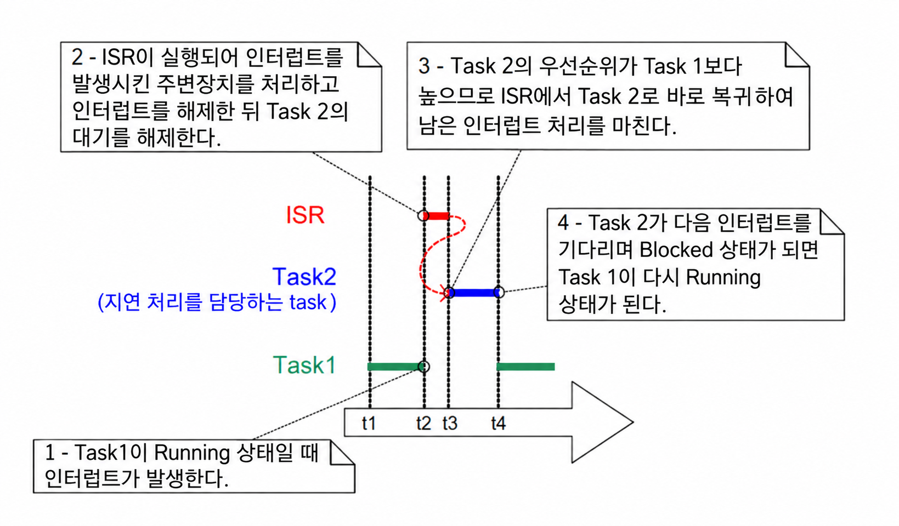
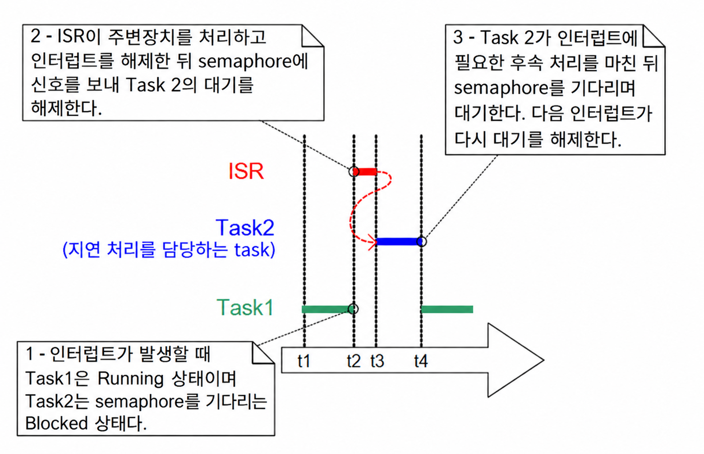
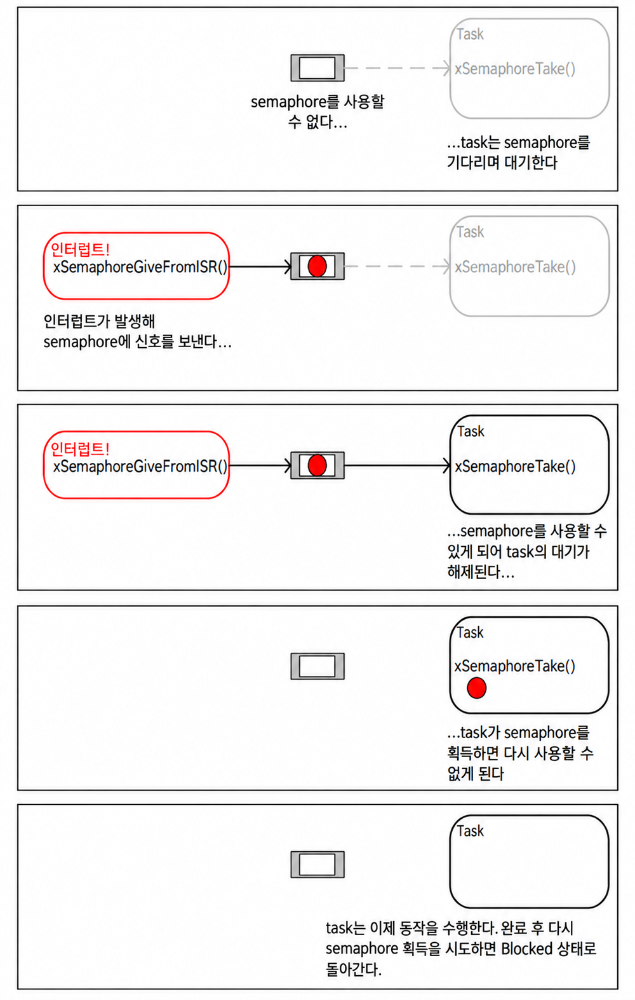
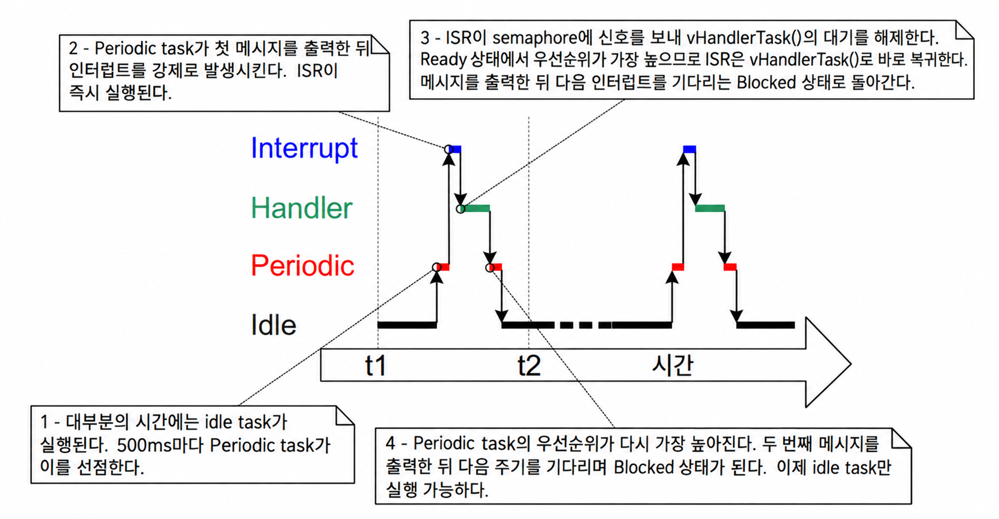
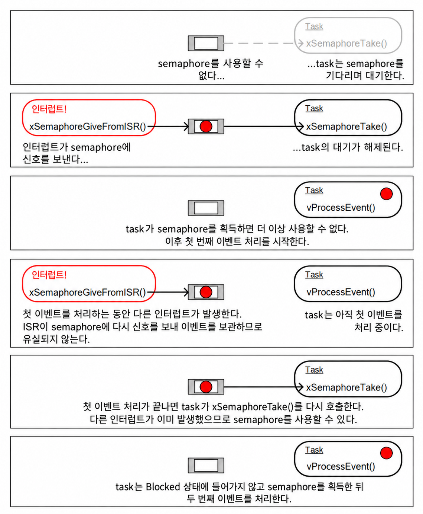
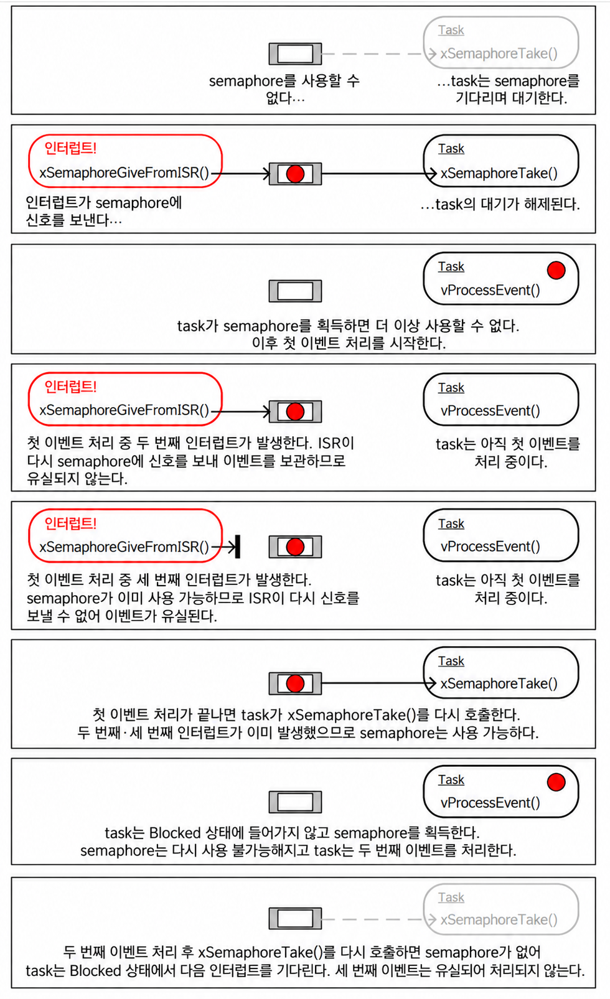
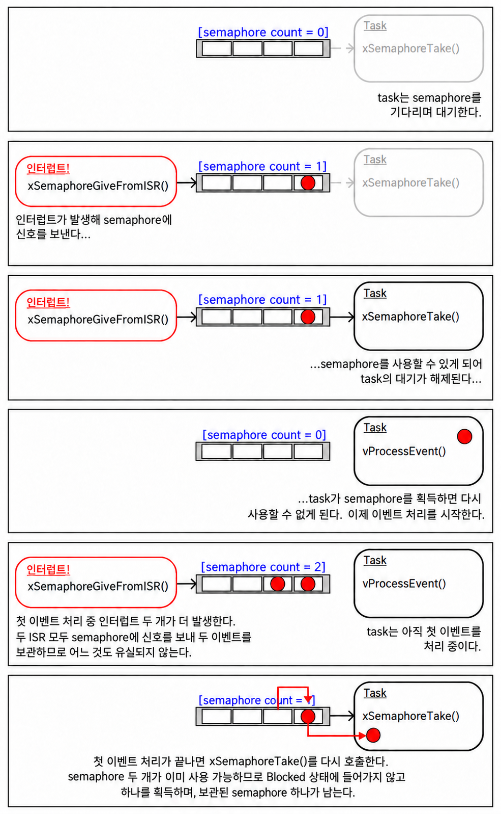
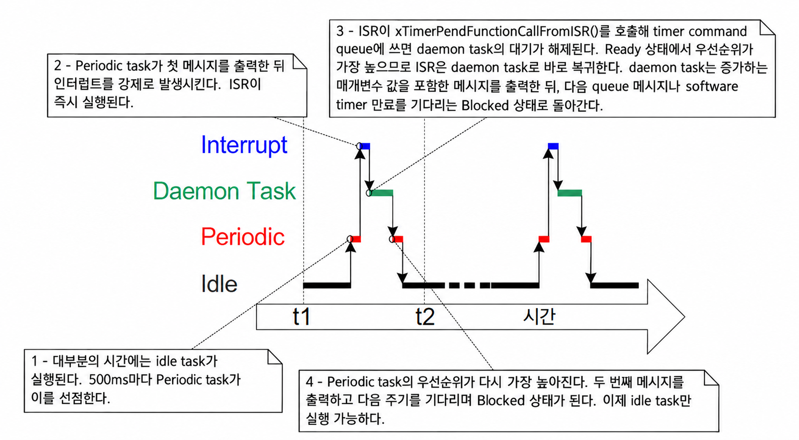
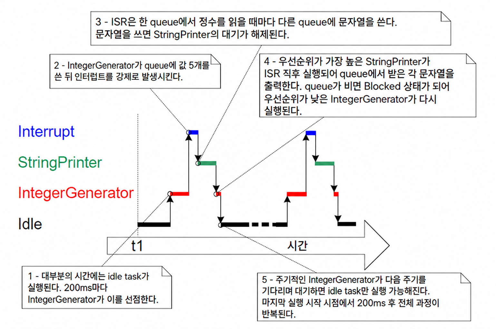
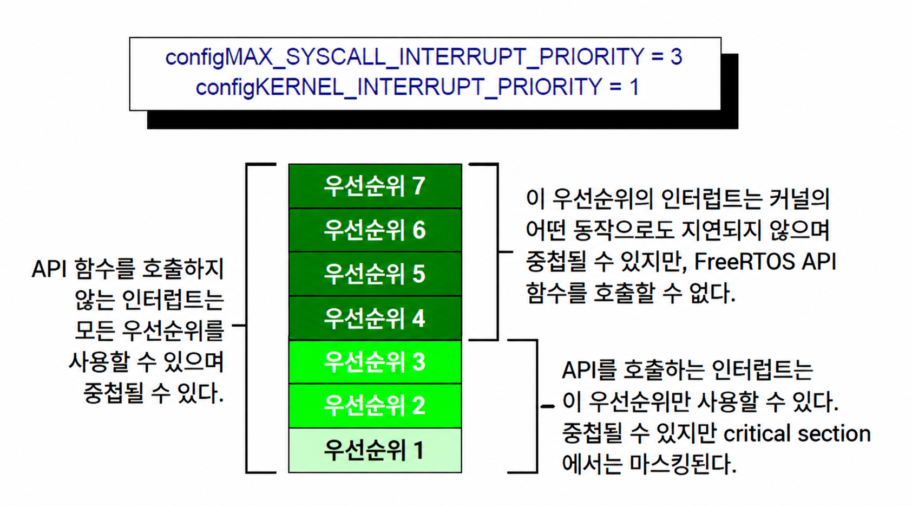

<a id="7-interrupt-management"></a>
# 7 인터럽트 관리 (Interrupt Management)

<a id="71-introduction"></a>
## 7.1 소개 (Introduction)

<a id="711-events"></a>
### 7.1.1 이벤트 (Events)

임베디드 실시간 시스템은 환경에서 비롯되는 이벤트에 대응하여 조치를 취해야 한다. 예를 들어 이더넷 주변장치에 도착한 패킷(이벤트)은 처리를 위해 TCP/IP stack(스택)으로 전달하는 작업(조치)을 필요로 할 수 있다. 실질적인 시스템은 다양한 소스로부터 발생하는 이벤트를 처리해야 하며, 이들 모두는 서로 다른 처리 오버헤드와 응답 시간 요구사항을 가질 것이다. 각 경우에 있어 최선의 이벤트 처리 구현 전략을 판단해야 한다:

- 이벤트를 어떻게 감지해야 하는가? 일반적으로 인터럽트가 사용되지만 입력을 폴링할 수도 있다.

- 인터럽트가 사용되는 경우, 인터럽트 서비스 루틴(ISR) 내부에서 얼마나 많은 처리를 수행해야 하고, 외부에서는 얼마나 수행해야 하는가? 일반적으로 각 ISR을 가능한 한 짧게 유지하는 것이 바람직하다.

- 이벤트가 메인(비-ISR) 코드에 어떻게 전달되며, 잠재적으로 비동기적인 발생을 가장 잘 처리할 수 있도록 이 코드를 어떻게 구조화할 수 있는가?

FreeRTOS는 애플리케이션 설계자에게 특정한 이벤트 처리 전략을 강제하지 않지만, 선택된 전략을 간단하고 유지보수하기 쉬운 방식으로 구현할 수 있는 기능을 제공한다.

task(태스크)의 우선순위와 인터럽트의 우선순위를 명확히 구별하는 것이 중요하다:

- task는 FreeRTOS가 실행되는 하드웨어와 무관한 소프트웨어 기능이다. task의 우선순위는 애플리케이션 작성자에 의해 소프트웨어적으로 할당되며, 소프트웨어 알고리즘인 scheduler(스케줄러)이 어떤 task를 Running 상태(실행 중)로 둘지 결정한다.

- 인터럽트 서비스 루틴은 소프트웨어로 작성되지만 하드웨어 기능이다. 하드웨어가 어떤 인터럽트 서비스 루틴을 언제 실행할지 제어하기 때문이다. task는 실행 중인 ISR이 없을 때만 실행되므로, 가장 낮은 우선순위의 인터럽트라도 가장 높은 우선순위의 task를 인터럽트하며 task가 ISR을 선점할 수 있는 방법은 없다.

FreeRTOS가 실행되는 모든 아키텍처는 인터럽트를 처리할 수 있지만, 인터럽트 진입 및 인터럽트 우선순위 할당에 관련된 세부 사항은 아키텍처마다 다르다.

<a id="712-scope"></a>
### 7.1.2 범위 (Scope)

이 장에서는 다음 내용을 다룬다:

- 인터럽트 서비스 루틴 내부에서 사용할 수 있는 FreeRTOS API 함수.
- 인터럽트 처리를 task로 지연시키는 방법.
- binary semaphore(이진 세마포어)와 counting semaphore(계수 세마포어)를 생성하고 사용하는 방법.
- binary semaphore와 counting semaphore의 차이점.
- 인터럽트 서비스 루틴으로 데이터를 전달하거나 가져오기 위해 queue(큐)를 사용하는 방법.
- 일부 FreeRTOS 포트에서 사용 가능한 인터럽트 중첩(nesting) 모델.

<a id="72-using-the-freertos-api-from-an-isr"></a>
## 7.2 ISR에서 FreeRTOS API 사용 (Using the FreeRTOS API from an ISR)

<a id="721-the-interrupt-safe-api"></a>
### 7.2.1 인터럽트 안전 API (The Interrupt Safe API)

인터럽트 서비스 루틴(ISR)에서 FreeRTOS API 함수가 제공하는 기능을 사용해야 하는 경우가 종종 있지만, 많은 FreeRTOS API 함수는 ISR 내부에서 유효하지 않은 동작을 수행한다. 이 중 가장 대표적인 것은 API 함수를 호출한 task를 Blocked 상태(대기)로 진입시키는 것이다—만약 API 함수가 ISR에서 호출된다면 task에서 호출된 것이 아니므로 Blocked 상태로 전환될 호출 task가 존재하지 않는다. FreeRTOS는 일부 API 함수의 두 가지 버전을 제공함으로써 이 문제를 해결한다. 하나는 task에서 사용하기 위한 버전이고 다른 하나는 ISR에서 사용하기 위한 버전이다. ISR에서 사용하기 위한 함수는 이름 뒤에 "FromISR"이 붙어 있다.

> *참고: ISR 내에서 이름에 "FromISR"이 붙어 있지 않은 FreeRTOS API 함수를 절대로 호출해서는 안 된다.*

<a id="722-the-benefits-of-using-a-separate-interrupt-safe-api"></a>
### 7.2.2 별도의 인터럽트 안전 API를 사용하는 이점 (The Benefits of Using a Separate Interrupt Safe API)

인터럽트에서 사용할 별도의 API를 갖추면 task 코드가 더 효율적이고, ISR 코드가 더 효율적이며, 인터럽트 진입이 더 단순해진다. 그 이유를 알기 위해 task와 ISR 모두에서 호출할 수 있는 단일 버전의 API 함수를 제공하는 대안을 살펴본다. 만약 동일한 버전의 API 함수가 task와 ISR 모두에서 호출될 수 있다면:

- API 함수는 task에서 호출되었는지 ISR에서 호출되었는지 확인하기 위한 추가 로직이 필요하다. 추가 로직은 함수 내에 새로운 경로를 도입하여 함수를 더 길고 복잡하며 테스트하기 어렵게 만든다.

- 일부 API 함수 매개변수는 task에서 호출될 때는 불필요하고, 다른 매개변수는 ISR에서 호출될 때 불필요해질 것이다.

- 각 FreeRTOS 포트는 실행 컨텍스트(task 또는 ISR)를 결정하기 위한 메커니즘을 제공해야 한다.

- 실행 컨텍스트(task 또는 ISR)를 결정하기 쉽지 않은 아키텍처에서는 소프트웨어에 의해 실행 컨텍스트가 제공되도록 허용하는 추가적이고 낭비적이며 사용하기 더 복잡하고 비표준적인 인터럽트 진입 코드가 필요하게 된다.

<a id="723-the-disadvantages-of-using-a-separate-interrupt-safe-api"></a>
### 7.2.3 별도의 인터럽트 안전 API를 사용하는 단점 (The Disadvantages of Using a Separate, Interrupt Safe API)

일부 API 함수의 두 가지 버전을 갖추면 task와 ISR 모두를 더 효율적으로 만들 수 있지만, 새로운 문제가 발생한다. 때로는 FreeRTOS API의 일부는 아니지만 FreeRTOS API를 활용하는 함수를 task와 ISR 모두에서 호출해야 할 수 있다.

이는 일반적으로 소프트웨어 설계가 애플리케이션 작성자의 제어 범위를 벗어나는 유일한 시점인 서드파티 코드를 통합할 때만 문제가 된다. 이것이 문제가 된다면 다음 기법 중 하나를 사용하여 극복할 수 있다:

- 인터럽트 처리를 task로 지연시켜[^12] API 함수가 항상 task의 컨텍스트에서만 호출되도록 한다.

- 인터럽트 중첩을 지원하는 FreeRTOS 포트를 사용하는 경우, "FromISR"로 끝나는 버전의 API 함수를 사용한다. 해당 버전은 task와 ISR 모두에서 호출될 수 있기 때문이다. (그 반대는 성립하지 않는다. "FromISR"로 끝나지 않는 API 함수는 절대로 ISR에서 호출해서는 안 된다.)

- 서드파티 코드는 일반적으로 함수가 호출되는 컨텍스트(task 또는 인터럽트)를 테스트한 다음 해당 컨텍스트에 적합한 API 함수를 호출하도록 구현할 수 있는 RTOS 추상화 계층을 포함한다.

[^12]: 지연된 인터럽트 처리는 이 책의 다음 절에서 다룬다.

<a id="724-the-xhigherprioritytaskwoken-parameter"></a>
### 7.2.4 xHigherPriorityTaskWoken 매개변수 (The xHigherPriorityTaskWoken Parameter)

이 절에서는 `xHigherPriorityTaskWoken` 매개변수의 개념을 소개한다. 다음 절들에서 실용적인 예제가 제공되므로 아직 이 절을 완전히 이해하지 못했더라도 괜찮다.

인터럽트에 의해 문맥 전환이 수행되면 인터럽트가 종료될 때 실행 중인 task는 인터럽트에 진입했을 때 실행 중이던 task와 다를 수 있다—인터럽트가 한 task를 중단시켰지만 다른 task로 복귀하는 것이다.

일부 FreeRTOS API 함수는 task를 Blocked 상태에서 Ready 상태로 전환할 수 있다. 이는 이미 `xQueueSendToBack()`과 같은 함수에서 확인한 바 있으며, 해당 함수는 대상 queue에 데이터가 사용 가능해지기를 Blocked 상태에서 기다리는 task가 있는 경우 해당 task를 블록 해제한다.

FreeRTOS API 함수에 의해 블록 해제된 task의 우선순위가 Running 상태인 task의 우선순위보다 높다면, FreeRTOS 스케줄링 정책에 따라 더 높은 우선순위 task로의 전환이 발생해야 한다. 더 높은 우선순위 task로의 전환이 실제로 발생하는 시점은 API 함수가 호출된 컨텍스트에 따라 달라진다:

- API 함수가 task에서 호출된 경우:

  `FreeRTOSConfig.h`에서 `configUSE_PREEMPTION`이 1로 설정되어 있다면, 더 높은 우선순위 task로의 전환은 API 함수 내부에서, 즉 API 함수가 종료되기 전에 자동으로 발생한다. 이는 그림 6.6에서 이미 확인한 바 있으며, timer command queue에 쓰기를 수행한 함수가 종료되기 전에 RTOS daemon task로의 전환이 발생했다.

- API 함수가 인터럽트에서 호출된 경우:

  더 높은 우선순위 task로의 전환은 인터럽트 내부에서 자동으로 발생하지 않는다. 대신 애플리케이션 작성자에게 문맥 전환을 수행해야 함을 알리기 위해 변수가 설정된다. 인터럽트 안전 API 함수("FromISR"로 끝나는 함수)에는 이러한 목적으로 사용되는 `pxHigherPriorityTaskWoken`이라는 포인터 매개변수가 있다.

  문맥 전환이 수행되어야 하는 경우, 인터럽트 안전 API 함수는 `*pxHigherPriorityTaskWoken`을 `pdTRUE`로 설정한다. 이러한 일이 발생했음을 감지할 수 있으려면 `pxHigherPriorityTaskWoken`이 가리키는 변수가 처음 사용되기 전에 반드시 `pdFALSE`로 초기화되어야 한다.

  애플리케이션 작성자가 ISR에서 문맥 전환을 요청하지 않기로 선택하면, 더 높은 우선순위 task는 다음에 scheduler가 실행될 때까지(최악의 경우 다음 tick interrupt(tick 인터럽트) 동안) Ready 상태로 유지된다.

  FreeRTOS API 함수는 `*pxHigherPriorityTaskWoken`을 `pdTRUE`로만 설정할 수 있다. 하나의 ISR이 둘 이상의 FreeRTOS API 함수를 호출하는 경우 각 API 함수 호출에서 동일한 변수를 `pxHigherPriorityTaskWoken` 매개변수로 전달할 수 있으며, 이 변수는 처음 사용되기 전에 한 번만 `pdFALSE`로 초기화하면 된다.

API 함수의 인터럽트 안전 버전 내부에서 문맥 전환이 자동으로 발생하지 않는 데는 몇 가지 이유가 있다:

- 불필요한 문맥 전환 방지

  task가 처리를 수행할 필요가 생기기 전에 인터럽트가 여러 번 실행될 수 있다. 예를 들어 task가 인터럽트 구동 방식의 UART에 의해 수신된 문자열을 처리하는 시나리오를 살펴본다. 전체 문자열이 수신된 후에만 task가 처리할 작업이 생기므로, 문자가 수신될 때마다 UART ISR이 task로 전환하는 것은 낭비이다.

- 실행 순서에 대한 제어

  인터럽트는 산발적으로, 그리고 예측할 수 없는 시간에 발생할 수 있다. 숙련된 FreeRTOS 사용자는 FreeRTOS scheduler 잠금 메커니즘을 사용해서도 이를 달성할 수 있지만 애플리케이션의 특정 지점에서 다른 task로의 예측할 수 없는 전환을 일시적으로 피하기를 원할 수 있다.

- 이식성 (Portability)

  모든 FreeRTOS 포트에서 사용할 수 있는 가장 간단한 메커니즘이다.

- 효율성 (Efficiency)

  더 작은 프로세서 아키텍처를 대상으로 하는 포트는 ISR의 맨 끝에서만 문맥 전환을 요청할 수 있도록 허용하며, 이러한 제한을 제거하려면 추가적이고 더 복잡한 코드가 필요하다. 또한 동일한 ISR 내에서 둘 이상의 FreeRTOS API 함수를 호출하더라도 동일한 ISR 내에서 둘 이상의 문맥 전환 요청을 생성하지 않도록 한다.

- RTOS tick interrupt 내에서의 실행

  이 책의 뒷부분에서 보게 되겠지만 RTOS tick interrupt에 애플리케이션 코드를 추가할 수 있다. tick interrupt 내부에서 문맥 전환을 시도한 결과는 사용 중인 FreeRTOS 포트에 따라 다르다. 최선의 경우 scheduler에 대한 불필요한 호출로 이어진다.

`pxHigherPriorityTaskWoken` 매개변수의 사용은 선택 사항이다. 필요하지 않은 경우 `pxHigherPriorityTaskWoken`을 NULL로 설정하면 된다.

<a id="725-the-portyield_from_isr-and-portend_switching_isr-macros"></a>
### 7.2.5 portYIELD_FROM_ISR() 및 portEND_SWITCHING_ISR() 매크로 (The portYIELD_FROM_ISR() and portEND_SWITCHING_ISR() Macros)

이 절에서는 ISR에서 문맥 전환을 요청하는 데 사용되는 매크로를 소개한다. 다음 절들에서 실용적인 예제가 제공되므로 아직 이 절을 완전히 이해하지 못했더라도 괜찮다.

`taskYIELD()`는 task 내에서 문맥 전환을 요청하기 위해 호출할 수 있는 매크로이다. `portYIELD_FROM_ISR()`과 `portEND_SWITCHING_ISR()`은 모두 `taskYIELD()`의 인터럽트 안전 버전이다. `portYIELD_FROM_ISR()`과 `portEND_SWITCHING_ISR()`은 둘 다 동일한 방식으로 사용되며 동일한 작업을 수행한다[^13]. 일부 FreeRTOS 포트는 두 매크로 중 하나만 제공한다. 최신 FreeRTOS 포트는 두 매크로를 모두 제공한다. 이 책의 예제에서는 `portYIELD_FROM_ISR()`을 사용한다.

[^13]: 역사적으로 `portEND_SWITCHING_ISR()`은 인터럽트 핸들러가 어셈블리 코드 래퍼를 사용해야 했던 FreeRTOS 포트에서 사용된 이름이며, `portYIELD_FROM_ISR()`은 전체 인터럽트 핸들러를 C로 작성할 수 있었던 FreeRTOS 포트에서 사용된 이름이다.

<a name="list7.1" title="Listing 7.1 The portEND_SWITCHING_ISR() macros"></a>

```c
portEND_SWITCHING_ISR( xHigherPriorityTaskWoken );
```
***코드 7.1*** *portEND_SWITCHING_ISR() 매크로*

<a name="list7.2" title="Listing 7.2 The portYIELD_FROM_ISR() macros"></a>

```c
portYIELD_FROM_ISR( xHigherPriorityTaskWoken );
```
***코드 7.2*** *portYIELD_FROM_ISR() 매크로*

인터럽트 안전 API 함수로부터 전달된 `xHigherPriorityTaskWoken` 매개변수는 `portYIELD_FROM_ISR()` 호출의 매개변수로 직접 사용될 수 있다.

`portYIELD_FROM_ISR()`의 `xHigherPriorityTaskWoken` 매개변수가 `pdFALSE`(0)이면 문맥 전환이 요청되지 않으며 매크로는 아무런 영향을 미치지 않는다. `portYIELD_FROM_ISR()`의 `xHigherPriorityTaskWoken` 매개변수가 `pdFALSE`가 아니면 문맥 전환이 요청되고 Running 상태의 task가 변경될 수 있다. 인터럽트가 실행되는 동안 Running 상태의 task가 변경되었더라도 인터럽트는 항상 Running 상태의 task로 복귀한다.

대부분의 FreeRTOS 포트는 ISR 내의 어디에서나 `portYIELD_FROM_ISR()`을 호출할 수 있도록 허용한다. 몇몇 FreeRTOS 포트(주로 소형 아키텍처용)는 ISR의 맨 끝에서만 `portYIELD_FROM_ISR()`을 호출하도록 허용한다.

<a id="73-deferred-interrupt-processing"></a>
## 7.3 지연된 인터럽트 처리 (Deferred Interrupt Processing)

일반적으로 ISR을 가능한 한 짧게 유지하는 것이 모범 사례로 간주된다. 그 이유는 다음과 같다:

- task에 매우 높은 우선순위가 할당되었더라도 하드웨어에 의해 인터럽트가 처리되고 있지 않을 때만 실행될 수 있다.

- ISR은 task의 시작 시간과 실행 시간 모두를 방해(지터(jitter) 추가)할 수 있다.

- FreeRTOS가 실행되는 아키텍처에 따라 ISR이 실행되는 동안 새로운 인터럽트 전체 또는 최소한 일부를 수락하지 못할 수 있다.

- 애플리케이션 작성자는 변수, 주변장치, 메모리 버퍼와 같은 자원에 task와 ISR이 동시에 접근하는 결과를 고려하고 이에 대비해야 한다.

- 일부 FreeRTOS 포트는 인터럽트 중첩을 허용하지만, 인터럽트 중첩은 복잡성을 증가시키고 예측 가능성을 떨어뜨릴 수 있다. 인터럽트가 짧을수록 중첩될 가능성이 줄어든다.

인터럽트 서비스 루틴은 인터럽트의 원인을 기록하고 인터럽트를 클리어해야 한다. 인터럽트로 인해 요구되는 기타 모든 처리는 task에서 수행될 수 있는 경우가 많으므로 인터럽트 서비스 루틴이 실용적으로 가능한 한 빨리 종료될 수 있도록 한다. 인터럽트에 의해 요구되는 처리가 ISR로부터 task로 '지연(deferred)'되기 때문에 이를 '지연된 인터럽트 처리(deferred interrupt processing)'라고 부른다.

인터럽트 처리를 task로 지연시키면 애플리케이션 작성자가 애플리케이션의 다른 task에 대해 처리 우선순위를 지정할 수 있으며 모든 FreeRTOS API 함수를 사용할 수 있다.

인터럽트 처리가 지연된 task의 우선순위가 다른 모든 task의 우선순위보다 높다면, 처리가 ISR 자체에서 수행된 것과 마찬가지로 즉시 수행된다. 이 시나리오가 그림 7.1에 나와 있으며, 여기서 Task 1은 일반 애플리케이션 task이고 Task 2는 인터럽트 처리가 지연된 task이다.

<a name="fig7.1" title="Figure 7.1 Completing interrupt processing in a high priority task"></a>

* * *


***그림 7.1*** *높은 우선순위 task에서 인터럽트 처리 완료*

* * *

그림 7.1에서 인터럽트 처리는 시간 t2에 시작되어 실질적으로 시간 t4에 끝나지만, 시간 t2와 t3 사이의 기간만 ISR에서 소비된다. 지연된 인터럽트 처리를 사용하지 않았다면 시간 t2와 t4 사이의 전체 기간이 ISR에서 소비되었을 것이다.

인터럽트에 의해 요구되는 모든 처리를 ISR에서 수행하는 것이 가장 좋은 시점과 처리의 일부를 task로 지연시키는 것이 가장 좋은 시점에 대한 절대적인 규칙은 없다. task로 처리를 지연시키는 것은 다음과 같은 경우에 가장 유용하다:

- 인터럽트에 의해 요구되는 처리가 단순하지 않은 경우. 예를 들어 인터럽트가 단순히 아날로그-디지털 변환 결과를 저장하는 것이라면 ISR 내부에서 수행하는 것이 가장 좋지만, 변환 결과를 소프트웨어 필터에 통과시켜야 한다면 task에서 필터를 실행하는 것이 가장 좋을 수 있다.

- 콘솔에 쓰거나 메모리를 할당하는 것과 같이 ISR 내부에서 수행할 수 없는 작업을 인터럽트 처리가 수행하는 것이 편리한 경우.

- 인터럽트 처리가 결정론적이지 않은 경우—처리에 얼마나 걸릴지 사전에 알 수 없음을 의미한다.

다음 절들에서는 지연된 인터럽트 처리를 구현하는 데 사용할 수 있는 FreeRTOS 기능을 포함하여 지금까지 이 장에서 소개된 개념을 설명하고 시연한다.

<a id="74-binary-semaphores-used-for-synchronization"></a>
## 7.4 동기화에 사용되는 바이너리 세마포어 (Binary Semaphores Used for Synchronization)

binary semaphore API의 인터럽트 안전 버전을 사용하면 특정 인터럽트가 발생할 때마다 task를 블록 해제하여 실질적으로 task를 인터럽트와 동기화할 수 있다. 이를 통해 인터럽트 이벤트 처리의 대부분을 동기화된 task 내에서 구현할 수 있으며 매우 빠르고 짧은 부분만 ISR에 직접 남겨둘 수 있다. 이전 절에서 설명한 바와 같이 binary semaphore는 인터럽트 처리를 task로 '지연'시키는 데 사용된다[^14].

[^14]: binary semaphore를 사용하는 것보다 task 직접 알림(direct to task notification)을 사용하여 인터럽트에서 task를 블록 해제하는 것이 더 효율적이다. task 직접 알림은 10장 "task notification"에서 다룬다.

이전에 그림 7.1에서 확인한 바와 같이 인터럽트 처리가 특히 시간상 중요한 경우, 지연 처리 task의 우선순위를 설정하여 해당 task가 시스템의 다른 task를 항상 선점하도록 보장할 수 있다. 그런 다음 ISR은 `portYIELD_FROM_ISR()` 호출을 포함하도록 구현되어 ISR이 인터럽트 처리가 지연되는 task로 직접 복귀하도록 보장할 수 있다. 이는 마치 모든 처리가 ISR 자체 내에서 구현된 것처럼 전체 이벤트 처리가 시간상 연속적으로(중단 없이) 실행되도록 보장하는 효과를 갖는다. 그림 7.2는 그림 7.1에 표시된 시나리오를 반복하지만 semaphore(세마포어)를 사용하여 지연 처리 task의 실행을 제어하는 방법을 설명하도록 텍스트가 업데이트되어 있다.

<a name="fig7.2" title="Figure 7.2 Using a binary semaphore to implement deferred interrupt processing"></a>

* * *


***그림 7.2*** *지연된 인터럽트 처리를 구현하기 위한 binary semaphore 사용*

* * *

지연 처리 task는 이벤트가 발생하기를 기다리기 위해 Blocked 상태로 진입하는 수단으로 semaphore에 대한 블로킹 'take' 호출을 사용한다. 이벤트가 발생하면 ISR은 필요한 이벤트 처리가 진행될 수 있도록 동일한 semaphore에 'give' 작업을 사용하여 task를 블록 해제한다.

'semaphore 가져오기(taking a semaphore)'와 'semaphore 반환하기(giving a semaphore)'는 사용 시나리오에 따라 의미가 달라지는 개념이다. 이 인터럽트 동기화 시나리오에서 binary semaphore는 개념적으로 길이가 1인 queue로 간주될 수 있다. queue는 언제든지 최대 하나의 항목만 포함할 수 있으므로 항상 비어 있거나 가득 차 있다(따라서 바이너리이다). `xSemaphoreTake()`를 호출함으로써 인터럽트 처리가 지연되는 task는 사실상 최대 대기 시간을 가지고 queue에서 읽기를 시도하여 queue가 비어 있는 경우 task가 Blocked 상태로 진입하도록 만든다. 이벤트가 발생하면 ISR은 `xSemaphoreGiveFromISR()` 함수를 사용하여 queue에 토큰(semaphore)을 배치하여 queue를 채운다. 이로 인해 task는 Blocked 상태를 벗어나 토큰을 제거하여 queue를 다시 비워둔다. task가 처리를 완료하면 다시 한 번 queue에서 읽기를 시도하고 queue가 비어 있음을 발견하여 다음 이벤트를 기다리기 위해 Blocked 상태로 다시 진입한다. 이 시퀀스가 그림 7.3에 나와 있다.

그림 7.3은 인터럽트가 semaphore를 먼저 '가져오지' 않았음에도 semaphore를 '반환'하고, task가 semaphore를 '가져오지만' 결코 돌려주지 않는 모습을 보여준다. 이것이 바로 이 시나리오가 queue에 쓰고 읽는 것과 개념적으로 유사하다고 설명되는 이유이다. 이는 8장 "자원 관리"에서 설명하는 시나리오와 같이 semaphore를 가져간 task가 항상 이를 반환해야 하는 다른 semaphore 사용 시나리오와 동일한 규칙을 따르지 않기 때문에 종종 혼란을 야기한다.

<a name="fig7.3" title="Figure 7.3 Using a binary semaphore to synchronize a task with an interrupt"></a>

* * *


***그림 7.3*** *task를 인터럽트와 동기화하기 위한 binary semaphore 사용*

* * *

<a id="741-the-xsemaphorecreatebinary-api-function"></a>
### 7.4.1 xSemaphoreCreateBinary() API 함수 (The xSemaphoreCreateBinary() API Function)

FreeRTOS에는 컴파일 타임에 binary semaphore를 생성하는 데 필요한 메모리를 정적으로 할당하는 `xSemaphoreCreateBinaryStatic()` 함수도 포함되어 있다. 모든 다양한 유형의 FreeRTOS semaphore에 대한 핸들은 `SemaphoreHandle_t` 타입의 변수에 저장된다.

semaphore를 사용하기 전에 반드시 생성해야 한다. binary semaphore를 생성하려면 `xSemaphoreCreateBinary()` API 함수를 사용한다[^15].

[^15]: 일부 semaphore API 함수는 실제로는 함수가 아니라 매크로이다. 단순화를 위해 이 책 전반에서 모두 함수로 지칭한다.

<a name="list7.3" title="Listing 7.3 The xSemaphoreCreateBinary() API function prototype"></a>

```c
SemaphoreHandle_t xSemaphoreCreateBinary( void );
```
***코드 7.3*** *xSemaphoreCreateBinary() API 함수 원형*

**xSemaphoreCreateBinary() 반환값**

- 반환값

  NULL이 반환되면 FreeRTOS가 semaphore 데이터 구조를 할당하기에 사용 가능한 heap(힙) 메모리가 부족하여 semaphore를 생성할 수 없음을 의미한다.

  NULL이 아닌 값이 반환되면 semaphore가 성공적으로 생성되었음을 나타낸다. 반환된 값은 생성된 semaphore의 핸들로 저장되어야 한다.

<a id="742-the-xsemaphoretake-api-function"></a>
### 7.4.2 xSemaphoreTake() API 함수 (The xSemaphoreTake() API Function)

semaphore를 '가져온다(Taking)'는 것은 semaphore를 '획득'하거나 '수신'함을 의미한다. semaphore는 사용 가능한 경우에만 가져올 수 있다.

recursive mutex(재귀 뮤텍스)를 제외한 모든 다양한 유형의 FreeRTOS semaphore는 `xSemaphoreTake()` 함수를 사용하여 '가져올' 수 있다.

`xSemaphoreTake()`는 인터럽트 서비스 루틴 내에서 절대로 사용해서는 안 된다.

<a name="list7.4" title="Listing 7.4 The xSemaphoreTake() API function prototype"></a>

```c
BaseType_t xSemaphoreTake( SemaphoreHandle_t xSemaphore, TickType_t xTicksToWait );
```
***코드 7.4*** *xSemaphoreTake() API 함수 원형*

**xSemaphoreTake() 매개변수 및 반환값**

- `xSemaphore`

  '가져올' semaphore.

  semaphore는 `SemaphoreHandle_t` 타입의 변수로 참조된다. 사용하기 전에 반드시 명시적으로 생성해야 한다.

- `xTicksToWait`

  semaphore를 즉시 사용할 수 없는 경우 semaphore를 기다리기 위해 task가 Blocked 상태로 유지되어야 하는 최대 시간.

  `xTicksToWait`가 0이면 semaphore를 사용할 수 없을 때 `xSemaphoreTake()`가 즉시 반환된다.

  최대 대기 시간은 tick(틱) 주기로 지정되므로 절대 시간은 tick rate(초당 tick 수)에 따라 달라진다. 매크로 `pdMS_TO_TICKS()`를 사용하여 밀리초 단위로 지정된 시간을 tick 단위 시간으로 변환할 수 있다.

  `FreeRTOSConfig.h`에서 `INCLUDE_vTaskSuspend`가 1로 설정되어 있는 경우, `xTicksToWait`를 `portMAX_DELAY`로 설정하면 task가 (타임아웃 없이) 무기한 대기하게 된다.

- 반환값

  두 가지 가능한 반환값이 있다:

  - `pdPASS`

    `xSemaphoreTake()` 호출이 semaphore를 획득하는 데 성공한 경우에만 `pdPASS`가 반환된다.

    최대 대기 시간이 지정된 경우(`xTicksToWait`가 0이 아님), 호출 task가 semaphore가 즉시 사용 가능하지 않아 이를 기다리기 위해 Blocked 상태로 전환되었을 수 있으나 최대 대기 시간이 만료되기 전에 semaphore를 사용할 수 있게 된 것이다.

  - `pdFALSE`

    semaphore를 사용할 수 없다.

    최대 대기 시간이 지정된 경우(`xTicksToWait`가 0이 아님), 호출 task가 semaphore가 사용 가능해지기를 기다리기 위해 Blocked 상태로 전환되었으나 그 일이 발생하기 전에 최대 대기 시간이 만료된 것이다.

<a id="743-the-xsemaphoregivefromisr-api-function"></a>
### 7.4.3 xSemaphoreGiveFromISR() API 함수 (The xSemaphoreGiveFromISR() API Function)

binary semaphore와 counting semaphore[^16]는 `xSemaphoreGiveFromISR()` 함수를 사용하여 '반환(give)'할 수 있다.

[^16]: counting semaphore는 이 책의 뒷부분에서 설명한다.

`xSemaphoreGiveFromISR()`은 `xSemaphoreGive()`의 인터럽트 안전 버전이므로 이 장의 시작 부분에서 설명한 `pxHigherPriorityTaskWoken` 매개변수를 갖는다.

<a id="list"></a>
<a name="list7.5" title="Listing 7.5 The xSemaphoreGiveFromISR() API function prototype"></a>

```c
BaseType_t xSemaphoreGiveFromISR( SemaphoreHandle_t xSemaphore,
                                  BaseType_t *pxHigherPriorityTaskWoken );
```
***코드 7.5*** *xSemaphoreGiveFromISR() API 함수 원형*

**xSemaphoreGiveFromISR() 매개변수 및 반환값**

- `xSemaphore`

  '반환할' semaphore.

  semaphore는 `SemaphoreHandle_t` 타입의 변수로 참조되며 사용하기 전에 반드시 명시적으로 생성되어야 한다.

- `pxHigherPriorityTaskWoken`

  단일 semaphore에 대해 semaphore를 사용할 수 있게 되기를 기다리며 하나 이상의 task가 블록되어 있을 수 있다. `xSemaphoreGiveFromISR()`을 호출하면 semaphore를 사용할 수 있게 되어 semaphore를 기다리던 task가 Blocked 상태를 벗어나게 될 수 있다. 만약 `xSemaphoreGiveFromISR()`을 호출하여 task가 Blocked 상태를 벗어나게 되었고, 블록 해제된 task가 현재 실행 중인 task(인터럽트된 task)보다 높은 우선순위를 갖는다면 내부적으로 `xSemaphoreGiveFromISR()`은 `*pxHigherPriorityTaskWoken`을 `pdTRUE`로 설정한다.

  `xSemaphoreGiveFromISR()`이 이 값을 `pdTRUE`로 설정하면 일반적으로 인터럽트가 종료되기 전에 문맥 전환을 수행해야 한다. 이렇게 하면 인터럽트가 가장 높은 우선순위의 Ready 상태 task로 직접 복귀하게 된다.

- 반환값

  두 가지 가능한 반환값이 있다:

  - `pdPASS`

    `xSemaphoreGiveFromISR()` 호출이 성공한 경우에만 `pdPASS`가 반환된다.

  - `pdFAIL`

    semaphore를 이미 사용할 수 있는 상태라면 반환할 수 없으며 `xSemaphoreGiveFromISR()`은 `pdFAIL`을 반환한다.

<a name="example7.1" title="Example 7.1 Using a binary semaphore to synchronize a task with an interrupt"></a>
---
***예제 7.1*** *인터럽트와 task 동기화를 위한 binary semaphore 사용*

---

이 예제는 binary semaphore를 사용하여 인터럽트 서비스 루틴에서 task를 블록 해제함으로써 실질적으로 task를 인터럽트와 동기화한다.

간단한 주기적 task를 사용하여 500밀리초마다 소프트웨어 인터럽트를 생성한다. 일부 타깃 환경에서 실제 인터럽트에 후킹하는 복잡성 때문에 편의상 소프트웨어 인터럽트를 사용한다. 코드 7.6은 주기적 task의 구현을 보여준다. task는 인터럽트가 생성되기 전과 후에 모두 문자열을 출력한다는 점에 유의하라. 이를 통해 예제가 실행될 때 생성되는 출력에서 실행 시퀀스를 관찰할 수 있다.

<a name="list7.6" title="Listing 7.6 Implementation of the task that periodically generates a software interrupt in Example 7.1"></a>

```c
/* The number of the software interrupt used in this example. The code
   shown is from the Windows project, where numbers 0 to 2 are used by the
   FreeRTOS Windows port itself, so 3 is the first number available to the
   application. */
#define mainINTERRUPT_NUMBER 3

static void vPeriodicTask( void *pvParameters )
{
    const TickType_t xDelay500ms = pdMS_TO_TICKS( 500UL );

    /* As per most tasks, this task is implemented within an infinite loop. */
    for( ;; )
    {
        /* Block until it is time to generate the software interrupt again. */
        vTaskDelay( xDelay500ms );

        /* Generate the interrupt, printing a message both before and after
           the interrupt has been generated, so the sequence of execution is
           evident from the output.

           The syntax used to generate a software interrupt is dependent on
           the FreeRTOS port being used. The syntax used below can only be
           used with the FreeRTOS Windows port, in which such interrupts are
           only simulated. */
        vPrintString( "Periodic task - About to generate an interrupt.\r\n" );
        vPortGenerateSimulatedInterrupt( mainINTERRUPT_NUMBER );
        vPrintString( "Periodic task - Interrupt generated.\r\n\r\n\r\n" );
    }
}
```
***코드 7.6*** *예제 7.1에서 주기적으로 소프트웨어 인터럽트를 발생시키는 task 구현*

코드 7.7은 인터럽트 처리가 지연되는 task—binary semaphore의 사용을 통해 소프트웨어 인터럽트와 동기화되는 task—의 구현을 보여준다. 여기서도 task의 각 반복마다 문자열이 출력되므로 예제가 실행될 때 생성되는 출력에서 task와 인터럽트가 실행되는 순서가 명확하게 드러난다.

코드 7.7에 표시된 코드는 인터럽트가 소프트웨어에 의해 생성되는 예제 7.1에는 적합하지만 하드웨어 주변장치에 의해 인터럽트가 생성되는 시나리오에는 적합하지 않다는 점에 유의해야 한다. 다음 하위 절에서는 하드웨어 생성 인터럽트에 적합하도록 코드 구조를 어떻게 변경해야 하는지 설명한다.

<a id="list7.7."></a>
<a name="list7.7" title="Listing 7.7 The implementation of the task to which the interrupt processing is deferred (the task that...)"></a>

```c
static void vHandlerTask( void *pvParameters )
{
    /* As per most tasks, this task is implemented within an infinite loop. */
    for( ;; )
    {
        /* Use the semaphore to wait for the event. The semaphore was created
           before the scheduler was started, so before this task ran for the
           first time. The task blocks indefinitely, meaning this function
           call will only return once the semaphore has been successfully
           obtained - so there is no need to check the value returned by
           xSemaphoreTake(). */
        xSemaphoreTake( xBinarySemaphore, portMAX_DELAY );

        /* To get here the event must have occurred. Process the event (in
           this Case, just print out a message). */
        vPrintString( "Handler task - Processing event.\r\n" );
    }
}
```
***코드 7.7*** *예제 7.1에서 인터럽트 처리를 넘겨받는 task 구현*

코드 7.8은 ISR을 보여준다. 이는 인터럽트 처리가 지연되는 task를 블록 해제하기 위해 semaphore를 '반환(give)'하는 것 외에는 거의 아무것도 하지 않는다.

`xHigherPriorityTaskWoken` 변수가 어떻게 사용되는지 주목하라. 이는 `xSemaphoreGiveFromISR()`을 호출하기 전에 `pdFALSE`로 설정된 다음 `portYIELD_FROM_ISR()`이 호출될 때 매개변수로 사용된다. `xHigherPriorityTaskWoken`이 `pdTRUE`와 같으면 `portYIELD_FROM_ISR()` 매크로 내부에서 문맥 전환이 요청된다.

ISR의 프로토타입과 문맥 전환을 강제하기 위해 호출되는 매크로는 모두 FreeRTOS Windows 포트에 맞는 것이며 다른 FreeRTOS 포트에서는 다를 수 있다. 사용 중인 포트에 필요한 구문을 찾으려면 FreeRTOS.org 웹사이트의 포트별 문서 페이지와 FreeRTOS 다운로드에 제공된 예제를 참조한다.

FreeRTOS가 실행되는 대부분의 아키텍처와 달리 FreeRTOS Windows 포트는 ISR이 값을 반환할 것을 요구한다. Windows 포트와 함께 제공되는 `portYIELD_FROM_ISR()` 매크로 구현에는 return 문이 포함되어 있으므로 코드 7.8에서는 명시적으로 값을 반환하는 모습을 보여주지 않는다.

<a name="list7.8" title="Listing 7.8 The ISR for the software interrupt used in Example 7.1"></a>

```c
static uint32_t ulExampleInterruptHandler( void )
{
    BaseType_t xHigherPriorityTaskWoken;

    /* The xHigherPriorityTaskWoken parameter must be initialized to
       pdFALSE as it will get set to pdTRUE inside the interrupt safe
       API function if a context switch is required. */
    xHigherPriorityTaskWoken = pdFALSE;

    /* 'Give' the semaphore to unblock the task, passing in the address of
       xHigherPriorityTaskWoken as the interrupt safe API function's
       pxHigherPriorityTaskWoken parameter. */
    xSemaphoreGiveFromISR( xBinarySemaphore, &xHigherPriorityTaskWoken );

    /* Pass the xHigherPriorityTaskWoken value into portYIELD_FROM_ISR().
       If xHigherPriorityTaskWoken was set to pdTRUE inside
       xSemaphoreGiveFromISR() then calling portYIELD_FROM_ISR() will request
       a context switch. If xHigherPriorityTaskWoken is still pdFALSE then
       calling portYIELD_FROM_ISR() will have no effect. Unlike most FreeRTOS
       ports, the Windows port requires the ISR to return a value - the return
       statement is inside the Windows version of portYIELD_FROM_ISR(). */
    portYIELD_FROM_ISR( xHigherPriorityTaskWoken );
}
```
***코드 7.8*** *예제 7.1의 소프트웨어 인터럽트 ISR*

`main()` 함수는 binary semaphore를 생성하고, task를 생성하며, 인터럽트 핸들러를 설치하고, scheduler를 시작한다. 구현은 코드 7.9에 나와 있다.

인터럽트 핸들러를 설치하기 위해 호출되는 함수의 구문은 FreeRTOS Windows 포트에 특화된 것이며 다른 FreeRTOS 포트에서는 다를 수 있다. 사용 중인 포트에 필요한 구문을 찾으려면 FreeRTOS.org 웹사이트의 포트별 문서 페이지와 FreeRTOS 다운로드에 제공된 예제를 참조한다.

<a name="list7.9" title="Listing 7.9 The implementation of main() for Example 7.1"></a>

```c
int main( void )
{
    /* Before a semaphore is used it must be explicitly created. In this
       example a binary semaphore is created. */
    xBinarySemaphore = xSemaphoreCreateBinary();

    /* Check the semaphore was created successfully. */
    if( xBinarySemaphore != NULL )
    {
        /* Create the 'handler' task, which is the task to which interrupt
           processing is deferred. This is the task that will be synchronized
           with the interrupt. The handler task is created with a high priority
           to ensure it runs immediately after the interrupt exits. In this
           case a priority of 3 is chosen. */
        xTaskCreate( vHandlerTask, "Handler", 1000, NULL, 3, NULL );

        /* Create the task that will periodically generate a software
           interrupt. This is created with a priority below the handler task
           to ensure it will get preempted each time the handler task exits
           the Blocked state. */
        xTaskCreate( vPeriodicTask, "Periodic", 1000, NULL, 1, NULL );

        /* Install the handler for the software interrupt. The syntax necessary
           to do this is dependent on the FreeRTOS port being used. The syntax
           shown here can only be used with the FreeRTOS windows port, where
           such interrupts are only simulated. */
        vPortSetInterruptHandler( mainINTERRUPT_NUMBER,
                                  ulExampleInterruptHandler );

        /* Start the scheduler so the created tasks start executing. */
        vTaskStartScheduler();
    }

    /* As normal, the following line should never be reached. */
    for( ;; );
}
```
***코드 7.9*** *예제 7.1의 main() 함수 구현*

예제 7.1은 그림 7.4에 표시된 출력을 생성한다. 예상대로 `vHandlerTask()`는 인터럽트가 생성되는 즉시 Running 상태로 진입하므로, task의 출력이 주기적 task에 의해 생성된 출력을 분할한다. 추가 설명은 그림 7.5에 제공된다.

<a name="fig7.4" title="Figure 7.4 The output produced when Example 7.1 is executed"></a>
<a name="fig7.5" title="Figure 7.5 The sequence of execution when Example 7.1 is executed"></a>

* * *


***그림 7.4*** *예제 7.1 실행 시 생성되는 출력*



***그림 7.5*** *예제 7.1 실행 시의 실행 시퀀스*

* * *

<a id="744-improving-the-implementation-of-the-task-used-in-example-71"></a>
### 7.4.4 예제 7.1에서 사용된 태스크 구현 개선 (Improving the Implementation of the Task Used in Example 7.1)

예제 7.1은 binary semaphore를 사용하여 task를 인터럽트와 동기화했다. 실행 시퀀스는 다음과 같았다:

1. 인터럽트가 발생했다.

1. ISR이 실행되어 task를 블록 해제하기 위해 semaphore를 '반환(give)'했다.

1. task는 ISR 직후에 실행되어 semaphore를 '획득(take)'했다.

1. task는 이벤트를 처리한 다음 semaphore를 다시 '획득'하려고 시도했다—semaphore를 아직 사용할 수 없었기 때문에(또 다른 인터럽트가 아직 발생하지 않았기 때문에) Blocked 상태로 진입했다.

예제 7.1에서 사용된 task의 구조는 인터럽트가 비교적 낮은 빈도로 발생하는 경우에만 적합하다. 그 이유를 이해하기 위해 task가 첫 번째 인터럽트 처리를 완료하기 전에 두 번째 인터럽트가 발생하고 이어서 세 번째 인터럽트가 발생하면 어떻게 될지 살펴본다:

- 두 번째 ISR이 실행될 때 semaphore는 비어 있으므로 ISR이 semaphore를 반환하고 task는 첫 번째 이벤트 처리를 완료한 직후 두 번째 이벤트를 처리한다. 해당 시나리오가 그림 7.6에 나와 있다.

- 세 번째 ISR이 실행될 때 semaphore는 이미 사용 가능한 상태이므로 ISR이 semaphore를 다시 반환하지 못하게 되며 task는 세 번째 이벤트가 발생했음을 알지 못한다. 해당 시나리오가 그림 7.7에 나와 있다.

<a name="fig7.6" title="Figure 7.6 The scenario when one interrupt occurs before the task has finished processing the first event"></a>
<a name="fig7.7" title="Figure 7.7 The scenario when two interrupts occur before the task has finished processing the first event"></a>

* * *


***그림 7.6*** *task가 첫 번째 이벤트 처리를 마치기 전에 하나의 인터럽트가 발생하는 시나리오*



***그림 7.7*** *task가 첫 번째 이벤트 처리를 마치기 전에 두 개의 인터럽트가 발생하는 시나리오*

* * *

예제 7.1에서 사용되고 코드 7.7에 표시된 지연된 인터럽트 처리 task는 `xSemaphoreTake()`를 호출할 때마다 하나의 이벤트만 처리하도록 구조화되어 있다. 이는 이벤트를 생성한 인터럽트가 소프트웨어에 의해 트리거되었고 예측 가능한 시간에 발생했기 때문에 예제 7.1에는 적합했다. 실제 애플리케이션에서는 인터럽트가 하드웨어에 의해 생성되며 예측할 수 없는 시간에 발생한다. 따라서 인터럽트가 누락될 가능성을 최소화하기 위해 지연된 인터럽트 처리 task는 `xSemaphoreTake()`를 호출할 때마다 이미 사용 가능한 모든 이벤트를 처리하도록 구조화되어야 한다[^17]. 이것이 코드 7.10에 시연되어 있으며, UART에 대한 지연된 인터럽트 핸들러가 어떻게 구조화될 수 있는지 보여준다. 코드 7.10에서는 UART가 문자를 수신할 때마다 수신 인터럽트를 생성하고 UART가 수신된 문자를 하드웨어 FIFO(하드웨어 버퍼)에 배치한다고 가정한다.

[^17]: 대안으로 이벤트를 카운트하기 위해 counting semaphore나 task 직접 알림을 사용할 수 있다. counting semaphore는 다음 절에서 설명한다. task 직접 알림은 10장 "task notification"에서 설명한다. task 직접 알림은 실행 시간과 RAM 사용량 모두에서 가장 효율적이므로 선호되는 방식이다.

예제 7.1에서 사용된 지연된 인터럽트 처리 task에는 또 다른 약점이 있었다. `xSemaphoreTake()`를 호출할 때 타임아웃을 사용하지 않았다는 점이다. 대신 task는 `xSemaphoreTake()`의 `xTicksToWait` 매개변수로 `portMAX_DELAY`를 전달하여 semaphore가 사용 가능해질 때까지 (타임아웃 없이) 무기한 대기했다. 예제 코드에서는 예제의 구조를 단순화하여 이해하기 쉽게 만들기 때문에 무기한 타임아웃이 자주 사용된다. 그러나 무기한 타임아웃은 오류로부터 복구하기 어렵게 만들기 때문에 실제 애플리케이션에서는 일반적으로 나쁜 관행이다. 예를 들어 task가 인터럽트가 semaphore를 반환하기를 기다리고 있지만 하드웨어의 오류 상태로 인해 인터럽트가 생성되지 못하는 시나리오를 살펴본다:

- task가 타임아웃 없이 대기 중이라면 오류 상태를 알지 못한 채 영원히 대기하게 된다.

- task가 타임아웃을 두고 대기 중이라면 타임아웃이 만료될 때 `xSemaphoreTake()`가 `pdFAIL`을 반환하므로 task는 다음 실행 시 오류를 감지하고 해결할 수 있다. 이 시나리오 역시 코드 7.10에 시연되어 있다.

<a name="list7.10" title="Listing 7.10 The recommended structure of a deferred interrupt processing task, using a UART receive..."></a>

```c
static void vUARTReceiveHandlerTask( void *pvParameters )
{
    /* xMaxExpectedBlockTime holds the maximum time expected between two
       interrupts. */
    const TickType_t xMaxExpectedBlockTime = pdMS_TO_TICKS( 500 );

    /* As per most tasks, this task is implemented within an infinite loop. */
    for( ;; )
    {
        /* The semaphore is 'given' by the UART's receive (Rx) interrupt.
           Wait a maximum of xMaxExpectedBlockTime ticks for the next
           interrupt. */
        if( xSemaphoreTake( xBinarySemaphore, xMaxExpectedBlockTime ) == pdPASS)
        {
            /* The semaphore was obtained. Process ALL pending Rx events before
               calling xSemaphoreTake() again. Each Rx event will have placed a
               character in the UART's receive FIFO, and UART_RxCount() is
               assumed to return the number of characters in the FIFO. */
            while( UART_RxCount() > 0 )
            {
                /* UART_ProcessNextRxEvent() is assumed to process one Rx
                   character, reducing the number of characters in the FIFO
                   by 1. */
                UART_ProcessNextRxEvent();
            }

            /* No more Rx events are pending (there are no more characters in
               the FIFO), so loop back and call xSemaphoreTake() to wait for
               the next interrupt. Any interrupts occurring between this point
               in the code and the call to xSemaphoreTake() will be latched in
               the semaphore, so will not be lost. */
        }
        else
        {
            /* An event was not received within the expected time. Check for,
               and if necessary clear, any error conditions in the UART that
               might be preventing the UART from generating any more
               interrupts. */
            UART_ClearErrors();
        }
    }
}
```
***코드 7.10*** *UART 수신 handler를 예로 든 인터럽트 처리 지연 task의 권장 구조*

<a id="75-counting-semaphores"></a>
## 7.5 카운팅 세마포어 (Counting Semaphores)

binary semaphore를 길이가 1인 queue로 생각할 수 있는 것처럼, counting semaphore는 길이가 1보다 큰 queue로 생각할 수 있다. task는 queue에 저장된 데이터에는 관심이 없으며 queue에 있는 항목의 개수에만 관심이 있다. counting semaphore를 사용할 수 있으려면 `FreeRTOSConfig.h`에서 `configUSE_COUNTING_SEMAPHORES`가 1로 설정되어야 한다.

counting semaphore가 '반환(give)'될 때마다 queue의 또 다른 공간이 사용된다. queue에 있는 항목의 개수가 semaphore의 '카운트' 값이다.

counting semaphore는 일반적으로 두 가지 용도로 사용된다:

1. 이벤트 카운팅[^18]

   이 시나리오에서 이벤트 핸들러는 이벤트가 발생할 때마다 semaphore를 '반환(give)'하여 각 '반환' 시 semaphore의 카운트 값이 증가하도록 한다. task는 이벤트를 처리할 때마다 semaphore를 '획득(take)'하여 각 '획득' 시 semaphore의 카운트 값이 감소하도록 한다. 카운트 값은 발생한 이벤트 수와 처리된 이벤트 수의 차이이다. 이 메커니즘이 그림 7.8에 나와 있다.

   이벤트를 카운트하는 데 사용되는 counting semaphore는 초기 카운트 값 0으로 생성된다.

   [^18]: counting semaphore를 사용하는 것보다 task 직접 알림을 사용하여 이벤트를 카운트하는 것이 더 효율적이다. task 직접 알림은 10장까지 다루지 않는다.

1. 자원 관리 (Resource management)

   이 시나리오에서 카운트 값은 사용 가능한 자원의 수를 나타낸다. 자원에 대한 제어를 획득하려면 task는 먼저 semaphore를 획득해야 하며, 이는 semaphore의 카운트 값을 감소시킨다. 카운트 값이 0에 도달하면 여유 자원이 없는 것이다. task가 자원 사용을 마치면 semaphore를 다시 '반환(give)'하여 semaphore의 카운트 값을 증가시킨다.

   자원을 관리하는 데 사용되는 counting semaphore는 초기 카운트 값이 사용 가능한 자원 수와 같도록 생성된다. 8장에서는 자원을 관리하기 위해 semaphore를 사용하는 방법을 다룬다.

<a name="fig7.8" title="Figure 7.8 Using a counting semaphore to 'count' events"></a>

* * *


***그림 7.8*** *이벤트를 '카운트'하기 위한 counting semaphore 사용*

* * *

<a id="751-the-xsemaphorecreatecounting-api-function"></a>
### 7.5.1 xSemaphoreCreateCounting() API 함수 (The xSemaphoreCreateCounting() API Function)

FreeRTOS에는 컴파일 타임에 counting semaphore를 생성하는 데 필요한 메모리를 정적으로 할당하는 `xSemaphoreCreateCountingStatic()` 함수도 포함되어 있다. 모든 다양한 유형의 FreeRTOS semaphore에 대한 핸들은 `SemaphoreHandle_t` 타입의 변수에 저장된다.

semaphore를 사용하기 전에 반드시 생성해야 한다. counting semaphore를 생성하려면 `xSemaphoreCreateCounting()` API 함수를 사용한다.

<a name="list7.11" title="Listing 7.11 The xSemaphoreCreateCounting() API function prototype"></a>

```c
SemaphoreHandle_t xSemaphoreCreateCounting( UBaseType_t uxMaxCount,
                                            UBaseType_t uxInitialCount );
```
***코드 7.11*** *xSemaphoreCreateCounting() API 함수 원형*

**xSemaphoreCreateCounting() 매개변수 및 반환값**

- `uxMaxCount`

  semaphore가 카운트할 최대값. queue 비유를 계속하자면 `uxMaxCount` 값은 사실상 queue의 길이이다.

  semaphore가 이벤트를 카운트하거나 래치(latch)하는 데 사용되는 경우 `uxMaxCount`는 래치될 수 있는 이벤트의 최대 개수이다.

  semaphore가 자원 모음에 대한 접근을 관리하는 데 사용되는 경우 `uxMaxCount`는 사용 가능한 총 자원 수로 설정되어야 한다.

- `uxInitialCount`

  생성된 후 semaphore의 초기 카운트 값.

  semaphore가 이벤트를 카운트하거나 래치하는 데 사용되는 경우 `uxInitialCount`는 0으로 설정되어야 한다(semaphore가 생성될 때 아직 아무런 이벤트도 발생하지 않았다고 가정하기 때문).

  semaphore가 자원 모음에 대한 접근을 관리하는 데 사용되는 경우 `uxInitialCount`는 `uxMaxCount`와 같게 설정되어야 한다(semaphore가 생성될 때 모든 자원을 사용할 수 있다고 가정하기 때문).

- 반환값

  NULL이 반환되면 FreeRTOS가 semaphore 데이터 구조를 할당하기에 사용 가능한 heap 메모리가 부족하여 semaphore를 생성할 수 없음을 의미한다. 3장에서 heap 메모리 관리에 대한 자세한 정보를 제공한다.

  NULL이 아닌 값이 반환되면 semaphore가 성공적으로 생성되었음을 나타낸다. 반환된 값은 생성된 semaphore의 핸들로 저장되어야 한다.

<a name="example7.2" title="Example 7.2 Using a counting semaphore to synchronize a task with an interrupt"></a>
---
***예제 7.2*** *인터럽트와 task 동기화를 위한 counting semaphore 사용*

---

예제 7.2는 binary semaphore 대신 counting semaphore를 사용하여 예제 7.1 구현을 개선한다. `main()`은 `xSemaphoreCreateBinary()` 호출 대신 `xSemaphoreCreateCounting()` 호출을 포함하도록 변경된다. 새로운 API 호출은 코드 7.12에 나와 있다.

<a name="list7.12" title="Listing 7.12 The call to xSemaphoreCreateCounting() used to create the counting semaphore in Example 7.2"></a>

```c
/* Before a semaphore is used it must be explicitly created. In this example a
   counting semaphore is created. The semaphore is created to have a maximum
   count value of 10, and an initial count value of 0. */
xCountingSemaphore = xSemaphoreCreateCounting( 10, 0 );
```
***코드 7.12*** *예제 7.2의 counting semaphore를 생성하는 xSemaphoreCreateCounting() 호출*

높은 빈도로 발생하는 다중 이벤트를 시뮬레이션하기 위해 인터럽트 서비스 루틴은 인터럽트당 semaphore를 한 번 이상 '반환(give)'하도록 변경된다. 각 이벤트는 semaphore의 카운트 값에 래치된다. 수정된 인터럽트 서비스 루틴은 코드 7.13에 나와 있다.

<a name="list7.13" title="Listing 7.13 The implementation of the interrupt service routine used by Example 7.2"></a>

```c
static uint32_t ulExampleInterruptHandler( void )
{
    BaseType_t xHigherPriorityTaskWoken;

    /* The xHigherPriorityTaskWoken parameter must be initialized to pdFALSE
       as it will get set to pdTRUE inside the interrupt safe API function if
       a context switch is required. */
    xHigherPriorityTaskWoken = pdFALSE;

    /* 'Give' the semaphore multiple times. The first will unblock the deferred
       interrupt handling task, the following 'gives' are to demonstrate that
       the semaphore latches the events to allow the task to which interrupts
       are deferred to process them in turn, without events getting lost. This
       simulates multiple interrupts being received by the processor, even
       though in this case the events are simulated within a single interrupt
       occurrence. */
    xSemaphoreGiveFromISR( xCountingSemaphore, &xHigherPriorityTaskWoken );
    xSemaphoreGiveFromISR( xCountingSemaphore, &xHigherPriorityTaskWoken );
    xSemaphoreGiveFromISR( xCountingSemaphore, &xHigherPriorityTaskWoken );

    /* Pass the xHigherPriorityTaskWoken value into portYIELD_FROM_ISR().
       If xHigherPriorityTaskWoken was set to pdTRUE inside
       xSemaphoreGiveFromISR() then calling portYIELD_FROM_ISR() will request
       a context switch. If xHigherPriorityTaskWoken is still pdFALSE then
       calling portYIELD_FROM_ISR() will have no effect. Unlike most FreeRTOS
       ports, the Windows port requires the ISR to return a value - the return
       statement is inside the Windows version of portYIELD_FROM_ISR(). */
    portYIELD_FROM_ISR( xHigherPriorityTaskWoken );
}
```
***코드 7.13*** *예제 7.2에서 사용하는 ISR 구현*

다른 모든 함수는 예제 7.1에서 사용된 것과 동일하게 유지된다.

예제 7.2가 실행될 때 생성되는 출력은 그림 7.9에 나와 있다. 보시다시피 인터럽트 처리가 지연된 task는 인터럽트가 생성될 때마다 세 가지 (시뮬레이션된) 이벤트를 모두 처리한다. 이벤트가 semaphore의 카운트 값에 래치되어 task가 차례대로 처리할 수 있게 된다.

<a name="fig7.9" title="Figure 7.9 The output produced when Example 7.2 is executed"></a>

* * *


***그림 7.9*** *예제 7.2 실행 시 생성되는 출력*

* * *

<a id="76-deferring-work-to-the-rtos-daemon-task"></a>
## 7.6 작업을 RTOS 데몬 태스크로 지연시키기 (Deferring Work to the RTOS Daemon Task)

지금까지 제시된 지연된 인터럽트 처리 예제에서는 애플리케이션 작성자가 지연 처리 기법을 사용하는 각 인터럽트마다 task를 생성해야 했다. `xTimerPendFunctionCallFromISR()`[^19] API 함수를 사용하여 인터럽트 처리를 RTOS daemon task로 지연시키는 것도 가능하며, 이는 각 인터럽트마다 별도의 task를 생성할 필요성을 제거한다. daemon task로 인터럽트 처리를 지연시키는 것을 '중앙집중식 지연 인터럽트 처리(centralized deferred interrupt processing)'라고 부른다.

[^19]: daemon task는 원래 software timer callback 함수를 실행하는 데에만 사용되었기 때문에 원래 timer service task라고 불렸다. 따라서 `xTimerPendFunctionCall()`은 `timers.c`에 구현되어 있으며, 함수 이름 앞에 해당 함수가 구현된 파일의 이름을 접두사로 붙이는 규칙에 따라 함수의 이름에 'Timer'가 접두사로 붙어 있다.

6장에서는 software timer(소프트웨어 타이머) 관련 FreeRTOS API 함수가 timer command queue를 통해 daemon task로 명령을 보내는 방법을 설명했다. `xTimerPendFunctionCall()` 및 `xTimerPendFunctionCallFromISR()` API 함수는 동일한 timer command queue를 사용하여 daemon task로 '함수 실행' 명령을 보낸다. 그런 다음 daemon task로 전송된 함수는 daemon task의 컨텍스트에서 실행된다.

중앙집중식 지연 인터럽트 처리의 이점은 다음과 같다:

- 자원 사용량 감소

  각 지연된 인터럽트에 대해 별도의 task를 생성할 필요가 없다.

- 단순화된 사용자 모델

  지연된 인터럽트 처리 함수는 표준 C 함수이다.

중앙집중식 지연 인터럽트 처리의 단점은 다음과 같다:

- 유연성 감소

  각 지연된 인터럽트 처리 task의 우선순위를 개별적으로 설정할 수 없다. 각 지연된 인터럽트 처리 함수는 daemon task의 우선순위로 실행된다. 6장에서 설명한 바와 같이 daemon task의 우선순위는 `FreeRTOSConfig.h` 내의 `configTIMER_TASK_PRIORITY` 컴파일 타임 구성 상수에 의해 설정된다.

- 결정론성 감소

  `xTimerPendFunctionCallFromISR()`은 timer command queue의 뒤쪽으로 명령을 보낸다. timer command queue에 이미 있던 명령들이 `xTimerPendFunctionCallFromISR()`에 의해 queue로 전송된 '함수 실행' 명령보다 먼저 daemon task에 의해 처리된다.

서로 다른 인터럽트는 서로 다른 타이밍 제약 조건을 가지므로 동일한 애플리케이션 내에서 인터럽트 처리를 지연시키는 두 가지 방법을 모두 사용하는 것이 일반적이다.

<a id="761-the-xtimerpendfunctioncallfromisr-api-function"></a>
### 7.6.1 xTimerPendFunctionCallFromISR() API 함수 (The xTimerPendFunctionCallFromISR() API Function)

`xTimerPendFunctionCallFromISR()`은 `xTimerPendFunctionCall()`의 인터럽트 안전 버전이다. 두 API 함수 모두 애플리케이션 작성자가 제공한 함수가 RTOS daemon task에 의해, 즉 그 컨텍스트에서 실행될 수 있도록 허용한다. 실행할 함수와 함수의 입력 매개변수 값은 모두 timer command queue를 통해 daemon task로 전송된다. 따라서 함수가 실제로 실행되는 시점은 애플리케이션의 다른 task에 대한 daemon task의 상대적 우선순위에 따라 달라진다.

<a name="list7.14" title="Listing 7.14 The xTimerPendFunctionCallFromISR() API function prototype"></a>

```c
BaseType_t xTimerPendFunctionCallFromISR( PendedFunction_t
                                          xFunctionToPend,
                                          void *pvParameter1,
                                          uint32_t ulParameter2,
                                          BaseType_t *pxHigherPriorityTaskWoken );
```
***코드 7.14*** *xTimerPendFunctionCallFromISR() API 함수 원형*

<a name="list7.15" title="Listing 7.15 The prototype to which a function passed in the xFunctionToPend parameter of xTimerPendFunctionCallFromISR()..."></a>

```c
void vPendableFunction( void *pvParameter1, uint32_t ulParameter2 );
```
***코드 7.15*** *xTimerPendFunctionCallFromISR()의 xFunctionToPend에 전달하는 함수가 따라야 하는 원형*

**xTimerPendFunctionCallFromISR() 매개변수 및 반환값**

- `xFunctionToPend`

  daemon task에서 실행될 함수에 대한 포인터(실제로는 함수 이름). 함수의 프로토타입은 코드 7.15에 표시된 것과 동일해야 한다.

- `pvParameter1`

  daemon task에 의해 실행되는 함수의 `pvParameter1` 매개변수로 전달될 값. 이 매개변수는 모든 데이터 타입을 전달할 수 있도록 `void *` 타입을 갖는다. 예를 들어 정수 타입을 `void *`로 직접 캐스팅할 수 있으며, 또는 `void *`를 구조체를 가리키는 데 사용할 수도 있다.

- `ulParameter2`

  daemon task에 의해 실행되는 함수의 `ulParameter2` 매개변수로 전달될 값.

- `pxHigherPriorityTaskWoken`

  `xTimerPendFunctionCallFromISR()`은 timer command queue에 쓰기를 수행한다. RTOS daemon task가 timer command queue에 데이터가 들어오기를 기다리며 Blocked 상태에 있었다면, timer command queue에 쓰기를 수행하면 daemon task가 Blocked 상태를 벗어나게 된다. 만약 daemon task의 우선순위가 현재 실행 중인 task(인터럽트된 task)의 우선순위보다 높다면 내부적으로 `xTimerPendFunctionCallFromISR()`은 `*pxHigherPriorityTaskWoken`을 `pdTRUE`로 설정한다.

  `xTimerPendFunctionCallFromISR()`이 이 값을 `pdTRUE`로 설정하면 인터럽트가 종료되기 전에 문맥 전환을 수행해야 한다. 이렇게 하면 daemon task가 가장 높은 우선순위의 Ready 상태 task가 되므로 인터럽트가 daemon task로 직접 복귀하게 된다.

- 반환값

  두 가지 가능한 반환값이 있다:

  - `pdPASS`

    '함수 실행' 명령이 timer command queue에 기록된 경우 `pdPASS`가 반환된다.

  - `pdFAIL`

    timer command queue가 이미 가득 차서 '함수 실행' 명령을 쓸 수 없는 경우 `pdFAIL`이 반환된다. 6장에서 timer command queue의 길이를 설정하는 방법을 설명한다.

<a name="example7.3" title="Example 7.3 Centralized deferred interrupt processing"></a>
---
***예제 7.3*** *중앙집중식 지연 인터럽트 처리*

---

예제 7.3은 semaphore를 사용하지 않고 인터럽트에 의해 요구되는 처리를 수행하기 위해 특별히 task를 생성하지 않으면서 예제 7.1과 유사한 기능을 제공한다. 대신 처리는 RTOS daemon task에 의해 수행된다.

예제 7.3에서 사용되는 인터럽트 서비스 루틴은 코드 7.16에 나와 있다. 이는 `xTimerPendFunctionCallFromISR()`을 호출하여 `vDeferredHandlingFunction()`이라는 함수에 대한 포인터를 daemon task로 전달한다. 지연된 인터럽트 처리는 `vDeferredHandlingFunction()` 함수에 의해 수행된다.

인터럽트 서비스 루틴은 실행될 때마다 `ulParameterValue`라는 변수를 증가시킨다. `ulParameterValue`는 `xTimerPendFunctionCallFromISR()` 호출에서 `ulParameter2`의 값으로 사용되므로, `vDeferredHandlingFunction()`이 daemon task에 의해 실행될 때 `vDeferredHandlingFunction()` 호출의 `ulParameter2` 값으로도 사용된다. 함수의 다른 매개변수인 `pvParameter1`은 이 예제에서는 사용되지 않는다.

<a name="list7.16" title="Listing 7.16 The software interrupt handler used in Example 7.3"></a>

```c
static uint32_t ulExampleInterruptHandler( void )
{
    static uint32_t ulParameterValue = 0;
    BaseType_t xHigherPriorityTaskWoken;

    /* The xHigherPriorityTaskWoken parameter must be initialized to pdFALSE
       as it will get set to pdTRUE inside the interrupt safe API function if
       a context switch is required. */
    xHigherPriorityTaskWoken = pdFALSE;

    /* Send a pointer to the interrupt's deferred handling function to the
       daemon task. The deferred handling function's pvParameter1 parameter
       is not used so just set to NULL. The deferred handling function's
       ulParameter2 parameter is used to pass a number that is incremented by
       one each time this interrupt handler executes. */
    xTimerPendFunctionCallFromISR( vDeferredHandlingFunction, /* Function to execute */
                                   NULL, /* Not used */
                                   ulParameterValue, /* Incrementing value. */
                                   &xHigherPriorityTaskWoken );
    ulParameterValue++;

    /* Pass the xHigherPriorityTaskWoken value into portYIELD_FROM_ISR(). If
       xHigherPriorityTaskWoken was set to pdTRUE inside
       xTimerPendFunctionCallFromISR() then calling portYIELD_FROM_ISR() will
       request a context switch. If xHigherPriorityTaskWoken is still pdFALSE
       then calling portYIELD_FROM_ISR() will have no effect. Unlike most
       FreeRTOS ports, the Windows port requires the ISR to return a value -
       the return statement is inside the Windows version
       of portYIELD_FROM_ISR(). */
    portYIELD_FROM_ISR( xHigherPriorityTaskWoken );
}
```
***코드 7.16*** *예제 7.3의 소프트웨어 인터럽트 handler*

`vDeferredHandlingFunction()`의 구현은 코드 7.17에 나와 있다. 고정된 문자열과 해당 `ulParameter2` 매개변수의 값을 출력한다.

`vDeferredHandlingFunction()`은 이 예제에서 매개변수 중 하나만 실제로 사용되더라도 반드시 코드 7.15에 표시된 프로토타입을 가져야 한다.

<a name="list7.17" title="Listing 7.17 The function that performs the processing necessitated by the interrupt in Example 7.3"></a>

```c
static void vDeferredHandlingFunction( void *pvParameter1, uint32_t ulParameter2 )
{
    /* Process the event - in this case just print out a message and the value
       of ulParameter2. pvParameter1 is not used in this example. */
    vPrintStringAndNumber( "Handler function - Processing event ", ulParameter2 );
}
```
***코드 7.17*** *예제 7.3에서 인터럽트에 필요한 처리를 수행하는 함수*

예제 7.3에서 사용되는 `main()` 함수는 코드 7.18에 나와 있다. 지연된 인터럽트 처리를 수행하기 위해 semaphore나 task를 생성하지 않으므로 예제 7.1에서 사용된 `main()` 함수보다 단순하다.

`vPeriodicTask()`는 주기적으로 소프트웨어 인터럽트를 생성하는 task이다. daemon task가 Blocked 상태를 벗어나는 즉시 daemon task에 의해 선점되도록 보장하기 위해 daemon task의 우선순위보다 낮은 우선순위로 생성된다.

<a name="list7.18" title="Listing 7.18 The implementation of main() for Example 7.3"></a>

```c
int main( void )
{
    /* The task that generates the software interrupt is created at a priority
       below the priority of the daemon task. The priority of the daemon task
       is set by the configTIMER_TASK_PRIORITY compile time configuration
       constant in FreeRTOSConfig.h. */
    const UBaseType_t ulPeriodicTaskPriority = configTIMER_TASK_PRIORITY - 1;

    /* Create the task that will periodically generate a software interrupt. */
    xTaskCreate( vPeriodicTask, "Periodic", 1000, NULL, ulPeriodicTaskPriority,
                 NULL );

    /* Install the handler for the software interrupt. The syntax necessary to
       do this is dependent on the FreeRTOS port being used. The syntax shown
       here can only be used with the FreeRTOS windows port, where such
       interrupts are only simulated. */
    vPortSetInterruptHandler( mainINTERRUPT_NUMBER, ulExampleInterruptHandler );

    /* Start the scheduler so the created task starts executing. */
    vTaskStartScheduler();

    /* As normal, the following line should never be reached. */
    for( ;; );
}
```
***코드 7.18*** *예제 7.3의 main() 함수 구현*

예제 7.3은 그림 7.10에 표시된 출력을 생성한다. daemon task의 우선순위가 소프트웨어 인터럽트를 생성하는 task의 우선순위보다 높으므로, 인터럽트가 생성되는 즉시 daemon task에 의해 `vDeferredHandlingFunction()`이 실행된다. 그 결과 전용 지연 인터럽트 처리 task를 블록 해제하기 위해 semaphore를 사용했을 때와 마찬가지로 `vDeferredHandlingFunction()`에 의해 출력된 메시지가 주기적 task에 의해 출력된 두 메시지 사이에 나타난다. 추가 설명은 그림 7.11에 제공된다.

<a name="fig7.10" title="Figure 7.10 The output produced when Example 7.3 is executed"></a>
<a name="fig7.11" title="Figure 7.11 The sequence of execution when Example 7.3 is executed"></a>

* * *


***그림 7.10*** *예제 7.3 실행 시 생성되는 출력*



***그림 7.11*** *예제 7.3 실행 시의 실행 시퀀스*

* * *

<a id="77-using-queues-within-an-interrupt-service-routine"></a>
## 7.7 인터럽트 서비스 루틴 내에서 큐 사용 (Using Queues within an Interrupt Service Routine)

binary semaphore와 counting semaphore는 이벤트를 통신하는 데 사용된다. queue는 이벤트를 통신하고 데이터를 전송하는 데 사용된다.

`xQueueSendToFrontFromISR()`은 인터럽트 서비스 루틴에서 안전하게 사용할 수 있는 `xQueueSendToFront()`의 버전이며, `xQueueSendToBackFromISR()`은 인터럽트 서비스 루틴에서 안전하게 사용할 수 있는 `xQueueSendToBack()`의 버전이고, `xQueueReceiveFromISR()`은 인터럽트 서비스 루틴에서 안전하게 사용할 수 있는 `xQueueReceive()`의 버전이다.

<a id="771-the-xqueuesendtofrontfromisr-and-xqueuesendtobackfromisr-api-functions"></a>
### 7.7.1 xQueueSendToFrontFromISR() 및 xQueueSendToBackFromISR() API 함수 (The xQueueSendToFrontFromISR() and xQueueSendToBackFromISR() API Functions)

<a name="list7.19" title="Listing 7.19 The xQueueSendToFrontFromISR() API function prototype"></a>

```c
BaseType_t xQueueSendToFrontFromISR( QueueHandle_t xQueue,
                                     const void *pvItemToQueue
                                     BaseType_t *pxHigherPriorityTaskWoken );
```
***코드 7.19*** *xQueueSendToFrontFromISR() API 함수 원형*

<a name="list7.20" title="Listing 7.20 The xQueueSendToBackFromISR() API function prototype"></a>

```c
BaseType_t xQueueSendToBackFromISR( QueueHandle_t xQueue,
                                    const void *pvItemToQueue
                                    BaseType_t *pxHigherPriorityTaskWoken );
```
***코드 7.20*** *xQueueSendToBackFromISR() API 함수 원형*

`xQueueSendFromISR()`과 `xQueueSendToBackFromISR()`은 기능적으로 동일하다.

**xQueueSendToFrontFromISR() 및 xQueueSendToBackFromISR() 매개변수와 반환값**

- `xQueue`

  데이터가 전송되는(쓰는) queue의 핸들. 이 queue 핸들은 queue를 생성하는 데 사용된 `xQueueCreate()` 호출에서 반환된 값이다.

- `pvItemToQueue`

  queue에 배치될 항목에 대한 포인터.

  queue가 보유할 각 항목의 크기는 queue가 생성될 때 정의되었으므로 `pvItemToQueue`로부터 queue 저장 영역으로 그만큼의 바이트가 복사된다.

- `pxHigherPriorityTaskWoken`

  단일 queue에 대해 데이터를 사용할 수 있게 되기를 기다리며 하나 이상의 task가 블록되어 있을 수 있다. `xQueueSendToFrontFromISR()` 또는 `xQueueSendToBackFromISR()`을 호출하면 데이터를 사용할 수 있게 되어 해당 task가 Blocked 상태를 벗어나게 될 수 있다. 만약 API 함수를 호출하여 task가 Blocked 상태를 벗어나게 되었고, 블록 해제된 task가 현재 실행 중인 task(인터럽트된 task)보다 높은 우선순위를 갖는다면 내부적으로 API 함수는 `*pxHigherPriorityTaskWoken`을 `pdTRUE`로 설정한다.

  `xQueueSendToFrontFromISR()` 또는 `xQueueSendToBackFromISR()`이 이 값을 `pdTRUE`로 설정하면 인터럽트가 종료되기 전에 문맥 전환을 수행해야 한다. 이렇게 하면 인터럽트가 가장 높은 우선순위의 Ready 상태 task로 직접 복귀하게 된다.

- 반환값

  두 가지 가능한 반환값이 있다:

  - `pdPASS`

    데이터가 queue로 성공적으로 전송된 경우에만 `pdPASS`가 반환된다.

  - `errQUEUE_FULL`

    queue가 이미 가득 차서 데이터를 queue로 보낼 수 없는 경우 `errQUEUE_FULL`이 반환된다.

<a id="772-considerations-when-using-a-queue-from-an-isr"></a>
### 7.7.2 ISR에서 큐를 사용할 때의 고려 사항 (Considerations When Using a Queue From an ISR)

queue는 인터럽트에서 task로 데이터를 전달하는 쉽고 편리한 방법을 제공하지만, 데이터가 높은 빈도로 도착하는 경우에는 queue를 사용하는 것이 효율적이지 않다.

FreeRTOS 다운로드에 포함된 많은 데모 애플리케이션에는 UART 수신 ISR에서 문자를 전달하기 위해 queue를 사용하는 간단한 UART 드라이버가 포함되어 있다. 이러한 데모에서 queue가 사용되는 이유는 두 가지이다: ISR에서 queue가 사용되는 것을 시연하기 위함과 FreeRTOS 포트를 테스트하기 위해 의도적으로 시스템에 부하를 주기 위함이다. 이러한 방식으로 queue를 사용하는 ISR은 결코 효율적인 설계를 대표하도록 의도된 것이 아니며, 데이터가 천천히 도착하지 않는 한 상용 제품 코드에서는 이 기법을 모방하지 않을 것을 권장한다. 상용 제품 코드에 적합한 보다 효율적인 기법은 다음과 같다:

- 문자를 수신하고 버퍼링하기 위해 DMA(Direct Memory Access) 하드웨어를 사용한다. 이 방식은 실질적으로 소프트웨어 오버헤드가 없다. 그런 다음 전송 중단이 감지된 후에만 버퍼를 처리할 task를 블록 해제하기 위해 task 직접 알림[^20]을 사용할 수 있다.

  [^20]: task 직접 알림은 ISR에서 task를 블록 해제하는 가장 효율적인 방법을 제공한다. task 직접 알림은 10장 "task notification"에서 다룬다.

- 수신된 각 문자를 스레드 안전 RAM 버퍼로 복사한다[^21]. 여기서도 전체 메시지가 수신되었거나 전송 중단이 감지된 후 버퍼를 처리할 task를 블록 해제하기 위해 task 직접 알림을 사용할 수 있다.

  [^21]: FreeRTOS+TCP([https://www.FreeRTOS.org/tcp](http://www.FreeRTOS.org/tcp))의 일부로 제공되는 '스트림 버퍼(Stream Buffer)'를 이 목적으로 사용할 수 있다.

- 수신된 문자를 ISR 내에서 직접 처리한 다음 (원시 데이터가 아닌) 데이터 처리 결과만을 task로 보내기 위해 queue를 사용한다. 이는 이전에 그림 5.4에서 확인한 바 있다.

<a name="example7.4" title="Example 7.4 Sending and receiving on a queue from within an interrupt"></a>
---
***예제 7.4*** *인터럽트 내에서 queue 전송 및 수신*

---

이 예제는 동일한 인터럽트 내에서 `xQueueSendToBackFromISR()`과 `xQueueReceiveFromISR()`이 사용되는 모습을 보여준다. 이전과 마찬가지로 편의상 인터럽트는 소프트웨어에 의해 생성된다.

200밀리초마다 queue로 5개의 숫자를 보내는 주기적 task가 생성된다. 5개의 값이 모두 전송된 후에만 소프트웨어 인터럽트를 생성한다. task 구현은 코드 7.21에 나와 있다.

<a name="list7.21" title="Listing 7.21 The implementation of the task that writes to the queue in Example 7.4"></a>

```c
static void vIntegerGenerator( void *pvParameters )
{
    TickType_t xLastExecutionTime;
    uint32_t ulValueToSend = 0;
    int i;

    /* Initialize the variable used by the call to vTaskDelayUntil(). */
    xLastExecutionTime = xTaskGetTickCount();

    for( ;; )
    {
        /* This is a periodic task. Block until it is time to run again. The
           task will execute every 200ms. */
        vTaskDelayUntil( &xLastExecutionTime, pdMS_TO_TICKS( 200 ) );

        /* Send five numbers to the queue, each value one higher than the
           previous value. The numbers are read from the queue by the interrupt
           service routine. The interrupt service routine always empties the
           queue, so this task is guaranteed to be able to write all five
           values without needing to specify a block time. */
        for( i = 0; i < 5; i++ )
        {
            xQueueSendToBack( xIntegerQueue, &ulValueToSend, 0 );
            ulValueToSend++;
        }

        /* Generate the interrupt so the interrupt service routine can read the
           values from the queue. The syntax used to generate a software
           interrupt is dependent on the FreeRTOS port being used. The syntax
           used below can only be used with the FreeRTOS Windows port, in which
           such interrupts are only simulated. */
        vPrintString( "Generator task - About to generate an interrupt.\r\n" );
        vPortGenerateSimulatedInterrupt( mainINTERRUPT_NUMBER );
        vPrintString( "Generator task - Interrupt generated.\r\n\r\n\r\n" );
    }
}
```
***코드 7.21*** *예제 7.4에서 queue에 데이터를 쓰는 task 구현*

인터럽트 서비스 루틴은 주기적 task에 의해 queue에 기록된 모든 값을 읽어내어 queue가 비워질 때까지 `xQueueReceiveFromISR()`을 반복 호출한다. 수신된 각 값의 마지막 2비트는 문자열 배열의 인덱스로 사용된다. 그런 다음 해당 인덱스 위치에 있는 문자열에 대한 포인터가 `xQueueSendFromISR()` 호출을 사용하여 다른 queue로 전송된다. 인터럽트 서비스 루틴의 구현은 코드 7.22에 나와 있다.

<a name="list7.22" title="Listing 7.22 The implementation of the interrupt service routine used by Example 7.4"></a>

```c
static uint32_t ulExampleInterruptHandler( void )
{
    BaseType_t xHigherPriorityTaskWoken;
    uint32_t ulReceivedNumber;

    /* The strings are declared static const to ensure they are not allocated
       on the interrupt service routine's stack, and so exist even when the
       interrupt service routine is not executing. */

    static const char *pcStrings[] =
    {
        "String 0\r\n",
        "String 1\r\n",
        "String 2\r\n",
        "String 3\r\n"
    };

    /* As always, xHigherPriorityTaskWoken is initialized to pdFALSE to be
       able to detect it getting set to pdTRUE inside an interrupt safe API
       function.  Note that as an interrupt safe API function can only set
       xHigherPriorityTaskWoken to pdTRUE, it is safe to use the same
       xHigherPriorityTaskWoken variable in both the call to
       xQueueReceiveFromISR() and the call to xQueueSendToBackFromISR(). */
    xHigherPriorityTaskWoken = pdFALSE;

    /* Read from the queue until the queue is empty. */
    while( xQueueReceiveFromISR( xIntegerQueue,
                                 &ulReceivedNumber,
                                 &xHigherPriorityTaskWoken ) != errQUEUE_EMPTY )
    {
        /* Truncate the received value to the last two bits (values 0 to 3
           inclusive), then use the truncated value as an index into the
           pcStrings[] array to select a string (char *) to send on the other
           queue. */
        ulReceivedNumber &= 0x03;
        xQueueSendToBackFromISR( xStringQueue,
                                 &pcStrings[ ulReceivedNumber ],
                                 &xHigherPriorityTaskWoken );
    }

    /* If receiving from xIntegerQueue caused a task to leave the Blocked
       state, and if the priority of the task that left the Blocked state is
       higher than the priority of the task in the Running state, then
       xHigherPriorityTaskWoken will have been set to pdTRUE inside
       xQueueReceiveFromISR().

       If sending to xStringQueue caused a task to leave the Blocked state, and
       if the priority of the task that left the Blocked state is higher than
       the priority of the task in the Running state, then
       xHigherPriorityTaskWoken will have been set to pdTRUE inside
       xQueueSendToBackFromISR().

       xHigherPriorityTaskWoken is used as the parameter to portYIELD_FROM_ISR().
       If xHigherPriorityTaskWoken equals pdTRUE then calling portYIELD_FROM_ISR()
       will request a context switch. If xHigherPriorityTaskWoken is still
       pdFALSE then calling portYIELD_FROM_ISR() will have no effect.

       The implementation of portYIELD_FROM_ISR() used by the Windows port
       includes a return statement, which is why this function does not
       explicitly return a value. */
    portYIELD_FROM_ISR( xHigherPriorityTaskWoken );
}
```
***코드 7.22*** *예제 7.4의 소프트웨어 인터럽트 handler 구현*

인터럽트 서비스 루틴으로부터 문자 포인터를 수신하는 task는 메시지가 도착할 때까지 queue에서 블록되어 각 문자열이 수신될 때마다 출력한다. 구현은 코드 7.23에 나와 있다.

<a name="list7.23" title="Listing 7.23 The task that prints out the strings received from the interrupt service routine in Example 7.4"></a>

```c
static void vStringPrinter( void *pvParameters )
{
    char *pcString;

    for( ;; )
    {
        /* Block on the queue to wait for data to arrive. */
        xQueueReceive( xStringQueue, &pcString, portMAX_DELAY );

        /* Print out the string received. */
        vPrintString( pcString );
    }
}
```
***코드 7.23*** *예제 7.4에서 ISR로부터 받은 문자열을 출력하는 task*

평소와 마찬가지로 `main()`은 scheduler를 시작하기 전에 필요한 queue와 task를 생성한다. 구현은 코드 7.24에 나와 있다.

<a name="list7.24" title="Listing 7.24 The main() function for Example 7.4"></a>

```c
int main( void )
{
    /* Before a queue can be used it must first be created. Create both queues
       used by this example. One queue can hold variables of type uint32_t, the
       other queue can hold variables of type char*. Both queues can hold a
       maximum of 10 items. A real application should check the return values
       to ensure the queues have been successfully created. */
    xIntegerQueue = xQueueCreate( 10, sizeof( uint32_t ) );
    xStringQueue = xQueueCreate( 10, sizeof( char * ) );

    /* Create the task that uses a queue to pass integers to the interrupt
       service routine. The task is created at priority 1. */
    xTaskCreate( vIntegerGenerator, "IntGen", 1000, NULL, 1, NULL );

    /* Create the task that prints out the strings sent to it from the
       interrupt service routine. This task is created at the higher
       priority of 2. */
    xTaskCreate( vStringPrinter, "String", 1000, NULL, 2, NULL );

    /* Install the handler for the software interrupt. The syntax necessary to
       do this is dependent on the FreeRTOS port being used. The syntax shown
       here can only be used with the FreeRTOS Windows port, where such
       interrupts are only simulated. */
    vPortSetInterruptHandler( mainINTERRUPT_NUMBER, ulExampleInterruptHandler );

    /* Start the scheduler so the created tasks start executing. */
    vTaskStartScheduler();

    /* If all is well then main() will never reach here as the scheduler will
       now be running the tasks. If main() does reach here then it is likely
       that there was insufficient heap memory available for the idle task
       to be created. Chapter 2 provides more information on heap memory
       management. */
    for( ;; );
}
```
***코드 7.24*** *예제 7.4의 main() 함수*

예제 7.4가 실행될 때 생성되는 출력은 그림 7.12에 나와 있다. 보시다시피 인터럽트는 5개의 정수를 모두 수신하고 이에 대한 응답으로 5개의 문자열을 생성한다. 추가 설명은 그림 7.13에 제공된다.

<a name="fig7.12" title="Figure 7.12 The output produced when Example 7.4 is executed"></a>
<a name="fig7.13" title="Figure 7.13 The sequence of execution produced by Example 7.4"></a>

* * *


***그림 7.12*** *예제 7.4 실행 시 생성되는 출력*



***그림 7.13*** *예제 7.4에서 생성되는 실행 시퀀스*

* * *

<a id="78-interrupt-nesting"></a>
## 7.8 인터럽트 중첩 (Interrupt Nesting)

task 우선순위와 인터럽트 우선순위 사이에 혼란이 자주 발생한다. 이 절에서는 인터럽트 서비스 루틴(ISR)들이 서로에 대해 상대적으로 실행되는 우선순위인 인터럽트 우선순위를 다룬다. task에 할당된 우선순위는 인터럽트에 할당된 우선순위와 전혀 관련이 없다. 하드웨어가 ISR이 언제 실행될지를 결정하는 반면 소프트웨어가 task가 언제 실행될지를 결정한다. 하드웨어 인터럽트에 대응하여 실행되는 ISR은 task를 인터럽트하지만 task는 ISR을 선점할 수 없다.

인터럽트 중첩을 지원하는 포트는 아래에 자세히 설명된 상수 중 하나 또는 둘 모두를 `FreeRTOSConfig.h`에 정의해야 한다. `configMAX_SYSCALL_INTERRUPT_PRIORITY`와 `configMAX_API_CALL_INTERRUPT_PRIORITY`는 둘 다 동일한 속성을 정의한다. 이전 FreeRTOS 포트는 `configMAX_SYSCALL_INTERRUPT_PRIORITY`를 사용하고 최신 FreeRTOS 포트는 `configMAX_API_CALL_INTERRUPT_PRIORITY`를 사용한다.

**인터럽트 중첩을 제어하는 상수**

- `configMAX_SYSCALL_INTERRUPT_PRIORITY` 또는 `configMAX_API_CALL_INTERRUPT_PRIORITY`

  인터럽트 안전 FreeRTOS API 함수를 호출할 수 있는 가장 높은 인터럽트 우선순위를 설정한다.

- `configKERNEL_INTERRUPT_PRIORITY`

  tick interrupt에서 사용하는 인터럽트 우선순위를 설정하며 항상 가능한 가장 낮은 인터럽트 우선순위로 설정해야 한다.

  사용 중인 FreeRTOS 포트가 `configMAX_SYSCALL_INTERRUPT_PRIORITY` 상수를 함께 사용하지 않는 경우, 인터럽트 안전 FreeRTOS API 함수를 사용하는 모든 인터럽트도 반드시 `configKERNEL_INTERRUPT_PRIORITY`에 의해 정의된 우선순위로 실행되어야 한다.

각 인터럽트 소스는 수치 우선순위(numeric priority)와 논리 우선순위(logical priority)를 갖는다:

- 수치 우선순위 (Numeric priority)

  수치 우선순위는 단순히 인터럽트 우선순위에 할당된 숫자이다. 예를 들어 인터럽트에 우선순위 7이 할당된 경우 수치 우선순위는 7이다. 마찬가지로 인터럽트에 우선순위 200이 할당된 경우 수치 우선순위는 200이다.

- 논리 우선순위 (Logical priority)

  인터럽트의 논리 우선순위는 다른 인터럽트에 대한 해당 인터럽트의 선행 관계(우선권)를 나타낸다.

  서로 다른 우선순위의 두 인터럽트가 동시에 발생하는 경우, 프로세서는 둘 중 논리 우선순위가 더 낮은 인터럽트의 ISR을 실행하기 전에 논리 우선순위가 더 높은 인터럽트의 ISR을 먼저 실행한다.

  인터럽트는 논리 우선순위가 더 낮은 모든 인터럽트를 중단(중첩)할 수 있지만 논리 우선순위가 같거나 더 높은 인터럽트는 중단(중첩)할 수 없다.

인터럽트의 수치 우선순위와 논리 우선순위 사이의 관계는 프로세서 아키텍처에 따라 다르다. 일부 프로세서에서는 인터럽트에 할당된 수치 우선순위가 높을수록 해당 인터럽트의 논리 우선순위가 *더 높아지지만*, 다른 프로세서 아키텍처에서는 인터럽트에 할당된 수치 우선순위가 높을수록 해당 인터럽트의 논리 우선순위가 *더 낮아진다*.

완전한 인터럽트 중첩 모델은 `configMAX_SYSCALL_INTERRUPT_PRIORITY`를 `configKERNEL_INTERRUPT_PRIORITY`보다 더 높은 논리 인터럽트 우선순위로 설정하여 생성된다. 이것이 그림 7.14에 시연되어 있으며 다음과 같은 시나리오를 보여준다:

- 프로세서에 7개의 고유한 인터럽트 우선순위가 있다.
- 수치 우선순위 7이 할당된 인터럽트가 수치 우선순위 1이 할당된 인터럽트보다 더 높은 논리 우선순위를 갖는다.
- `configKERNEL_INTERRUPT_PRIORITY`는 1로 설정된다.
- `configMAX_SYSCALL_INTERRUPT_PRIORITY`는 3으로 설정된다.

<a name="fig7.14" title="Figure 7.14 Constants affecting interrupt nesting behavior"></a>

* * *


***그림 7.14*** *인터럽트 중첩 동작에 영향을 미치는 상수*

* * *

그림 7.14를 참조하면 다음과 같다:

- 1부터 3까지(포함)의 우선순위를 사용하는 인터럽트는 커널이나 애플리케이션이 critical section(임계 구역) 내에 있는 동안 실행되지 못하도록 차단된다. 이러한 우선순위에서 실행되는 ISR은 인터럽트 안전 FreeRTOS API 함수를 사용할 수 있다. critical section은 8장에서 설명한다.

- 우선순위 4 이상을 사용하는 인터럽트는 critical section의 영향을 받지 않으므로 scheduler가 수행하는 어떠한 작업도 이들 인터럽트가 즉시 실행되는 것을 막지 못한다(하드웨어 자체의 한계 내에서). 이러한 우선순위에서 실행되는 ISR은 어떠한 FreeRTOS API 함수도 사용할 수 없다.

- 일반적으로 매우 엄격한 타이밍 정확도를 요구하는 기능(예: 모터 제어)은 scheduler가 인터럽트 응답 시간에 지터를 유발하지 않도록 보장하기 위해 `configMAX_SYSCALL_INTERRUPT_PRIORITY`보다 높은 우선순위를 사용한다.

<a id="781-a-note-to-arm-cortex-m22-and-arm-gic-users"></a>
### 7.8.1 ARM Cortex-M[^22] 및 ARM GIC 사용자를 위한 참고 사항 (A Note to ARM Cortex-M and ARM GIC Users)

[^22]: 이 절은 Cortex-M0 및 Cortex-M0+ 코어에는 부분적으로만 적용된다.

Cortex-M 프로세서의 인터럽트 구성은 혼란스럽고 오류가 발생하기 쉽다. 개발을 지원하기 위해 FreeRTOS Cortex-M 포트는 인터럽트 구성을 자동으로 확인하지만 `configASSERT()`가 정의된 경우에만 확인한다. `configASSERT()`는 12.2절에서 설명한다.

ARM Cortex 코어 및 ARM GIC(Generic Interrupt Controller)는 논리적으로 *높은* 우선순위 인터럽트를 나타내기 위해 수치적으로 *낮은* 우선순위 숫자를 사용한다. 이는 직관에 반하는 것처럼 보일 수 있으며 잊어버리기 쉽다. 인터럽트에 논리적으로 낮은 우선순위를 할당하려면 수치적으로 높은 값을 할당해야 한다. 인터럽트에 논리적으로 높은 우선순위를 할당하려면 수치적으로 낮은 값을 할당해야 한다.

Cortex-M 인터럽트 컨트롤러는 각 인터럽트 우선순위를 지정하는 데 최대 8비트를 사용할 수 있도록 허용하므로 255가 가능한 가장 낮은 우선순위가 된다. 0이 가장 높은 우선순위이다. 그러나 Cortex-M 마이크로컨트롤러는 일반적으로 가능한 8비트 중 일부만을 구현한다. 실제로 구현되는 비트 수는 마이크로컨트롤러 제품군에 따라 다르다.

가능한 8비트 중 일부만 구현된 경우 바이트의 최상위 비트(MSB)만 사용할 수 있으며 최하위 비트(LSB)는 미구현 상태로 남겨진다. 미구현 비트는 어떤 값을 취할 수도 있지만 일반적으로 1로 설정한다. 이것이 그림 7.15에 시연되어 있으며 4개의 우선순위 비트를 구현하는 Cortex-M 마이크로컨트롤러에서 2진수 101의 우선순위가 어떻게 저장되는지 보여준다.

<a name="fig7.15" title="Figure 7.15 How a priority of binary 101 is stored by a Cortex-M microcontroller that implements four priority bits"></a>

* * *


***그림 7.15*** *4개의 우선순위 비트를 구현하는 Cortex-M 마이크로컨트롤러에 2진수 101의 우선순위가 저장되는 방식*

* * *

그림 7.15에서 하위 4비트가 구현되지 않았기 때문에 2진수 값 101이 상위 4비트로 시프트되었다. 미구현 비트는 1로 설정되었다.

일부 라이브러리 함수는 우선순위 값이 구현된(상위) 비트로 시프트된 후에 지정되기를 기대한다. 그러한 함수를 사용할 때 그림 7.15에 표시된 우선순위는 10진수 95로 지정될 수 있다. 10진수 95는 2진수 101을 4비트 위로 시프트하여 2진수 101nnnn(여기서 'n'은 미구현 비트)으로 만들고 미구현 비트를 1로 설정하여 2진수 1011111로 만든 것이다.

일부 라이브러리 함수는 우선순위 값이 구현된(상위) 비트로 시프트되기 전에 지정되기를 기대한다. 그러한 함수를 사용할 때 그림 7.15에 표시된 우선순위는 10진수 5로 지정되어야 한다. 10진수 5는 아무런 시프트 없는 2진수 101이다.

`configMAX_SYSCALL_INTERRUPT_PRIORITY`와 `configKERNEL_INTERRUPT_PRIORITY`는 Cortex-M 레지스터에 직접 기록될 수 있는 방식으로, 즉 우선순위 값이 구현된 비트로 시프트된 후에 지정되어야 한다.

`configKERNEL_INTERRUPT_PRIORITY`는 항상 가능한 가장 낮은 인터럽트 우선순위로 설정되어야 한다. 미구현 우선순위 비트는 1로 설정될 수 있으므로 실제로 구현된 우선순위 비트 수에 관계없이 이 상수는 항상 255로 설정될 수 있다.

Cortex-M 인터럽트는 기본적으로 가능한 가장 높은 우선순위인 우선순위 0으로 기본 설정된다. Cortex-M 하드웨어의 구현은 `configMAX_SYSCALL_INTERRUPT_PRIORITY`를 0으로 설정하는 것을 허용하지 않으므로 FreeRTOS API를 사용하는 인터럽트의 우선순위를 기본값으로 남겨두어서는 절대로 안 된다.
