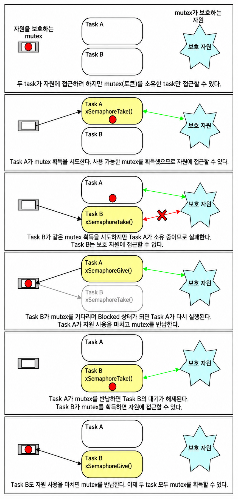
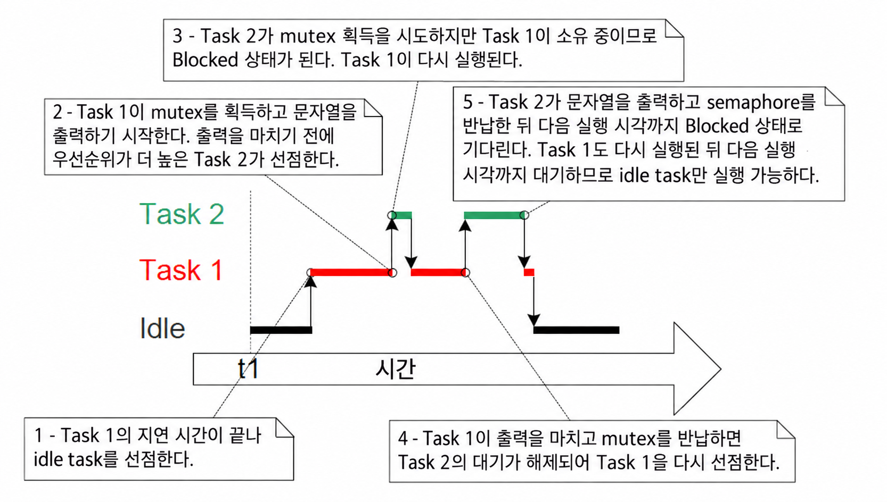
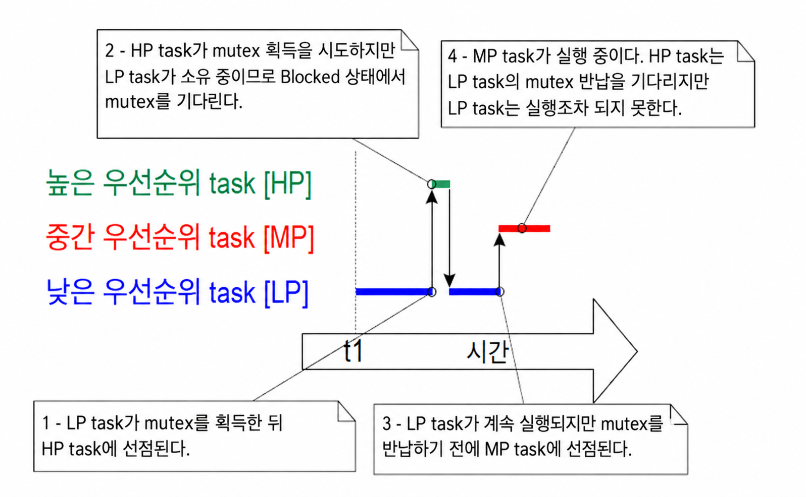
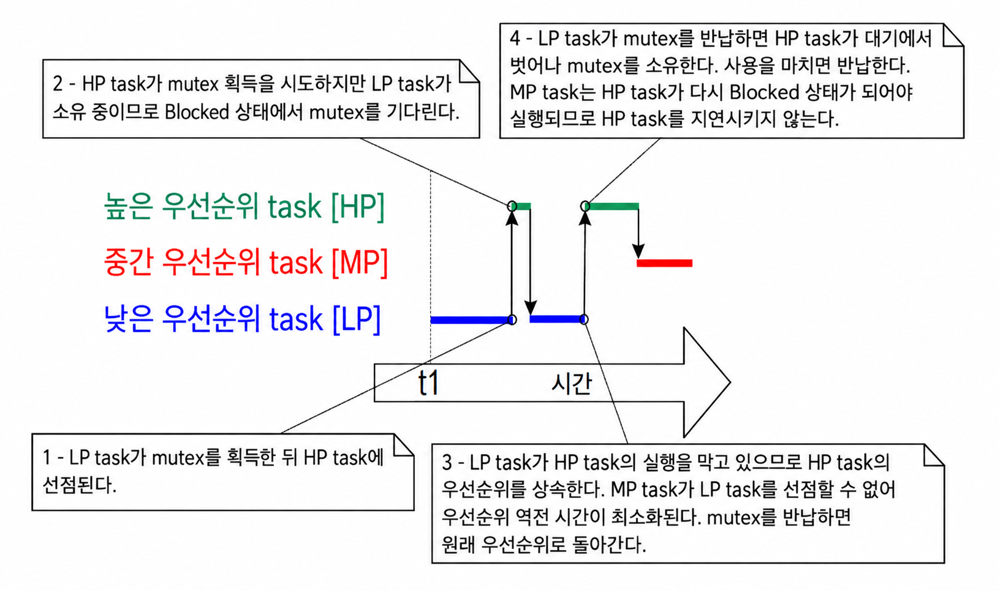
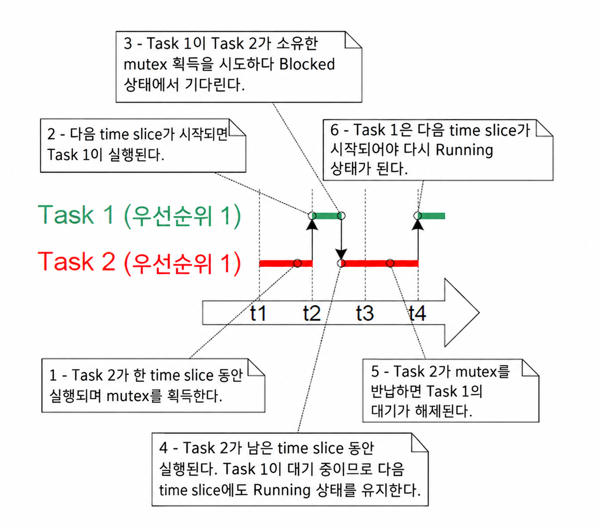
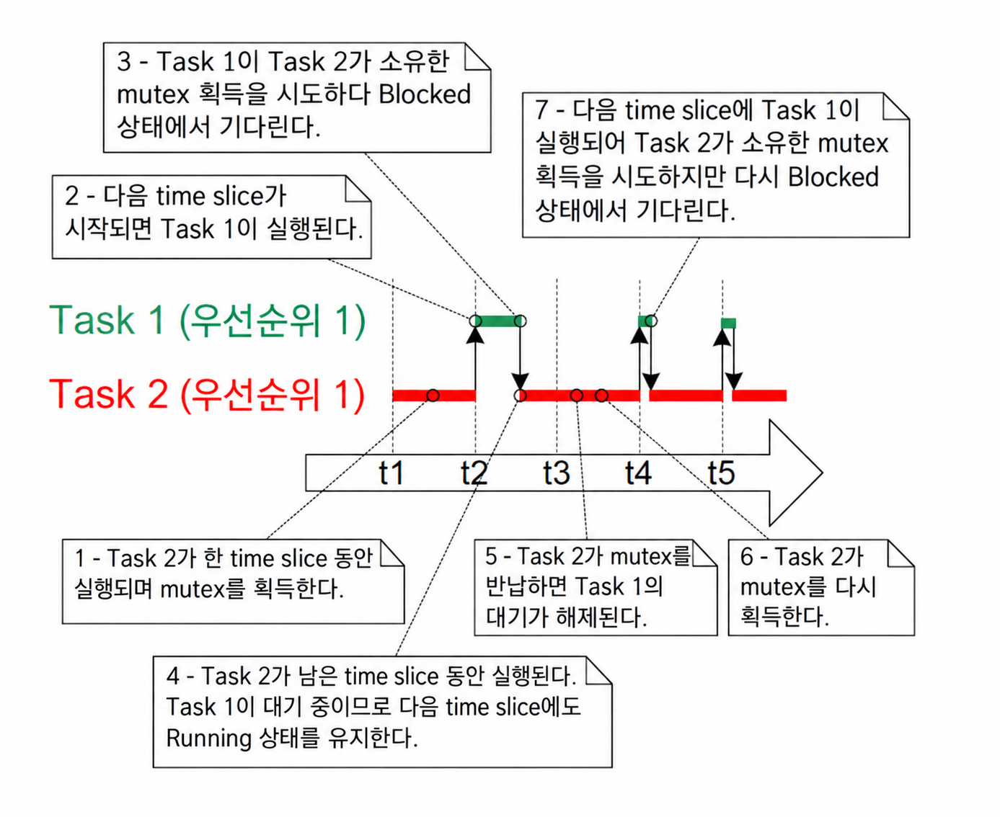

<a id="8-resource-management"></a>
# 8 자원 관리 (Resource Management)

<a id="81-chapter-introduction-and-scope"></a>
## 8.1 장 소개 및 범위 (Chapter Introduction and Scope)

멀티태스킹 시스템에서는 한 task(태스크)가 자원에 접근하기 시작했지만 Running 상태(실행 중)를 벗어나기 전에 접근을 완료하지 못하면 오류가 발생할 가능성이 있다. task가 자원을 일관되지 않은 상태로 남겨두면 다른 task나 인터럽트가 동일한 자원에 접근할 때 데이터 손상이나 기타 유사한 문제가 발생할 수 있다.

다음은 몇 가지 예시이다:

* 주변장치 접근 (Accessing Peripherals)

  두 task가 LCD(Liquid Crystal Display)에 쓰기를 시도하는 다음 시나리오를 살펴본다.

  1. Task A가 실행되어 LCD에 "Hello world" 문자열을 쓰기 시작한다.

  2. Task A는 문자열의 시작 부분("Hello w")만 출력한 후 Task B에 의해 선점된다.

  3. Task B는 Blocked 상태(대기)로 진입하기 전에 LCD에 "Abort, Retry, Fail?"을 쓴다.

  4. Task A는 선점되었던 지점부터 계속 실행하여 문자열의 나머지 문자("orld") 출력을 완료한다.

  이제 LCD에는 "Hello wAbort, Retry, Fail?orld"라는 손상된 문자열이 표시된다.

* 읽기, 수정, 쓰기 작업 (Read, Modify, Write Operations)

  코드 8.1은 C 코드 한 줄과 이 C 코드가 일반적으로 어셈블리 코드로 어떻게 변환되는지에 대한 예를 보여준다. PORTA의 값이 먼저 메모리에서 레지스터로 읽혀지고, 레지스터 내에서 수정된 다음, 다시 메모리로 쓰는 것을 볼 수 있다. 이를 '읽기, 수정, 쓰기(read, modify, write)' 작업이라고 부른다.

   <a name="list8.1" title="Listing 8.1 An example read, modify, write sequence"></a>

   ```c
   /* The C code being compiled. */
   PORTA |= 0x01;

   /* The assembly code produced when the C code is compiled. */
   LOAD  R1,[#PORTA] ; Read a value from PORTA into R1
   MOVE  R2,#0x01    ; Move the absolute constant 1 into R2
   OR    R1,R2       ; Bitwise OR R1 (PORTA) with R2 (constant 1)
   STORE R1,[#PORTA] ; Store the new value back to PORTA
   ```
   ***코드 8.1*** *읽기·수정·쓰기 순서의 예*

   이 작업은 완료하는 데 둘 이상의 명령어가 필요하고 인터럽트될 수 있으므로 '비원자적(non-atomic)' 작업이다. 두 task가 PORTA라는 메모리 매핑 레지스터를 업데이트하려고 시도하는 다음 시나리오를 살펴본다.

   1. Task A가 PORTA의 값을 레지스터로 로드한다—작업의 읽기 부분.

   2. Task A는 동일한 작업의 수정 및 쓰기 부분을 완료하기 전에 Task B에 의해 선점된다.

   3. Task B가 PORTA의 값을 업데이트한 다음 Blocked 상태로 진입한다.

   4. Task A는 선점되었던 지점부터 계속 실행한다. 업데이트된 값을 PORTA에 다시 쓰기 전에 이미 레지스터에 보관하고 있던 PORTA 값의 사본을 수정한다.

   이 시나리오에서 Task A는 PORTA에 대해 구버전의 값을 업데이트하고 다시 쓴다. Task B는 Task A가 PORTA 값의 사본을 가져간 후, 그리고 Task A가 수정된 값을 PORTA 레지스터에 다시 쓰기 전에 PORTA를 수정했다. Task A가 PORTA에 쓸 때 Task B에 의해 이미 수행된 수정을 덮어쓰게 되어 실질적으로 PORTA 레지스터 값을 손상시킨다.

   이 예제는 주변장치 레지스터를 사용하지만 변수에 대한 읽기, 수정, 쓰기 작업을 수행할 때도 동일한 원리가 적용된다.

- 변수에 대한 비원자적 접근 (Non-atomic Access to Variables)

  구조체의 여러 멤버를 업데이트하거나 아키텍처의 기본 워드 크기보다 큰 변수를 업데이트하는 것(예: 16비트 머신에서 32비트 변수 업데이트)은 비원자적 작업의 예이다. 이러한 작업이 인터럽트되면 데이터 손실이나 손상이 발생할 수 있다.

- 함수 재진입성 (Function Reentrancy)

  둘 이상의 task에서, 또는 task와 인터럽트 모두에서 함수를 호출해도 안전한 경우 그 함수를 '재진입 가능(reentrant)'하다고 한다. 재진입 가능한 함수는 데이터나 논리적 작업이 손상될 위험 없이 둘 이상의 실행 스레드에서 접근할 수 있으므로 '스레드 안전(thread safe)'하다고 한다.

  각 task는 자체 stack(스택)과 자체 프로세서(하드웨어) 레지스터 값 세트를 유지한다. 함수가 stack에 저장되거나 레지스터에 보관된 데이터 외에 다른 데이터에 접근하지 않는다면 그 함수는 재진입 가능하며 스레드 안전하다. 코드 8.2는 재진입 가능한 함수의 예이다. 코드 8.3은 재진입 가능하지 않은 함수의 예이다.
  
  애플리케이션이 newlib C 라이브러리를 사용하는 경우, newlib에 필요한 스레드 로컬 스토리지(Thread Local Storage)가 올바르게 할당되도록 FreeRTOSConfig.h에서 `configUSE_NEWLIB_REENTRANT`를 1로 설정해야 한다.

  애플리케이션이 picolibc C 라이브러리를 사용하는 경우, picolibc에 필요한 스레드 로컬 스토리지가 올바르게 할당되도록 FreeRTOSConfig.h에서 `configUSE_PICOLIBC_TLS`를 1로 설정해야 한다.

  애플리케이션이 다른 C 라이브러리를 사용하고 스레드 로컬 스토리지(TLS)를 요구하는 경우, FreeRTOSConfig.h에서 `configUSE_C_RUNTIME_TLS_SUPPORT`를 1로 설정해야 하며 다음 매크로를 구현해야 한다:
  - `configTLS_BLOCK_TYPE` - task별 TLS 블록의 타입.
  - `configINIT_TLS_BLOCK` - task별 TLS 블록 초기화.
  - `configSET_TLS_BLOCK` - 현재 TLS 블록 업데이트. 올바른 TLS 블록이 사용되도록 문맥 전환 중에 호출됨.
  - `configDEINIT_TLS_BLOCK` - TLS 블록 해제.

  <a name="list8.2" title="Listing 8.2 An example of a reentrant function"></a>

  ```c
  /* A parameter is passed into the function. This will either be passed on the 
     stack, or in a processor register. Either way is safe as each task or 
     interrupt that calls the function maintains its own stack and its own set 
     of register values, so each task or interrupt that calls the function will 
     have its own copy of lVar1. */
  long lAddOneHundred( long lVar1 )
  {
      /* This function scope variable will also be allocated to the stack or a 
         register, depending on the compiler and optimization level. Each task
         or interrupt that calls this function will have its own copy of lVar2. */
      long lVar2;

      lVar2 = lVar1 + 100;
      return lVar2;
  }
  ```
  ***코드 8.2*** *재진입 가능한 함수의 예*

  <a name="list8.3" title="Listing 8.3 An example of a function that is not reentrant"></a>

  ```c
  /* In this case lVar1 is a global variable, so every task that calls
     lNonsenseFunction will access the same single copy of the variable. */
  long lVar1;

  long lNonsenseFunction( void )
  {
      /* lState is static, so is not allocated on the stack. Each task that
         calls this function will access the same single copy of the variable. */
      static long lState = 0;
      long lReturn;

      switch( lState )
      {
          case 0 : lReturn = lVar1 + 10;
                   lState = 1;
                   break;

          case 1 : lReturn = lVar1 + 20;
                   lState = 0;
                   break;
      }
  }
  ```
  ***코드 8.3*** *재진입 가능하지 않은 함수의 예*

<a id="811-mutual-exclusion"></a>
### 8.1.1 상호 배제 (Mutual Exclusion)

항상 데이터 일관성을 유지하기 위해 task 간에 공유되거나 task와 인터럽트 간에 공유되는 자원에 대한 접근은 '상호 배제(mutual exclusion)' 기법을 사용하여 관리되어야 한다. 그 목표는 task가 재진입 가능하지 않고 스레드 안전하지 않은 공유 자원에 접근하기 시작하면 해당 자원이 일관된 상태로 돌아갈 때까지 동일한 task가 자원에 독점적으로 접근하도록 보장하는 것이다.

FreeRTOS는 상호 배제를 구현하는 데 사용할 수 있는 몇 가지 기능을 제공하지만, 가장 좋은 상호 배제 방법은 (실용적이지 않은 경우가 많지만 가능할 때마다) 자원이 공유되지 않고 각 자원이 단일 task에서만 접근되도록 애플리케이션을 설계하는 것이다.

<a id="812-scope"></a>
### 8.1.2 범위 (Scope)

이 장에서는 다음 내용을 다룬다:

- 자원 관리와 제어가 필요한 시기와 이유.
- critical section(임계 구역)이란 무엇인가.
- 상호 배제의 의미.
- scheduler(스케줄러) 일시 중단의 의미.
- mutex(뮤텍스) 사용 방법.
- 게이트키퍼(gatekeeper) task를 생성하고 사용하는 방법.
- 우선순위 역전(priority inversion)이란 무엇이며, 우선순위 상속(priority inheritance)이 그 영향을 어떻게 줄일 수 있는지(완전히 제거하지는 못함).

<a id="82-critical-sections-and-suspending-the-scheduler"></a>
## 8.2 critical section 및 스케줄러 일시 중단 (Critical Sections and Suspending the Scheduler)

<a id="821-basic-critical-sections"></a>
### 8.2.1 기본 critical section (Basic Critical Sections)

기본 critical section은 각각 `taskENTER_CRITICAL()`과 `taskEXIT_CRITICAL()` 매크로 호출로 둘러싸인 코드 영역이다. critical section은 크리티컬 영역(critical region)으로도 알려져 있다.

`taskENTER_CRITICAL()`과 `taskEXIT_CRITICAL()`은 매개변수를 받지 않으며 값을 반환하지 않는다[^23]. 그 사용법이 코드 8.4에 나와 있다.

[^23]: 함수형 매크로는 실제 함수와 동일한 방식으로 실제로 '값을 반환'하지 않는다. 이 책에서는 매크로를 함수처럼 생각하는 것이 가장 단순할 때 매크로에 대해 '값을 반환한다'는 용어를 적용한다.

<a name="list8.4" title="Listing 8.4 Using a critical section to guard access to a register"></a>

```c
/* Ensure access to the PORTA register cannot be interrupted by placing
   it within a critical section. Enter the critical section. */
taskENTER_CRITICAL();

/* A switch to another task cannot occur between the call to
   taskENTER_CRITICAL() and the call to taskEXIT_CRITICAL(). Interrupts may
   still execute on FreeRTOS ports that allow interrupt nesting, but only
   interrupts whose logical priority is above the value assigned to the
   configMAX_SYSCALL_INTERRUPT_PRIORITY constant – and those interrupts are
   not permitted to call FreeRTOS API functions. */
PORTA |= 0x01;

/* Access to PORTA has finished, so it is safe to exit the critical section. */
taskEXIT_CRITICAL();
```
***코드 8.4*** *critical section을 사용한 레지스터 접근 보호*

이 책과 함께 제공되는 예제 프로젝트는 표준 출력(FreeRTOS Windows 포트를 사용할 때는 터미널 창)에 문자열을 쓰기 위해 `vPrintString()`이라는 함수를 사용한다. `vPrintString()`은 여러 다른 task에서 호출되므로 이론적으로는 코드 8.5에 표시된 것처럼 critical section을 사용하여 표준 출력에 대한 접근을 보호할 수 있다.

<a name="list8.5" title="Listing 8.5 A possible implementation of vPrintString()"></a>

```c
void vPrintString( const char *pcString )
{
    /* Write the string to stdout, using a critical section as a crude method of
       mutual exclusion. */
    taskENTER_CRITICAL();
    {
        printf( "%s", pcString );
        fflush( stdout );
    }
    taskEXIT_CRITICAL();
}
```
***코드 8.5*** *vPrintString()의 구현 예*

이러한 방식으로 구현된 critical section은 상호 배제를 제공하는 매우 투박한 방법이다. 사용 중인 FreeRTOS 포트에 따라 인터럽트를 완전히 비활성화하거나 `configMAX_SYSCALL_INTERRUPT_PRIORITY`로 설정된 인터럽트 우선순위까지 비활성화함으로써 작동한다. 선점형 문맥 전환은 인터럽트 내부에서만 발생할 수 있으므로, 인터럽트가 비활성화되어 있는 한 `taskENTER_CRITICAL()`을 호출한 task는 critical section을 벗어날 때까지 Running 상태로 유지되는 것이 보장된다.

기본 critical section은 매우 짧게 유지되어야 하며, 그렇지 않으면 인터럽트 응답 시간에 부정적인 영향을 미친다. `taskENTER_CRITICAL()`에 대한 모든 호출은 `taskEXIT_CRITICAL()` 호출과 긴밀하게 쌍을 이루어야 한다. 이러한 이유로 터미널에 쓰는 작업은 비교적 긴 작업이 될 수 있으므로 표준 출력(stdout, 컴퓨터가 출력 데이터를 쓰는 스트림)을 critical section을 사용하여 보호해서는 안 된다(코드 8.5에 나와 있는 것처럼). 이 장의 예제들에서는 대안적인 솔루션을 탐구한다.

커널이 중첩 깊이를 카운트하여 보관하므로 critical section이 중첩되는 것은 안전하다. critical section은 중첩 깊이가 0으로 돌아갈 때, 즉 이전에 호출된 모든 `taskENTER_CRITICAL()`에 대해 하나의 `taskEXIT_CRITICAL()` 호출이 실행되었을 때만 종료된다.

`taskENTER_CRITICAL()`과 `taskEXIT_CRITICAL()`을 호출하는 것은 task가 FreeRTOS가 실행되는 프로세서의 인터럽트 활성화 상태를 변경할 수 있는 유일하게 정당한 방법이다. 다른 수단으로 인터럽트 활성화 상태를 변경하면 매크로의 중첩 카운트가 무효화된다.

`taskENTER_CRITICAL()`과 `taskEXIT_CRITICAL()`은 'FromISR'로 끝나지 않으므로 인터럽트 서비스 루틴에서 절대로 호출해서는 안 된다. `taskENTER_CRITICAL_FROM_ISR()`은 `taskENTER_CRITICAL()`의 인터럽트 안전 버전이고, `taskEXIT_CRITICAL_FROM_ISR()`은 `taskEXIT_CRITICAL()`의 인터럽트 안전 버전이다. 인터럽트 안전 버전은 인터럽트 중첩을 허용하는 FreeRTOS 포트에 대해서만 제공된다—인터럽트 중첩을 허용하지 않는 포트에서는 불필요할 것이다.

`taskENTER_CRITICAL_FROM_ISR()`은 일치하는 `taskEXIT_CRITICAL_FROM_ISR()` 호출에 전달되어야 하는 값을 반환한다. 이것이 코드 8.6에 나와 있다.

<a name="list8.6" title="Listing 8.6 Using a critical section in an interrupt service routine"></a>

```c
void vAnInterruptServiceRoutine( void )
{
    /* Declare a variable in which the return value from 
       taskENTER_CRITICAL_FROM_ISR() will be saved. */
    UBaseType_t uxSavedInterruptStatus;

    /* This part of the ISR can be interrupted by any higher priority 
       interrupt. */

    /* Use taskENTER_CRITICAL_FROM_ISR() to protect a region of this ISR.
       Save the value returned from taskENTER_CRITICAL_FROM_ISR() so it can 
       be passed into the matching call to taskEXIT_CRITICAL_FROM_ISR(). */
    uxSavedInterruptStatus = taskENTER_CRITICAL_FROM_ISR();

    /* This part of the ISR is between the call to 
       taskENTER_CRITICAL_FROM_ISR() and taskEXIT_CRITICAL_FROM_ISR(), so can 
       only be interrupted by interrupts that have a priority above that set 
       by the configMAX_SYSCALL_INTERRUPT_PRIORITY constant. */

    /* Exit the critical section again by calling taskEXIT_CRITICAL_FROM_ISR(),
       passing in the value returned by the matching call to 
       taskENTER_CRITICAL_FROM_ISR(). */
    taskEXIT_CRITICAL_FROM_ISR( uxSavedInterruptStatus );

    /* This part of the ISR can be interrupted by any higher priority 
       interrupt. */
}
```
***코드 8.6*** *ISR에서 critical section 사용*

critical section에 의해 실제로 보호되는 코드를 실행하는 것보다 critical section에 진입하고 이후 종료하는 코드를 실행하는 데 더 많은 처리 시간을 사용하는 것은 낭비이다. 기본 critical section은 진입이 매우 빠르고, 종료가 매우 빠르며, 항상 결정론적이므로 보호 대상 코드 영역이 매우 짧을 때 사용하는 것이 이상적이다.

<a id="822-suspending-or-locking-the-scheduler"></a>
### 8.2.2 스케줄러 일시 중단(또는 잠금) (Suspending (or Locking) the Scheduler)

scheduler를 일시 중단하여 critical section을 생성할 수도 있다. scheduler 일시 중단은 때때로 scheduler '잠금(locking)'이라고도 불린다.

기본 critical section은 다른 task와 인터럽트에 의한 접근으로부터 코드 영역을 보호하지만, scheduler를 일시 중단하여 구현된 critical section은 인터럽트가 활성화된 상태로 유지되므로 다른 task에 의한 접근으로부터만 코드 영역을 보호한다.

단순히 인터럽트를 비활성화하여 구현하기에는 너무 긴 critical section은 대신 scheduler를 일시 중단하여 구현할 수 있다. 그러나 scheduler가 일시 중단된 동안의 인터럽트 활동은 scheduler를 재개(또는 '일시 중단 해제')하는 것을 비교적 긴 작업으로 만들 수 있으므로 각 경우에 어떤 방법이 가장 좋은지 고려해야 한다.

<a id="823-the-vtasksuspendall-api-function"></a>
### 8.2.3 vTaskSuspendAll() API 함수 (The vTaskSuspendAll() API Function)

<a name="list8.7" title="Listing 8.7 The vTaskSuspendAll() API function prototype"></a>

```c
void vTaskSuspendAll( void );
```
***코드 8.7*** *vTaskSuspendAll() API 함수 원형*

scheduler는 `vTaskSuspendAll()`을 호출하여 일시 중단한다. scheduler를 일시 중단하면 문맥 전환이 발생하는 것을 방지하지만 인터럽트는 활성화된 상태로 유지된다. scheduler가 일시 중단된 동안 인터럽트가 문맥 전환을 요청하면 해당 요청은 보류(pending) 상태로 유지되며 scheduler가 재개(일시 중단 해제)될 때만 수행된다.

scheduler가 일시 중단된 동안에는 FreeRTOS API 함수를 절대로 호출해서는 안 된다.

<a id="824-the-xtaskresumeall-api-function"></a>
### 8.2.4 xTaskResumeAll() API 함수 (The xTaskResumeAll() API Function)

<a name="list8.8" title="Listing 8.8 The xTaskResumeAll() API function prototype"></a>

```c
BaseType_t xTaskResumeAll( void );
```
***코드 8.8*** *xTaskResumeAll() API 함수 원형*

scheduler는 `xTaskResumeAll()`을 호출하여 재개(일시 중단 해제)한다.

**xTaskResumeAll() 반환값**

- 반환값

  scheduler가 일시 중단된 동안 요청된 문맥 전환은 보류 상태로 유지되며 scheduler가 재개될 때만 수행된다. `xTaskResumeAll()`이 반환되기 전에 보류 중인 문맥 전환이 수행되면 `pdTRUE`가 반환된다. 그렇지 않으면 `pdFALSE`가 반환된다.

커널이 중첩 깊이를 카운트하여 보관하므로 `vTaskSuspendAll()`과 `xTaskResumeAll()`에 대한 호출이 중첩되는 것은 안전하다. scheduler는 중첩 깊이가 0으로 돌아갈 때, 즉 이전에 호출된 모든 `vTaskSuspendAll()`에 대해 하나의 `xTaskResumeAll()` 호출이 실행되었을 때만 재개된다.

코드 8.9는 터미널 출력에 대한 접근을 보호하기 위해 scheduler를 일시 중단하는 `vPrintString()`의 실제 구현을 보여준다.

<a name="list8.9" title="Listing 8.9 The implementation of vPrintString()"></a>

```c
void vPrintString( const char *pcString )
{
    /* Write the string to stdout, suspending the scheduler as a method of 
       mutual exclusion. */
    vTaskSuspendAll();
    {
        printf( "%s", pcString );
        fflush( stdout );
    }
    xTaskResumeAll();
}
```
***코드 8.9*** *vPrintString() 구현*

<a id="83-mutexes-and-binary-semaphores"></a>
## 8.3 뮤텍스(및 바이너리 세마포어) (Mutexes (and Binary Semaphores))

mutex(뮤텍스)는 둘 이상의 task 간에 공유되는 자원에 대한 접근을 제어하는 데 사용되는 특별한 유형의 binary semaphore(이진 세마포어)이다. MUTEX라는 단어는 '상호 배제(MUTual EXclusion)'에서 유래했다. mutex를 사용할 수 있으려면 `FreeRTOSConfig.h`에서 `configUSE_MUTEXES`가 1로 설정되어야 한다.

상호 배제 시나리오에서 사용될 때 mutex는 공유되는 자원과 연관된 토큰으로 생각할 수 있다. task가 자원에 정당하게 접근하려면 먼저 성공적으로 토큰을 '획득(take)'해야 한다(토큰 소유자가 되어야 함). 토큰 소유자가 자원 사용을 마치면 토큰을 다시 '반환(give)'해야 한다. 토큰이 반환된 후에만 다른 task가 성공적으로 토큰을 획득하여 동일한 공유 자원에 안전하게 접근할 수 있다. task는 토큰을 보유하고 있지 않은 한 공유 자원에 접근할 수 없다. 이 메커니즘이 그림 8.1에 나와 있다.

mutex와 binary semaphore는 많은 특성을 공유하지만 그림 8.1에 표시된 시나리오(mutex가 상호 배제에 사용되는 경우)는 그림 7.6에 표시된 시나리오(binary semaphore가 동기화에 사용되는 경우)와 완전히 다르다. 주요 차이점은 semaphore(세마포어)가 획득된 후에 일어나는 일이다:

- 상호 배제에 사용되는 semaphore는 반드시 항상 반환되어야 한다.
- 동기화에 사용되는 semaphore는 일반적으로 폐기되며 반환되지 않는다.

<a name="fig8.1" title="Figure 8.1 Mutual exclusion implemented using a mutex"></a>

* * *


***그림 8.1*** *mutex를 사용하여 구현된 상호 배제*

* * *

이 메커니즘은 순수하게 애플리케이션 작성자의 규율을 통해 작동한다. task가 언제든지 자원에 접근하지 못할 이유는 없지만, 각 task는 mutex 소유자가 될 수 없는 한 그렇게 하지 않기로 '동의'하는 것이다.

<a id="831-the-xsemaphorecreatemutex-api-function"></a>
### 8.3.1 xSemaphoreCreateMutex() API 함수 (The xSemaphoreCreateMutex() API Function)

FreeRTOS에는 컴파일 타임에 mutex를 생성하는 데 필요한 메모리를 정적으로 할당하는 `xSemaphoreCreateMutexStatic()` 함수도 포함되어 있다. mutex는 semaphore의 일종이다. 모든 다양한 유형의 FreeRTOS semaphore에 대한 핸들은 `SemaphoreHandle_t` 타입의 변수에 저장된다.

mutex를 사용하기 전에 반드시 생성해야 한다. mutex 타입 semaphore를 생성하려면 `xSemaphoreCreateMutex()` API 함수를 사용한다.

<a name="list8.10" title="Listing 8.10 The xSemaphoreCreateMutex() API function prototype"></a>

```c
SemaphoreHandle_t xSemaphoreCreateMutex( void );
```
***코드 8.10*** *xSemaphoreCreateMutex() API 함수 원형*

**xSemaphoreCreateMutex() 반환값**

- 반환값

  NULL이 반환되면 FreeRTOS가 mutex 데이터 구조를 할당하기에 사용 가능한 heap(힙) 메모리가 부족하여 mutex를 생성할 수 없음을 의미한다. 3장에서 heap 메모리 관리에 대한 자세한 정보를 제공한다.

  NULL이 아닌 반환값은 mutex가 성공적으로 생성되었음을 나타낸다. 반환된 값은 생성된 mutex의 핸들로 저장되어야 한다.

<a name="example8.1" title="Example 8.1 Rewriting vPrintString() to use a semaphore"></a>
---
***예제 8.1*** *semaphore를 사용하도록 vPrintString() 재작성*

---

이 예제는 `prvNewPrintString()`이라는 새로운 버전의 `vPrintString()`을 생성한 다음 여러 task에서 새 함수를 호출한다. `prvNewPrintString()`은 기능적으로 `vPrintString()`과 동일하지만 scheduler를 잠그는 대신 mutex를 사용하여 표준 출력에 대한 접근을 제어한다. `prvNewPrintString()`의 구현은 코드 8.11에 나와 있다.

<a name="list8.11" title="Listing 8.11 The implementation of prvNewPrintString()"></a>

```c
static void prvNewPrintString( const char *pcString )
{
    /* The mutex is created before the scheduler is started, so already exists
       by the time this task executes.

       Attempt to take the mutex, blocking indefinitely to wait for the mutex
       if it is not available straight away. The call to xSemaphoreTake() will
       only return when the mutex has been successfully obtained, so there is 
       no need to check the function return value. If any other delay period 
       was used then the code must check that xSemaphoreTake() returns pdTRUE 
       before accessing the shared resource (which in this case is standard 
       out). As noted earlier in this book, indefinite time outs are not 
       recommended for production code. */
    xSemaphoreTake( xMutex, portMAX_DELAY );
    {
        /* The following line will only execute once the mutex has been 
           successfully obtained. Standard out can be accessed freely now as 
           only one task can have the mutex at any one time. */
        printf( "%s", pcString );
        fflush( stdout );

        /* The mutex MUST be given back! */
    }
    xSemaphoreGive( xMutex );
}
```
***코드 8.11*** *prvNewPrintString() 구현*

`prvNewPrintString()`은 `prvPrintTask()`에 의해 구현된 task의 두 인스턴스에 의해 반복적으로 호출된다. 각 호출 사이에 의사 난수 지연 시간이 사용된다. task 매개변수는 각 task 인스턴스에 고유한 문자열을 전달하는 데 사용된다. `prvPrintTask()`의 구현은 코드 8.12에 나와 있다.

<a name="list8.12" title="Listing 8.12 The implementation of prvPrintTask() for Example 8.1"></a>

```c
static void prvPrintTask( void *pvParameters )
{
    char *pcStringToPrint;
    const TickType_t xMaxBlockTimeTicks = 0x20;

    /* Two instances of this task are created. The string printed by the task 
       is passed into the task using the task's parameter. The parameter is 
       cast to the required type. */
    pcStringToPrint = ( char * ) pvParameters;

    for( ;; )
    {
        /* Print out the string using the newly defined function. */
        prvNewPrintString( pcStringToPrint );

        /* Wait a pseudo random time. Note that rand() is not necessarily
           reentrant, but in this case it does not really matter as the code 
           does not care what value is returned. In a more secure application 
           a version of rand() that is known to be reentrant should be used - 
           or calls to rand() should be protected using a critical section. */
        vTaskDelay( ( rand() % xMaxBlockTimeTicks ) );
    }
}
```
***코드 8.12*** *예제 8.1의 prvPrintTask() 구현*

평소와 마찬가지로 `main()`은 단순히 mutex를 생성하고, task를 생성한 다음, scheduler를 시작한다. 구현은 코드 8.13에 나와 있다.

`prvPrintTask()`의 두 인스턴스는 서로 다른 우선순위로 생성되므로 낮은 우선순위 task는 때때로 높은 우선순위 task에 의해 선점된다. 각 task가 터미널에 상호 배타적으로 접근할 수 있도록 mutex가 사용되므로 선점이 발생하더라도 표시되는 문자열은 정확하며 손상되지 않는다. 선점 빈도는 `xMaxBlockTimeTicks` 상수에 의해 설정되는 task가 Blocked 상태에서 보내는 최대 시간을 줄임으로써 증가시킬 수 있다.

FreeRTOS Windows 포트에서 예제 8.1을 사용할 때의 특이 사항:

- `printf()`를 호출하면 Windows 시스템 호출이 생성된다. Windows 시스템 호출은 FreeRTOS의 제어 범위를 벗어나며 불안정성을 초래할 수 있다.

- Windows 시스템 호출이 실행되는 방식상 mutex를 사용하지 않더라도 손상된 문자열을 보는 것은 드물다.

<a name="list8.13" title="Listing 8.13 The implementation of main() for Example 8.1"></a>

```c
int main( void )
{
    /* Before a semaphore is used it must be explicitly created. In this
       example a mutex type semaphore is created. */
    xMutex = xSemaphoreCreateMutex();

    /* Check the semaphore was created successfully before creating the
       tasks. */
    if( xMutex != NULL )
    {
        /* Create two instances of the tasks that write to stdout. The string
           they write is passed in to the task as the task's parameter. The 
           tasks are created at different priorities so some pre-emption will 
           occur. */
        xTaskCreate( prvPrintTask, "Print1", 1000,
                     "Task 1 ***************************************\r\n",
                     1, NULL );

        xTaskCreate( prvPrintTask, "Print2", 1000,
                     "Task 2 ---------------------------------------\r\n", 
                     2, NULL );

        /* Start the scheduler so the created tasks start executing. */
        vTaskStartScheduler();
    }

    /* If all is well then main() will never reach here as the scheduler will
       now be running the tasks. If main() does reach here then it is likely 
       that there was insufficient heap memory available for the idle task to 
       be created.  Chapter 3 provides more information on heap memory 
       management. */
    for( ;; );
}
```
***코드 8.13*** *예제 8.1의 main() 함수 구현*

예제 8.1이 실행될 때 생성되는 출력은 그림 8.2에 나와 있다. 가능한 실행 시퀀스는 그림 8.3에 설명되어 있다.

<a name="fig8.2" title="Figure 8.2 The output produced when Example 8.1 is executed"></a>

* * *


***그림 8.2*** *예제 8.1 실행 시 생성되는 출력*

* * *

그림 8.2는 예상대로 터미널에 표시되는 문자열에 손상이 없음을 보여준다. 무작위 순서는 task에서 사용하는 무작위 지연 기간의 결과이다.

<a name="fig8.3" title="Figure 8.3 A possible sequence of execution for Example 8.1"></a>

* * *


***그림 8.3*** *예제 8.1에 대한 가능한 실행 시퀀스*

* * *

> [옮긴이 주] 이 그림의 5번 설명에 쓰인 semaphore는 원문 표현을 유지했다. 주변 설명에서 다루는 객체는 mutex이다. [원문 대조 사항 N07](SOURCE_NOTES.md#n07).

<a id="832-priority-inversion"></a>
### 8.3.2 우선순위 역전 (Priority Inversion)

그림 8.3은 상호 배제를 제공하기 위해 mutex를 사용할 때 발생할 수 있는 잠재적인 함정 중 하나를 보여준다. 묘사된 실행 시퀀스는 더 높은 우선순위의 Task 2가 낮은 우선순위의 Task 1이 mutex 제어권을 포기할 때까지 기다려야 하는 모습을 보여준다. 더 높은 우선순위 task가 이런 방식으로 더 낮은 우선순위 task에 의해 지연되는 현상을 '우선순위 역전(priority inversion)'이라고 부른다. 높은 우선순위 task가 semaphore를 기다리는 동안 중간 우선순위 task가 실행되기 시작하면 이 바람직하지 않은 동작은 더욱 과장될 것이다—그 결과 높은 우선순위 task가 낮은 우선순위 task를 기다리게 되며, 낮은 우선순위 task는 실행조차 할 수 없게 된다. 중간 우선순위 task가 낮은 우선순위 task와 높은 우선순위 task를 무기한 차단할 수 있기 때문에 이를 흔히 _무제한 우선순위 역전(unbounded priority inversion)_이라고 부른다. 이 최악의 시나리오가 그림 8.4에 나와 있다.

<a name="fig8.4" title="Figure 8.4 A worst case priority inversion scenario"></a>

* * *


***그림 8.4*** *최악의 우선순위 역전 시나리오*

* * *

우선순위 역전은 중대한 문제가 될 수 있지만 소형 임베디드 시스템에서는 자원에 접근하는 방식을 고려함으로써 시스템 설계 시점에 피할 수 있는 경우가 많다.

<a id="833-priority-inheritance"></a>
### 8.3.3 우선순위 상속 (Priority Inheritance)

FreeRTOS mutex와 binary semaphore는 매우 유사하다—차이점은 mutex는 기본 '우선순위 상속(priority inheritance)' 메커니즘을 포함하지만 binary semaphore는 그렇지 않다는 점이다. 우선순위 상속은 우선순위 역전의 부정적인 영향을 최소화하는 방식이다. 우선순위 역전을 '고치는' 것은 아니며 역전이 항상 시간상 제한되도록 보장함으로써 그 영향을 줄일 뿐이다. 그러나 우선순위 상속은 시스템 타이밍 분석을 복잡하게 만들며 올바른 시스템 동작을 위해 이에 의존하는 것은 좋은 관행이 아니다.

우선순위 상속은 동일한 mutex를 획득하려고 시도하는 가장 높은 우선순위 task의 우선순위로 mutex 소유자의 우선순위를 일시적으로 높임으로써 작동한다. mutex를 보유한 낮은 우선순위 task는 mutex를 기다리는 task의 우선순위를 '상속'받는다. 이것이 그림 8.5에 나와 있다. mutex 소유자의 우선순위는 mutex를 반환할 때 원래 값으로 자동 재설정된다.

<a name="fig8.5" title="Figure 8.5 Priority inheritance minimizing the effect of priority inversion"></a>

* * *


***그림 8.5*** *우선순위 역전의 영향을 최소화하는 우선순위 상속*

* * *

방금 보았듯이 우선순위 상속 기능은 mutex를 사용하는 task의 우선순위에 영향을 미친다. 이러한 이유로 인터럽트 서비스 루틴 내에서 mutex를 사용해서는 절대로 안 된다.

FreeRTOS는 공간과 실행 사이클을 모두 최적화하도록 설계된 기본 우선순위 상속 메커니즘을 구현한다. 완전한 우선순위 상속 메커니즘은 특히 task가 한 번에 둘 이상의 mutex를 보유할 때 임의의 순간에 상속된 우선순위를 결정하기 위해 훨씬 더 많은 데이터와 프로세서 사이클을 필요로 한다.

염두에 두어야 할 우선순위 상속 메커니즘의 구체적인 동작:
* task가 이미 보유하고 있는 mutex를 먼저 해제하지 않고 mutex를 획득하는 경우 상속된 우선순위가 더 높아질 수 있다.
* task는 자신이 보유한 모든 mutex를 해제할 때까지 가장 높게 상속받은 우선순위를 유지한다. 이는 mutex가 해제되는 순서와 무관하다.
* 여러 mutex를 보유하고 있는 경우 보유된 mutex 중 어느 하나를 기다리는 task가 대기를 완료(타임아웃)하더라도 task는 가장 높게 상속받은 우선순위를 유지한다.

<a id="834-deadlock-or-deadly-embrace"></a>
### 8.3.4 교착 상태(데드락) (Deadlock (or Deadly Embrace))

'교착 상태(Deadlock)'는 상호 배제를 위해 mutex를 사용할 때 발생하는 또 다른 잠재적인 함정이다. 교착 상태는 때때로 '치명적 포옹(deadly embrace)'이라는 보다 극적인 이름으로도 알려져 있다.

교착 상태는 두 task가 상대방이 보유한 자원을 서로 기다리고 있어서 둘 다 진행할 수 없을 때 발생한다. Task A와 Task B가 모두 어떤 작업을 수행하기 위해 mutex X *및* mutex Y를 획득해야 하는 다음 시나리오를 살펴본다:

1. Task A가 실행되어 mutex X를 성공적으로 획득한다.

2. Task A는 Task B에 의해 선점된다.

3. Task B는 mutex X도 획득하려고 시도하기 전에 mutex Y를 성공적으로 획득한다—그러나 mutex X는 Task A가 보유하고 있으므로 Task B가 사용할 수 없다. Task B는 mutex X가 해제되기를 기다리기 위해 Blocked 상태로 진입하기로 결정한다.

4. Task A는 계속 실행된다. mutex Y를 획득하려고 시도한다—그러나 mutex Y는 Task B가 보유하고 있으므로 Task A가 사용할 수 없다. Task A는 mutex Y가 해제되기를 기다리기 위해 Blocked 상태로 진입하기로 결정한다.

이 시나리오의 끝에서 Task A는 Task B가 보유한 mutex를 기다리고 있고 Task B는 Task A가 보유한 mutex를 기다리고 있다. 두 task 모두 진행할 수 없으므로 교착 상태가 발생했다.

우선순위 역전과 마찬가지로 교착 상태를 피하는 가장 좋은 방법은 설계 시점에 그 가능성을 고려하고 교착 상태가 발생할 수 없도록 시스템을 설계하는 것이다. 특히 이 책에서 앞서 언급했듯이 task가 mutex를 획득하기 위해 (타임아웃 없이) 무기한 대기하는 것은 일반적으로 나쁜 관행이다. 대신 mutex를 기다려야 할 것으로 예상되는 최대 시간보다 조금 더 긴 타임아웃을 사용한다—그러면 해당 시간 내에 mutex를 획득하지 못하는 것이 설계 오류(교착 상태일 수 있음)의 증상이 된다.

실제로 소형 임베디드 시스템에서는 시스템 설계자가 전체 애플리케이션을 잘 이해하고 있으므로 발생할 수 있는 영역을 식별하고 제거할 수 있기 때문에 교착 상태가 큰 문제가 되지 않는다.

<a id="835-recursive-mutexes"></a>
### 8.3.5 재귀적 뮤텍스 (Recursive Mutexes)

task가 자기 자신과 교착 상태에 빠지는 것도 가능하다. 이는 task가 mutex를 먼저 반환하지 않고 동일한 mutex를 두 번 이상 획득하려고 시도할 때 발생한다. 다음 시나리오를 살펴본다:

1. task가 mutex를 성공적으로 획득한다.

2. mutex를 보유한 상태에서 task가 라이브러리 함수를 호출한다.

3. 라이브러리 함수의 구현이 동일한 mutex를 획득하려고 시도하고, mutex를 사용할 수 있게 되기를 기다리기 위해 Blocked 상태로 진입한다.

이 시나리오의 끝에서 task는 mutex가 반환되기를 기다리기 위해 Blocked 상태에 있지만 task는 이미 mutex 소유자이다. task가 자기 자신을 기다리기 위해 Blocked 상태에 있으므로 교착 상태가 발생했다.

이러한 유형의 교착 상태는 표준 mutex 대신 recursive mutex(재귀 뮤텍스)를 사용하여 피할 수 있다. recursive mutex는 동일한 task에 의해 두 번 이상 '획득(take)'될 수 있으며, recursive mutex를 '획득'한 이전의 모든 호출에 대해 하나의 '반환(give)' 호출이 실행된 후에만 반환된다.

표준 mutex와 recursive mutex는 유사한 방식으로 생성되고 사용된다:

- 표준 mutex는 `xSemaphoreCreateMutex()`를 사용하여 생성된다. recursive mutex는 `xSemaphoreCreateRecursiveMutex()`를 사용하여 생성된다. 두 API 함수는 동일한 프로토타입을 갖는다.

- 표준 mutex는 `xSemaphoreTake()`를 사용하여 '획득'한다. recursive mutex는 `xSemaphoreTakeRecursive()`를 사용하여 '획득'한다. 두 API 함수는 동일한 프로토타입을 갖는다.

- 표준 mutex는 `xSemaphoreGive()`를 사용하여 '반환'한다. recursive mutex는 `xSemaphoreGiveRecursive()`를 사용하여 '반환'한다. 두 API 함수는 동일한 프로토타입을 갖는다.

코드 8.14는 recursive mutex를 생성하고 사용하는 방법을 보여준다.

<a name="list8.14" title="Listing 8.14 Creating and using a recursive mutex"></a>

```c
/* Recursive mutexes are variables of type SemaphoreHandle_t. */
SemaphoreHandle_t xRecursiveMutex;

/* The implementation of a task that creates and uses a recursive mutex. */
void vTaskFunction( void *pvParameters )
{
    const TickType_t xMaxBlock20ms = pdMS_TO_TICKS( 20 );

    /* Before a recursive mutex is used it must be explicitly created. */
    xRecursiveMutex = xSemaphoreCreateRecursiveMutex();

    /* Check the semaphore was created successfully. configASSERT() is 
       described in section 12.2. */
    configASSERT( xRecursiveMutex );

    /* As per most tasks, this task is implemented as an infinite loop. */
    for( ;; )
    {
        /* ... */

        /* Take the recursive mutex. */
        if( xSemaphoreTakeRecursive( xRecursiveMutex, xMaxBlock20ms ) == pdPASS )
        {
            /* The recursive mutex was successfully obtained. The task can now
               access the resource the mutex is protecting. At this point the 
               recursive call count (which is the number of nested calls to 
               xSemaphoreTakeRecursive()) is 1, as the recursive mutex has 
               only been taken once. */

            /* While it already holds the recursive mutex, the task takes the 
               mutex again. In a real application, this is only likely to occur
               inside a sub-function called by this task, as there is no 
               practical reason to knowingly take the same mutex more than 
               once. The calling task is already the mutex holder, so the 
               second call to xSemaphoreTakeRecursive() does nothing more than
               increment the recursive call count to 2. */
            xSemaphoreTakeRecursive( xRecursiveMutex, xMaxBlock20ms );

            /* ... */

            /* The task returns the mutex after it has finished accessing the
               resource the mutex is protecting. At this point the recursive 
               call count is 2, so the first call to xSemaphoreGiveRecursive()
               does not return the mutex. Instead, it simply decrements the 
               recursive call count back to 1. */
            xSemaphoreGiveRecursive( xRecursiveMutex );

            /* The next call to xSemaphoreGiveRecursive() decrements the 
               recursive call count to 0, so this time the recursive mutex is 
               returned. */
            xSemaphoreGiveRecursive( xRecursiveMutex );

            /* Now one call to xSemaphoreGiveRecursive() has been executed for
               every proceeding call to xSemaphoreTakeRecursive(), so the task
               is no longer the mutex holder. */
        }
    }
}
```
***코드 8.14*** *recursive mutex 생성과 사용*

<a id="836-mutexes-and-task-scheduling"></a>
### 8.3.6 뮤텍스와 태스크 스케줄링 (Mutexes and Task Scheduling)

서로 다른 우선순위를 가진 두 task가 동일한 mutex를 사용하는 경우 FreeRTOS 스케줄링 정책은 task가 실행될 순서를 명확하게 만든다. 실행 가능한 가장 높은 우선순위 task가 Running 상태로 진입할 task로 선택된다. 예를 들어 높은 우선순위 task가 낮은 우선순위 task가 보유한 mutex를 기다리기 위해 Blocked 상태에 있다면, 낮은 우선순위 task가 mutex를 반환하는 즉시 높은 우선순위 task가 낮은 우선순위 task를 선점한다. 그런 다음 높은 우선순위 task가 mutex 소유자가 된다. 이 시나리오는 그림 8.5에서 이미 확인한 바 있다.

그러나 task들이 동일한 우선순위를 가질 때 task가 실행될 순서에 대해 잘못된 가정을 하는 경우가 흔하다. Task 1과 Task 2가 동일한 우선순위를 갖고 Task 1이 Task 2가 보유한 mutex를 기다리기 위해 Blocked 상태에 있다면, Task 2가 mutex를 '반환(give)'할 때 Task 1은 Task 2를 선점하지 않는다. 대신 Task 2는 Running 상태로 유지되고 Task 1은 단순히 Blocked 상태에서 Ready 상태로 이동한다. 이 시나리오가 그림 8.6에 나와 있으며 수직선은 tick interrupt(tick 인터럽트)가 발생하는 시점을 나타낸다.

<a name="fig8.6" title="Figure 8.6 A possible sequence of execution when tasks that have the same priority use the same mutex"></a>

* * *


***그림 8.6*** *동일한 우선순위를 가진 task들이 동일한 mutex를 사용할 때 가능한 실행 시퀀스*

* * *

그림 8.6에 표시된 시나리오에서 FreeRTOS scheduler는 mutex를 사용할 수 있게 되자마자 Task 1을 Running 상태 task로 만들지 *않는데*, 그 이유는 다음과 같다:

- Task 1과 Task 2는 동일한 우선순위를 가지므로 Task 2가 Blocked 상태로 진입하지 않는 한 다음 tick interrupt까지 Task 1로의 전환이 발생하지 않아야 한다(`FreeRTOSConfig.h`에서 `configUSE_TIME_SLICING`이 1로 설정되어 있다고 가정할 때).

- task가 타이트 루프(tight loop)에서 mutex를 사용하고 task가 mutex를 '반환'할 때마다 문맥 전환이 발생한다면 task는 아주 짧은 시간 동안만 Running 상태로 유지될 것이다. 둘 이상의 task가 타이트 루프에서 동일한 mutex를 사용한다면 task 간에 빠르게 전환하느라 처리 시간이 낭비될 것이다.

둘 이상의 task가 타이트 루프에서 mutex를 사용하고 mutex를 사용하는 task들의 우선순위가 같다면, task들이 거의 동일한 양의 처리 시간을 받도록 주의를 기울여야 한다. task들이 동일한 양의 처리 시간을 받지 못할 수 있는 이유가 그림 8.7에 시연되어 있으며, 코드 8.15에 표시된 task의 두 인스턴스가 동일한 우선순위로 생성될 때 발생할 수 있는 실행 시퀀스를 보여준다.

<a name="list8.15" title="Listing 8.15 A task that uses a mutex in a tight loop"></a>

```c
/* The implementation of a task that uses a mutex in a tight loop. The task 
   creates a text string in a local buffer, then writes the string to a display.
   Access to the display is protected by a mutex. */

void vATask( void *pvParameter )
{
    extern SemaphoreHandle_t xMutex;
    char cTextBuffer[ 128 ];

    for( ;; )
    {
        /* Generate the text string – this is a fast operation. */
        vGenerateTextInALocalBuffer( cTextBuffer );

        /* Obtain the mutex that is protecting access to the display. */
        xSemaphoreTake( xMutex, portMAX_DELAY );

        /* Write the generated text to the display–this is a slow operation. */
        vCopyTextToFrameBuffer( cTextBuffer );

        /* The text has been written to the display, so return the mutex. */
        xSemaphoreGive( xMutex );
    }
}
```
***코드 8.15*** *짧은 루프 안에서 mutex를 사용하는 task*

코드 8.15의 주석은 문자열을 생성하는 것은 빠른 작업이고 디스플레이를 업데이트하는 것은 느린 작업임을 나타낸다. 따라서 디스플레이가 업데이트되는 동안 mutex가 유지되므로 task는 실행 시간의 대부분 동안 mutex를 보유하게 된다.

그림 8.7에서 수직선은 tick interrupt가 발생하는 시점을 나타낸다.

<a name="fig8.7" title="Figure 8.7 A sequence of execution that could occur if two instances of the task shown by Listing 8.15 are created at the same priority"></a>

* * *


***그림 8.7*** *코드 8.15에 표시된 task의 두 인스턴스가 동일한 우선순위로 생성될 때 발생할 수 있는 실행 시퀀스*

* * *

그림 8.7의 7단계는 Task 1이 Blocked 상태로 다시 진입하는 모습을 보여준다—이는 `xSemaphoreTake()` API 함수 내부에서 발생한다.

그림 8.7은 타임 슬라이스의 시작이 Task 2가 mutex 소유자가 아닌 짧은 기간 중 하나와 일치할 때까지 Task 1이 mutex를 획득하지 못하도록 차단됨을 보여준다.

그림 8.7에 표시된 시나리오는 `xSemaphoreGive()` 호출 후에 `taskYIELD()` 호출을 추가하여 피할 수 있다. 이것이 코드 8.16에 시연되어 있으며 task가 mutex를 보유하고 있는 동안 tick count(누적 tick 값)가 변경된 경우 `taskYIELD()`를 호출한다.

<a name="list8.16" title="Listing 8.16 Ensuring tasks that use a mutex in a loop receive a more equal amount of processing time..."></a>

```c
void vFunction( void *pvParameter )
{
    extern SemaphoreHandle_t xMutex;
    char cTextBuffer[ 128 ];
    TickType_t xTimeAtWhichMutexWasTaken;

    for( ;; )
    {
        /* Generate the text string – this is a fast operation. */
        vGenerateTextInALocalBuffer( cTextBuffer );

        /* Obtain the mutex that is protecting access to the display. */
        xSemaphoreTake( xMutex, portMAX_DELAY );

        /* Record the time at which the mutex was taken. */
        xTimeAtWhichMutexWasTaken = xTaskGetTickCount();

        /* Write the generated text to the display–this is a slow operation. */
        vCopyTextToFrameBuffer( cTextBuffer );

        /* The text has been written to the display, so return the mutex. */
        xSemaphoreGive( xMutex );

        /* If taskYIELD() was called on each iteration then this task would
           only ever remain in the Running state for a short period of time, 
           and processing time would be wasted by rapidly switching between 
           tasks. Therefore, only call taskYIELD() if the tick count changed 
           while the mutex was held. */
        if( xTaskGetTickCount() != xTimeAtWhichMutexWasTaken )
        {
            taskYIELD();
        }
    }
}
```
***코드 8.16*** *루프에서 mutex를 사용하는 task에 처리 시간을 더 고르게 배분하면서 지나치게 빈번한 문맥 전환으로 인한 시간 낭비 방지*

<a id="84-gatekeeper-tasks"></a>
## 8.4 게이트키퍼 태스크 (Gatekeeper Tasks)

gatekeeper task는 우선순위 역전이나 교착 상태의 위험 없이 상호 배제를 구현하는 깔끔한 방법을 제공한다.

gatekeeper task는 자원에 대한 단독 소유권을 갖는 task이다. gatekeeper task만이 자원에 직접 접근할 수 있으며 자원에 접근해야 하는 다른 task는 게이트키퍼의 서비스를 이용하여 간접적으로만 접근할 수 있다.

<a id="841-re-writing-vprintstring-to-use-a-gatekeeper-task"></a>
### 8.4.1 게이트키퍼 태스크를 사용하도록 vPrintString() 재작성 (Re-writing vPrintString() to use a gatekeeper task)

예제 8.2는 `vPrintString()`에 대한 또 다른 대안적 구현을 제공한다. 이번에는 gatekeeper task를 사용하여 표준 출력에 대한 접근을 관리한다. task가 표준 출력에 메시지를 쓰고자 할 때 출력 함수를 직접 호출하지 않고 대신 메시지를 게이트키퍼로 보낸다.

gatekeeper task는 표준 출력에 대한 접근을 직렬화(serialize)하기 위해 FreeRTOS queue(큐)를 사용한다. task의 내부 구현은 표준 출력에 직접 접근할 수 있는 유일한 task이므로 상호 배제를 고려할 필요가 없다.

gatekeeper task는 queue에 메시지가 도착하기를 기다리며 대부분의 시간을 Blocked 상태에서 보낸다. 메시지가 도착하면 게이트키퍼는 다음 메시지를 기다리기 위해 Blocked 상태로 돌아가기 전에 단순히 메시지를 표준 출력에 쓴다. gatekeeper task의 구현은 코드 8.18에 나와 있다.

인터럽트도 queue로 보낼 수 있으므로 인터럽트 서비스 루틴도 터미널에 메시지를 쓰기 위해 게이트키퍼의 서비스를 안전하게 사용할 수 있다. 이 예제에서는 tick(틱) hook(tick hook) 함수를 사용하여 매 200틱마다 메시지를 출력한다.

tick hook(또는 tick callback)은 매 tick interrupt 동안 커널에 의해 호출되는 함수이다. tick hook 함수를 사용하려면:

1. `FreeRTOSConfig.h`에서 `configUSE_TICK_HOOK`을 1로 설정한다.

2. 코드 8.17에 표시된 정확한 함수 이름과 프로토타입을 사용하여 hook 함수의 구현을 제공한다.

<a name="list8.17" title="Listing 8.17 The name and prototype for a tick hook function"></a>

```c
void vApplicationTickHook( void );
```
***코드 8.17*** *tick hook 함수의 이름과 원형*

tick hook 함수는 tick interrupt의 컨텍스트 내에서 실행되므로 매우 짧게 유지되어야 하고, 적당한 양의 stack 공간만 사용해야 하며, 'FromISR()'로 끝나지 않는 FreeRTOS API 함수를 절대로 호출해서는 안 된다.

scheduler는 항상 tick hook 함수 직후에 실행되므로 tick hook에서 호출되는 인터럽트 안전 FreeRTOS API 함수는 `pxHigherPriorityTaskWoken` 매개변수를 사용할 필요가 없으며 해당 매개변수를 NULL로 설정할 수 있다.

<a name="list8.18" title="Listing 8.18 The gatekeeper task"></a>

```c
static void prvStdioGatekeeperTask( void *pvParameters )
{
    char *pcMessageToPrint;

    /* This is the only task that is allowed to write to standard out. Any
       other task wanting to write a string to the output does not access 
       standard out directly, but instead sends the string to this task. As 
       only this task accesses standard out there are no mutual exclusion or 
       serialization issues to consider within the implementation of the task 
       itself. */
    for( ;; )
    {
        /* Wait for a message to arrive. An indefinite block time is specified
           so there is no need to check the return value – the function will 
           only return when a message has been successfully received. */
        xQueueReceive( xPrintQueue, &pcMessageToPrint, portMAX_DELAY );

        /* Output the received string. */
        printf( "%s", pcMessageToPrint );
        fflush( stdout );

        /* Loop back to wait for the next message. */
    }
}
```
***코드 8.18*** *gatekeeper task*

<a name="example8.2" title="Example 8.2 The alternative implementation for print task"></a>
---
***예제 8.2*** *출력 task를 위한 대안적 구현*

---

queue에 쓰는 task는 코드 8.19에 나와 있다. 이전과 마찬가지로 task의 두 개의 별도 인스턴스가 생성되며, task가 queue에 쓰는 문자열은 task 매개변수를 사용하여 task로 전달된다.

<a name="list8.19" title="The print task implementation for Example 8.2"></a>

```c
static void prvPrintTask( void *pvParameters )
{
    int iIndexToString;
    const TickType_t xMaxBlockTimeTicks = 0x20;

    /* Two instances of this task are created. The task parameter is used to 
       pass an index into an array of strings into the task. Cast this to the
       required type. */
    iIndexToString = ( int ) pvParameters;

    for( ;; )
    {
        /* Print out the string, not directly, but instead by passing a pointer
           to the string to the gatekeeper task via a queue. The queue is 
           created before the scheduler is started so will already exist by the
           time this task executes for the first time. A block time is not 
           specified because there should always be space in the queue. */
        xQueueSendToBack( xPrintQueue, &( pcStringsToPrint[ iIndexToString ]), 0 );

        /* Wait a pseudo random time. Note that rand() is not necessarily
           reentrant, but in this case it does not really matter as the code 
           does not care what value is returned. In a more secure application 
           a version of rand() that is known to be reentrant should be used - 
           or calls to rand() should be protected using a critical section. */
        vTaskDelay( ( rand() % xMaxBlockTimeTicks ) );
    }
}
```
***코드 8.19*** *예제 8.2의 출력 task 구현*

tick hook 함수는 호출된 횟수를 카운트하여 카운트가 200에 도달할 때마다 gatekeeper task로 메시지를 보낸다. 시연 목적으로만 tick hook은 queue의 맨 앞(front)에 쓰고 task들은 queue의 맨 뒤(back)에 쓴다. tick hook 구현은 코드 8.20에 나와 있다.

<a name="list8.20" title="Listing 8.20 The tick hook implementation"></a>

```c
void vApplicationTickHook( void )
{
    static int iCount = 0;

    /* Print out a message every 200 ticks. The message is not written out
       directly, but sent to the gatekeeper task. */
    iCount++;

    if( iCount >= 200 )
    {
        /* As xQueueSendToFrontFromISR() is being called from the tick hook, it
           is not necessary to use the xHigherPriorityTaskWoken parameter (the 
           third parameter), and the parameter is set to NULL. */
        xQueueSendToFrontFromISR( xPrintQueue, 
                                  &( pcStringsToPrint[ 2 ] ), 
                                  NULL );

        /* Reset the count ready to print out the string again in 200 ticks
           time. */
        iCount = 0;
    }
}
```
***코드 8.20*** *tick hook 구현*

평소와 마찬가지로 `main()`은 예제를 실행하는 데 필요한 queue와 task를 생성한 다음 scheduler를 시작한다. `main()`의 구현은 코드 8.21에 나와 있다.

<a name="list8.21" title="Listing 8.21 The implementation of main() for Example 8.2"></a>

```c
/* Define the strings that the tasks and interrupt will print out via the
   gatekeeper. */
static char *pcStringsToPrint[] =
{
    "Task 1 ****************************************************\r\n",
    "Task 2 ----------------------------------------------------\r\n",
    "Message printed from the tick hook interrupt ##############\r\n"
};

/*-----------------------------------------------------------*/

/* Declare a variable of type QueueHandle_t. The queue is used to send messages
   from the print tasks and the tick interrupt to the gatekeeper task. */
QueueHandle_t xPrintQueue;

/*-----------------------------------------------------------*/

int main( void )
{
    /* Before a queue is used it must be explicitly created. The queue is 
       created to hold a maximum of 5 character pointers. */
    xPrintQueue = xQueueCreate( 5, sizeof( char * ) );

    /* Check the queue was created successfully. */
    if( xPrintQueue != NULL )
    {
        /* Create two instances of the tasks that send messages to the 
           gatekeeper. The index to the string the task uses is passed to the 
           task via the task parameter (the 4th parameter to xTaskCreate()). 
           The tasks are created at different priorities so the higher priority
           task will occasionally preempt the lower priority task. */
        xTaskCreate( prvPrintTask, "Print1", 1000, ( void * ) 0, 1, NULL );
        xTaskCreate( prvPrintTask, "Print2", 1000, ( void * ) 1, 2, NULL );

        /* Create the gatekeeper task. This is the only task that is permitted
           to directly access standard out. */
        xTaskCreate( prvStdioGatekeeperTask, "Gatekeeper", 1000, NULL, 0, NULL );

        /* Start the scheduler so the created tasks start executing. */
        vTaskStartScheduler();
    }

    /* If all is well then main() will never reach here as the scheduler will 
       now be running the tasks. If main() does reach here then it is likely 
       that there was insufficient heap memory available for the idle task to 
       be created. Chapter 3 provides more information on heap memory 
       management. */
    for( ;; );
}
```
***코드 8.21*** *예제 8.2의 main() 함수 구현*

예제 8.2가 실행될 때 생성되는 출력은 그림 8.8에 나와 있다. 보시다시피 task에서 비롯된 문자열과 인터럽트에서 비롯된 문자열이 모두 손상 없이 올바르게 출력된다.

<a name="fig8.8" title="Figure 8.8 The output produced when Example 8.2 is executed"></a>

* * *


***그림 8.8*** *예제 8.2 실행 시 생성되는 출력*

* * *

gatekeeper task에는 출력 task보다 낮은 우선순위가 할당되므로 게이트키퍼로 전송된 메시지는 두 출력 task가 모두 Blocked 상태에 있을 때까지 queue에 남아 있다. 어떤 상황에서는 메시지가 즉시 처리되도록 게이트키퍼에 더 높은 우선순위를 할당하는 것이 적절할 수 있지만, 그렇게 하면 게이트키퍼가 보호된 자원에 대한 접근을 완료할 때까지 더 낮은 우선순위의 task를 지연시키는 대가를 치르게 된다.
