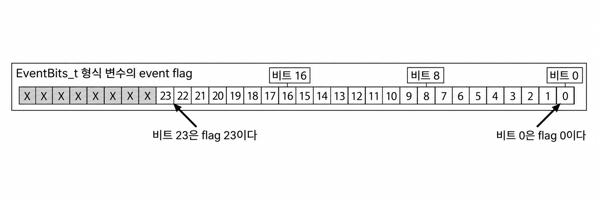
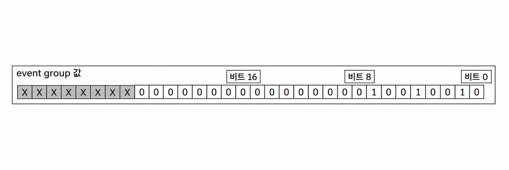

<a id="9-event-groups"></a>
# 9 이벤트 그룹 (Event Groups)

<a id="91-chapter-introduction-and-scope"></a>
## 9.1 장 소개 및 범위 (Chapter Introduction and Scope)

실시간 임베디드 시스템은 이벤트에 응답하여 동작을 수행해야 한다는 점은 이미 언급된 바 있다. 이전 장들에서는 이벤트가 태스크로 전달될 수 있도록 하는 FreeRTOS의 기능들을 설명하였다. 이러한 기능의 예로는 세마포어와 큐가 있으며, 둘 다 다음과 같은 특성을 갖는다:

- 태스크가 단일 이벤트가 발생하기를 기다리며 Blocked 상태(대기 상태)에 머무를 수 있도록 한다.

- 이벤트가 발생하면 단일 태스크의 블록을 해제한다. 블록이 해제되는 태스크는 이벤트를 기다리고 있던 태스크 중 우선순위가 가장 높은 태스크이다.

이벤트 그룹(Event group)은 이벤트가 태스크로 전달될 수 있도록 하는 FreeRTOS의 또 다른 기능이다. 큐 및 세마포어와 달리:

- 이벤트 그룹을 사용하면 태스크가 하나 이상의 이벤트 조합이 발생하기를 기다리며 Blocked 상태에 머무를 수 있다.

- 이벤트 그룹은 해당 이벤트 또는 이벤트 조합이 발생했을 때, 동일한 이벤트를 기다리고 있던 모든 태스크의 블록을 해제한다.

이러한 이벤트 그룹만의 고유한 특성은 여러 태스크를 동기화하거나, 둘 이상의 태스크에 이벤트를 브로드캐스트(동시 전파)하거나, 일련의 이벤트 집합 중 어느 하나라도 발생하기를 기다리며 Blocked 상태에 머무르거나, 여러 작업이 완료되기를 기다리며 Blocked 상태에 머무르는 데 매우 유용하다.

또한 이벤트 그룹은 단일 이벤트 그룹으로 여러 개의 바이너리 세마포어를 대체할 수 있는 경우가 많으므로 응용 프로그램이 사용하는 RAM 크기를 줄일 수 있는 기회를 제공한다.

이벤트 그룹 기능은 선택 사항이다. 이벤트 그룹 기능을 포함하려면 FreeRTOS 소스 파일인 `event_groups.c`를 프로젝트의 일부로 빌드해야 한다.


<a id="911-scope"></a>
### 9.1.1 학습 범위 (Scope)

이 장에서는 독자에게 다음 사항들에 대한 명확한 이해를 제공하는 것을 목표로 한다:

- 이벤트 그룹의 실질적인 활용 사례.
- 다른 FreeRTOS 기능 대비 이벤트 그룹의 장점과 단점.
- 이벤트 그룹 내의 비트를 설정(set)하는 방법.
- 이벤트 그룹 내의 비트가 설정되기를 기다리며 Blocked 상태에 머무르는 방법.
- 이벤트 그룹을 사용하여 일련의 태스크 집합을 동기화하는 방법.


<a id="92-characteristics-of-an-event-group"></a>
## 9.2 이벤트 그룹의 특성 (Characteristics of an Event Group)

<a id="921-event-groups-event-flags-and-event-bits"></a>
### 9.2.1 이벤트 그룹, 이벤트 플래그 및 이벤트 비트 (Event Groups, Event Flags and Event Bits)

이벤트 '플래그(flag)'는 이벤트가 발생했는지 여부를 나타내는 데 사용되는 불리언(Boolean, 1 또는 0) 값이다. 이벤트 '그룹(group)'은 이벤트 플래그들의 집합이다.

이벤트 플래그는 1 또는 0의 값만 가질 수 있으므로, 이벤트 플래그 하나의 상태를 단일 비트에 저장할 수 있으며, 이벤트 그룹 내의 모든 이벤트 플래그 상태를 단일 변수에 저장할 수 있다. 즉, 이벤트 그룹 내의 각 이벤트 플래그 상태는 `EventBits_t` 타입 변수 내의 개별 비트로 표현된다. 이러한 이유로 이벤트 플래그는 이벤트 '비트(bit)'라고도 불린다. `EventBits_t` 변수 내의 특정 비트가 1로 설정되면 해당 비트가 나타내는 이벤트가 발생한 것이다. `EventBits_t` 변수 내의 특정 비트가 0으로 설정되면 해당 비트가 나타내는 이벤트가 발생하지 않은 것이다.

Figure 9.1은 개별 이벤트 플래그가 `EventBits_t` 타입 변수 내의 개별 비트에 어떻게 매핑되는지를 보여준다.


<a name="fig9.1" title="Figure 9.1 Event flag to bit number mapping in a variable of type EventBits\_t"></a>

* * *

***Figure 9.1*** *Event flag to bit number mapping in a variable of type EventBits\_t*
* * *

예를 들어, 이벤트 그룹의 값이 0x92(이진수 1001 0010)라면 이벤트 비트 1, 4, 7만 설정된 상태이므로, 비트 1, 4, 7이 나타내는 이벤트만 발생한 것이다. Figure 9.2는 이벤트 비트 1, 4, 7이 설정되고 다른 모든 이벤트 비트는 클리어되어 이벤트 그룹 값이 0x92인 `EventBits_t` 타입 변수를 보여준다.


<a name="fig9.2" title="Figure 9.2 An event group in which only bits 1, 4 and 7 are set, and all the other event flags are clear, making the event group's value 0x92"></a>

* * *

***Figure 9.2*** *An event group in which only bits 1, 4 and 7 are set, and all the other event flags are clear, making the event group's value 0x92*
* * *

이벤트 그룹 내의 개별 비트에 의미를 부여하는 것은 응용 프로그램 개발자의 몫이다. 예를 들어, 응용 프로그램 개발자는 이벤트 그룹을 생성한 후 다음과 같이 정의할 수 있다:

- 이벤트 그룹 내의 비트 0을 "네트워크로부터 메시지가 수신됨"을 의미하도록 정의한다.

- 이벤트 그룹 내의 비트 1을 "네트워크로 전송할 메시지가 준비됨"을 의미하도록 정의한다.

- 이벤트 그룹 내의 비트 2를 "현재 네트워크 연결을 중단(abort)함"을 의미하도록 정의한다.


<a id="922-more-about-the-eventbits_t-data-type"></a>
### 9.2.2 EventBits_t 데이터 타입 상세 (More About the EventBits_t Data Type)

이벤트 그룹 내의 이벤트 비트 수는 FreeRTOSConfig.h에 정의된 `configTICK_TYPE_WIDTH_IN_BITS` 컴파일 타임 설정 상수에 따라 달라진다[^24]:

[^24]: `configTICK_TYPE_WIDTH_IN_BITS`는 RTOS 틱 카운트를 저장하는 데 사용되는 타입을 구성하므로 이벤트 그룹 기능과는 무관해 보일 수 있다. `EventBits_t` 타입에 미치는 영향은 FreeRTOS 내부 구현의 결과이며, `configTICK_TYPE_WIDTH_IN_BITS`를 `TICK_TYPE_WIDTH_16_BITS`로 설정하는 것이 바람직하더라도 FreeRTOS가 32비트 타입보다 16비트 타입을 더 효율적으로 처리할 수 있는 아키텍처에서 실행될 때만 그렇게 설정해야 한다.

- `configTICK_TYPE_WIDTH_IN_BITS`가 `TICK_TYPE_WIDTH_16_BITS`인 경우 각 이벤트 그룹은 8개의 사용 가능한 이벤트 비트를 포함한다.

- `configTICK_TYPE_WIDTH_IN_BITS`가 `TICK_TYPE_WIDTH_32_BITS`인 경우 각 이벤트 그룹은 24개의 사용 가능한 이벤트 비트를 포함한다.

- `configTICK_TYPE_WIDTH_IN_BITS`가 `TICK_TYPE_WIDTH_64_BITS`인 경우 각 이벤트 그룹은 56개의 사용 가능한 이벤트 비트를 포함한다.


<a id="923-access-by-multiple-tasks"></a>
### 9.2.3 여러 태스크에 의한 접근 (Access by Multiple Tasks)

이벤트 그룹은 독립적인 객체로서 그 존재를 알고 있는 모든 태스크나 ISR에서 접근할 수 있다. 원하는 수만큼의 태스크가 동일한 이벤트 그룹에 비트를 설정할 수 있으며, 원하는 수만큼의 태스크가 동일한 이벤트 그룹에서 비트를 읽을 수 있다.


<a id="924-a-practical-example-of-using-an-event-group"></a>
### 9.2.4 이벤트 그룹의 실제 활용 예 (A Practical Example of Using an Event Group)

FreeRTOS+TCP TCP/IP 스택의 구현은 설계를 단순화함과 동시에 리소스 사용량을 최소화하기 위해 이벤트 그룹을 어떻게 활용할 수 있는지 보여주는 실질적인 예를 제공한다.

TCP 소켓은 다양한 이벤트에 응답해야 한다. 이벤트의 예로는 accept(수락) 이벤트, bind(바인드) 이벤트, read(읽기) 이벤트, close(종료) 이벤트 등이 있다. 특정 시점에 소켓이 기대할 수 있는 이벤트는 소켓의 상태에 따라 다르다. 예를 들어 소켓이 생성되었지만 아직 주소에 바인드되지 않은 경우 bind 이벤트를 수신할 것으로 기대할 수 있지만, read 이벤트를 수신할 것은 기대하지 않는다(주소가 없으면 데이터를 읽을 수 없다).

FreeRTOS+TCP 소켓의 상태는 `FreeRTOS_Socket_t`라는 구조체에 유지된다. 이 구조체에는 소켓이 처리해야 하는 각 이벤트별로 이벤트 비트가 정의된 이벤트 그룹이 포함되어 있다. 단일 이벤트 또는 일련의 이벤트 그룹을 기다리기 위해 블록하는 FreeRTOS+TCP API 호출은 단순히 해당 이벤트 그룹에서 블록한다.

또한 이벤트 그룹에는 '중단(abort)' 비트도 포함되어 있어 소켓이 당시에 어떤 이벤트를 기다리고 있었는지에 관계없이 TCP 연결을 중단할 수 있다.


<a id="93-event-management-using-event-groups"></a>
## 9.3 이벤트 그룹을 사용한 이벤트 관리 (Event Management Using Event Groups)

<a id="931-the-xeventgroupcreate-api-function"></a>
### 9.3.1 xEventGroupCreate() API 함수 (The xEventGroupCreate() API Function)

FreeRTOS에는 컴파일 타임에 정적으로 이벤트 그룹 생성에 필요한 메모리를 할당하는 `xEventGroupCreateStatic()` 함수도 포함되어 있다. 이벤트 그룹은 사용하기 전에 명시적으로 생성되어야 한다.

이벤트 그룹은 `EventGroupHandle_t` 타입 변수를 사용하여 참조된다. `xEventGroupCreate()` API 함수는 이벤트 그룹을 생성하는 데 사용되며, 생성된 이벤트 그룹을 참조할 수 있는 `EventGroupHandle_t`를 반환한다.


<a name="list9.1" title="Listing 9.1 The xEventGroupCreate() API function prototype"></a>

```c
EventGroupHandle_t xEventGroupCreate( void );
```
***Listing 9.1*** *The xEventGroupCreate() API function prototype*


**xEventGroupCreate() 반환 값**

- 반환 값 (Return Value)

  NULL이 반환되면 FreeRTOS가 이벤트 그룹 데이터 구조를 할당하는 데 사용할 수 있는 힙 메모리가 부족하여 이벤트 그룹을 생성할 수 없음을 의미한다. 힙 메모리 관리에 대한 자세한 정보는 3장을 참조하라.

  NULL이 아닌 값이 반환되면 이벤트 그룹이 성공적으로 생성되었음을 나타낸다. 반환된 값은 생성된 이벤트 그룹의 핸들로 저장되어야 한다.


<a id="932-the-xeventgroupsetbits-api-function"></a>
### 9.3.2 xEventGroupSetBits() API 함수 (The xEventGroupSetBits() API Function)

`xEventGroupSetBits()` API 함수는 이벤트 그룹 내의 하나 이상의 비트를 설정하며, 일반적으로 설정되는 비트가 나타내는 이벤트가 발생했음을 태스크에 알리는 데 사용된다.

> *주의: 인터럽트 서비스 루틴(ISR) 내에서는 절대로 `xEventGroupSetBits()`를 호출해서는 안 된다. 그 대신 인터럽트 안전 버전인 `xEventGroupSetBitsFromISR()`을 사용해야 한다.*


<a name="list9.2" title="Listing 9.2. The xEventGroupSetBits() API function prototype"></a>

```c
EventBits_t xEventGroupSetBits( EventGroupHandle_t xEventGroup,

const EventBits_t uxBitsToSet );
```
***Listing 9.2*** *The xEventGroupSetBits() API function prototype*


**xEventGroupSetBits() 매개변수 및 반환 값**

- `xEventGroup`

  비트를 설정할 이벤트 그룹의 핸들이다. 이 이벤트 그룹 핸들은 이벤트 그룹을 생성할 때 사용한 `xEventGroupCreate()` 호출에서 반환된 값이다.

- `uxBitsToSet`

  이벤트 그룹에서 1로 설정할 이벤트 비트(들)를 지정하는 비트 마스크이다. 이벤트 그룹의 값은 이벤트 그룹의 기존 값과 `uxBitsToSet`에 전달된 값을 비트 단위 OR 연산하여 업데이트된다.

  예를 들어, `uxBitsToSet`을 0x04(이진수 0100)로 설정하면 이벤트 그룹 내의 이벤트 비트 3이 설정되며(이미 설정되어 있지 않은 경우), 이벤트 그룹 내의 다른 모든 이벤트 비트는 변경되지 않은 상태로 유지된다.

- 반환 값 (Return Value)

  `xEventGroupSetBits()` 호출이 반환될 당시의 이벤트 그룹 값이다. 다른 태스크에 의해 비트가 다시 클리어되었을 수 있으므로, 반환된 값에 `uxBitsToSet`으로 지정된 비트가 반드시 설정되어 있는 것은 아님에 유의하라.


<a id="933-the-xeventgroupsetbitsfromisr-api-function"></a>
### 9.3.3 xEventGroupSetBitsFromISR() API 함수 (The xEventGroupSetBitsFromISR() API Function)

`xEventGroupSetBitsFromISR()`은 `xEventGroupSetBits()`의 인터럽트 안전(interrupt-safe) 버전이다.

세마포어를 주는(give) 동작은 세마포어를 주는 행위로 인해 최대 하나의 태스크만 Blocked 상태를 벗어난다는 사실을 미리 알 수 있으므로 결정론적(deterministic) 작업이다. 반면 이벤트 그룹에 비트를 설정할 때는 얼마나 많은 태스크가 Blocked 상태를 벗어날지 미리 알 수 없으므로, 이벤트 그룹에 비트를 설정하는 것은 결정론적 작업이 아니다.

FreeRTOS 설계 및 구현 표준에서는 인터럽트 서비스 루틴 내부나 인터럽트가 비활성화된 상태에서 비결정론적 작업이 수행되는 것을 허용하지 않는다. 이러한 이유로 `xEventGroupSetBitsFromISR()`은 인터럽트 서비스 루틴 내부에서 직접 이벤트 비트를 설정하지 않고, 대신 해당 동작을 RTOS 데몬 태스크로 지연(defer)시킨다.


<a name="list9.3" title="Listing 9.3 The xEventGroupSetBitsFromISR() API function prototype"></a>

```c
BaseType_t xEventGroupSetBitsFromISR( EventGroupHandle_t xEventGroup,
                                      const EventBits_t uxBitsToSet,
                                      BaseType_t *pxHigherPriorityTaskWoken );
```
***Listing 9.3*** *The xEventGroupSetBitsFromISR() API function prototype*


**xEventGroupSetBitsFromISR() 매개변수 및 반환 값**

- `xEventGroup`

  비트를 설정할 이벤트 그룹의 핸들이다. 이 이벤트 그룹 핸들은 이벤트 그룹을 생성할 때 사용한 `xEventGroupCreate()` 호출에서 반환된 값이다.

- `uxBitsToSet`

  이벤트 그룹에서 1로 설정할 이벤트 비트(들)를 지정하는 비트 마스크이다. 이벤트 그룹의 값은 이벤트 그룹의 기존 값과 `uxBitsToSet`에 전달된 값을 비트 단위 OR 연산하여 업데이트된다.

  예를 들어, `uxBitsToSet`을 0x05(이진수 0101)로 설정하면 이벤트 그룹 내의 이벤트 비트 2와 이벤트 비트 0이 설정되며(이미 설정되어 있지 않은 경우), 이벤트 그룹 내의 다른 모든 이벤트 비트는 변경되지 않은 상태로 유지된다.

- `pxHigherPriorityTaskWoken`

  `xEventGroupSetBitsFromISR()`은 인터럽트 서비스 루틴 내부에서 직접 이벤트 비트를 설정하지 않고, 타이머 커맨드 큐에 명령을 전송하여 RTOS 데몬 태스크로 작업을 지연시킨다. 만약 데몬 태스크가 타이머 커맨드 큐에 데이터가 들어오기를 기다리며 Blocked 상태에 머물러 있었다면, 타이머 커맨드 큐에 데이터를 기록함으로써 데몬 태스크가 Blocked 상태를 벗어나게 된다. 데몬 태스크의 우선순위가 현재 실행 중인 태스크(인터럽트가 걸린 태스크)의 우선순위보다 높으면 내부적으로 `xEventGroupSetBitsFromISR()`은 `*pxHigherPriorityTaskWoken`을 `pdTRUE`로 설정한다.

  `xEventGroupSetBitsFromISR()`이 이 값을 `pdTRUE`로 설정한 경우 인터럽트가 종료되기 전에 컨텍스트 스위칭을 수행해야 한다. 이렇게 하면 데몬 태스크가 Ready 상태(준비 완료) 태스크 중 가장 높은 우선순위를 갖게 되므로 인터럽트가 데몬 태스크로 직접 복귀하도록 보장된다.

- 반환 값 (Return Value)

  두 가지 가능한 반환 값이 있다:

  - `pdPASS`는 데이터가 타이머 커맨드 큐에 성공적으로 전송된 경우에만 반환된다.

  - `pdFALSE`는 타이머 커맨드 큐가 이미 가득 차서 '비트 설정' 명령을 큐에 기록할 수 없는 경우 반환된다.


<a id="934-the-xeventgroupwaitbits-api-function"></a>
### 9.3.4 xEventGroupWaitBits() API 함수 (The xEventGroupWaitBits() API Function)

`xEventGroupWaitBits()` API 함수를 사용하면 태스크가 이벤트 그룹의 값을 읽을 수 있으며, 이벤트 그룹 내의 하나 이상의 이벤트 비트가 아직 설정되어 있지 않은 경우 선택적으로 해당 비트들이 설정될 때까지 Blocked 상태에서 기다릴 수 있다.


<a name="list9.4" title="Listing 9.4 The xEventGroupWaitBits() API function prototype"></a>

```c
EventBits_t xEventGroupWaitBits( EventGroupHandle_t xEventGroup,
                                 const EventBits_t uxBitsToWaitFor,
                                 const BaseType_t xClearOnExit,
                                 const BaseType_t xWaitForAllBits,
                                 TickType_t xTicksToWait );
```
***Listing 9.4*** *The xEventGroupWaitBits() API function prototype*

스케줄러가 태스크의 Blocked 상태 진입 여부와 Blocked 상태 해제 시점을 결정하는 데 사용하는 조건을 '블록 해제 조건(unblock condition)'이라고 부른다. 블록 해제 조건은 `uxBitsToWaitFor`와 `xWaitForAllBits` 매개변수 값의 조합으로 지정된다:

- `uxBitsToWaitFor`는 이벤트 그룹에서 테스트할 이벤트 비트를 지정한다.

- `xWaitForAllBits`는 비트 단위 OR 테스트를 사용할지, 비트 단위 AND 테스트를 사용할지 지정한다.

`xEventGroupWaitBits()`가 호출되는 시점에 블록 해제 조건이 이미 충족되어 있으면 태스크는 Blocked 상태에 진입하지 않는다.

태스크가 Blocked 상태로 진입하거나 Blocked 상태에서 빠져나오게 되는 조건들의 예가 Table 6에 제공되어 있다. Table 6은 이벤트 그룹 및 `uxBitsToWaitFor` 값의 하위 4개 이진 비트만 보여주며, 이 두 값의 나머지 비트는 0이라고 가정한다.

<a name="tbl6" title="Table 6 The Effect of the uxBitsToWaitFor and xWaitForAllBits Parameters"></a>

* * *
| 기존 이벤트 그룹 값 (Existing Event Group Value) | uxBitsToWaitFor 값 | xWaitForAllBits 값 | 동작 결과 (Resultant Behavior) |
| ----------------------------------------------- | ------------------ | ------------------ | ------------------------------ |
| 0000 | 0101 | pdFALSE | 이벤트 그룹에 비트 0과 비트 2가 모두 설정되어 있지 않으므로 호출한 태스크는 Blocked 상태에 진입하며, 이벤트 그룹에 비트 0 또는(OR) 비트 2가 설정되면 Blocked 상태를 벗어난다. |
| 0100 | 0101 | pdTRUE | 이벤트 그룹에 비트 0과 비트 2가 둘 다 설정되어 있지는 않으므로 호출한 태스크는 Blocked 상태에 진입하며, 이벤트 그룹에 비트 0과(AND) 비트 2가 모두 설정되면 Blocked 상태를 벗어난다. |
| 0100 | 0110 | pdFALSE | xWaitForAllBits가 pdFALSE이고 uxBitsToWaitFor로 지정된 두 비트 중 하나가 이미 이벤트 그룹에 설정되어 있으므로 호출한 태스크는 Blocked 상태에 진입하지 않는다. |
| 0100 | 0110 | pdTRUE | xWaitForAllBits가 pdTRUE이고 uxBitsToWaitFor로 지정된 두 비트 중 하나만 이벤트 그룹에 설정되어 있으므로 호출한 태스크는 Blocked 상태에 진입한다. 태스크는 이벤트 그룹에 비트 1과 비트 2가 모두 설정될 때 Blocked 상태를 벗어난다. |

***Table 6*** *The Effect of the uxBitsToWaitFor and xWaitForAllBits Parameters*
* * *

호출한 태스크는 `uxBitsToWaitFor` 매개변수를 사용하여 테스트할 비트를 지정하며, 블록 해제 조건이 충족된 후에는 이 비트들을 다시 0으로 클리어해야 하는 경우가 많다. 이벤트 비트는 `xEventGroupClearBits()` API 함수를 사용하여 클리어할 수 있지만, 해당 함수를 사용하여 이벤트 비트를 수동으로 클리어하면 다음과 같은 경우 응용 프로그램 코드에서 경쟁 상태(race condition)가 발생할 수 있다:

- 동일한 이벤트 그룹을 사용하는 태스크가 둘 이상 있는 경우.
- 다른 태스크나 인터럽트 서비스 루틴에 의해 이벤트 그룹에 비트가 설정되는 경우.

이러한 잠재적 경쟁 상태를 방지하기 위해 `xClearOnExit` 매개변수가 제공된다. `xClearOnExit`가 `pdTRUE`로 설정되면 이벤트 비트를 테스트하고 클리어하는 작업이 호출 태스크에게 원자적(atomic) 작업(다른 태스크나 인터럽트에 의해 중단되지 않음)으로 동작한다.

**xEventGroupWaitBits() 매개변수 및 반환 값**

- `xEventGroup`

  읽으려는 이벤트 비트가 포함된 이벤트 그룹의 핸들이다. 이 이벤트 그룹 핸들은 이벤트 그룹을 생성할 때 사용한 `xEventGroupCreate()` 호출에서 반환된 값이다.

- `uxBitsToWaitFor`

  이벤트 그룹에서 테스트할 이벤트 비트(들)를 지정하는 비트 마스크이다.

  예를 들어, 호출 태스크가 이벤트 그룹에서 이벤트 비트 0 및/또는 이벤트 비트 2가 설정되기를 기다리려는 경우 `uxBitsToWaitFor`를 0x05(이진수 0101)로 설정한다. 추가 예시는 Table 6을 참조하라.

- `xClearOnExit`

  호출 태스크의 블록 해제 조건이 충족되었고 `xClearOnExit`가 `pdTRUE`로 설정된 경우, 호출 태스크가 `xEventGroupWaitBits()` API 함수를 종료하기 전에 이벤트 그룹 내에서 `uxBitsToWaitFor`로 지정된 이벤트 비트가 0으로 다시 클리어된다.

  `xClearOnExit`가 `pdFALSE`로 설정된 경우 이벤트 그룹 내의 이벤트 비트 상태는 `xEventGroupWaitBits()` API 함수에 의해 수정되지 않는다.

- `xWaitForAllBits`

  `uxBitsToWaitFor` 매개변수는 이벤트 그룹에서 테스트할 이벤트 비트를 지정한다. `xWaitForAllBits`는 `uxBitsToWaitFor` 매개변수로 지정된 이벤트 비트 중 하나 이상이 설정되었을 때 호출 태스크가 Blocked 상태에서 해제되어야 하는지, 아니면 `uxBitsToWaitFor` 매개변수로 지정된 모든 이벤트 비트가 설정되었을 때만 해제되어야 하는지를 지정한다.

  `xWaitForAllBits`가 `pdFALSE`로 설정된 경우, 블록 해제 조건 충족을 기다리기 위해 Blocked 상태에 진입한 태스크는 `uxBitsToWaitFor`로 지정된 비트 중 어느 하나라도 설정되면(또는 `xTicksToWait` 매개변수로 지정된 타임아웃이 만료되면) Blocked 상태를 벗어난다.

  `xWaitForAllBits`가 `pdTRUE`로 설정된 경우, 블록 해제 조건 충족을 기다리기 위해 Blocked 상태에 진입한 태스크는 `uxBitsToWaitFor`로 지정된 모든 비트가 설정되어야만(또는 `xTicksToWait` 매개변수로 지정된 타임아웃이 만료되면) Blocked 상태를 벗어난다.

  예시는 Table 6을 참조하라.

- `xTicksToWait`

  태스크가 블록 해제 조건이 충족되기를 기다리며 Blocked 상태에 머물러야 하는 최대 시간이다.

  `xTicksToWait`가 0이거나 `xEventGroupWaitBits()`가 호출된 시점에 블록 해제 조건이 이미 충족된 경우 `xEventGroupWaitBits()`는 즉시 반환된다.

  블록 시간은 틱 주기로 지정되므로 절대 시간은 틱 주파수에 따라 달라진다. `pdMS_TO_TICKS()` 매크로를 사용하여 밀리초 단위로 지정된 시간을 틱 단위 시간으로 변환할 수 있다.

  FreeRTOSConfig.h에서 `INCLUDE_vTaskSuspend`가 1로 설정되어 있는 경우, `xTicksToWait`를 `portMAX_DELAY`로 설정하면 태스크가 타임아웃 없이 무한정 대기한다.

- 반환 값 (Returned Value)

  호출 태스크의 블록 해제 조건이 충족되어 `xEventGroupWaitBits()`가 반환된 경우, 반환 값은 호출 태스크의 블록 해제 조건이 충족되었을 당시의 이벤트 그룹 값이다(`xClearOnExit`가 `pdTRUE`여서 비트가 자동으로 클리어되기 전의 값). 이 경우 반환 값 역시 블록 해제 조건을 충족한다.

  `xTicksToWait` 매개변수로 지정된 블록 시간이 만료되어 `xEventGroupWaitBits()`가 반환된 경우, 반환 값은 블록 시간이 만료되었을 당시의 이벤트 그룹 값이다. 이 경우 반환 값은 블록 해제 조건을 충족하지 않는다.


<a id="935-the-xeventgroupgetstaticbuffer-api-function"></a>
### 9.3.5 xEventGroupGetStaticBuffer() API 함수 (The xEventGroupGetStaticBuffer() API Function)

`xEventGroupGetStaticBuffer()` API 함수는 정적으로 생성된 이벤트 그룹의 버퍼에 대한 포인터를 가져오는 방법을 제공한다. 이는 이벤트 그룹 생성 시 제공된 것과 동일한 버퍼이다.

*주의: 인터럽트 서비스 루틴 내에서는 절대로 `xEventGroupGetStaticBuffer()`를 호출해서는 안 된다.*


<a name="list9.5" title="Listing 9.5 The xEventGroupGetStaticBuffer() API function prototype"></a>

```c
BaseType_t xEventGroupGetStaticBuffer( EventGroupHandle_t xEventGroup,

StaticEventGroup_t ** ppxEventGroupBuffer );
```
***Listing 9.5*** *The xEventGroupGetStaticBuffer() API function prototype*


**xEventGroupGetStaticBuffer() 매개변수 및 반환 값**

- `xEventGroup`

  버퍼를 가져올 대상 이벤트 그룹이다. 이 이벤트 그룹은 `xEventGroupCreateStatic()`으로 생성된 것이어야 한다.

- `ppxEventGroupBuffer`

  이벤트 그룹의 데이터 구조 버퍼를 가리키는 포인터를 반환하는 데 사용된다. 이는 생성 시에 제공된 것과 동일한 버퍼이다.

- 반환 값 (Return Value)

  두 가지 가능한 반환 값이 있다:

  - 버퍼를 성공적으로 가져온 경우 `pdTRUE`가 반환된다.

  - 버퍼를 성공적으로 가져오지 못한 경우 `pdFALSE`가 반환된다.

<a name="example9.1" title="Example 9.1 Experimenting with event groups"></a>
---
***예제 9.1*** *이벤트 그룹 실험 (Experimenting with event groups)*

---

이 예제에서는 다음 방법을 보여준다:

- 이벤트 그룹 생성.
- 인터럽트 서비스 루틴에서 이벤트 그룹의 비트 설정.
- 태스크에서 이벤트 그룹의 비트 설정.
- 이벤트 그룹에서 블록(대기).

`xEventGroupWaitBits()`의 `xWaitForAllBits` 매개변수가 미치는 효과는 먼저 `xWaitForAllBits`를 `pdFALSE`로 설정하여 예제를 실행한 다음, `xWaitForAllBits`를 `pdTRUE`로 설정하여 예제를 실행함으로써 시연된다.

이벤트 비트 0과 이벤트 비트 1은 태스크에서 설정된다. 이벤트 비트 2는 인터럽트 서비스 루틴에서 설정된다. 이 세 비트에는 Listing 9.6에 나와 있는 `#define` 문을 사용하여 서술적인 이름이 부여된다.


<a name="list9.6" title="Listing 9.6 Event bit definitions used in Example 9.1"></a>

```c
/* Definitions for the event bits in the event group. */
#define mainFIRST_TASK_BIT ( 1UL << 0UL )  /* Event bit 0, set by a task */
#define mainSECOND_TASK_BIT ( 1UL << 1UL ) /* Event bit 1, set by a task */
#define mainISR_BIT ( 1UL << 2UL )         /* Event bit 2, set by an ISR */
```
***Listing 9.6*** *Event bit definitions used in Example 9.1*


Listing 9.7은 이벤트 비트 0과 이벤트 비트 1을 설정하는 태스크의 구현을 보여준다. 이 태스크는 루프 내에서 `xEventGroupSetBits()` 호출 사이에 200밀리초의 지연을 두고 한 비트를 설정한 다음 다른 비트를 설정하는 작업을 반복한다. 실행 순서를 콘솔에서 확인할 수 있도록 각 비트가 설정되기 전에 문자열이 출력된다.


<a name="list9.7" title="Listing 9.7 The task that sets two bits in the event group in Example 9.1"></a>

```c
static void vEventBitSettingTask( void *pvParameters )
{
    const TickType_t xDelay200ms = pdMS_TO_TICKS( 200UL );

    for( ;; )
    {
        /* Delay for a short while before starting the next loop. */
        vTaskDelay( xDelay200ms );

        /* Print out a message to say event bit 0 is about to be set by the
           task, then set event bit 0. */
        vPrintString( "Bit setting task -\t about to set bit 0.\r\n" );
        xEventGroupSetBits( xEventGroup, mainFIRST_TASK_BIT );

        /* Delay for a short while before setting the other bit. */
        vTaskDelay( xDelay200ms );

        /* Print out a message to say event bit 1 is about to be set by the
           task, then set event bit 1. */
        vPrintString( "Bit setting task -\t about to set bit 1.\r\n" );
        xEventGroupSetBits( xEventGroup, mainSECOND_TASK_BIT );
    }
}
```
***Listing 9.7*** *The task that sets two bits in the event group in Example 9.1*


Listing 9.8은 이벤트 그룹에서 비트 2를 설정하는 인터럽트 서비스 루틴의 구현을 보여준다. 마찬가지로 실행 순서를 콘솔에서 볼 수 있도록 비트가 설정되기 전에 문자열이 출력된다. 그러나 이 경우에는 인터럽트 서비스 루틴 내에서 직접 콘솔 출력을 수행해서는 안 되므로, RTOS 데몬 태스크의 컨텍스트에서 출력을 수행하기 위해 `xTimerPendFunctionCallFromISR()`이 사용된다.

이전 예제와 마찬가지로, 인터럽트 서비스 루틴은 소프트웨어 인터럽트를 강제로 발생시키는 단순 주기적 태스크에 의해 트리거된다. 이 예제에서는 인터럽트가 500밀리초마다 생성된다.


<a name="list9.8" title="Listing 9.8 The ISR that sets bit 2 in the event group in Example 9.1"></a>

```c
static uint32_t ulEventBitSettingISR( void )
{
    /* The string is not printed within the interrupt service routine, but is
       instead sent to the RTOS daemon task for printing. It is therefore
       declared static to ensure the compiler does not allocate the string on
       the stack of the ISR, as the ISR's stack frame will not exist when the
       string is printed from the daemon task. */
    static const char *pcString = "Bit setting ISR -\t about to set bit 2.\r\n";
    BaseType_t xHigherPriorityTaskWoken = pdFALSE;

    /* Print out a message to say bit 2 is about to be set. Messages cannot
       be printed from an ISR, so defer the actual output to the RTOS daemon
       task by pending a function call to run in the context of the RTOS
       daemon task. */
    xTimerPendFunctionCallFromISR( vPrintStringFromDaemonTask,
                                   ( void * ) pcString,
                                   0,
                                   &xHigherPriorityTaskWoken );

    /* Set bit 2 in the event group. */
    xEventGroupSetBitsFromISR( xEventGroup,
                               mainISR_BIT,
                               &xHigherPriorityTaskWoken );

    /* xTimerPendFunctionCallFromISR() and xEventGroupSetBitsFromISR() both
       write to the timer command queue, and both used the same
       xHigherPriorityTaskWoken variable. If writing to the timer command
       queue resulted in the RTOS daemon task leaving the Blocked state, and
       if the priority of the RTOS daemon task is higher than the priority of
       the currently executing task (the task this interrupt interrupted) then
       xHigherPriorityTaskWoken will have been set to pdTRUE.

       xHigherPriorityTaskWoken is used as the parameter to
       portYIELD_FROM_ISR(). If xHigherPriorityTaskWoken equals pdTRUE, then
       calling portYIELD_FROM_ISR() will request a context switch. If
       xHigherPriorityTaskWoken is still pdFALSE, then calling
       portYIELD_FROM_ISR() will have no effect.

       The implementation of portYIELD_FROM_ISR() used by the Windows port
       includes a return statement, which is why this function does not
       explicitly return a value. */

    portYIELD_FROM_ISR( xHigherPriorityTaskWoken );
}
```
***Listing 9.8*** *The ISR that sets bit 2 in the event group in Example 9.1*


Listing 9.9는 `xEventGroupWaitBits()`를 호출하여 이벤트 그룹에서 블록하는 태스크의 구현을 보여준다. 이 태스크는 이벤트 그룹에 설정된 각 비트에 대해 문자열을 출력한다.

`xEventGroupWaitBits()`의 `xClearOnExit` 매개변수가 `pdTRUE`로 설정되어 있으므로, `xEventGroupWaitBits()` 호출이 반환되도록 만든 이벤트 비트(들)는 `xEventGroupWaitBits()`가 반환되기 전에 자동으로 클리어된다.


<a name="list9.9" title="Listing 9.9 The task that blocks to wait for event bits to become set in Example 9.1"></a>

```c
static void vEventBitReadingTask( void *pvParameters )
{
    EventBits_t xEventGroupValue;
    const EventBits_t xBitsToWaitFor = ( mainFIRST_TASK_BIT  |
                                         mainSECOND_TASK_BIT |
                                         mainISR_BIT );

    for( ;; )
    {
        /* Block to wait for event bits to become set within the event
           group. */
        xEventGroupValue = xEventGroupWaitBits( /* The event group to read */
                                                xEventGroup,

                                                /* Bits to test */
                                                xBitsToWaitFor,

                                                /* Clear bits on exit if the
                                                   unblock condition is met */
                                                pdTRUE,

                                                /* Don't wait for all bits. This
                                                   parameter is set to pdTRUE for the
                                                   second execution. */
                                                pdFALSE,

                                                /* Don't time out. */
                                                portMAX_DELAY );

        /* Print a message for each bit that was set. */
        if( ( xEventGroupValue & mainFIRST_TASK_BIT ) != 0 )
        {
            vPrintString( "Bit reading task -\t Event bit 0 was set\r\n" );
        }

        if( ( xEventGroupValue & mainSECOND_TASK_BIT ) != 0 )
        {
            vPrintString( "Bit reading task -\t Event bit 1 was set\r\n" );
        }

        if( ( xEventGroupValue & mainISR_BIT ) != 0 )
        {
            vPrintString( "Bit reading task -\t Event bit 2 was set\r\n" );
        }
    }
}
```
***Listing 9.9*** *The task that blocks to wait for event bits to become set in Example 9.1*


`main()` 함수는 스케줄러를 시작하기 전에 이벤트 그룹과 태스크들을 생성한다. 구현 내용은 Listing 9.10을 참조하라. 이벤트 그룹에서 읽는 태스크의 우선순위가 이벤트 그룹에 쓰는 태스크의 우선순위보다 높으므로, 읽기 태스크의 블록 해제 조건이 충족될 때마다 읽기 태스크가 쓰기 태스크를 선점하도록 보장된다.


<a name="list9.10" title="Listing 9.10 Creating the event group and tasks in Example 9.1"></a>

```c
int main( void )
{
    /* Before an event group can be used it must first be created. */
    xEventGroup = xEventGroupCreate();

    /* Create the task that sets event bits in the event group. */
    xTaskCreate( vEventBitSettingTask, "Bit Setter", 1000, NULL, 1, NULL );

    /* Create the task that waits for event bits to get set in the event
       group. */
    xTaskCreate( vEventBitReadingTask, "Bit Reader", 1000, NULL, 2, NULL );

    /* Create the task that is used to periodically generate a software
       interrupt. */
    xTaskCreate( vInterruptGenerator, "Int Gen", 1000, NULL, 3, NULL );

    /* Install the handler for the software interrupt. The syntax necessary
       to do this is dependent on the FreeRTOS port being used. The syntax
       shown here can only be used with the FreeRTOS Windows port, where such
       interrupts are only simulated. */
    vPortSetInterruptHandler( mainINTERRUPT_NUMBER, ulEventBitSettingISR );

    /* Start the scheduler so the created tasks start executing. */
    vTaskStartScheduler();

    /* The following line should never be reached. */
    for( ;; );
    return 0;
}
```
***Listing 9.10*** *Creating the event group and tasks in Example 9.1*


`xEventGroupWaitBits()`의 `xWaitForAllBits` 매개변수를 `pdFALSE`로 설정하여 예제 9.1을 실행했을 때 생성되는 출력이 Figure 9.3에 나와 있다. Figure 9.3을 보면 `xEventGroupWaitBits()` 호출 시 `xWaitForAllBits` 매개변수가 `pdFALSE`로 설정되었기 때문에, 이벤트 비트 중 어느 하나라도 설정될 때마다 이벤트 그룹에서 읽는 태스크가 Blocked 상태를 벗어나 즉시 실행되는 것을 확인할 수 있다.


<a name="fig9.3" title="Figure 9.3 The output produced when Example 9.1 is executed with xWaitForAllBits set to pdFALSE"></a>

* * *

***Figure 9.3*** *The output produced when Example 9.1 is executed with xWaitForAllBits set to pdFALSE*
* * *

`xEventGroupWaitBits()`의 `xWaitForAllBits` 매개변수를 `pdTRUE`로 설정하여 예제 9.1을 실행했을 때 생성되는 출력이 Figure 9.4에 나와 있다. Figure 9.4를 보면 `xWaitForAllBits` 매개변수가 `pdTRUE`로 설정되었기 때문에, 세 가지 이벤트 비트가 모두 설정된 후에야 비로소 이벤트 그룹에서 읽는 태스크가 Blocked 상태를 벗어나는 것을 확인할 수 있다.


<a name="fig9.4" title="Figure 9.4 The output produced when Example 9.1 is executed with xWaitForAllBits set to pdTRUE"></a>

* * *

***Figure 9.4*** *The output produced when Example 9.1 is executed with xWaitForAllBits set to pdTRUE*
* * *


<a id="94-task-synchronization-using-an-event-group"></a>
## 9.4 이벤트 그룹을 사용한 태스크 동기화 (Task Synchronization Using an Event Group)

애플리케이션 설계에 따라 둘 이상의 태스크가 서로 동기화되어야 하는 경우가 있다. 예를 들어 Task A가 이벤트를 수신한 후, 이벤트로 인해 필요한 처리 작업의 일부를 다른 세 태스크인 Task B, Task C, Task D에 위임하는 설계를 고려해 보라. 만약 Task B, C, D가 이전 이벤트 처리를 모두 완료할 때까지 Task A가 다른 이벤트를 수신할 수 없다면, 이 네 태스크는 모두 서로 동기화되어야 한다. 각 태스크의 동기화 지점은 해당 태스크가 자신의 처리를 완료한 직후가 되며, 다른 모든 태스크도 마찬가지로 처리를 완료할 때까지 더 이상 진행할 수 없다. Task A는 네 태스크가 모두 동기화 지점에 도달한 후에만 다른 이벤트를 수신할 수 있다.

이러한 유형의 태스크 동기화가 필요한 덜 추상적인 예는 FreeRTOS+TCP 데모 프로젝트 중 하나에서 찾을 수 있다. 이 데모는 두 태스크 간에 TCP 소켓을 공유한다. 한 태스크는 소켓으로 데이터를 전송하고, 다른 태스크는 동일한 소켓으로부터 데이터를 수신한다[^25]. 상대방 태스크가 소켓에 다시 접근하지 않을 것이 확실해질 때까지는 어느 태스크도 TCP 소켓을 닫는 것이 안전하지 않다. 두 태스크 중 어느 하나가 소켓을 닫고자 할 경우, 상대방 태스크에 그 의도를 알린 후 상대방 태스크가 소켓 사용을 중단할 때까지 기다렸다가 작업을 진행해야 한다. 소켓으로 데이터를 전송하는 태스크가 소켓을 닫고자 하는 시나리오가 Listing 9.11에 표시된 의사 코드로 설명되어 있다.

[^25]: 작성 시점을 기준으로 이는 단일 FreeRTOS+TCP 소켓을 태스크 간에 공유할 수 있는 유일한 방법이다.

Listing 9.11에 제시된 시나리오는 서로 동기화해야 하는 태스크가 두 개뿐이므로 단순하지만, 소켓이 열려 있는 것에 의존하는 처리를 수행하는 다른 태스크들이 더 있다면 시나리오가 얼마나 더 복잡해지고 동기화에 참여해야 하는 태스크가 얼마나 더 많아질지 쉽게 짐작할 수 있다.


<a name="list9.11" title="Listing 9.11 Pseudo code for two tasks that synchronize with each other to ensure a shared TCP socket..."></a>

```c
void SocketTxTask( void *pvParameters )
{
    xSocket_t xSocket;
    uint32_t ulTxCount = 0UL;

    for( ;; )
    {
        /* Create a new socket. This task will send to this socket, and another
           task will receive from this socket. */
        xSocket = FreeRTOS_socket( ... );

        /* Connect the socket. */
        FreeRTOS_connect( xSocket, ... );

        /* Use a queue to send the socket to the task that receives data. */
        xQueueSend( xSocketPassingQueue, &xSocket, portMAX_DELAY );

        /* Send 1000 messages to the socket before closing the socket. */
        for( ulTxCount = 0; ulTxCount < 1000; ulTxCount++ )
        {
            if( FreeRTOS_send( xSocket, ... ) < 0 )
            {
                /* Unexpected error - exit the loop, after which the socket
                   will be closed. */
                break;
            }
        }

        /* Let the Rx task know the Tx task wants to close the socket. */
        TxTaskWantsToCloseSocket();

        /* This is the Tx task's synchronization point. The Tx task waits here
           for the Rx task to reach its synchronization point. The Rx task will
           only reach its synchronization point when it is no longer using the
           socket, and the socket can be closed safely. */
        xEventGroupSync( ... );

        /* Neither task is using the socket. Shut down the connection, then
           close the socket. */
        FreeRTOS_shutdown( xSocket, ... );
        WaitForSocketToDisconnect();
        FreeRTOS_closesocket( xSocket );
    }
}
/*-----------------------------------------------------------*/

void SocketRxTask( void *pvParameters )
{
    xSocket_t xSocket;

    for( ;; )
    {
        /* Wait to receive a socket that was created and connected by the Tx
           task. */
        xQueueReceive( xSocketPassingQueue, &xSocket, portMAX_DELAY );

        /* Keep receiving from the socket until the Tx task wants to close the
           socket. */
        while( TxTaskWantsToCloseSocket() == pdFALSE )
        {
           /* Receive then process data. */
           FreeRTOS_recv( xSocket, ... );
           ProcessReceivedData();
        }

        /* This is the Rx task's synchronization point - it only reaches here
           when it is no longer using the socket, and it is therefore safe for
           the Tx task to close the socket. */
        xEventGroupSync( ... );
    }
}
```
***Listing 9.11*** *Pseudo code for two tasks that synchronize with each other to ensure a shared TCP socket is no longer in use by either task before the socket is closed*


이벤트 그룹을 사용하면 다음과 같이 동기화 지점을 생성할 수 있다:

- 동기화에 참여해야 하는 각 태스크에는 이벤트 그룹 내의 고유한 이벤트 비트가 하나씩 할당된다.

- 각 태스크는 동기화 지점에 도달했을 때 자신의 이벤트 비트를 설정한다.

- 각 태스크는 자신의 이벤트 비트를 설정한 후, 동기화에 참여하는 다른 모든 태스크를 나타내는 이벤트 비트도 설정될 때까지 이벤트 그룹에서 블록하여 기다린다.

그러나 이 시나리오에서는 `xEventGroupSetBits()`와 `xEventGroupWaitBits()` API 함수를 사용할 수 없다. 만약 이 두 함수를 사용한다면 비트를 설정하는 동작(태스크가 동기화 지점에 도달했음을 나타냄)과 비트를 테스트하는 동작(다른 동기화 태스크들이 동기화 지점에 도달했는지 확인하기 위함)이 두 개의 개별적인 작업으로 수행되기 때문이다. 이것이 왜 문제가 되는지 이해하기 위해 Task A, Task B, Task C가 이벤트 그룹을 사용하여 동기화를 시도하는 시나리오를 고려해 보라:

1. Task A와 Task B는 이미 동기화 지점에 도달했으므로 이벤트 그룹에 각자의 이벤트 비트가 설정되어 있으며, Task C의 이벤트 비트도 설정되기를 기다리며 Blocked 상태에 머물러 있다.

2. Task C가 동기화 지점에 도달하여 `xEventGroupSetBits()`를 사용해 이벤트 그룹에 자신의 비트를 설정한다. Task C의 비트가 설정되자마자 Task A와 Task B는 Blocked 상태를 벗어나 세 이벤트 비트를 모두 클리어한다.

3. 그런 다음 Task C는 `xEventGroupWaitBits()`를 호출하여 세 이벤트 비트가 모두 설정되기를 기다리지만, 그 시점에는 이미 세 이벤트 비트가 모두 클리어되었고 Task A와 Task B는 각자의 동기화 지점을 벗어났으므로 동기화는 실패하게 된다.

이벤트 그룹을 사용하여 동기화 지점을 성공적으로 생성하려면 이벤트 비트를 설정하는 동작과 이후 이벤트 비트를 테스트하는 동작이 단일한 중단 불가능한(uninterruptable) 작업으로 수행되어야 한다. `xEventGroupSync()` API 함수는 바로 이 목적으로 제공된다.


<a id="941-the-xeventgroupsync-api-function"></a>
### 9.4.1 xEventGroupSync() API 함수 (The xEventGroupSync() API Function)

`xEventGroupSync()`는 둘 이상의 태스크가 이벤트 그룹을 사용하여 서로 동기화할 수 있도록 제공된다. 이 함수를 사용하면 태스크가 이벤트 그룹에 하나 이상의 이벤트 비트를 설정한 후, 동일한 이벤트 그룹에서 이벤트 비트 조합이 설정될 때까지 기다리는 일련의 과정을 단일한 중단 불가능한 작업으로 수행할 수 있다.

`xEventGroupSync()`의 `uxBitsToWaitFor` 매개변수는 호출 태스크의 블록 해제 조건을 지정한다. 블록 해제 조건이 충족되어 `xEventGroupSync()`가 반환되는 경우, `xEventGroupSync()`가 반환되기 전에 `uxBitsToWaitFor`로 지정된 이벤트 비트가 다시 0으로 클리어된다.


<a name="list9.12" title="Listing 9.12 The xEventGroupSync() API function prototype"></a>

```c
EventBits_t xEventGroupSync( EventGroupHandle_t xEventGroup,
                             const EventBits_t uxBitsToSet,
                             const EventBits_t uxBitsToWaitFor,
                             TickType_t xTicksToWait );
```
***Listing 9.12*** *The xEventGroupSync() API function prototype*


**xEventGroupSync() 매개변수 및 반환 값**

- `xEventGroup`

  이벤트 비트를 설정하고 테스트할 이벤트 그룹의 핸들이다. 이 이벤트 그룹 핸들은 이벤트 그룹을 생성할 때 사용한 `xEventGroupCreate()` 호출에서 반환된 값이다.

- `uxBitsToSet`

  이벤트 그룹에서 1로 설정할 이벤트 비트(들)를 지정하는 비트 마스크이다. 이벤트 그룹의 값은 이벤트 그룹의 기존 값과 `uxBitsToSet`에 전달된 값을 비트 단위 OR 연산하여 업데이트된다.

  예를 들어, `uxBitsToSet`을 0x04(이진수 0100)로 설정하면 이벤트 비트 2가 설정되며(이미 설정되어 있지 않은 경우), 이벤트 그룹 내의 다른 모든 이벤트 비트는 변경되지 않은 상태로 유지된다.

- `uxBitsToWaitFor`

  이벤트 그룹에서 테스트할 이벤트 비트(들)를 지정하는 비트 마스크이다.

  예를 들어 호출 태스크가 이벤트 그룹에서 이벤트 비트 0, 1, 2가 설정되기를 기다리려는 경우 `uxBitsToWaitFor`를 0x07(이진수 111)로 설정한다.

- `xTicksToWait`

  태스크가 블록 해제 조건이 충족되기를 기다리며 Blocked 상태에 머물러야 하는 최대 시간이다.

  `xTicksToWait`가 0이거나 `xEventGroupSync()`가 호출된 시점에 블록 해제 조건이 이미 충족된 경우 `xEventGroupSync()`는 즉시 반환된다.

  블록 시간은 틱 주기로 지정되므로 절대 시간은 틱 주파수에 따라 달라진다. `pdMS_TO_TICKS()` 매크로를 사용하여 밀리초 단위로 지정된 시간을 틱 단위 시간으로 변환할 수 있다.

  FreeRTOSConfig.h에서 `INCLUDE_vTaskSuspend`가 1로 설정되어 있는 경우, `xTicksToWait`를 `portMAX_DELAY`로 설정하면 태스크가 타임아웃 없이 무한정 대기한다.

- 반환 값 (Returned Value)

  호출 태스크의 블록 해제 조건이 충족되어 `xEventGroupSync()`가 반환된 경우, 반환 값은 호출 태스크의 블록 해제 조건이 충족되었을 당시의 이벤트 그룹 값이다(비트가 자동으로 0으로 클리어되기 전의 값). 이 경우 반환 값 역시 호출 태스크의 블록 해제 조건을 충족한다.

  `xTicksToWait` 매개변수로 지정된 블록 시간이 만료되어 `xEventGroupSync()`가 반환된 경우, 반환 값은 블록 시간이 만료되었을 당시의 이벤트 그룹 값이다. 이 경우 반환 값은 호출 태스크의 블록 해제 조건을 충족하지 않는다.


<a name="example9.2" title="Example 9.2 Synchronizing tasks"></a>
---
***예제 9.2*** *태스크 동기화 (Synchronizing tasks)*

---

예제 9.2에서는 `xEventGroupSync()`를 사용하여 단일 태스크 구현의 세 인스턴스를 동기화한다. 태스크 매개변수는 각 태스크가 `xEventGroupSync()`를 호출할 때 설정할 이벤트 비트를 각 인스턴스에 전달하는 데 사용된다.

태스크는 `xEventGroupSync()`를 호출하기 전에 메시지를 출력하고, `xEventGroupSync()` 호출이 반환된 후에 다시 메시지를 출력한다. 각 메시지에는 타임스탬프가 포함되어 있다. 이를 통해 생성된 출력에서 실행 순서를 확인할 수 있다. 모든 태스크가 동시에 동기화 지점에 도달하는 것을 방지하기 위해 의사 난수(pseudo random) 지연이 사용된다.

태스크 구현은 Listing 9.13을 참조하라.


<a name="list9.13" title="Listing 9.13 The implementation of the task used in Example 9.2"></a>

```c
static void vSyncingTask( void *pvParameters )
{
    const TickType_t xMaxDelay = pdMS_TO_TICKS( 4000UL );
    const TickType_t xMinDelay = pdMS_TO_TICKS( 200UL );
    TickType_t xDelayTime;
    EventBits_t uxThisTasksSyncBit;
    const EventBits_t uxAllSyncBits = ( mainFIRST_TASK_BIT  |
                                        mainSECOND_TASK_BIT |
                                        mainTHIRD_TASK_BIT );

    /* Three instances of this task are created - each task uses a different
       event bit in the synchronization. The event bit to use is passed into
       each task instance using the task parameter. Store it in the
       uxThisTasksSyncBit variable. */
    uxThisTasksSyncBit = ( EventBits_t ) pvParameters;

    for( ;; )
    {
        /* Simulate this task taking some time to perform an action by delaying
           for a pseudo random time. This prevents all three instances of this
           task reaching the synchronization point at the same time, and so
           allows the example's behavior to be observed more easily. */
        xDelayTime = ( rand() % xMaxDelay ) + xMinDelay;
        vTaskDelay( xDelayTime );

        /* Print out a message to show this task has reached its synchronization
           point. pcTaskGetTaskName() is an API function that returns the name
           assigned to the task when the task was created. */
        vPrintTwoStrings( pcTaskGetTaskName( NULL ), "reached sync point" );

        /* Wait for all the tasks to have reached their respective
           synchronization points. */
        xEventGroupSync( /* The event group used to synchronize. */
                         xEventGroup,

                         /* The bit set by this task to indicate it has reached
                            the synchronization point. */
                         uxThisTasksSyncBit,

                         /* The bits to wait for, one bit for each task taking
                            part in the synchronization. */
                         uxAllSyncBits,

                         /* Wait indefinitely for all three tasks to reach the
                            synchronization point. */
                         portMAX_DELAY );

        /* Print out a message to show this task has passed its synchronization
           point. As an indefinite delay was used the following line will only
           be executed after all the tasks reached their respective
           synchronization points. */
        vPrintTwoStrings( pcTaskGetTaskName( NULL ), "exited sync point" );
    }
}
```
***Listing 9.13*** *The implementation of the task used in Example 9.2*

`main()` 함수는 이벤트 그룹을 생성하고 세 태스크를 모두 생성한 후 스케줄러를 시작한다. 구현 내용은 Listing 9.14를 참조하라.


<a name="list9.14" title="Listing 9.14 The main() function used in Example 9.2"></a>

```c
/* Definitions for the event bits in the event group. */

#define mainFIRST_TASK_BIT ( 1UL << 0UL ) /* Event bit 0, set by the 1st task */
#define mainSECOND_TASK_BIT( 1UL << 1UL ) /* Event bit 1, set by the 2nd task */
#define mainTHIRD_TASK_BIT ( 1UL << 2UL ) /* Event bit 2, set by the 3rd task */

/* Declare the event group used to synchronize the three tasks. */
EventGroupHandle_t xEventGroup;

int main( void )
{
    /* Before an event group can be used it must first be created. */
    xEventGroup = xEventGroupCreate();

    /* Create three instances of the task. Each task is given a different
       name, which is later printed out to give a visual indication of which
       task is executing. The event bit to use when the task reaches its
       synchronization point is passed into the task using the task parameter. */
    xTaskCreate( vSyncingTask, "Task 1", 1000, mainFIRST_TASK_BIT, 1, NULL );
    xTaskCreate( vSyncingTask, "Task 2", 1000, mainSECOND_TASK_BIT, 1, NULL );
    xTaskCreate( vSyncingTask, "Task 3", 1000, mainTHIRD_TASK_BIT, 1, NULL );

    /* Start the scheduler so the created tasks start executing. */
    vTaskStartScheduler();

    /* As always, the following line should never be reached. */
    for( ;; );
    return 0;
}
```
***Listing 9.14*** *The main() function used in Example 9.2*

예제 9.2를 실행했을 때 생성되는 출력이 Figure 9.5에 나와 있다. 각 태스크가 서로 다른(의사 난수) 시간에 동기화 지점에 도달하더라도, 각 태스크는 동시에[^26] 동기화 지점을 빠져나오는 것을 확인할 수 있다(마지막 태스크가 동기화 지점에 도달한 시점).

[^26]: Figure 9.5는 FreeRTOS Windows 포트에서 실행 중인 예제를 보여주는데, 이는 진정한 실시간 동작을 제공하지 않으며(특히 Windows 시스템 호출을 사용하여 콘솔에 출력할 때), 따라서 다소의 타이밍 편차가 나타날 수 있다.


<a name="fig9.5" title="Figure 9.5 The output produced when Example 9.2 is executed"></a>

* * *

***Figure 9.5*** *The output produced when Example 9.2 is executed*
* * *
