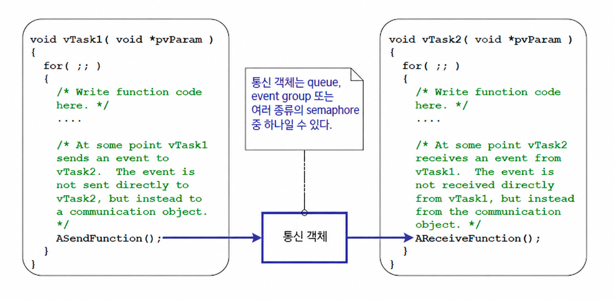
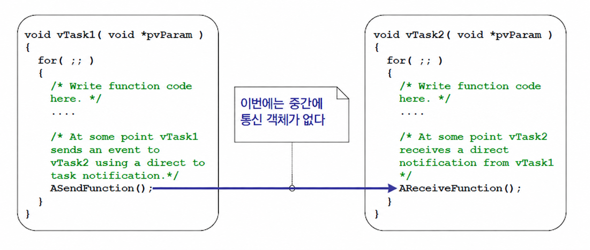
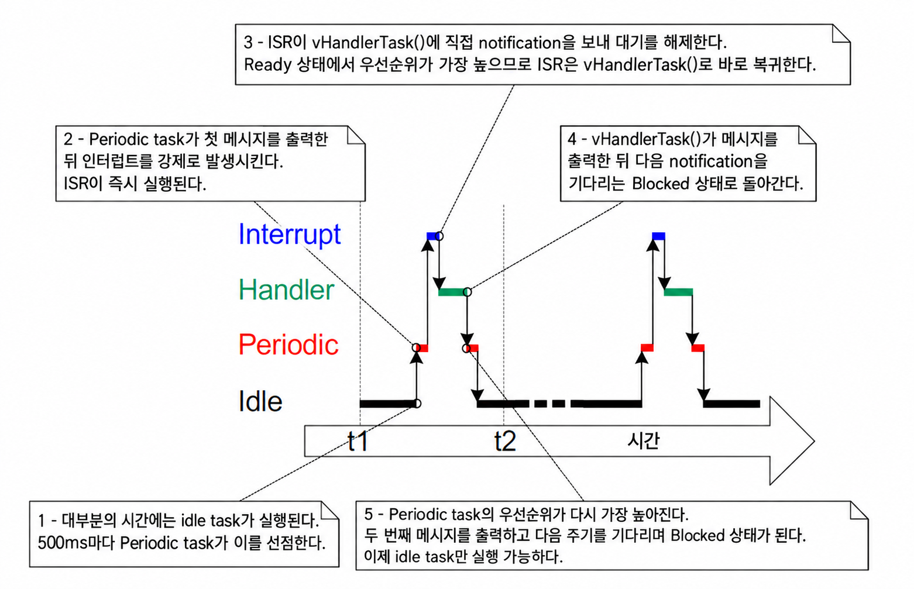
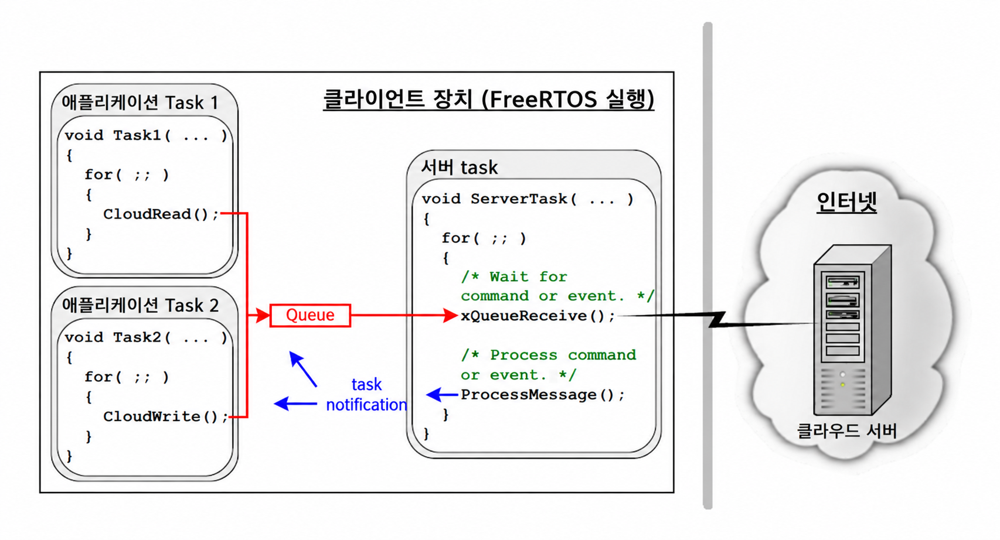

<a id="10-task-notifications"></a>
# 10 태스크 알림 (Task Notifications)

<a id="101-introduction"></a>
## 10.1 개요 (Introduction)

FreeRTOS 애플리케이션은 일반적으로 시스템 기능을 공동으로 제공하기 위해 서로 통신하는 일련의 독립적인 task(태스크)들로 구성된다. task notification(태스크 알림)은 한 task가 다른 task에 직접 알림을 보낼 수 있도록 하는 효율적인 메커니즘이다.

<a id="1011-communicating-through-intermediary-objects"></a>
### 10.1.1 중개 객체를 통한 통신 (Communicating Through Intermediary Objects)

이 책에서는 이미 task들이 서로 통신할 수 있는 다양한 방법들을 설명하였다. 지금까지 설명한 방법들은 통신 객체(communication object)의 생성을 필요로 했다. 통신 객체의 예로는 queue(큐), event group(이벤트 그룹), 다양한 종류의 semaphore(세마포어) 등이 있다.

통신 객체를 사용할 때는 이벤트와 데이터가 수신 task나 수신 ISR로 직접 전송되지 않고 대신 통신 객체로 전송된다. 마찬가지로 task와 ISR은 이벤트나 데이터를 전송한 task나 ISR로부터 직접 수신하지 않고 통신 객체로부터 수신한다. 이는 그림 10.1에 묘사되어 있다.

<a name="fig10.1" title="Figure 10.1 A communication object being used to send an event from one task to another"></a>

* * *


***그림 10.1*** *통신 객체를 사용하여 한 task에서 다른 task로 이벤트 전달*

* * *

<a id="1012-task-notificationsdirect-to-task-communication"></a>
### 10.1.2 태스크 알림 - 태스크 직접 통신 (Task Notifications—Direct to Task Communication)

'task notification(태스크 알림)'을 사용하면 별도의 통신 객체 없이도 task가 다른 task와 상호 작용하고 ISR과 동기화할 수 있다. task notification을 사용하면 task나 ISR이 수신 task에 직접 이벤트를 보낼 수 있다. 이는 그림 10.2에 묘사되어 있다.

<a name="fig10.2" title="Figure 10.2 A task notification used to send an event directly from one task to another"></a>

* * *


***그림 10.2*** *task notification을 사용하여 한 task에서 다른 task로 이벤트 직접 전달*

* * *

task notification 기능은 선택 사항이다. task notification 기능을 포함하려면 FreeRTOSConfig.h에서 `configUSE_TASK_NOTIFICATIONS`를 1로 설정한다.

`configUSE_TASK_NOTIFICATIONS`가 1로 설정되면 각 task는 'Pending(대기 중)' 또는 'Not-Pending(대기 중 아님)' 상태를 가질 수 있는 최소 하나의 '알림 상태(Notification State)'와 32비트 부호 없는 정수인 '알림 값(Notification Value)'을 갖는다. task가 알림을 받으면 알림 상태가 Pending으로 설정된다. task가 알림 값을 읽으면 알림 상태가 Not-Pending으로 설정된다. 만약 `configTASK_NOTIFICATION_ARRAY_ENTRIES`가 1보다 큰 값으로 설정되면 인덱스로 식별되는 여러 개의 알림 상태와 알림 값을 갖게 된다.

task는 알림 상태가 Pending이 될 때까지 선택적 타임아웃과 함께 Blocked 상태에서 대기할 수 있다.

<a id="1013-scope"></a>
### 10.1.3 학습 범위 (Scope)

이 장에서는 다음 내용을 다룬다:

- task의 알림 상태와 알림 값.
- semaphore와 같은 통신 객체 대신 task notification을 사용하는 방법과 적절한 시점.
- 통신 객체 대신 task notification을 사용할 때의 이점.

<a id="102-task-notifications-benefits-and-limitations"></a>
## 10.2 태스크 알림의 장점과 한계 (Task Notifications; Benefits and Limitations)

<a id="1021-performance-benefits-of-task-notifications"></a>
### 10.2.1 태스크 알림의 성능상 이점 (Performance Benefits of Task Notifications)

task notification을 사용하여 task에 이벤트나 데이터를 전송하는 것은 동일한 작업을 수행하기 위해 queue, semaphore 또는 event group을 사용하는 것보다 훨씬 빠르다.

<a id="1022-ram-footprint-benefits-of-task-notifications"></a>
### 10.2.2 태스크 알림의 RAM 사용량 이점 (RAM Footprint Benefits of Task Notifications)

마찬가지로 task notification을 사용하여 task에 이벤트나 데이터를 전송하면 동일한 작업을 수행하기 위해 queue, semaphore 또는 event group을 사용하는 것보다 훨씬 적은 RAM을 필요로 한다. 이는 각 통신 객체(queue, semaphore, event group)는 사용하기 전에 먼저 생성되어야 하는 반면, task notification 기능 활성화에는 고정된 오버헤드만 발생하기 때문이다. task notification의 RAM 비용은 task당 `configTASK_NOTIFICATION_ARRAY_ENTRIES` * 5바이트이다. `configTASK_NOTIFICATION_ARRAY_ENTRIES`의 기본값은 1이므로 task notification의 기본 크기는 task당 5바이트이다.

<a id="1023-limitations-of-task-notifications"></a>
### 10.2.3 태스크 알림의 한계 (Limitations of Task Notifications)

task notification은 통신 객체보다 빠르고 적은 RAM을 사용하지만 모든 시나리오에서 사용할 수 있는 것은 아니다. 이 절에서는 task notification을 사용할 수 없는 시나리오를 설명한다:

- ISR로 이벤트 또는 데이터 전송

  통신 객체는 ISR에서 task로, 그리고 task에서 ISR로 이벤트와 데이터를 전송하는 데 사용될 수 있다.

  task notification은 ISR에서 task로 이벤트와 데이터를 전송하는 데 사용할 수 있지만, task에서 ISR로 이벤트나 데이터를 전송하는 데는 사용할 수 없다.

- 둘 이상의 수신 task 지원

  통신 객체는 핸들(queue 핸들, semaphore 핸들, event group 핸들 등)을 알고 있는 모든 task나 ISR에서 접근할 수 있다. 원하는 수만큼의 task와 ISR이 특정 통신 객체로 전송된 이벤트나 데이터를 처리할 수 있다.

  task notification은 수신 task로 직접 전송되므로 알림을 받은 task에서만 처리될 수 있다. 그러나 실제 응용에서는 동일한 통신 객체에 여러 task와 ISR이 전송하는 경우는 흔하지만, 동일한 통신 객체로부터 여러 task와 ISR이 수신하는 경우는 드물기 때문에 이는 거의 한계가 되지 않는다.

- 여러 데이터 항목 버퍼링

  queue는 한 번에 둘 이상의 데이터 항목을 보유할 수 있는 통신 객체이다. queue로 전송되었지만 아직 queue에서 수신되지 않은 데이터는 queue 객체 내부에 버퍼링된다.

  task notification은 수신 task의 알림 값을 업데이트하여 task에 데이터를 전송한다. task의 알림 값은 한 번에 하나의 값만 보유할 수 있다.

- 둘 이상의 task로 브로드캐스트

  event group은 한 번에 둘 이상의 task로 이벤트를 전송하는 데 사용할 수 있는 통신 객체이다.

  task notification은 수신 task로 직접 전송되므로 수신 task에 의해서만 처리될 수 있다.

- 전송 완료를 기다리기 위해 Blocked 상태에서 대기

  통신 객체가 일시적으로 더 이상 데이터나 이벤트를 쓸 수 없는 상태인 경우(예: queue가 가득 차서 더 이상 데이터를 전송할 수 없는 경우), 해당 객체에 쓰기를 시도하는 task는 쓰기 작업이 완료되기를 기다리기 위해 선택적으로 Blocked 상태로 진입할 수 있다.

  이미 알림이 대기 중인(pending) task에 task notification 전송을 시도하는 경우, 전송 task가 수신 task의 알림 상태 초기화를 기다리며 Blocked 상태로 대기하는 것은 불가능하다. 나중에 살펴보겠지만 이는 task notification이 사용되는 실제 사례에서 거의 한계가 되지 않는다.

<a id="103-using-task-notifications"></a>
## 10.3 태스크 알림 사용법 (Using Task Notifications)

<a id="1031-task-notification-api-options"></a>
### 10.3.1 태스크 알림 API 옵션 (Task Notification API Options)

task notification은 binary semaphore(이진 세마포어), counting semaphore(계수 세마포어), event group, 때로는 queue 대신 사용할 수 있는 매우 강력한 기능이다. 이러한 광범위한 사용 시나리오는 task notification을 보내는 `xTaskNotify()` API 함수와 task notification을 수신하는 `xTaskNotifyWait()` API 함수를 사용하여 달성할 수 있다.

그러나 대부분의 경우 `xTaskNotify()` 및 `xTaskNotifyWait()` API 함수가 제공하는 완전한 유연성이 모두 필요하지는 않으며 더 단순한 함수로도 충분하다. 따라서 `xTaskNotify()`의 더 간단하지만 덜 유연한 대안으로 `xTaskNotifyGive()` API 함수가 제공되고, `xTaskNotifyWait()`의 더 간단하지만 덜 유연한 대안으로 `ulTaskNotifyTake()` API 함수가 제공된다.

task notification 시스템은 단일 알림 이벤트에 국한되지 않는다. 설정 매개변수 `configTASK_NOTIFICATION_ARRAY_ENTRIES`는 기본적으로 1로 설정되어 있다. 1보다 큰 값으로 설정하면 각 task 내에 알림 배열이 생성된다. 이를 통해 인덱스별로 알림을 관리할 수 있다. 모든 task notification API 함수에는 인덱스 지원 버전이 있다. 인덱스가 없는 버전을 사용하면 `notification[0]`(배열의 첫 번째 항목)에 접근하게 된다. 각 API 함수의 인덱스 지원 버전은 `Indexed` 접미사로 식별되므로 `xTaskNotify` 함수는 `xTaskNotifyIndexed`가 된다. 단순화를 위해 이 책 전반에서는 각 함수의 비인덱스(non-indexed) 버전만 사용할 것이다.

task notification API는 각 API 함수 타입의 기본 `Generic` 버전을 호출하는 매크로로 구현되어 있다. 단순화를 위해 이 책 전반에서는 API 매크로를 함수라고 부른다.

<a id="10311-the-complete-list-of-api-functions-sup27sup"></a>
#### 10.3.1.1 API 함수 전체 목록 <sup>27</sup> (The complete list of API functions <sup>27</sup>)

- `xTaskNotifyGive`
- `xTaskNotifyGiveIndexed`
- `vTaskNotifyGiveFromISR`
- `vTaskNotifyGiveIndexedFromISR`
- `vTaskNotifyTake`
- `vTaskNotifyTakeIndexed`
- `xTaskNotify`
- `xTaskNotifyIndexed`
- `xTaskNotifyWait`
- `xTaskNotifyWaitIndexed`
- `xTaskNotifyStateClear`
- `xTaskNotifyStateClearIndexed`
- `ulTaskNotifyValueClear`
- `ulTaskNotifyValueClearIndexed`
- `xTaskNotifyAndQueryIndexedFromISR`
- `xTaskNotifyAndQueryFromISR`
- `xTaskNotifyFromISR`
- `xTaskNotifyIndexedFromISR`
- `xTaskNotifyAndQuery`
- `xTaskNotifyAndQueryIndexed`

*(27): 이 함수들은 실제로는 매크로로 구현되어 있다.*

> 참고: 알림은 항상 task로 전송되고 인터럽트는 어떤 task와도 연관되지 않으므로 알림 수신을 위한 `FromISR` 함수는 존재하지 않는다.

<a id="1032-the-xtasknotifygive-api-functions"></a>
### 10.3.2 xTaskNotifyGive() API 함수 (The xTaskNotifyGive() API Functions)

`xTaskNotifyGive()`는 task로 알림을 직접 전송하고 수신 task의 알림 값을 1 증가(add one)시킨다. `xTaskNotifyGive()`를 호출하면 수신 task의 알림 상태가 아직 pending이 아니었던 경우 pending으로 설정된다.

`xTaskNotifyGive()` API 함수는 binary semaphore 또는 counting semaphore 대신 더 가볍고 빠른 대안으로 task notification을 사용할 수 있도록 제공된다.

<a name="list10.1" title="Listing 10.1 The xTaskNotifyGive() API function prototype"></a>

```c
BaseType_t xTaskNotifyGive( TaskHandle_t xTaskToNotify );
BaseType_t xTaskNotifyGiveIndexed( TaskHandle_t xTaskToNotify, UBaseType_t uxIndexToNotify );
```

***코드 10.1*** *xTaskNotifyGive() API 함수 원형*

**xTaskNotifyGive()/xTaskNotifyGiveIndexed() 매개변수 및 반환 값**

- `xTaskToNotify`

  알림을 보낼 대상 task의 핸들이다. task 핸들을 얻는 방법은 `xTaskCreate()` API 함수의 `pxCreatedTask` 매개변수를 참조한다.

- `uxIndexToNotify`

  배열 내의 인덱스이다.

- 반환 값 (Return value)

  `xTaskNotifyGive()`는 `xTaskNotify()`를 호출하는 매크로이다. 매크로에 의해 `xTaskNotify()`에 전달되는 매개변수들은 `pdPASS`만이 유일한 반환 값이 되도록 설정된다. `xTaskNotify()`는 이 책의 뒷부분에서 설명한다.

<a id="1033-the-vtasknotifygivefromisr-api-function"></a>
### 10.3.3 vTaskNotifyGiveFromISR() API 함수 (The vTaskNotifyGiveFromISR() API Function)

`vTaskNotifyGiveFromISR()`은 인터럽트 서비스 루틴에서 사용할 수 있는 `xTaskNotifyGive()`의 버전이다.

<a name="list10.2" title="Listing 10.2 The vTaskNotifyGiveFromISR() API function prototype"></a>

```c
void vTaskNotifyGiveFromISR( TaskHandle_t xTaskToNotify,
                             BaseType_t *pxHigherPriorityTaskWoken );
```

***코드 10.2*** *vTaskNotifyGiveFromISR() API 함수 원형*

**vTaskNotifyGiveFromISR() 매개변수 및 반환 값**

- `xTaskToNotify`

  알림을 보낼 대상 task의 핸들이다. task 핸들을 얻는 방법은 `xTaskCreate()` API 함수의 `pxCreatedTask` 매개변수를 참조한다.

- `pxHigherPriorityTaskWoken`

  알림을 받는 task가 알림 수신을 기다리며 Blocked 상태에 머물러 있는 경우, 알림을 전송하면 해당 task가 Blocked 상태를 벗어나게 된다.

  `vTaskNotifyGiveFromISR()` 호출로 인해 task가 Blocked 상태를 벗어나고, 블록 해제된 task의 우선순위가 현재 실행 중인 task(인터럽트가 걸린 task)의 우선순위보다 높으면 내부적으로 `vTaskNotifyGiveFromISR()`은 `*pxHigherPriorityTaskWoken`을 `pdTRUE`로 설정한다.

  `vTaskNotifyGiveFromISR()`이 이 값을 `pdTRUE`로 설정한 경우 인터럽트가 종료되기 전에 문맥 전환을 수행해야 한다. 이렇게 하면 인터럽트가 가장 높은 우선순위의 Ready 상태 task로 직접 복귀하도록 보장된다.

  모든 인터럽트 안전 API 함수와 마찬가지로 `pxHigherPriorityTaskWoken` 매개변수는 사용하기 전에 반드시 `pdFALSE`로 초기화되어야 한다.

<a id="1034-the-ultasknotifytake-api-function"></a>
### 10.3.4 ulTaskNotifyTake() API 함수 (The ulTaskNotifyTake() API Function)

`ulTaskNotifyTake()`를 사용하면 task가 자신의 알림 값이 0보다 커질 때까지 Blocked 상태에서 기다릴 수 있으며, 함수가 반환되기 전에 task의 알림 값을 1 감소(decrement)시키거나 0으로 클리어한다.

`ulTaskNotifyTake()` API 함수는 binary semaphore 또는 counting semaphore 대신 더 가볍고 빠른 대안으로 task notification을 사용할 수 있도록 제공된다.

<a name="list10.3" title="Listing 10.3 The ulTaskNotifyTake() API function prototype"></a>

```c
uint32_t ulTaskNotifyTake( BaseType_t xClearCountOnExit, TickType_t
xTicksToWait );
```

***코드 10.3*** *ulTaskNotifyTake() API 함수 원형*

**ulTaskNotifyTake() 매개변수 및 반환 값**

- `xClearCountOnExit`

  `xClearCountOnExit`가 `pdTRUE`로 설정되면 `ulTaskNotifyTake()` 호출이 반환되기 전에 호출 task의 알림 값이 0으로 클리어된다.

  `xClearCountOnExit`가 `pdFALSE`로 설정되고 호출 task의 알림 값이 0보다 큰 경우, `ulTaskNotifyTake()` 호출이 반환되기 전에 호출 task의 알림 값이 1 감소한다.

- `xTicksToWait`

  호출 task가 자신의 알림 값이 0보다 커지기를 기다리며 Blocked 상태에 머물러야 하는 최대 시간이다.

  최대 대기 시간은 tick(틱) 주기로 지정되므로 절대 시간은 tick rate(초당 tick 수)에 따라 달라진다. `pdMS_TO_TICKS()` 매크로를 사용하여 밀리초 단위로 지정된 시간을 tick 단위 시간으로 변환할 수 있다.

  `FreeRTOSConfig.h`에서 `INCLUDE_vTaskSuspend`가 1로 설정되어 있는 경우, `xTicksToWait`를 `portMAX_DELAY`로 설정하면 task가 타임아웃 없이 무한정 대기한다.

- 반환 값 (Return value)

  반환 값은 `xClearCountOnExit` 매개변수 값에 따라 0으로 클리어되거나 1 감소하기 *전*의 호출 task notification 값이다.

  최대 대기 시간이 지정되었고(`xTicksToWait`가 0이 아님) 반환 값이 0이 아닌 경우, 호출 task가 알림 값이 0보다 커지기를 기다리기 위해 Blocked 상태에 진입했으며 최대 대기 시간이 만료되기 전에 알림 값이 업데이트되었을 가능성이 있다.

  최대 대기 시간이 지정되었고(`xTicksToWait`가 0이 아님) 반환 값이 0인 경우, 호출 task가 알림 값이 0보다 커지기를 기다리기 위해 Blocked 상태에 진입했지만 그전에 지정된 최대 대기 시간이 만료되었음을 의미한다.

<a name="example10.1" title="Example 10.1 Using a task notification in place of a semaphore, method 1"></a>
---
***예제 10.1*** *semaphore 대신 task notification 사용 - 방법 1*

---

예제 7.1에서는 인터럽트 서비스 루틴 내에서 task의 블록을 해제하기 위해 binary semaphore를 사용함으로써 task를 인터럽트와 실질적으로 동기화했다. 이 예제는 예제 7.1의 기능을 재현하지만, binary semaphore 대신 task 직접 알림을 사용한다.

코드 10.4는 인터럽트와 동기화되는 task의 구현을 보여준다. 예제 7.1에서 사용되었던 `xSemaphoreTake()` 호출이 `ulTaskNotifyTake()` 호출로 대체되었다.

`ulTaskNotifyTake()`의 `xClearCountOnExit` 매개변수가 `pdTRUE`로 설정되어 있으므로 `ulTaskNotifyTake()`가 반환되기 전에 수신 task의 알림 값이 0으로 클리어된다. 따라서 `ulTaskNotifyTake()` 호출 사이에 이미 사용 가능해진 모든 이벤트를 한 번에 처리해야 한다. 예제 7.1에서는 binary semaphore를 사용했기 때문에 대기 중인 이벤트 수를 하드웨어로부터 확인해야 했으며, 이는 항상 실용적인 것은 아니다. 반면 예제 10.1에서는 대기 중인 이벤트 수가 `ulTaskNotifyTake()`에서 반환된다.

`ulTaskNotifyTake` 호출 사이에 발생하는 인터럽트 이벤트는 task의 알림 값에 래치(latch)되며, 호출 task에 이미 대기 중인 알림이 있는 경우 `ulTaskNotifyTake()` 호출은 즉시 반환된다.

<a name="list10.4" title="Listing 10.4 The implementation of the task to which the interrupt processing is deferred (the task that..."></a>

```c
/* The rate at which the periodic task generates software interrupts. */
const TickType_t xInterruptFrequency = pdMS_TO_TICKS( 500UL );

static void vHandlerTask( void *pvParameters )
{
    /* xMaxExpectedBlockTime is set to be a little longer than the maximum
       expected time between events. */
    const TickType_t xMaxExpectedBlockTime = xInterruptFrequency +
                                             pdMS_TO_TICKS( 10 );
    uint32_t ulEventsToProcess;

    /* As per most tasks, this task is implemented within an infinite loop. */
    for( ;; )
    {
        /* Wait to receive a notification sent directly to this task from the
           interrupt service routine. */
        ulEventsToProcess = ulTaskNotifyTake( pdTRUE, xMaxExpectedBlockTime );
        if( ulEventsToProcess != 0 )
        {
            /* To get here at least one event must have occurred. Loop here 
               until all the pending events have been processed (in this case,
               just print out a message for each event). */
            while( ulEventsToProcess > 0 )
            {
                vPrintString( "Handler task - Processing event.\r\n" );
                ulEventsToProcess--;
            }
        }
        else
        {
            /* If this part of the function is reached then an interrupt did 
               not arrive within the expected time, and (in a real application)
               it may be necessary to perform some error recovery operations. */
        }
    }
}
```

***코드 10.4*** *예제 10.1에서 인터럽트와 동기화하여 처리를 넘겨받는 task 구현*

소프트웨어 인터럽트를 생성하는 데 사용되는 주기적 task는 인터럽트가 생성되기 전과 인터럽트가 생성된 후에 메시지를 출력한다. 이를 통해 생성된 출력에서 실행 순서를 확인할 수 있다.

코드 10.5는 인터럽트 핸들러를 보여준다. 이 핸들러는 인터럽트 처리가 지연 위임된 task에 직접 알림을 보내는 것 외에는 거의 아무 작업도 수행하지 않는다.

<a name="list10.5" title="Listing 10.5 The implementation of the interrupt service routine used in Example 10.1"></a>

```c
static uint32_t ulExampleInterruptHandler( void )
{
    BaseType_t xHigherPriorityTaskWoken;

    /* The xHigherPriorityTaskWoken parameter must be initialized to pdFALSE as
       it will get set to pdTRUE inside the interrupt safe API function if a
       context switch is required. */
    xHigherPriorityTaskWoken = pdFALSE;

    /* Send a notification directly to the task to which interrupt processing 
       is being deferred. */
    vTaskNotifyGiveFromISR( /* The handle of the task to which the notification
                               is being sent. The handle was saved when the task
                               was created. */
                            xHandlerTask,

                            /* xHigherPriorityTaskWoken is used in the usual 
                               way. */
                            &xHigherPriorityTaskWoken );

    /* Pass the xHigherPriorityTaskWoken value into portYIELD_FROM_ISR(). If 
       xHigherPriorityTaskWoken was set to pdTRUE inside vTaskNotifyGiveFromISR()
       then calling portYIELD_FROM_ISR() will request a context switch. If
       xHigherPriorityTaskWoken is still pdFALSE then calling 
       portYIELD_FROM_ISR() will have no effect. The implementation of
       portYIELD_FROM_ISR() used by the Windows port includes a return statement,
       which is why this function does not explicitly return a value. */
    portYIELD_FROM_ISR( xHigherPriorityTaskWoken );
}
```

***코드 10.5*** *예제 10.1의 ISR 구현*

예제 10.1을 실행했을 때 생성되는 출력이 그림 10.3에 나와 있다. 예상대로 예제 7.1을 실행했을 때 생성된 출력과 동일하다. `vHandlerTask()`는 인터럽트가 생성되는 즉시 Running 상태로 진입하므로 task의 출력이 주기적 task에서 생성된 출력을 분할한다. 추가적인 설명은 그림 10.4에 제공되어 있다.

<a name="fig10.3" title="Figure 10.3 The output produced when Example 7.1 is executed"></a>
<a name="fig10.4" title="Figure 10.4 The sequence of execution when Example 10.1 is executed"></a>

* * *


***그림 10.3*** *예제 7.1의 실행 출력*



***그림 10.4*** *예제 10.1의 실행 순서*

* * *

> [옮긴이 주] 원문 그림 설명의 예제 번호 7.1을 유지했다. 이 절의 task notification 사용 예제는 10.1이다. [원문 대조 사항 N08](SOURCE_NOTES.md#n08).

<a name="example10.2" title="Example 10.2 Using a task notification in place of a semaphore, method 2"></a>
---
***예제 10.2*** *semaphore 대신 task notification 사용 - 방법 2*

---

예제 10.1에서는 `ulTaskNotifyTake()`의 `xClearOnExit` 매개변수가 `pdTRUE`로 설정되었다. 예제 10.2에서는 예제 10.1을 약간 수정하여 `ulTaskNotifyTake()`의 `xClearOnExit` 매개변수가 `pdFALSE`로 설정되었을 때의 동작을 보여준다.

`xClearOnExit`가 `pdFALSE`일 때 `ulTaskNotifyTake()`를 호출하면 호출 task의 알림 값을 0으로 클리어하는 대신 1 감소(reduce by one)시키기만 한다. 따라서 알림 카운트는 발생한 이벤트 수와 처리된 이벤트 수 간의 차이가 된다. 이를 통해 `vHandlerTask()`의 구조를 두 가지 방식으로 단순화할 수 있다:

1. 처리를 대기 중인 이벤트 수가 알림 값에 유지되므로 로컬 변수에 보관할 필요가 없다.

2. `ulTaskNotifyTake()` 호출 사이에 단 하나의 이벤트만 처리하면 된다.

예제 10.2에 사용된 `vHandlerTask()`의 구현은 코드 10.6에 나와 있다.

<a name="list10.6" title="Listing 10.6 The implementation of the task to which the interrupt processing is deferred (the task..."></a>

```c
static void vHandlerTask( void *pvParameters )
{
    /* xMaxExpectedBlockTime is set to be a little longer than the maximum 
       expected time between events. */
    const TickType_t xMaxExpectedBlockTime = xInterruptFrequency + 
                                             pdMS_TO_TICKS( 10 );

    /* As per most tasks, this task is implemented within an infinite loop. */
    for( ;; )
    {
        /* Wait to receive a notification sent directly to this task from the
           interrupt service routine. The xClearCountOnExit parameter is now
           pdFALSE, so the task's notification value will be decremented by
           ulTaskNotifyTake(), and not cleared to zero. */
        if( ulTaskNotifyTake( pdFALSE, xMaxExpectedBlockTime ) != 0 )
        {
            /* To get here an event must have occurred. Process the event (in 
               this case just print out a message). */
            vPrintString( "Handler task - Processing event.\r\n" );
        }
        else
        {
            /* If this part of the function is reached then an interrupt did 
               not arrive within the expected time, and (in a real application)
               it may be necessary to perform some error recovery operations. */
        }
    }
}
```

***코드 10.6*** *예제 10.2에서 인터럽트와 동기화하여 처리를 넘겨받는 task 구현*

시연 목적을 위해 인터럽트 서비스 루틴도 인터럽트당 둘 이상의 task notification을 보내도록 수정되었으며, 이를 통해 높은 빈도로 발생하는 여러 인터럽트를 시뮬레이션한다. 예제 10.2에 사용된 인터럽트 서비스 루틴의 구현은 코드 10.7에 나와 있다.

<a name="list10.7" title="Listing 10.7 The implementation of the interrupt service routine used in Example 10.2"></a>

```c
static uint32_t ulExampleInterruptHandler( void )
{
    BaseType_t xHigherPriorityTaskWoken;

    xHigherPriorityTaskWoken = pdFALSE;

    /* Send a notification to the handler task multiple times. The first
       'give' will unblock the task, the following 'gives' are to demonstrate 
       that the receiving task's notification value is being used to count 
       (latch) events - allowing the task to process each event in turn. */
    vTaskNotifyGiveFromISR( xHandlerTask, &xHigherPriorityTaskWoken );
    vTaskNotifyGiveFromISR( xHandlerTask, &xHigherPriorityTaskWoken );
    vTaskNotifyGiveFromISR( xHandlerTask, &xHigherPriorityTaskWoken );

    portYIELD_FROM_ISR( xHigherPriorityTaskWoken );
}
```

***코드 10.7*** *예제 10.2의 ISR 구현*

예제 10.2를 실행했을 때 생성되는 출력이 그림 10.5에 나와 있다. 볼 수 있듯이 인터럽트가 생성될 때마다 `vHandlerTask()`가 세 이벤트를 모두 처리한다.

<a name="fig10.5" title="Figure 10.5 The output produced when Example 10.2 is executed"></a>

* * *


***그림 10.5*** *예제 10.2의 실행 출력*

* * *

<a id="1035-the-xtasknotify-and-xtasknotifyfromisr-api-functions"></a>
### 10.3.5 xTaskNotify() 및 xTaskNotifyFromISR() API 함수 (The xTaskNotify() and xTaskNotifyFromISR() API Functions)

`xTaskNotify()`는 수신 task의 알림 값을 다음과 같은 방식 중 하나로 업데이트할 수 있는 더 강력한 버전의 `xTaskNotifyGive()`이다:

- 수신 task의 알림 값을 1 증가(add one)시킨다. 이 경우 `xTaskNotify()`는 `xTaskNotifyGive()`와 동일하다.

- 수신 task의 알림 값에서 하나 이상의 비트를 설정한다. 이를 통해 task의 알림 값을 event group 대신 더 가볍고 빠른 대안으로 사용할 수 있다.

- 수신 task가 마지막으로 업데이트된 이후 자신의 알림 값을 이미 읽은 경우에만 수신 task의 알림 값에 완전히 새로운 숫자를 쓴다. 이를 통해 task의 알림 값이 길이가 1인 queue에서 제공하는 것과 유사한 기능을 제공할 수 있다.

- 수신 task가 마지막으로 업데이트된 이후 자신의 알림 값을 읽었는지 여부에 관계없이 수신 task의 알림 값에 완전히 새로운 숫자를 쓴다. 이를 통해 task의 알림 값이 `xQueueOverwrite()` API 함수에서 제공하는 것과 유사한 기능을 제공할 수 있다. 결과 동작은 때때로 'mailbox(메일박스)'라고 불린다.

`xTaskNotify()`는 `xTaskNotifyGive()`보다 더 유연하고 강력하며, 이러한 추가적인 유연성과 강력함 때문에 사용법도 약간 더 복잡하다.

`xTaskNotifyFromISR()`은 인터럽트 서비스 루틴에서 사용할 수 있는 `xTaskNotify()`의 버전이므로 추가적인 `pxHigherPriorityTaskWoken` 매개변수를 갖는다.

`xTaskNotify()`를 호출하면 수신 task의 알림 상태가 아직 pending이 아니었던 경우 항상 pending으로 설정된다.

<a name="list10.8" title="Listing 10.8 Prototypes for the xTaskNotify() and xTaskNotifyFromISR() API functions"></a>

```c
BaseType_t xTaskNotify( TaskHandle_t xTaskToNotify,
                        uint32_t ulValue,
                        eNotifyAction eAction );

BaseType_t xTaskNotifyFromISR( TaskHandle_t xTaskToNotify,
                               uint32_t ulValue,
                               eNotifyAction eAction,
                               BaseType_t *pxHigherPriorityTaskWoken );
```

***코드 10.8*** *xTaskNotify() 및 xTaskNotifyFromISR() API 함수 원형*

**xTaskNotify() 매개변수 및 반환 값**

- `xTaskToNotify`

  알림을 보낼 대상 task의 핸들이다. task 핸들을 얻는 방법은 `xTaskCreate()` API 함수의 `pxCreatedTask` 매개변수를 참조한다.

- `ulValue`

  `ulValue`가 어떻게 사용되는지는 `eNotifyAction` 값에 따라 달라진다. 아래 내용을 참조한다.

- `eNotifyAction`

  수신 task의 알림 값을 업데이트하는 방법을 지정하는 열거형 타입이다. 아래 내용을 참조한다.

- 반환 값 (Return value)

  `xTaskNotify()`는 아래에 명시된 단 하나의 경우를 *제외하고는* `pdPASS`를 반환한다.

**유효한 xTaskNotify() eNotifyAction 매개변수 값 및 수신 task의 알림 값에 미치는 영향**

- `eNoAction`

  수신 task의 알림 값이 업데이트되지 않고 알림 상태만 pending으로 설정된다. `xTaskNotify()`의 `ulValue` 매개변수는 사용되지 않는다.

  `eNoAction` 동작을 사용하면 task notification을 binary semaphore 대신 더 빠르고 가벼운 대안으로 사용할 수 있다.

- `eSetBits`

  수신 task의 알림 값이 `xTaskNotify()`의 `ulValue` 매개변수에 전달된 값과 비트 단위 OR 연산된다. 예를 들어 `ulValue`가 0x01로 설정되면 수신 task의 알림 값에서 비트 0이 설정된다. 또 다른 예로 `ulValue`가 0x06(이진수 0110)이면 수신 task의 알림 값에서 비트 1과 비트 2가 설정된다.

  `eSetBits` 동작을 사용하면 task notification을 event group 대신 더 빠르고 가벼운 대안으로 사용할 수 있다.

- `eIncrement`

  수신 task의 알림 값이 1 증가한다. `xTaskNotify()`의 `ulValue` 매개변수는 사용되지 않는다.

  `eIncrement` 동작을 사용하면 task notification을 binary semaphore 또는 counting semaphore 대신 더 빠르고 가벼운 대안으로 사용할 수 있으며, 더 간단한 `xTaskNotifyGive()` API 함수와 동일하다.

- `eSetValueWithoutOverwrite`

  `xTaskNotify()`가 호출되기 전에 수신 task에 이미 대기 중인 알림이 있었다면 아무런 동작도 수행되지 않으며 `xTaskNotify()`는 `pdFAIL`을 반환한다.

  `xTaskNotify()`가 호출되기 전에 수신 task에 대기 중인 알림이 없었다면 수신 task의 알림 값은 `xTaskNotify()`의 `ulValue` 매개변수에 전달된 값으로 설정된다.

- `eSetValueWithOverwrite`

  `xTaskNotify()`가 호출되기 전에 수신 task에 대기 중인 알림이 있었는지 여부에 관계없이 수신 task의 알림 값이 `xTaskNotify()`의 `ulValue` 매개변수에 전달된 값으로 설정된다.

<a id="1036-the-xtasknotifywait-api-function"></a>
### 10.3.6 xTaskNotifyWait() API 함수 (The xTaskNotifyWait() API Function)

`xTaskNotifyWait()`는 `ulTaskNotifyTake()`의 더 강력한 버전이다. 이 함수를 사용하면 호출 task의 알림 상태가 아직 pending이 아닌 경우 선택적 타임아웃과 함께 pending이 될 때까지 기다릴 수 있다. `xTaskNotifyWait()`는 함수 진입 시와 함수 종료 시 모두 호출 task의 알림 값에서 비트를 클리어할 수 있는 옵션을 제공한다.

<a name="list10.9" title="Listing 10.9 The xTaskNotifyWait() API function prototype"></a>

```c
BaseType_t xTaskNotifyWait( uint32_t   ulBitsToClearOnEntry,
                            uint32_t   ulBitsToClearOnExit,
                            uint32_t   *pulNotificationValue,
                            TickType_t xTicksToWait );
```

***코드 10.9*** *xTaskNotifyWait() API 함수 원형*

**xTaskNotifyWait() 매개변수 및 반환 값**

- `ulBitsToClearOnEntry`

  호출 task가 `xTaskNotifyWait()`를 호출하기 전에 대기 중인 알림이 없었던 경우, `ulBitsToClearOnEntry`에 설정된 모든 비트가 함수 진입 시 task의 알림 값에서 클리어된다.

  예를 들어 `ulBitsToClearOnEntry`가 0x01이면 task의 알림 값의 비트 0이 클리어된다. 또 다른 예로 `ulBitsToClearOnEntry`를 0xffffffff(`ULONG_MAX`)로 설정하면 task의 알림 값의 모든 비트가 클리어되어 사실상 값이 0으로 초기화된다.

- `ulBitsToClearOnExit`

  호출 task가 알림을 수신했거나 `xTaskNotifyWait()`가 호출되었을 때 이미 알림이 대기 중이어서 `xTaskNotifyWait()`를 종료하는 경우, task가 `xTaskNotifyWait()` 함수를 종료하기 전에 `ulBitsToClearOnExit`에 설정된 모든 비트가 task의 알림 값에서 클리어된다.

  비트는 task의 알림 값이 `*pulNotificationValue`에 저장된 후에 클리어된다(아래 `pulNotificationValue` 설명 참조).

  예를 들어 `ulBitsToClearOnExit`가 0x03이면 함수가 종료되기 전에 task의 알림 값의 비트 0과 비트 1이 클리어된다.

  `ulBitsToClearOnExit`를 0xffffffff(`ULONG_MAX`)로 설정하면 task의 알림 값의 모든 비트가 클리어되어 사실상 값이 0으로 초기화된다.

- `pulNotificationValue`

  task의 알림 값을 외부로 전달하는 데 사용된다. `*pulNotificationValue`로 복사되는 값은 `ulBitsToClearOnExit` 설정으로 인해 비트가 클리어되기 전의 task notification 값이다.

  `pulNotificationValue`는 선택적 매개변수이며 필요하지 않은 경우 NULL로 설정할 수 있다.

- `xTicksToWait`

  호출 task가 자신의 알림 상태가 pending이 되기를 기다리며 Blocked 상태에 머물러야 하는 최대 시간이다.

  최대 대기 시간은 tick 주기로 지정되므로 절대 시간은 tick rate에 따라 달라진다. `pdMS_TO_TICKS()` 매크로를 사용하여 밀리초 단위로 지정된 시간을 tick 단위 시간으로 변환할 수 있다.

  `FreeRTOSConfig.h`에서 `INCLUDE_vTaskSuspend`가 1로 설정되어 있는 경우, `xTicksToWait`를 `portMAX_DELAY`로 설정하면 task가 타임아웃 없이 무한정 대기한다.

- 반환 값 (Return value)

  두 가지 가능한 반환 값이 있다:

  - `pdTRUE`

    알림을 수신했거나 `xTaskNotifyWait()`가 호출되었을 때 호출 task에 이미 대기 중인 알림이 있어 `xTaskNotifyWait()`가 반환되었음을 나타낸다.

    최대 대기 시간이 지정되었던 경우(`xTicksToWait`가 0이 아님), 호출 task가 알림 상태가 pending이 되기를 기다리기 위해 Blocked 상태에 진입했지만 최대 대기 시간이 만료되기 전에 알림 상태가 pending으로 설정되었을 수 있다.

  - `pdFALSE`

    호출 task가 task notification을 수신하지 못한 채 `xTaskNotifyWait()`가 반환되었음을 나타낸다.

    `xTicksToWait`가 0이 아니었던 경우 호출 task는 알림 상태가 pending이 되기를 기다리며 Blocked 상태에 머물렀지만, 그전에 지정된 최대 대기 시간이 만료되었음을 의미한다.

<a id="1037-task-notifications-used-in-peripheral-device-drivers-uart-example"></a>
### 10.3.7 주변장치 드라이버에서의 태스크 알림 활용: UART 예제 (Task Notifications Used in Peripheral Device Drivers: UART Example)

주변장치 드라이버 라이브러리는 하드웨어 인터페이스에서 공통적인 작업을 수행하는 함수들을 제공한다. 이러한 라이브러리가 흔히 제공되는 주변장치의 예로는 범용 비동기 송수신기(UART), 직렬 주변장치 인터페이스(SPI) 포트, 아날로그-디지털 변환기(ADC), 이더넷 포트 등이 있다. 이러한 라이브러리에서 일반적으로 제공하는 함수로는 주변장치 초기화, 주변장치로의 데이터 전송, 주변장치로부터의 데이터 수신 함수 등이 있다.

주변장치에 대한 일부 작업은 완료하는 데 비교적 오랜 시간이 걸린다. 이러한 작업의 예로는 고정밀 ADC 변환 및 UART를 통한 대용량 데이터 패킷 전송 등이 있다. 이러한 경우 드라이버 라이브러리 함수는 주변장치의 상태 레지스터를 폴링(반복 읽기)하여 작업이 완료되었는지 확인하도록 구현될 수 있다. 그러나 이러한 방식의 폴링은 생산적인 처리가 수행되지 않는 동안 프로세서 시간의 100%를 차지하므로 거의 항상 낭비적이다. 이러한 낭비는 멀티태스킹 시스템에서 특히 치명적인데, 주변장치를 폴링하는 task로 인해 실제로 수행할 생산적인 작업이 있는 더 낮은 우선순위 task의 실행이 차단될 수 있기 때문이다.

처리 시간의 낭비 가능성을 방지하기 위해 효율적인 RTOS 인식(RTOS aware) 디바이스 드라이버는 인터럽트 구동 방식이어야 하며, 긴 작업을 시작하는 task에게 작업이 완료될 때까지 Blocked 상태에서 대기할 수 있는 옵션을 제공해야 한다. 그렇게 하면 긴 작업을 수행하는 task가 Blocked 상태에 있는 동안 더 낮은 우선순위의 task가 실행될 수 있으며, 생산적으로 사용할 수 없는 한 어떤 task도 처리 시간을 낭비하지 않게 된다.

RTOS 인식 드라이버 라이브러리에서 task를 Blocked 상태로 전환하기 위해 binary semaphore를 사용하는 것은 일반적인 관행이다. 이 기법은 코드 10.10에 표시된 의사 코드로 설명되어 있으며, 이는 UART 포트로 데이터를 전송하는 RTOS 인식 라이브러리 함수의 개요를 제공한다. 코드 10.10에서:

- `xUART`는 UART 주변장치를 설명하고 상태 정보를 유지하는 구조체이다. 구조체의 `xTxSemaphore` 멤버는 `SemaphoreHandle_t` 타입 변수이다. semaphore는 이미 생성되어 있다고 가정한다.

- `xUART_Send()` 함수는 상호 배제(mutual exclusion) 로직을 포함하지 않는다. 둘 이상의 task가 `xUART_Send()` 함수를 사용하려는 경우, 애플리케이션 작성자가 애플리케이션 자체 내에서 상호 배제를 관리해야 한다. 예를 들어 task가 `xUART_Send()`를 호출하기 전에 mutex(뮤텍스)를 획득하도록 요구할 수 있다.

- `xSemaphoreTake()` API 함수는 UART 전송이 시작된 후 호출 task를 Blocked 상태로 전환하는 데 사용된다.

- `xSemaphoreGiveFromISR()` API 함수는 전송이 완료된 후, 즉 UART 주변장치의 전송 종료 인터럽트 서비스 루틴이 실행될 때 task를 Blocked 상태에서 해제하는 데 사용된다.

<a name="list10.10" title="Listing 10.10 Pseudo code demonstrating how a binary semaphore can be used in a driver library transmit..."></a>

```c
/* Driver library function to send data to a UART. */

BaseType_t xUART_Send( xUART *pxUARTInstance, 
                       uint8_t *pucDataSource, 
                       size_t uxLength )
{
    BaseType_t xReturn;

    /* Ensure the UART's transmit semaphore is not already available by 
       attempting to take the semaphore without a timeout. */
    xSemaphoreTake( pxUARTInstance->xTxSemaphore, 0 );

    /* Start the transmission. */
    UART_low_level_send( pxUARTInstance, pucDataSource, uxLength );

    /* Block on the semaphore to wait for the transmission to complete. If 
       the semaphore is obtained then xReturn will get set to pdPASS. If the 
       semaphore take operation times out then xReturn will get set to pdFAIL. 
       Note that, if the interrupt occurs between UART_low_level_send() being 
       called, and xSemaphoreTake() being called, then the event will be 
       latched in the binary semaphore, and the call to xSemaphoreTake() will 
       return immediately. */
    xReturn = xSemaphoreTake( pxUARTInstance->xTxSemaphore, 
                              pxUARTInstance->xTxTimeout );

    return xReturn;
}
/*-----------------------------------------------------------*/

/* The service routine for the UART's transmit end interrupt, which executes 
   after the last byte has been sent to the UART. */
void xUART_TransmitEndISR( xUART *pxUARTInstance )
{
    BaseType_t xHigherPriorityTaskWoken = pdFALSE;

    /* Clear the interrupt. */
    UART_low_level_interrupt_clear( pxUARTInstance );

    /* Give the Tx semaphore to signal the end of the transmission. If a task 
       is Blocked waiting for the semaphore then the task will be removed from
       the Blocked state. */
    xSemaphoreGiveFromISR( pxUARTInstance->xTxSemaphore, 
                           &xHigherPriorityTaskWoken );
    portYIELD_FROM_ISR( xHigherPriorityTaskWoken );
}
```

***코드 10.10*** *드라이버 라이브러리의 송신 함수에서 binary semaphore를 사용하는 방법을 보여주는 의사 코드*

코드 10.10에 설명된 기법은 완벽하게 작동하며 실제로 흔히 사용되는 관행이지만 몇 가지 단점이 있다:

- 라이브러리가 여러 semaphore를 사용하므로 RAM 사용량이 증가한다.

- semaphore는 생성되기 전에는 사용할 수 없으므로, semaphore를 사용하는 라이브러리는 명시적으로 초기화되기 전에는 사용할 수 없다.

- semaphore는 광범위한 사용 사례에 적용할 수 있는 일반적인 객체이다. semaphore에는 semaphore가 사용 가능해지기를 기다리며 원하는 수만큼의 task가 Blocked 상태에서 대기할 수 있도록 하고, semaphore가 사용 가능해졌을 때 Blocked 상태에서 해제할 task를 (결정론적 방식으로) 선택하는 로직이 포함되어 있다. 해당 로직을 실행하는 데는 유한한 시간이 걸리며, 특정 시점에 semaphore를 기다리는 task가 둘 이상 존재할 수 없는 코드 10.10과 같은 시나리오에서는 이러한 처리 오버헤드가 불필요하다.

코드 10.11은 binary semaphore 대신 task notification을 사용하여 이러한 단점을 방지하는 방법을 보여준다.

> *주의: 라이브러리가 task notification을 사용하는 경우, 라이브러리 함수 호출로 인해 호출 task의 알림 상태와 알림 값이 변경될 수 있음을 라이브러리 문서에 명확히 명시해야 한다.*

코드 10.11에서:

- `xUART` 구조체의 `xTxSemaphore` 멤버가 `xTaskToNotify` 멤버로 대체되었다. `xTaskToNotify`는 `TaskHandle_t` 타입 변수이며 UART 작업이 완료되기를 기다리는 task의 핸들을 유지하는 데 사용된다.

- `xTaskGetCurrentTaskHandle()` FreeRTOS API 함수는 Running 상태에 있는 task의 핸들을 얻는 데 사용된다.

- 라이브러리가 FreeRTOS 객체를 생성하지 않으므로 RAM 오버헤드가 발생하지 않으며 명시적으로 초기화할 필요가 없다.

- task notification은 UART 작업 완료를 기다리는 task로 직접 전송되므로 불필요한 로직이 실행되지 않는다.

`xUART` 구조체의 `xTaskToNotify` 멤버는 task와 인터럽트 서비스 루틴 모두에서 접근되므로 프로세서가 그 값을 어떻게 업데이트할지 고려해야 한다:

- `xTaskToNotify`가 단일 메모리 쓰기 작업으로 업데이트되는 경우 코드 10.11에 표시된 것과 같이 critical section(임계 구역) 외부에서 업데이트할 수 있다. 이는 `xTaskToNotify`가 32비트 변수(`TaskHandle_t`가 32비트 타입)이고 FreeRTOS가 실행 중인 프로세서가 32비트 프로세서인 경우에 해당한다.

- `xTaskToNotify`를 업데이트하는 데 둘 이상의 메모리 쓰기 작업이 필요한 경우, 인터럽트 서비스 루틴이 불일치 상태인 `xTaskToNotify`에 접근하지 않도록 critical section 내부에서만 업데이트해야 한다. 이는 `xTaskToNotify`가 32비트 변수이고 FreeRTOS가 실행 중인 프로세서가 16비트 프로세서인 경우에 해당하는데, 32비트 전체를 업데이트하려면 두 번의 16비트 메모리 쓰기 작업이 필요하기 때문이다.

내부적으로 FreeRTOS 구현에서 `TaskHandle_t`는 포인터이므로 `sizeof( TaskHandle_t )`는 항상 `sizeof( void * )`와 같다.

<a name="list10.11" title="Listing 10.11 Pseudo code demonstrating how a task notification can be used in a driver library transmit..."></a>

```c
/* Driver library function to send data to a UART. */
BaseType_t xUART_Send( xUART *pxUARTInstance, 
                       uint8_t *pucDataSource, 
                       size_t uxLength )
{
    BaseType_t xReturn;

    /* Save the handle of the task that called this function. The book text
       contains notes as to whether the following line needs to be protected 
       by a critical section or not. */
    pxUARTInstance->xTaskToNotify = xTaskGetCurrentTaskHandle();

    /* Ensure the calling task does not already have a notification pending by 
       calling ulTaskNotifyTake() with the xClearCountOnExit parameter set to 
       pdTRUE, and a block time of 0 (don't block). */
    ulTaskNotifyTake( pdTRUE, 0 );

    /* Start the transmission. */
    UART_low_level_send( pxUARTInstance, pucDataSource, uxLength );

    /* Block until notified that the transmission is complete. If the 
       notification is received then xReturn will be set to 1 because the ISR 
       will have incremented this task's notification value to 1 (pdTRUE). If 
       the operation times out then xReturn will be 0 (pdFALSE) because this 
       task's notification value will not have been changed since it was 
       cleared to 0 above. Note that, if the ISR executes between the calls to
       UART_low_level_send() and the call to ulTaskNotifyTake(), then the 
       event will be latched in the task's notification value, and the call to 
       ulTaskNotifyTake() will return immediately. */
    xReturn = ( BaseType_t ) ulTaskNotifyTake( pdTRUE, 
                                               pxUARTInstance->xTxTimeout );

    return xReturn;
}
/*-----------------------------------------------------------*/

/* The ISR that executes after the last byte has been sent to the UART. */
void xUART_TransmitEndISR( xUART *pxUARTInstance )
{
    BaseType_t xHigherPriorityTaskWoken = pdFALSE;

    /* This function should not execute unless there is a task waiting to be 
       notified. Test this condition with an assert. This step is not strictly
       necessary, but will aid debugging. configASSERT() is described in 
       section 12.2. */
    configASSERT( pxUARTInstance->xTaskToNotify != NULL );

    /* Clear the interrupt. */
    UART_low_level_interrupt_clear( pxUARTInstance );

    /* Send a notification directly to the task that called xUART_Send(). If 
       the task is Blocked waiting for the notification then the task will be 
       removed from the Blocked state. */
    vTaskNotifyGiveFromISR( pxUARTInstance->xTaskToNotify,
                            &xHigherPriorityTaskWoken );

    /* Now there are no tasks waiting to be notified. Set the xTaskToNotify 
       member of the xUART structure back to NULL. This step is not strictly 
       necessary but will aid debugging. */
    pxUARTInstance->xTaskToNotify = NULL;
    portYIELD_FROM_ISR( xHigherPriorityTaskWoken );
}
```

***코드 10.11*** *드라이버 라이브러리의 송신 함수에서 task notification을 사용하는 방법을 보여주는 의사 코드*

task notification은 수신 함수에서도 semaphore를 대체할 수 있으며, 이는 UART 포트에서 데이터를 수신하는 RTOS 인식 라이브러리 함수의 개요를 제공하는 의사 코드 코드 10.12에 설명되어 있다. 코드 10.12를 참조하면:

- `xUART_Receive()` 함수는 상호 배제 로직을 포함하지 않는다. 둘 이상의 task가 `xUART_Receive()` 함수를 사용하려는 경우 애플리케이션 작성자가 애플리케이션 자체 내에서 상호 배제를 관리해야 한다. 예를 들어 task가 `xUART_Receive()`를 호출하기 전에 mutex를 획득하도록 요구할 수 있다.

- UART의 수신 인터럽트 서비스 루틴은 UART에 수신된 문자들을 RAM 버퍼에 저장한다. `xUART_Receive()` 함수는 RAM 버퍼로부터 문자들을 반환한다.

- `xUART_Receive()`의 `uxWantedBytes` 매개변수는 수신할 문자 수를 지정하는 데 사용된다. RAM 버퍼에 요청된 수만큼의 문자가 아직 포함되어 있지 않은 경우, 호출 task는 버퍼의 문자 수가 증가했다는 알림을 받기 위해 Blocked 상태로 전환된다. `while()` 루프는 수신 버퍼에 요청된 수의 문자가 포함되거나 타임아웃이 발생할 때까지 이 시퀀스를 반복하는 데 사용된다.

- 호출 task는 Blocked 상태로 두 번 이상 진입할 수 있다. 따라서 최대 대기 시간은 `xUART_Receive()`가 호출된 이후 이미 경과한 시간을 고려하여 조정된다. 이러한 조정을 통해 `xUART_Receive()` 내부에서 소비된 총 시간이 `xUART` 구조체의 `xRxTimeout` 멤버로 지정된 최대 대기 시간을 초과하지 않도록 보장한다. 최대 대기 시간은 FreeRTOS의 `vTaskSetTimeOutState()` 및 `xTaskCheckForTimeOut()` 도우미 함수를 사용하여 조정된다.

<a name="list10.12" title="Listing 10.12 Pseudo code demonstrating how a task notification can be used in a driver library receive..."></a>

```c
/* Driver library function to receive data from a UART. */

size_t xUART_Receive( xUART *pxUARTInstance, 
                      uint8_t *pucBuffer,
                      size_t uxWantedBytes )
{
    size_t uxReceived = 0;
    TickType_t xTicksToWait;
    TimeOut_t xTimeOut;

    /* Record the time at which this function was entered. */
    vTaskSetTimeOutState( &xTimeOut );

    /* xTicksToWait is the timeout value - it is initially set to the maximum 
       receive timeout for this UART instance. */
    xTicksToWait = pxUARTInstance->xRxTimeout;

    /* Save the handle of the task that called this function. The book text 
       contains notes as to whether the following line needs to be protected 
       by a critical section or not. */
    pxUARTInstance->xTaskToNotify = xTaskGetCurrentTaskHandle();

    /* Loop until the buffer contains the wanted number of bytes, or a
       timeout occurs. */
    while( UART_bytes_in_rx_buffer( pxUARTInstance ) < uxWantedBytes )
    {
        /* Look for a timeout, adjusting xTicksToWait to account for the time
           spent in this function so far. */
        if( xTaskCheckForTimeOut( &xTimeOut, &xTicksToWait ) != pdFALSE )
        {
            /* Timed out before the wanted number of bytes were available, 
               exit the loop. */
            break;
        }

        /* The receive buffer does not yet contain the required amount of 
           bytes. Wait for a maximum of xTicksToWait ticks to be notified that 
           the receive interrupt service routine has placed more data into the 
           buffer. It does not matter if the calling task already had a 
           notification pending when it called this function, if it did, it
           would just iteration around this while loop one extra time. */
        ulTaskNotifyTake( pdTRUE, xTicksToWait );
    }

    /* No tasks are waiting for receive notifications, so set xTaskToNotify
       back to NULL. The book text contains notes as to whether the following 
       line needs to be protected by a critical section or not. */
    pxUARTInstance->xTaskToNotify = NULL;

    /* Attempt to read uxWantedBytes from the receive buffer into pucBuffer. 
       The actual number of bytes read (which might be less than uxWantedBytes)
       is returned. */
    uxReceived = UART_read_from_receive_buffer( pxUARTInstance, 
                                                pucBuffer,
                                                uxWantedBytes );
    return uxReceived;
}

/*-----------------------------------------------------------*/

/* The interrupt service routine for the UART's receive interrupt */
void xUART_ReceiveISR( xUART *pxUARTInstance )
{
    BaseType_t xHigherPriorityTaskWoken = pdFALSE;

    /* Copy received data into this UART's receive buffer and clear the
       interrupt. */
    UART_low_level_receive( pxUARTInstance );

    /* If a task is waiting to be notified of the new data then notify it now. */
    if( pxUARTInstance->xTaskToNotify != NULL )
    {
        vTaskNotifyGiveFromISR( pxUARTInstance->xTaskToNotify,
                                &xHigherPriorityTaskWoken );
        portYIELD_FROM_ISR( xHigherPriorityTaskWoken );
    }
}
```

***코드 10.12*** *드라이버 라이브러리의 수신 함수에서 task notification을 사용하는 방법을 보여주는 의사 코드*

<a id="1038-task-notifications-used-in-peripheral-device-drivers-adc-example"></a>
### 10.3.8 주변장치 드라이버에서의 태스크 알림 활용: ADC 예제 (Task Notifications Used in Peripheral Device Drivers: ADC Example)

이전 절에서는 `vTaskNotifyGiveFromISR()`을 사용하여 인터럽트에서 task로 task notification을 보내는 방법을 보여주었다. `vTaskNotifyGiveFromISR()`은 사용하기 간단한 함수이지만 기능이 제한적이다. 즉, 값이 없는 이벤트로만 task notification을 보낼 수 있으며 데이터는 보낼 수 없다. 이 절에서는 `xTaskNotifyFromISR()`을 사용하여 task notification 이벤트와 함께 데이터를 보내는 방법을 보여준다. 이 기법은 아날로그-디지털 변환기(ADC)를 위한 RTOS 인식 인터럽트 서비스 루틴의 개요를 제공하는 코드 10.13의 의사 코드로 설명된다. 코드 10.13에서:

- ADC 변환은 최소 50밀리초마다 한 번씩 시작된다고 가정한다.

- `ADC_ConversionEndISR()`은 ADC의 변환 완료 인터럽트를 위한 서비스 루틴으로, 새로운 ADC 값을 사용할 수 있을 때마다 실행되는 인터럽트이다.

- `vADCTask()`에 의해 구현된 task는 ADC에 의해 생성된 각 값을 처리한다. task가 생성될 때 task의 핸들이 `xADCTaskToNotify`에 저장되었다고 가정한다.

- `ADC_ConversionEndISR()`은 `eAction` 매개변수를 `eSetValueWithoutOverwrite`로 설정한 `xTaskNotifyFromISR()`을 사용하여 `vADCTask()` task에 task notification을 보내고 ADC 변환 결과를 task의 알림 값에 기록한다.

- `vADCTask()` task는 `xTaskNotifyWait()`를 사용하여 새로운 ADC 값이 사용 가능해졌다는 알림을 기다리고, 자신의 알림 값으로부터 ADC 변환 결과를 검색한다.

<a name="list10.13" title="Listing 10.13 Pseudo code demonstrating how a task notification can be used to pass a value to a task"></a>

```c
/* A task that uses an ADC. */
void vADCTask( void *pvParameters )
{
    uint32_t ulADCValue;
    BaseType_t xResult;

    /* The rate at which ADC conversions are triggered. */
    const TickType_t xADCConversionFrequency = pdMS_TO_TICKS( 50 );

    for( ;; )
    {
        /* Wait for the next ADC conversion result. */
        xResult = xTaskNotifyWait(
                    /* The new ADC value will overwrite the old value, so there
                       is no need to clear any bits before waiting for the new 
                       notification value. */
                    0,
                    /* Future ADC values will overwrite the existing value, so
                       there is no need to clear any bits before exiting 
                       xTaskNotifyWait(). */
                    0,
                    /* The address of the variable into which the task's 
                       notification value (which holds the latest ADC 
                       conversion result) will be copied. */
                    &ulADCValue,
                    /* A new ADC value should be received every 
                       xADCConversionFrequency ticks. */
                    xADCConversionFrequency * 2 );

        if( xResult == pdPASS )
        {
            /* A new ADC value was received. Process it now. */
            ProcessADCResult( ulADCValue );
        }
        else
        {
            /* The call to xTaskNotifyWait() did not return within the expected
               time, something must be wrong with the input that triggers the 
               ADC conversion, or with the ADC itself. Handle the error here. */
        }
    }
}

/*-----------------------------------------------------------*/

/* The interrupt service routine that executes each time an ADC conversion 
   completes. */
void ADC_ConversionEndISR( xADC *pxADCInstance )
{
    uint32_t ulConversionResult;
    BaseType_t xHigherPriorityTaskWoken = pdFALSE, xResult;

    /* Read the new ADC value and clear the interrupt. */
    ulConversionResult = ADC_low_level_read( pxADCInstance );

    /* Send a notification, and the ADC conversion result, directly to
       vADCTask(). */
    xResult = xTaskNotifyFromISR( xADCTaskToNotify, /* xTaskToNotify parameter */
                                  ulConversionResult, /* ulValue parameter */
                                  eSetValueWithoutOverwrite, /* eAction parameter. */
                                  &xHigherPriorityTaskWoken );

    /* If the call to xTaskNotifyFromISR() returns pdFAIL then the task is not
       keeping up with the rate at which ADC values are being generated. 
       configASSERT() is described in section 12.2. */
    configASSERT( xResult == pdPASS );
    portYIELD_FROM_ISR( xHigherPriorityTaskWoken );
}
```

***코드 10.13*** *task notification으로 task에 값을 전달하는 방법을 보여주는 의사 코드*

<a id="1039-task-notifications-used-directly-within-an-application"></a>
### 10.3.9 응용 프로그램 내에서 직접 활용하는 태스크 알림 (Task Notifications Used Directly Within an Application)

이 절에서는 다음 기능을 포함하는 가상의 애플리케이션에서 task notification을 사용하는 방법을 시연함으로써 task notification의 강력함을 다시 한번 강조한다:

- 애플리케이션은 느린 인터넷 연결을 통해 원격 데이터 서버로 데이터를 전송하고 데이터를 요청한다. 이후 이 원격 데이터 서버를 *클라우드 서버(cloud server)*라고 부른다.

- 클라우드 서버에 데이터를 요청한 후 요청 task는 요청한 데이터를 수신할 때까지 Blocked 상태에서 기다려야 한다.

- 클라우드 서버로 데이터를 전송한 후 전송 task는 클라우드 서버가 데이터를 올바르게 수신했다는 승인(acknowledgement)을 받을 때까지 Blocked 상태에서 기다려야 한다.

소프트웨어 설계 개략도가 그림 10.6에 나와 있다. 그림 10.6에서:

- 클라우드 서버에 대한 다중 인터넷 연결 처리의 복잡성은 단일 FreeRTOS task 내에 캡슐화된다. 이 task는 FreeRTOS 애플리케이션 내에서 프록시 서버 역할을 하며 *서버 task(server task)*라고 부른다.

- 애플리케이션 task는 `CloudRead()`를 호출하여 클라우드 서버로부터 데이터를 읽는다. `CloudRead()`는 클라우드 서버와 직접 통신하지 않고, 대신 queue를 통해 읽기 요청을 서버 task로 보내고 task notification으로 서버 task로부터 요청한 데이터를 수신한다.

- 애플리케이션 task는 `CloudWrite()`를 호출하여 클라우드 서버에 데이터를 쓴다. `CloudWrite()`는 클라우드 서버와 직접 통신하지 않고, 대신 queue를 통해 쓰기 요청을 서버 task로 보내고 task notification으로 서버 task로부터 쓰기 작업 결과를 수신한다.

`CloudRead()` 및 `CloudWrite()` 함수에 의해 서버 task로 전송되는 구조체는 코드 10.14에 나와 있다.

<a name="fig10.6" title="Figure 10.6 The communication paths from the application tasks to the cloud server, and back again"></a>

* * *


***그림 10.6*** *애플리케이션 task와 클라우드 서버 사이의 왕복 통신 경로*

* * *

<a name="list10.14" title="Listing 10.14 The structure and data type sent on a queue to the server task"></a>

```c
typedef enum CloudOperations
{
    eRead, /* Send data to the cloud server. */
    eWrite /* Receive data from the cloud server. */
} Operation_t;

typedef struct CloudCommand
{
    Operation_t eOperation; /* The operation to perform (read or write). */
    uint32_t ulDataID; /* Identifies the data being read or written. */
    uint32_t ulDataValue; /* Only used when writing data to the cloud server. */
    TaskHandle_t xTaskToNotify;/* The handle of the task performing the operation. */
} CloudCommand_t;
```

***코드 10.14*** *서버 task에 queue로 전달하는 구조체와 데이터 형식*

`CloudRead()`에 대한 의사 코드는 코드 10.15에 나와 있다. 이 함수는 요청을 서버 task로 보낸 다음, 요청한 데이터를 사용할 수 있다는 알림을 받을 때까지 `xTaskNotifyWait()`를 호출하여 Blocked 상태에서 기다린다.

서버 task가 읽기 요청을 관리하는 방법을 보여주는 의사 코드는 코드 10.16에 나와 있다. 클라우드 서버로부터 데이터를 수신하면 서버 task는 `eAction` 매개변수를 `eSetValueWithOverwrite`로 설정한 `xTaskNotify()`를 호출하여 애플리케이션 task의 블록을 해제하고 수신된 데이터를 애플리케이션 task로 보낸다.

코드 10.16은 `GetCloudData()`가 클라우드 서버로부터 값을 얻기 위해 대기할 필요가 없다고 가정한 단순화된 시나리오를 보여준다.

<a name="list10.15" title="Listing 10.15 The Implementation of the Cloud Read API Function"></a>

```c
/* ulDataID identifies the data to read. pulValue holds the address of the 
   variable into which the data received from the cloud server is to be written. */
BaseType_t CloudRead( uint32_t ulDataID, uint32_t *pulValue )
{
    CloudCommand_t xRequest;
    BaseType_t xReturn;

    /* Set the CloudCommand_t structure members to be correct for this read
       request. */
    xRequest.eOperation = eRead; /* This is a request to read data. */
    xRequest.ulDataID = ulDataID; /* A code that identifies the data to read. */
    xRequest.xTaskToNotify = xTaskGetCurrentTaskHandle(); /* Handle of the
                                                             calling task. */

    /* Ensure there are no notifications already pending by reading the
       notification value with a block time of 0, then send the structure to 
       the server task. */
    xTaskNotifyWait( 0, 0, NULL, 0 );
    xQueueSend( xServerTaskQueue, &xRequest, portMAX_DELAY );

    /* Wait for a notification from the server task. The server task writes
       the value received from the cloud server directly into this task's 
       notification value, so there is no need to clear any bits in the 
       notification value on entry to or exit from the xTaskNotifyWait() 
       function. The received value is written to *pulValue, so pulValue is
       passed as the address to which the notification value is written. */
    xReturn = xTaskNotifyWait( 0, /* No bits cleared on entry */
                               0, /* No bits to clear on exit */
                               pulValue, /* Notification value into *pulValue */
                               pdMS_TO_TICKS( 250 ) ); /* Wait 250ms maximum */

    /* If xReturn is pdPASS, then the value was obtained. If xReturn is pdFAIL,
       then the request timed out. */
    return xReturn;
}
```

***코드 10.15*** *Cloud Read API 함수 구현*

<a name="list10.16" title="Listing 10.16 The Server Task Processing a Read Request"></a>

```c
void ServerTask( void *pvParameters )
{
    CloudCommand_t xCommand;
    uint32_t ulReceivedValue;

    for( ;; )
    {
        /* Wait for the next CloudCommand_t structure to be received from a task */
        xQueueReceive( xServerTaskQueue, &xCommand, portMAX_DELAY );

        switch( xCommand.eOperation ) /* Was it a read or write request? */
        {
            case eRead:

                /* Obtain the requested data item from the remote cloud server */
                ulReceivedValue = GetCloudData( xCommand.ulDataID );

                /* Call xTaskNotify() to send both a notification and the value
                   received from the cloud server to the task that made the 
                   request. The handle of the task is obtained from the 
                   CloudCommand_t structure. */
                xTaskNotify( xCommand.xTaskToNotify, /* The task's handle is in
                                                        the structure */
                             ulReceivedValue, /* Cloud data sent as notification 
                                                 value */
                             eSetValueWithOverwrite );
                break;

                /* Other switch cases go here. */
        }
    }
}
```

***코드 10.16*** *읽기 요청을 처리하는 서버 task*

`CloudWrite()`에 대한 의사 코드는 코드 10.17에 나와 있다. 시연 목적으로 `CloudWrite()`는 비트 단위 상태 코드를 반환하며, 상태 코드의 각 비트에는 고유한 의미가 할당된다. 코드 10.17 상단의 `#define` 문에 네 가지 예시 상태 비트가 나와 있다.

task는 네 개의 상태 비트를 클리어하고 요청을 서버 task로 보낸 다음, 상태 알림을 기다리기 위해 `xTaskNotifyWait()`를 호출하여 Blocked 상태에서 대기한다.

<a name="list10.17" title="Listing 10.17 The Implementation of the Cloud Write API Function"></a>

```c
/* Status bits used by the cloud write operation. */
#define SEND_SUCCESSFUL_BIT ( 0x01 << 0 )
#define OPERATION_TIMED_OUT_BIT ( 0x01 << 1 )
#define NO_INTERNET_CONNECTION_BIT ( 0x01 << 2 )
#define CANNOT_LOCATE_CLOUD_SERVER_BIT ( 0x01 << 3 )

/* A mask that has the four status bits set. */
#define CLOUD_WRITE_STATUS_BIT_MASK ( SEND_SUCCESSFUL_BIT |
                                      OPERATION_TIMED_OUT_BIT |
                                      NO_INTERNET_CONNECTION_BIT |
                                      CANNOT_LOCATE_CLOUD_SERVER_BIT )

uint32_t CloudWrite( uint32_t ulDataID, uint32_t ulDataValue )
{
    CloudCommand_t xRequest;
    uint32_t ulNotificationValue;

    /* Set the CloudCommand_t structure members to be correct for this
       write request. */
    xRequest.eOperation = eWrite; /* This is a request to write data */
    xRequest.ulDataID = ulDataID; /* A code that identifies the data being
                                     written */
    xRequest.ulDataValue = ulDataValue; /* Value of the data written to the
                                           cloud server. */
    xRequest.xTaskToNotify = xTaskGetCurrentTaskHandle(); /* Handle of the 
                                                             calling task. */

    /* Clear the three status bits relevant to the write operation by calling
       xTaskNotifyWait() with the ulBitsToClearOnExit parameter set to
       CLOUD_WRITE_STATUS_BIT_MASK, and a block time of 0. The current
       notification value is not required, so the pulNotificationValue 
       parameter is set to NULL. */
    xTaskNotifyWait( 0, CLOUD_WRITE_STATUS_BIT_MASK, NULL, 0 );

    /* Send the request to the server task. */
    xQueueSend( xServerTaskQueue, &xRequest, portMAX_DELAY );

    /* Wait for a notification from the server task. The server task writes
       a bitwise status code into this task's notification value, which is 
       written to ulNotificationValue. */
    xTaskNotifyWait( 0, /* No bits cleared on entry. */
                     CLOUD_WRITE_STATUS_BIT_MASK, /* Clear relevant bits to 0 on exit. */
                     &ulNotificationValue, /* Notified value. */
                     pdMS_TO_TICKS( 250 ) ); /* Wait a maximum of 250ms. */

    /* Return the status code to the calling task. */
    return ( ulNotificationValue & CLOUD_WRITE_STATUS_BIT_MASK );
}
```

***코드 10.17*** *Cloud Write API 함수 구현*

서버 task가 쓰기 요청을 관리하는 방법을 보여주는 의사 코드는 코드 10.18에 나와 있다. 데이터가 클라우드 서버로 전송되면 서버 task는 `eAction` 매개변수를 `eSetBits`로 설정한 `xTaskNotify()`를 호출하여 애플리케이션 task의 블록을 해제하고 비트 단위 상태 코드를 애플리케이션 task로 보낸다. 수신 task의 알림 값에서는 `CLOUD_WRITE_STATUS_BIT_MASK` 상수로 정의된 비트만 변경될 수 있으므로, 수신 task는 자신의 알림 값에 있는 다른 비트를 다른 목적으로 계속 사용할 수 있다.

코드 10.18은 `SetCloudData()`가 원격 클라우드 서버로부터 승인을 얻기 위해 대기할 필요가 없다고 가정한 단순화된 시나리오를 보여준다.

<a name="list10.18" title="Listing 10.18 The Server Task Processing a Send Request"></a>

```c
void ServerTask( void *pvParameters )
{
    CloudCommand_t xCommand;
    uint32_t ulBitwiseStatusCode;

    for( ;; )
    {
        /* Wait for the next message. */
        xQueueReceive( xServerTaskQueue, &xCommand, portMAX_DELAY );

        /* Was it a read or write request? */
        switch( xCommand.eOperation )
        {
            case eWrite:

            /* Send the data to the remote cloud server. SetCloudData() returns
               a bitwise status code that only uses the bits defined by the
               CLOUD_WRITE_STATUS_BIT_MASK definition (shown in Listing 10.17). */
            ulBitwiseStatusCode = SetCloudData( xCommand.ulDataID,
                                                xCommand.ulDataValue );

            /* Send a notification to the task that made the write request. 
               The eSetBits action is used so any status bits set in 
               ulBitwiseStatusCode will be set in the notification value of 
               the task being notified. All the other bits remain unchanged. 
               The handle of the task is obtained from the CloudCommand_t
               structure. */
            xTaskNotify( xCommand.xTaskToNotify, /* The task's handle is in 
                                                    the structure. */
                         ulBitwiseStatusCode,    /* Cloud data sent as 
                                                    notification value. */
                         eSetBits );
            break;

            /* Other switch cases go here. */
        }
    }
}
```

***코드 10.18*** *송신 요청을 처리하는 서버 task*