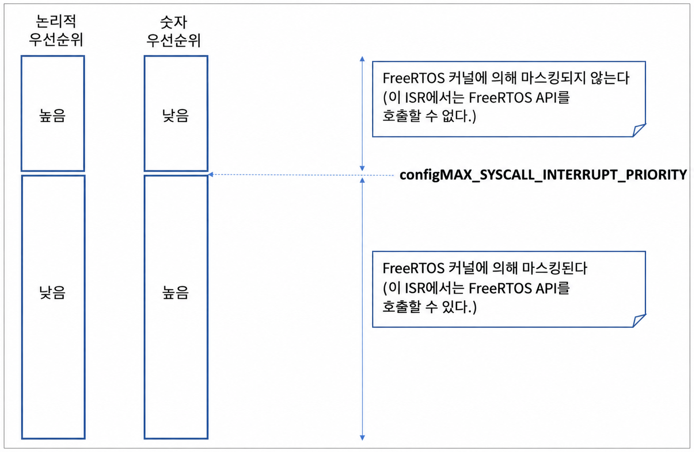

<a id="13-troubleshooting"></a>
# 13 문제 해결 (Troubleshooting)

<a id="131-chapter-introduction-and-scope"></a>
## 13.1 장 소개 및 범위 (Chapter Introduction and Scope)

이 장에서는 FreeRTOS를 처음 접하는 사용자들이 가장 흔히 겪는 문제들을 중점적으로 다룬다. 먼저 수년간 기술 지원 요청의 가장 빈번한 원인이었던 세 가지 문제인 잘못된 인터럽트 우선순위 지정, stack(스택) overflow, printf()의 부적절한 사용에 집중한다. 그런 다음 자주 묻는 질문(FAQ) 형식으로 기타 일반적인 오류와 그 원인 및 해결책을 간략히 살펴본다.

> *`configASSERT()`를 사용하면 가장 흔한 오류 원인의 상당수를 즉시 포착하고 식별하여 개발 생산성을 향상시킨다. FreeRTOS 애플리케이션을 개발하거나 디버깅하는 동안에는 `configASSERT()`를 반드시 정의해 둘 것을 강력히 권장한다. `configASSERT()`에 대한 설명은 제12.2절에 나와 있다.*

<a id="132-interrupt-priorities"></a>
## 13.2 인터럽트 우선순위 (Interrupt Priorities)

> *참고: 이는 기술 지원 요청의 첫 번째 원인이며, 대부분의 포트에서 `configASSERT()`를 정의하면 이 오류를 즉시 잡아낼 수 있다!*

사용 중인 FreeRTOS 포트가 인터럽트 중첩(interrupt nesting)을 지원하고 특정 인터럽트의 서비스 루틴에서 FreeRTOS API를 사용하는 경우, 제7.8절 '인터럽트 중첩'에서 설명한 바와 같이 해당 인터럽트의 우선순위를 `configMAX_SYSCALL_INTERRUPT_PRIORITY` 이하로 설정하는 것이 *필수적*이다. 이를 지키지 않으면 critical section(임계 구역)이 제대로 작동하지 않아 간헐적인 시스템 실패가 발생하게 된다.

다음과 같은 특성을 가진 프로세서에서 FreeRTOS를 실행할 때는 특히 주의해야 한다:

- 인터럽트 우선순위의 기본값이 가능한 가장 높은 우선순위로 설정되는 경우. 일부 ARM Cortex 프로세서 등이 이에 해당한다. 이러한 프로세서에서는 FreeRTOS API를 사용하는 인터럽트의 우선순위를 초기화하지 않은 채 둘 수 없다.

- 숫자가 큰 우선순위 번호가 논리적으로 낮은 인터럽트 우선순위를 나타내는 경우. 직관에 반대되어 혼란을 유발할 수 있다. 이 역시 ARM Cortex 프로세서 등에서 그러하다.

- 예를 들어 이러한 프로세서에서 우선순위 5로 실행 중인 인터럽트는 우선순위 4를 갖는 인터럽트에 의해 선점될 수 있다. 따라서 `configMAX_SYSCALL_INTERRUPT_PRIORITY`가 5로 설정된 경우, FreeRTOS API를 사용하는 모든 인터럽트는 숫자상으로 5 이상인 우선순위만 할당받을 수 있다. 이 경우 인터럽트 우선순위 5나 6은 유효하지만, 인터럽트 우선순위 3은 확실히 유효하지 않다.

  

- 서로 다른 라이브러리 구현마다 인터럽트 우선순위를 지정하는 방식이 서로 다르다. 이 역시 인터럽트 우선순위가 하드웨어 레지스터에 기록되기 전에 비트 시프트되는 ARM Cortex 프로세서를 대상으로 하는 라이브러리와 특히 관련이 깊다. 일부 라이브러리는 비트 시프트를 자체적으로 수행하는 반면, 다른 라이브러리는 라이브러리 함수에 우선순위를 전달하기 전에 미리 비트 시프트가 수행되어 있을 것을 기대한다.

- 동일한 아키텍처라도 제조사 구현에 따라 서로 다른 수의 인터럽트 우선순위 비트를 구현한다. 예를 들어 한 제조사의 Cortex-M 프로세서는 3개의 우선순위 비트를 구현할 수 있고, 다른 제조사의 Cortex-M 프로세서는 4개의 우선순위 비트를 구현할 수 있다.

- 인터럽트 우선순위를 정의하는 비트는 선점 우선순위(pre-emption priority)를 정의하는 비트와 서브 우선순위(sub-priority)를 정의하는 비트로 분할될 수 있다. 서브 우선순위가 사용되지 않도록 모든 비트가 선점 우선순위를 지정하는 데 할당되어 있는지 확인해야 한다.

일부 FreeRTOS 포트에서는 `configMAX_SYSCALL_INTERRUPT_PRIORITY`의 대체 이름으로 `configMAX_API_CALL_INTERRUPT_PRIORITY`를 사용한다.

<a id="133-stack-overflow"></a>
## 13.3 스택 오버플로 (Stack Overflow)

stack overflow는 기술 지원 요청의 두 번째로 흔한 원인이다. FreeRTOS는 stack 관련 문제의 감지 및 디버깅을 돕기 위한 여러 기능을 제공한다[^28].

[^28]: 이 기능들은 FreeRTOS Windows 포트에서는 사용할 수 없다.

<a id="1331-the-uxtaskgetstackhighwatermark-api-function"></a>
### 13.3.1 uxTaskGetStackHighWaterMark() API 함수 (The uxTaskGetStackHighWaterMark() API Function)

각 task(태스크)는 자체 stack을 유지하며 총 stack 크기는 task가 생성될 때 지정된다. `uxTaskGetStackHighWaterMark()`는 task가 자신에게 할당된 stack 공간을 오버플로하는 데 얼마나 근접했는지를 조회하는 데 사용된다. 이 값을 stack 'high-water mark(high water mark)'라고 부른다.

<a name="list13.1" title="Listing 13.1 The uxTaskGetStackHighWaterMark() API function prototype"></a>

```c
UBaseType_t uxTaskGetStackHighWaterMark( TaskHandle_t xTask );
```
***코드 13.1 (Listing 13.1)*** *uxTaskGetStackHighWaterMark() API 함수 원형*

**uxTaskGetStackHighWaterMark() 매개변수 및 반환 값**

- `xTask`

  stack high-water mark를 조회할 대상 task의 핸들이다. task 핸들을 얻는 방법에 대해서는 `xTaskCreate()` API 함수의 `pxCreatedTask` 매개변수를 참조한다.

  task는 유효한 task 핸들 대신 NULL을 전달하여 자신의 stack high-water mark를 조회할 수 있다.

- 반환 값 (Return value)

  task가 실행되고 인터럽트가 처리됨에 따라 task가 사용하는 stack의 양은 증가하고 감소한다. `uxTaskGetStackHighWaterMark()`는 task가 실행을 시작한 이후 사용 가능했던 최소 남은 stack 공간의 양을 반환한다. 이는 stack 사용량이 최대(가장 깊은) 값에 도달했을 때 미사용 상태로 남아 있던 stack의 양이다. high-water mark가 0에 가까울수록 task가 stack overflow에 근접했음을 의미한다.

`uxTaskGetStackHighWaterMark()` 대신 반환 타입만 다른 `uxTaskGetStackHighWaterMark2()` API를 사용할 수 있다.

<a name="list13.2" title="Listing 13.2 The uxTaskGetStackHighWaterMark2() API function prototype"></a>

```c
configSTACK_DEPTH_TYPE uxTaskGetStackHighWaterMark2( TaskHandle_t xTask );
```
***코드 13.2 (Listing 13.2)*** *uxTaskGetStackHighWaterMark2() API 함수 원형*

`configSTACK_DEPTH_TYPE`을 사용하면 애플리케이션 작성자가 stack 깊이에 사용되는 타입을 제어할 수 있다.

<a id="1332-run-time-stack-checkingoverview"></a>
### 13.3.2 런타임 스택 검사 개요 (Run Time Stack Checking—Overview)

FreeRTOS에는 세 가지 선택적 런타임 stack 검사 메커니즘이 포함되어 있다. 이들은 FreeRTOSConfig.h 내의 `configCHECK_FOR_STACK_OVERFLOW` 컴파일 타임 설정 상수에 의해 제어된다. 모든 방법은 문맥 전환을 수행하는 데 걸리는 시간을 증가시킨다.

stack overflow hook(또는 stack overflow callback)은 커널이 stack overflow를 감지했을 때 호출하는 함수이다. stack overflow hook 함수를 사용하려면:

1. 다음 하위 절에 설명된 대로 FreeRTOSConfig.h에서 `configCHECK_FOR_STACK_OVERFLOW`를 1, 2 또는 3으로 설정한다.

2. 코드 13.3에 표시된 정확한 함수 이름과 프로토타입을 사용하여 hook 함수의 구현을 제공한다.

<a name="list13.3" title="Listing 13.3 The stack overflow hook function prototype"></a>

```c
void vApplicationStackOverflowHook( TaskHandle_t *pxTask, signed char *pcTaskName );
```
***코드 13.3 (Listing 13.3)*** *stack overflow hook 함수 원형*

stack overflow hook은 stack 오류를 더 쉽게 포착하고 디버깅할 수 있도록 제공되지만 stack overflow가 발생했을 때 실제로 이를 복구할 수 있는 현실적인 방법은 없다. 함수의 매개변수는 stack이 오버플로된 task의 핸들과 이름을 hook 함수로 전달한다.

stack overflow hook은 인터럽트 컨텍스트에서 호출된다.

일부 마이크로컨트롤러는 잘못된 메모리 접근을 감지하면 폴트(fault) 예외를 발생시키며, 커널이 stack overflow hook 함수를 호출할 기회를 갖기 전에 폴트가 트리거될 수도 있다.

<a id="1333-run-time-stack-checkingmethod-1"></a>
### 13.3.3 런타임 스택 검사 - 방법 1 (Run Time Stack Checking—Method 1)

방법 1은 `configCHECK_FOR_STACK_OVERFLOW`가 1로 설정되었을 때 선택된다.

task의 전체 실행 컨텍스트는 task가 스왑 아웃될 때마다 해당 task의 stack에 저장된다. 이때가 stack 사용량이 최고조에 달하는 시점일 가능성이 높다. `configCHECK_FOR_STACK_OVERFLOW`가 1로 설정되면 커널은 컨텍스트가 저장된 후 stack 포인터가 유효한 stack 공간 내에 남아 있는지 확인한다. stack 포인터가 유효 범위를 벗어난 것으로 확인되면 stack overflow hook이 호출된다.

방법 1은 실행 속도가 빠르지만 문맥 전환 사이에 발생하는 stack overflow는 놓칠 수 있다.

<a id="1334-run-time-stack-checkingmethod-2"></a>
### 13.3.4 런타임 스택 검사 - 방법 2 (Run Time Stack Checking—Method 2)

방법 2는 방법 1에서 설명한 검사에 추가 검사를 수행한다. `configCHECK_FOR_STACK_OVERFLOW`가 2로 설정되었을 때 선택된다.

task가 생성될 때 task의 stack은 알려진 패턴으로 채워진다. 방법 2는 task stack 공간의 마지막 유효한 20바이트를 테스트하여 이 패턴이 덮어쓰여지지 않았는지 확인한다. 20바이트 중 어느 하나라도 예상 값에서 변경된 경우 stack overflow hook 함수가 호출된다.

방법 2는 방법 1만큼 빠르지는 않지만 20바이트만 테스트하므로 여전히 비교적 빠르다. 대부분의 stack overflow를 잡아낼 수 있지만 일부 오버플로를 놓칠 가능성도 (극히 희박하지만) 존재한다.

<a id="1334-run-time-stack-checkingmethod-3"></a>
### 13.3.4 런타임 스택 검사 - 방법 3 (Run Time Stack Checking—Method 3)

> [옮긴이 주] 원문에서 방법 2와 방법 3의 절 번호가 모두 13.3.4이다. 원문 번호와 서로 다른 anchor를 유지했다. [원문 대조 사항 N10](SOURCE_NOTES.md#n10).

방법 3은 `configCHECK_FOR_STACK_OVERFLOW`가 3으로 설정되었을 때 선택된다.

이 방법은 선택된 포트에서만 사용할 수 있다. 사용 가능한 경우 이 방법은 ISR stack 검사를 활성화한다. ISR stack overflow가 감지되면 어서션(assert)이 트리거된다. 이 경우 stack overflow hook 함수는 task stack 전용이며 ISR stack 전용이 아니기 때문에 호출되지 않는다.

<a id="134-use-of-printf-and-sprintf"></a>
## 13.4 printf() 및 sprintf() 사용 (Use of printf() and sprintf())

`printf()`를 통한 로깅은 흔한 오류 원인이며 이를 알지 못하는 애플리케이션 개발자가 디버깅을 돕기 위해 `printf()` 호출을 추가하여 문제를 더욱 악화시키는 경우가 흔하다.

많은 크로스 컴파일러 벤더는 소형 임베디드 시스템에서 사용하기에 적합한 `printf()` 구현을 제공한다. 그렇다 하더라도 해당 구현이 스레드 안전(thread safe)하지 않을 수 있고, 인터럽트 서비스 루틴 내부에서 사용하기에 적합하지 않을 수 있으며, 출력이 전달되는 위치에 따라 실행하는 데 비교적 오랜 시간이 걸릴 수 있다.

소형 임베디드 시스템용으로 특별히 설계된 `printf()` 구현을 사용할 수 없어 일반적인 범용 `printf()` 구현을 대신 사용하는 경우에는 각별한 주의가 필요하다:

- `printf()` 또는 `sprintf()` 호출을 포함하는 것만으로도 애플리케이션 실행 파일의 크기가 대폭 증가할 수 있다.

- `printf()` 및 `sprintf()`는 `malloc()`을 호출할 수 있으며, 이는 heap_3 이외의 메모리 할당 방식을 사용하는 경우 유효하지 않을 수 있다. 자세한 정보는 제3.2절 '메모리 할당 방식 예시'를 참조한다.

- `printf()` 및 `sprintf()`는 그렇지 않은 경우보다 몇 배 더 큰 stack을 요구할 수 있다.

<a id="1341-printf-stdargc"></a>
### 13.4.1 Printf-stdarg.c

FreeRTOS 데모 프로젝트 중 상당수는 표준 라이브러리 버전 대신 사용할 수 있는 최소형의 stack 효율적인 `sprintf()` 구현을 제공하는 `printf-stdarg.c`라는 파일을 사용한다. 대부분의 경우 이를 통해 `sprintf()` 및 관련 함수를 호출하는 각 task에 훨씬 더 작은 stack을 할당할 수 있다.

`printf-stdarg.c`는 또한 `printf()` 출력을 한 문자씩 포트로 전달하는 메커니즘을 제공하여 속도는 느리지만 stack 사용량을 더욱 줄일 수 있도록 한다.

FreeRTOS 다운로드에 포함된 모든 `printf-stdarg.c` 복사본이 `snprintf()`를 구현하는 것은 아님에 유의하라. `snprintf()`를 구현하지 않는 복사본은 `sprintf()`로 직접 매핑되므로 버퍼 크기 매개변수를 단순히 무시한다.

`printf-stdarg.c`는 오픈 소스이지만 제3자가 소유하므로 FreeRTOS와 별도로 라이선스가 부여된다. 라이선스 조건은 소스 파일 상단에 포함되어 있다.

<a id="135-other-common-sources-of-error"></a>
## 13.5 기타 일반적인 오류 원인 (Other Common Sources of Error)

<a id="1351-symptom-adding-a-simple-task-to-a-demo-causes-the-demo-to-crash"></a>
### 13.5.1 증상: 데모에 단순한 태스크를 추가하면 데모가 비정상 종료됨 (Symptom: Adding a simple task to a demo causes the demo to crash)

task를 생성하려면 heap(힙)에서 메모리를 확보해야 한다. 많은 데모 애플리케이션 프로젝트는 데모 task를 생성하기에 딱 맞을 정도로만 heap 크기를 설정하므로 task를 생성한 후에는 추가 task, queue(큐), event group(이벤트 그룹) 또는 semaphore(세마포어)를 추가할 수 있는 heap이 부족하게 된다.

idle task(유휴 task)와 경우에 따라 RTOS daemon task는 `vTaskStartScheduler()`가 호출될 때 자동으로 생성된다. `vTaskStartScheduler()`는 이러한 task를 생성할 heap 메모리가 충분하지 않은 경우에만 반환된다. `vTaskStartScheduler()` 호출 뒤에 널 루프 `[ for(;;); ]`를 포함하면 이 오류를 더 쉽게 디버깅할 수 있다.

더 많은 task를 추가하려면 heap 크기를 늘리거나 기존 데모 task 중 일부를 제거해야 한다. heap 크기 증가는 항상 사용 가능한 RAM 양에 의해 제한된다. 자세한 정보는 제3.2절 '메모리 할당 방식 예시'를 참조한다.

<a id="1352-symptom-using-an-api-function-within-an-interrupt-causes-the-application-to-crash"></a>
### 13.5.2 증상: 인터럽트 내에서 API 함수를 사용하면 응용 프로그램이 비정상 종료됨 (Symptom: Using an API function within an interrupt causes the application to crash)

API 함수의 이름이 '...FromISR()'로 끝나지 않는 한 인터럽트 서비스 루틴 내에서 API 함수를 사용해서는 안 된다. 특히 인터럽트 안전 매크로를 사용하지 않는 한 인터럽트 내에서 critical section을 생성해서는 안 된다. 자세한 정보는 제7.2절 'ISR에서 FreeRTOS API 사용'을 참조한다.

인터럽트 중첩을 지원하는 FreeRTOS 포트에서는 `configMAX_SYSCALL_INTERRUPT_PRIORITY`보다 높은 인터럽트 우선순위가 할당된 인터럽트 내에서 어떤 API 함수도 사용해서는 안 된다. 자세한 정보는 제7.8절 '인터럽트 중첩'을 참조한다.

<a id="1353-symptom-sometimes-the-application-crashes-within-an-interrupt-service-routine"></a>
### 13.5.3 증상: 인터럽트 서비스 루틴 내에서 응용 프로그램이 간헐적으로 비정상 종료됨 (Symptom: Sometimes the application crashes within an interrupt service routine)

가장 먼저 확인할 사항은 인터럽트가 stack overflow를 일으키지 않는지 여부이다. 일부 포트는 task 내에서만 stack overflow를 검사하고 인터럽트 내에서는 검사하지 않는다.

인터럽트를 정의하고 사용하는 방식은 포트와 컴파일러마다 다르다. 따라서 두 번째로 확인할 사항은 인터럽트 서비스 루틴에서 사용되는 구문, 매크로 및 호출 규칙이 사용 중인 포트에 대해 제공된 문서 페이지에 설명된 것과 정확히 일치하는지, 그리고 포트와 함께 제공된 데모 애플리케이션에서 시연된 것과 정확히 일치하는지 확인하는 것이다.

애플리케이션이 숫자가 낮은 우선순위 번호로 논리적으로 높은 우선순위를 나타내는 프로세서에서 실행 중인 경우 직관에 반대될 수 있으므로 각 인터럽트에 할당된 우선순위가 이를 고려하고 있는지 확인해야 한다. 애플리케이션이 각 인터럽트의 우선순위를 가능한 최대 우선순위로 기본 설정하는 프로세서에서 실행 중인 경우 각 인터럽트의 우선순위가 기본값에 머물러 있지 않은지 확인해야 한다. 자세한 정보는 제7.8절 '인터럽트 중첩' 및 제13.2절 '인터럽트 우선순위'를 참조한다.

<a id="1354-symptom-the-scheduler-crashes-when-attempting-to-start-the-first-task"></a>
### 13.5.4 증상: 첫 번째 태스크 시작을 시도할 때 스케줄러가 비정상 종료됨 (Symptom: The scheduler crashes when attempting to start the first task)

FreeRTOS 인터럽트 핸들러가 설치되어 있는지 확인하라. 자세한 정보는 사용 중인 FreeRTOS 포트의 문서 페이지를 참조하고, 예제는 해당 포트에 제공된 데모 애플리케이션을 참조한다.

일부 프로세서는 scheduler(스케줄러)를 시작하기 전에 특권 모드(privileged mode)에 있어야 한다. 이를 달성하는 가장 쉬운 방법은 `main()`이 호출되기 전 C 스타트업 코드 내에서 프로세서를 특권 모드로 전환하는 것이다.

<a id="1355-symptom-interrupts-are-unexpectedly-left-disabled-or-critical-sections-do-not-nest-correctly"></a>
### 13.5.5 증상: 인터럽트가 예기치 않게 비활성화된 채로 남거나 임계 영역 중첩이 올바르게 동작하지 않음 (Symptom: Interrupts are unexpectedly left disabled, or critical sections do not nest correctly)

scheduler가 시작되기 전에 FreeRTOS API 함수가 호출되면 인터럽트가 의도적으로 비활성화된 상태로 유지되며 첫 번째 task가 실행을 시작할 때까지 다시 활성화되지 않는다. 이는 scheduler가 시작되기 전, 그리고 scheduler가 불일치 상태에 있을 수 있는 시스템 초기화 중에 FreeRTOS API 함수를 사용하려고 시도하는 인터럽트로 인한 시스템 충돌을 방지하기 위함이다.

`taskENTER_CRITICAL()` 및 `taskEXIT_CRITICAL()` 호출 이외의 다른 방법을 사용하여 마이크로컨트롤러 인터럽트 활성화 비트나 우선순위 플래그를 변경하지 마라. 이 매크로들은 호출 중첩 깊이를 카운트하여 호출 중첩이 완전히 0으로 풀렸을 때만 인터럽트가 다시 활성화되도록 보장한다. 일부 라이브러리 함수 자체가 내부적으로 인터럽트를 활성화하고 비활성화할 수 있음에 유의하라.

<a id="1356-symptom-the-application-crashes-even-before-the-scheduler-is-started"></a>
### 13.5.6 증상: 스케줄러가 시작되기도 전에 응용 프로그램이 비정상 종료됨 (Symptom: The application crashes even before the scheduler is started)

문맥 전환을 유발할 가능성이 있는 인터럽트 서비스 루틴은 scheduler가 시작되기 전에 실행되어서는 안 된다. queue나 semaphore와 같은 FreeRTOS 객체로 전송하거나 수신하려는 모든 인터럽트 서비스 루틴에도 동일하게 적용된다. 문맥 전환은 scheduler가 시작된 이후에만 발생할 수 있다.

많은 API 함수는 scheduler가 시작된 이후에만 호출할 수 있다. `vTaskStartScheduler()`가 호출될 때까지는 API 사용을 task, queue, semaphore와 같은 객체 생성으로 제한하고 이러한 객체의 실제 사용은 시작 이후로 미루는 것이 가장 좋다.

<a id="1357-symptom-calling-api-functions-while-the-scheduler-is-suspended-or-from-inside-a-critical-section-causes-the-application-to-crash"></a>
### 13.5.7 증상: 스케줄러가 일시 중단된 상태에서 또는 임계 영역 내부에서 API 함수를 호출하면 응용 프로그램이 비정상 종료됨 (Symptom: Calling API functions while the scheduler is suspended, or from inside a critical section, causes the application to crash)

scheduler는 `vTaskSuspendAll()`을 호출하여 일시 중단하고 `xTaskResumeAll()`을 호출하여 재개(일시 중단 해제)한다. critical section은 `taskENTER_CRITICAL()`을 호출하여 진입하고 `taskEXIT_CRITICAL()`을 호출하여 종료한다.

scheduler가 일시 중단된 상태에서 또는 critical section 내부에서 API 함수를 호출하지 마라.

<a id="136-additional-debugging-steps"></a>
## 13.6 추가 디버깅 단계 (Additional Debugging Steps)

위에서 설명한 일반적인 원인에서 다루지 않은 문제가 발생하면 다음과 같은 디버깅 단계를 시도해 볼 수 있다:

- 애플리케이션의 FreeRTOSConfig 파일에서 `configASSERT()`를 정의하고 동적 메모리 할당 실패(malloc failed) 검사 및 stack overflow 검사를 활성화한다.
- FreeRTOS API의 반환 값을 확인하여 정상적으로 성공했는지 검증한다.
- `configUSE_TIME_SLICING` 및 `configUSE_PREEMPTION`과 같은 scheduler 관련 설정이 애플리케이션 요구 사항에 맞게 올바르게 설정되어 있는지 확인한다.
- [이 페이지](https://www.freertos.org/Debugging-Hard-Faults-On-Cortex-M-Microcontrollers.html)는 Cortex-M 마이크로컨트롤러에서 하드 폴트(hard fault)를 디버깅하는 방법에 대한 세부 정보를 제공한다.
